# Kia Sportage: Procedimentos de Reparo

[Home](../../index.md) / [Manual de Serviço e Reparo do Kia Sportage SL](../sportage-482.md) / [Sistema Elétrico do Corpo](sportage-984.md) / [Interruptor multifuncional](sportage-1001.md) / Procedimentos de Reparo

## Remoção

1. Desconecte o terminal negativo (-) da bateria.

2. Remova as capas superiores e inferiores do pilar do volante (A) após remover 3 parafusos.

   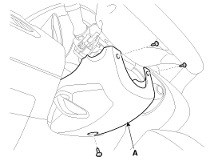

   > **Nota**
   >
   > - Cuide para não danificar e arranhar as capas e suas partes relacionadas.
   > - Cuide para não danificar o gancho ao remover as capas superiores e inferiores do pilar do volante.

3. Desconecte o conector do interruptor de luz (A) e o conector do interruptor de limpador (B).

   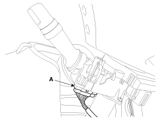

   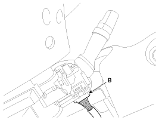

4. Remova o interruptor de limpador (A) empurrando a pinça de bloqueio (B).

   > **Nota**
   >
   > - Ao remover apenas o interruptor de limpador e limpador de faróis, libere o bloqueio do interruptor de limpador sem remover o volante.

   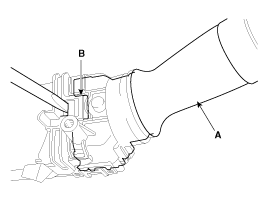

5. Remova o volante.

   (Consulte o grupo ST - "Pilar do volante e eixo")

6. Remova o clock spring.

   (Consulte o grupo RT - "Módulo do airbag")

7. Desloque os 2 parafusos da montagem do interruptor multifuncional (A).

   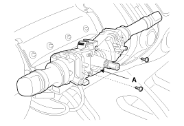

## Instalação

1. Instale o interruptor multifuncional.

2. Instale o clock spring e o volante.

3. Instale as capas superiores e inferiores do pilar do volante.

4. Instale o volante.

## Inspeção

Inspeção do Interruptor de Luz

1. Com o interruptor multifuncional em cada posição, verifique a continuidade entre os terminais abaixo.

   Se a continuidade não for conforme especificado, substitua o interruptor multifuncional.

   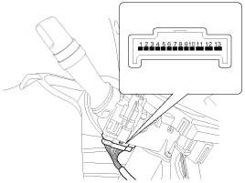

   Interruptor de Luz (Luz Automática)

   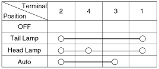

   Interruptor de Luz

   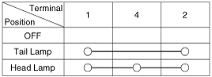

   Interruptor de Dimmer e Passagem

   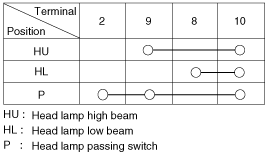

   Interruptor de Sinal de Frente

   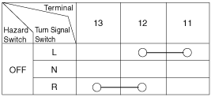

   Farol de Neblina da Frente

   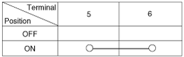

Inspeção do Interruptor de Limpador e Limpador de Faróis

1. Com o interruptor multifuncional em cada posição, verifique a continuidade entre os terminais abaixo.

   Se a continuidade não for conforme especificado, substitua o interruptor multifuncional.

   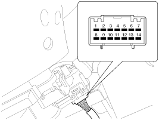

   Interruptor de Limpador

   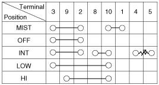

   Interruptor de Limpador de Faróis

   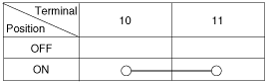

   Interruptor de Limpador de Faróis Traseiros

   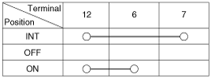

   Interruptor de Limpador de Faróis Traseiros

   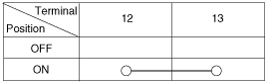

## Inspeção (Com GDS)

1. Verifique a especificação de entrada/saída do BCM do interruptor multifuncional usando o GDS. Se a especificação for anormal, substitua a lâmpada ou o interruptor de limpador.

2. Se for necessário diagnosticar o interruptor multifuncional, selecione o modelo e "BCM".

   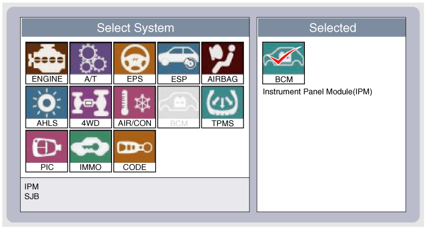

3. Selecione "Dados de corrente" e verifique a condição de entrada/saída do "Interruptor multifuncional".

   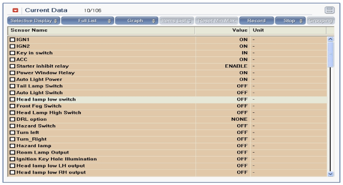

4. Para realizar o teste de saídas do "Interruptor multifuncional", selecione "Teste de atuação".

   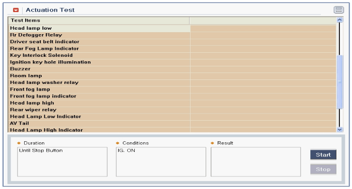
