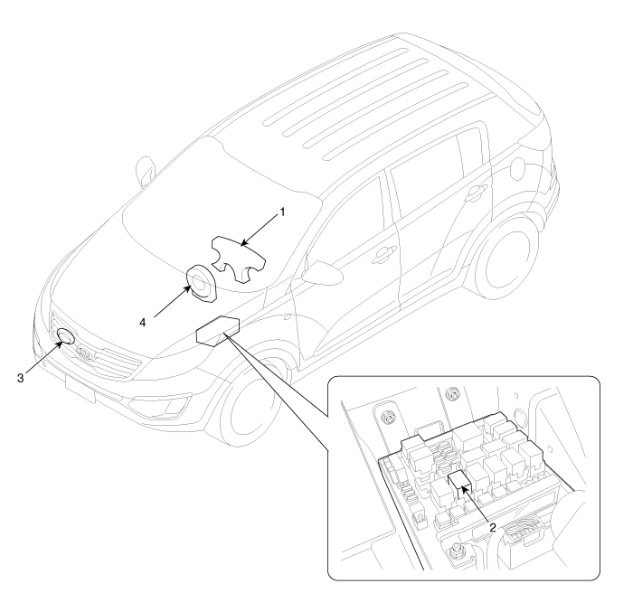

# Buzina — Componentes e localização

[Home](../../index.md) / [Manual de Serviço e Reparo](../sportage-482.md) / [Sistema Elétrico do Corpo](sportage-984.md) / [Buzina](sportage-1005.md) / Componentes e localização

## Diagrama

## Legenda

| Nº | Componente |
| --- | --- |
| 1 | Interruptor da buzina |
| 2 | Relé da buzina (compartmento do motor) |
| 3 | Buzina (baixo tom) |
| 4 | Espirro do relógio |
