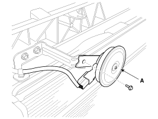
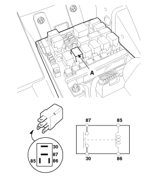
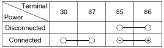
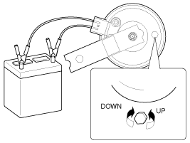

# Kia Sportage: Procedimentos de Reparo

[Home](../../index.md) / [Manual de Serviço e Reparo do Kia Sportage SL](../sportage-482.md) / [Sistema Elétrico do Corpo](sportage-984.md) / [Buzina](sportage-1005.md) / Procedimentos de Reparo

## Remoção

1. Remova a cobertura superior do radiador.

   (Consulte o grupo BD - "Bumpê frontal")

2. Remova a viga e desconecte o conector da buzina, depois remova a buzina de baixo tom (A).

   

## Instalação

1. Instale a buzina após conectar o conector da buzina.

2. Instale a cobertura superior do radiador.

## Inspeção

Teste a buzina conectando a tensão da bateria ao terminal 1 e groundando o terminal 2.

A buzina deve fazer um som. Se a buzina não fizer um som, substitua-a.

Inspeção da Relê da Buzina

1. Remova o relê da buzina (A) do caixa de relês no compartimento do motor.

2. Quando a tensão e o ground são conectados aos terminais 85 e 86, deve haver continuidade entre os terminais 30 e 87.

3. Quando a tensão é desconectada, não deve haver continuidade entre os terminais 30 e 87.

   

   

## Ajuste

1. Operacionalize a buzina e ajuste o tom para um nível apropriado girando o parafuso de ajuste.

   > **Nota**
   >
   > - O parafuso de ajuste da buzina está selado com silicone selante de fábrica.
   > - A forma e o tamanho do selante aplicado são variáveis e manchas ou gotas são aceitáveis e não devem ser manipuladas.

   
