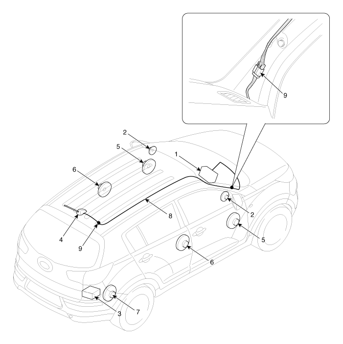
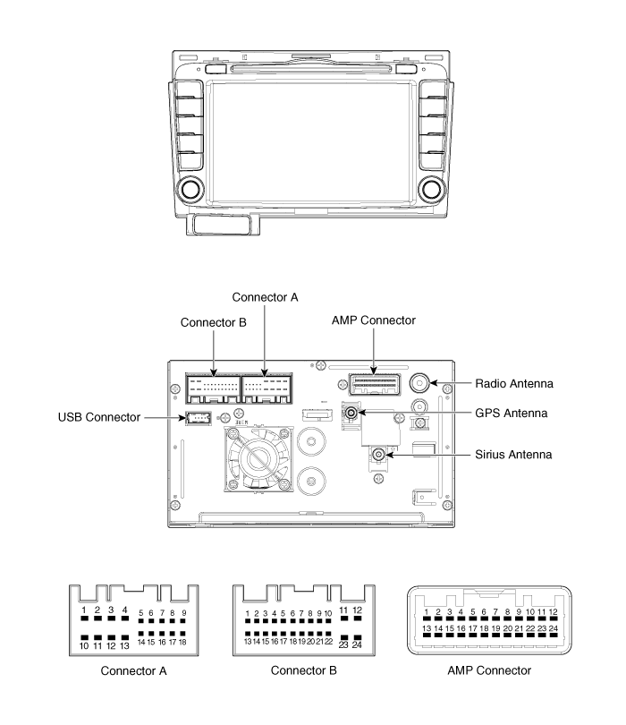
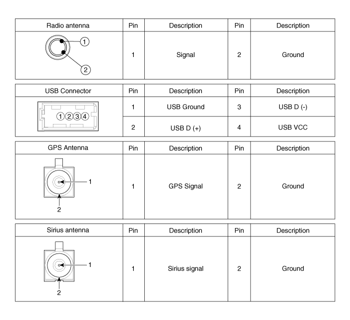
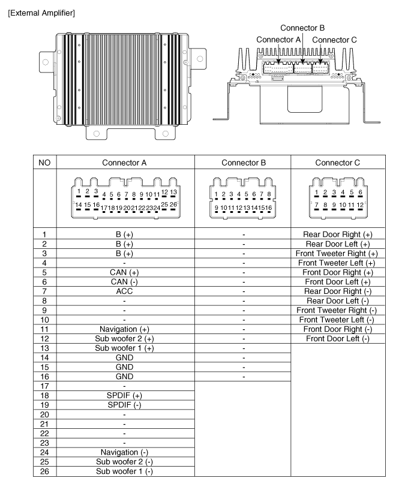
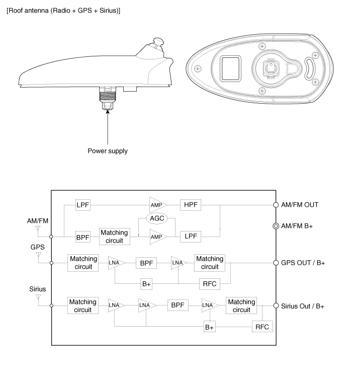

# Sistema AVN — Componentes e localização

[Home](../../index.md) / [Manual de Serviço e Reparo](../sportage-482.md) / [Sistema Elétrico do Corpo](sportage-984.md) / [Sistema AVN](sportage-1008.md) / Componentes e localização

## Diagrama — Localização

## Legenda — Localização

| Nº | Componente |
| --- | --- |
| 1 | Unidade AVN (A/V & Navegação) |
| 2 | Altifalante Tweeter |
| 3 | Amplificador Externo |
| 4 | Antena do Teto (GPS + SDARS + Rádio) |
| 5 | Altifalante da Porta Frente |
| 6 | Altifalante da Porta Traseira |
| 7 | Altifalante Woofer |
| 8 | Fio de Fornecimento da Antena |
| 9 | Conector de Fiação |

? SDARS : Serviço de Rádio Digital por Satélite

## Diagrama — Componentes

Unidade AVN (A/V & Navegação)

## Informações de Conector

| Número | Conector A | Conector B | Conector AMP |
| --- | --- | --- | --- |
| 1 | - | MM CAN (+) | - |
| 2 | Vídeo da Câmera de Reversão | MTS Detect / - | - |
| 3 | V_GND da Câmera de Reversão | Parqueamento (M/T GND) | - |
| 4 | P_GND da Câmera de Reversão | Chave do Volante | - |
| 5 | SPDIF GND | - | - |
| 6 | SPDIF (+) | Ignição | - |
| 7 | ALT-L | AUX/iPOD Video | - |
| 8 | Iluminação (+) | AUX Áudio Direito | - |
| 9 | Ré | AUX A GND | - |
| 10 | - | MIC (+) | - |
| 11 | Bateria da Câmera de Reversão (+) | Acessório (ACC) | Abertura da Porta |
| 12 | Voz do Navegador (-) | Bateria (+) | GND |
| 13 | Voz do Navegador (+) | MM CAN (-) | - |
| 14 | - | Luz Automática | - |
| 15 | SPDIF (-) | Posição P | - |
| 16 | Desbloqueio da Porta | Velocidade | - |
| 17 | Iluminação (-) | GND da Chave do Volante | - |
| 18 | Fio Remoto da Antena | - | - |
| 19 | ? | AUX/iPOD V GND | - |
| 20 | DET do AUX Audio | - |  |
| 21 | L do AUX Audio | - |  |
| 22 | MIC (-) | - |  |
| 23 | GND | GND |  |
| 24 | GND | - |  |
