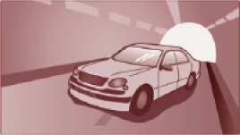

# Kia Sportage: Descrição e Operação

[Home](../../index.md) / [Manual de Serviço e Reparo do Kia Sportage SL](../sportage-482.md) / [Sistema Elétrico do Corpo](sportage-984.md) / [Sistema AVN](sportage-1008.md) / Descrição e Operação

## Limitações Do Sistema De Navegação

Estado da Receção do Sinal GPS

Como a frequência do sinal GPS é recebida/transmitida em linhas retas, a receção pode não funcionar se dispositivos ocultos estiverem posicionados sobre ou próximos à antena GPS ou ao se viajar pelas seguintes localidades.

| • | Túneis |
| --- | --- |

| • | Estacionamentos subterrâneos |
| --- | --- |

| • | Sob uma ponte |
| --- | --- |

| • | Estradas em áreas florestais |
| --- | --- |

| • | Áreas próximas a edifícios altos |
| --- | --- |

| • | Estradas em cañões |
| --- | --- |

Exibição da Posição do Veículo

1. Se ocorrerem erros multipass devido a reflexões em edifícios ou causas relacionadas, o marcador da posição atual no sistema de navegação pode diferir da posição real do veículo.

2. A posição do veículo no sistema de navegação pode diferir da posição real se o veículo estiver sob uma estrutura, e a posição do marcador pode ser atualizada após um curto período de viagem através de alinhamento de mapa ou informações GPS (pode ser necessário alguns minutos em alguns casos).

   | • | Ao dirigir em uma estrada em Y com um ângulo estreito, a posição atual pode ser exibida na direção oposta. |
   | --- | --- |

   | • | Se o veículo estiver carregado em um veículo de transporte de carros, o marcador da posição atual pode ficar estagnado na última posição antes do carregamento. |
   | --- | --- |

   | • | Ao dirigir em uma estrada em espiral. |
   | --- | --- |

   | • | Ao dirigir em regiões montanhosas com curvas agudas ou freios bruscos. |
   | --- | --- |

   | • | Ao entrar em uma estrada após ter estado em um estacionamento subterrâneo ou em uma estrutura de estacionamento com muitas rotas. |
   | --- | --- |

   | • | Quando os pneus foram recentemente substituídos (Especialmente quando se utiliza pneus de emergência ou sem ganchos). |
   | --- | --- |

   | • | Ao remover o terminal da bateria. |
   | --- | --- |

   | • | Ao dirigir em ruas urbanas, a posição atual pode ser exibida do lado oposto ou em uma posição fora da estrada. |
   | --- | --- |

   | • | Ao mudar o nível de zoom do máximo para um nível de zoom diferente, o marcador da posição atual pode ser exibido em uma outra estrada. |
   | --- | --- |

   | • | Ao dirigir em tráfego pesado com paradas frequentes ou em interseções. |
   | --- | --- |

   | • | Ao dirigir em condições escorregadias, como areia pesada, neve, etc. |
   | --- | --- |

   | • | Ao dirigir com a corrente de pneu em uso. |
   | --- | --- |

   | • | Ao usar um pneu com especificação de tamanho incorreta. |
   | --- | --- |

   | • | Quando a pressão do pneu dos quatro pneus é diferente. |
   | --- | --- |

   | • | Quando a roda de substituição é um pneu usado (Especialmente pneus sem ganchos que passaram por uma segunda temporada, etc.). |
   | --- | --- |

   | • | Ao dirigir perto de edifícios altos. |
   | --- | --- |

   | • | Se um transportador de teto foi instalado. |
   | --- | --- |

| • | Quando estiver conduzindo a altas velocidades ou calculando um itinerário longo. |
   | --- | --- |

Instruções de Rota

A instrução de rota adequada pode não ocorrer devido às condições de busca ou à posição de condução.

| • | Pode ser dada uma instrução para seguir reto enquanto estiver em uma estrada reta. |
| --- | --- |

| • | Pode não ser dada uma instrução mesmo após ter virado em uma interseção. |
| --- | --- |

| • | Existem certas interseções em que a instrução de rota pode não ocorrer. |
| --- | --- |

| • | Pode ocorrer uma instrução de rota indicando a entrada em uma área de não acesso (Área de não acesso, estrada em construção, etc.). |
| --- | --- |

| • | Pode ser dada uma instrução a uma posição remota do destino se as estradas para chegar ao destino real não existirem ou forem muito estreitas. |
| --- | --- |

| • | Pode ser dada uma instrução de voz incorreta se o veículo sair do caminho designado (ex: se uma curva for feita em uma interseção enquanto a navegação fornecia instrução para seguir reto). |
| --- | --- |

| • | Os dados do mapa podem estar ausentes ou incorretos, causando a não instrução de rota. |
| --- | --- |

Recálculo de Rota

Os seguintes fenômenos podem ocorrer após o recálculo de rota.

| • | Pode ser dada uma instrução para uma posição diferente da posição atual ao virar em uma interseção. |
| --- | --- |

| • | O recálculo de rota pode levar mais tempo ao conduzir a altas velocidades. |
| --- | --- |

| • | Pode ocorrer uma instrução de rota indicando uma inversão U em uma área de não inversão U. |
| --- | --- |

| • | Pode ocorrer uma instrução de rota indicando a entrada em uma área de não acesso (Área de não acesso, estrada em construção, etc.). |
| --- | --- |

| • | Pode ser dada uma instrução a uma posição remota do destino se as estradas para chegar ao destino real não existirem ou forem muito estreitas. |
| --- | --- |

| • | Pode ser dada uma instrução de voz incorreta se o veículo sair do caminho designado (ex: se uma curva for feita em uma interseção enquanto a navegação fornecia instrução para seguir reto). |
| --- | --- |
