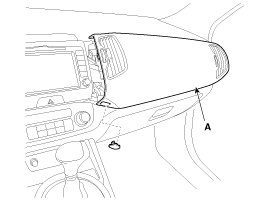
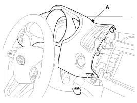
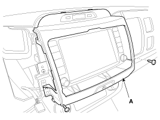
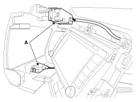
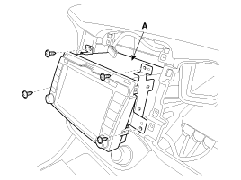
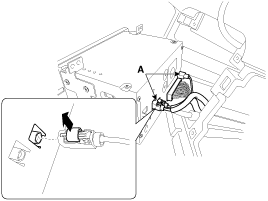

# Kia Sportage: Procedimentos de Reparo

[Home](../../index.md) / [Manual de Serviço e Reparo do Kia Sportage SL](../sportage-482.md) / [Sistema Elétrico do Corpo](sportage-984.md) / [Sistema AVN](sportage-1008.md) / Procedimentos de Reparo

## Remoção

> **Nota**
>
> - Cuide para não danificar e arranhar o conjunto do interruptor de luz de emergência e suas partes relacionadas.
> - Aplicar fitas protetivas no conjunto do interruptor de luz de emergência e suas partes relacionadas.

1. Desconecte o terminal negativo (-) da bateria.

2. Remova o revestimento do garnish do passageiro (A).

   (Consulte o grupo BD - "Revestimento do crash pad")

   

3. Desconecte os conectores e remova a placa do fascia do cluster (A).

   (Consulte o grupo BD - "Revestimento do crash pad")

   

4. Remova a placa do fascia do centro (A) após desafinar o parafuso de montagem (2EA).

   

5. Desconecte o conector (A) instalado na placa do fascia do centro.

   

6. Remova o conjunto AVN (A) após desafinar o parafuso de montagem (4EA).

   

7. Desconecte os conectores (A) e o cabo do conjunto AVN, removendo completamente o conjunto AVN.

   

   > **Nota**
   >
   > - Levante a alça do conector na direção do seta, desconecte o conector.
   > - Ao montar, instale o conector e a alça do conector.

   > **Cautela**
   >
   > - Se o CD não sair, não tente removê-lo.
   > - O player pode ser danificado.
   > - Portanto, entre em contato com uma oficina de serviço para reparos.

## Instalação

1. Conecte os conectores e o cabo do head unit AVN.

2. Instale o head unit AVN.

3. Instale a placa do fascia do centro.

4. Instale a placa do fascia do cluster.

5. Instale o garnish do passageiro do crash pad.

6. Conecte o terminal negativo (-) da bateria.

   > **Nota**
   >
   > - Certifique-se de que os conectores estejam conectados corretamente.
   > - Verifique o sistema AVN.
