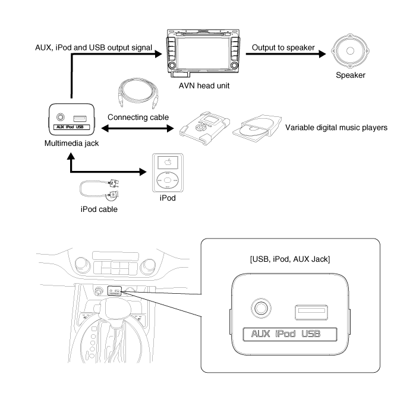

# Kia Sportage: AUX(Auxiliar) Jack: Descrição e Operação

[Início](../../index.md) / [Manual de Serviço e Reparo do Kia Sportage SL](../sportage-482.md) / [Sistema Elétrico do Corpo](sportage-984.md) / [Sistema AVN](sportage-1008.md) / AUX(Auxiliar) Jack: Descrição e Operação

## Descrição

O jack multimeios na tampa do console é para clientes que gostam de ouvir players de música portáteis externos como o MP3, iPod e etc., através do sistema de som do veículo quando conectado a este jack. Essa é uma opção adicional para o cliente.

No caso de distorções de mídia conectada à fonte AUX, o unidade de áudio pode não estar defeituosa, mas o nível de saída do mídia utilizado não corresponde à especificação da entrada AUX.

