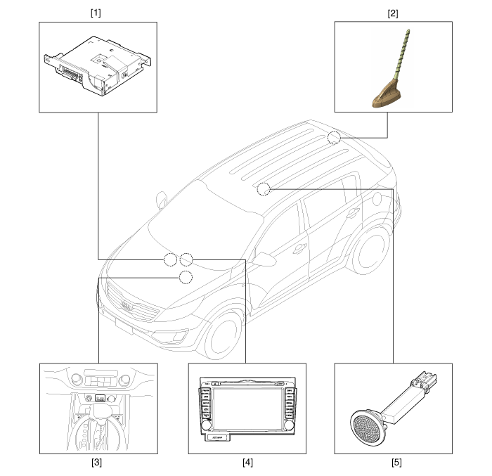

# Sistema MTS — Componentes e localização

[Home](../../index.md) / [Manual de Serviço e Reparo](../sportage-482.md) / [Sistema Elétrico do Corpo](sportage-984.md) / [Sistema MTS](sportage-1018.md) / Componentes e localização

## Diagrama

## Legenda

| Nº | Componente |
| --- | --- |
| 1 | Unidade de Telemática (TMU) |
| 2 | Antena do Teto (GPS) |
| 3 | Conector AUX |
| 4 | Unidade de AVN |
| 5 | Microfone |
