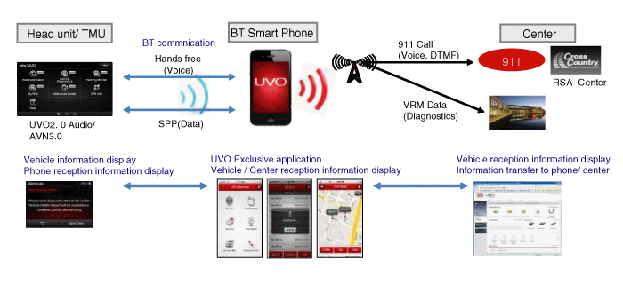
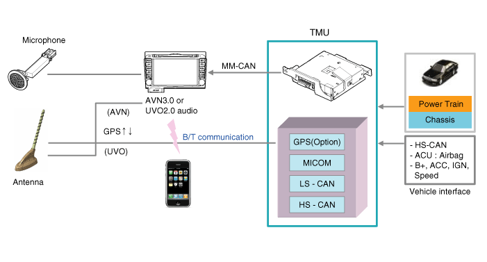

# Kia Sportage: Descrição e Operação

[Início](../../index.md) / [Manual de Serviço e Reparo do Kia Sportage SL](../sportage-482.md) / [Sistema Elétrico do Corpo](sportage-984.md) / [Sistema MTS](sportage-1018.md) / Descrição e Operação

## Descrição

O Sistema de Informações do Veículo é um serviço de Telemática que garante uma condução confortável e prazerosa, fornecendo informações de segurança, segurança e diagnóstico do veículo, com a opção de usar seu smartphone.

> **Nota**
>
> - O termo "Telemática" é uma combinação de telecomunicações e informática. O sistema de Telemática utiliza uma variedade de dispositivos de comunicação instalados no veículo para analisar diversas condições do veículo e da condução, mantendo a condução segura e conveniente.

Características Principais

| – | Os objetivos do sistema de Telemática são segurança, diagnóstico, gestão do veículo e suporte à condução. |
| --- | --- |

| – | Serviços via aplicativos do smartphone |
| --- | --- |

| – | Comunicação bidirecional entre os dispositivos UVO2.0/AVN3.0 e smartphones, e entre smartphones e o centro de atendimento. Um unidade de áudio/AVN é fornecida e o sistema suporta tanto a conexão com o smartphone quanto a operação independente. |
| --- | --- |

Diagrama de Bloco

? SPP (Protocolo de Porta Serial) : Protocolo para o smartphone e dados

Componentes do Veículo

Listas de Serviços

| Número | Nome do Serviço | Descrição |
| --- | --- | --- |
| 1 | Assistência de Notificação de Acidente | O serviço de chamada de emergência automaticamente contacta o centro de emergência local quando os airbags são desplegados. |
| 2 | Assistência de Rotas | O serviço de chamada de emergência automaticamente contacta o centro de atendimento KMA quando é necessário um socorro de reboque e/ou combustível. |
| 3 | Diagnóstico Automático | O sistema pode detectar automaticamente falhas nos controladores PT e fornecer dicas sobre a resolução de problemas. |
| 4 | Diagnóstico do Veículo | O usuário pode realizar diagnósticos do veículo a qualquer momento. |
| 5 | Diagnóstico Programado | O sistema informa ao usuário sobre as datas de inspeção regular e envia os resultados da inspeção para o centro de serviço. |
| 6 | Guia de eServiços | Um sistema de guia de voz automático fornece informações sobre diversas funções de Telemática ao usuário. |
| 7 | Meus POIs | Envie informações de destino de destino do seu smartphone para o sistema. Seus destinos de destino são salvos em www.myuvo.com. |
| 8 | Monitor de Estacionamento | Use seu smartphone para encontrar onde você estacionou. |
| 9 | MeuUVO | Use seu smartphone para verificar seus padrões de condução, resultados de diagnóstico do veículo, histórico de diagnóstico e histórico de substituição de peças no site móvel. |
| 10 | Manutenção | Use seu smartphone para gerenciar o cronograma de substituição de peças com base na quilometragem. |

Modo de Engenharia do TMU para Revendedores

1. Função

   | – | Atualização do TMU : Atualize o unidade TMU usando o arquivo de atualização. |
   | --- | --- |

   | – | Configuração Padrão do Fábrica do TMU : Limpe a configuração do TMU e a informação relativa ao TMU. ; Informações do telefone registrado, status de ativação, reset de senha,
   configuração 911 padrão (padrão é "OFF"), histórico de alerta, lista de Meus POIs,
   dados de serviço, dados de diagnóstico, informações de condução |
   | --- | --- |

   | – | Informação de Versão do TMU : Verifique a versão do TMU. |
   | --- | --- |

2. Acesso ao Modo de Engenharia do Distribuidor no Unidade de Som (Menu Oculto) (em ordem abaixo)

   | (1) | Tipo de Som a. Pressione o botão SETUP. b. Clique na tela de som em ordem. ; Clique na posição uma vez > Clique na posição uma vez > Clique na posição cinco vezes SE você clicar em outra posição, você deve ir para outra tela e tentar novamente. c. Entre no Modo de Engenharia do Distribuidor e verifique a versão do TMU. d. Pressione o botão "TMU Update" ou "Padrão da Fábrica" na unidade de som. • O arquivo binário TMU deve estar na raiz do USB. (nome do arquivo: KMA_TMU_install.inf) (O nome do arquivo binário TMU não deve ser alterado.) • A atualização do TMU pode levar cerca de 15 minutos. • Não toque em nada durante a atualização do TMU. • Se a atualização falhar, por favor, atualize novamente. |
   | --- | --- |
   | a. | Pressione o botão SETUP. |
   | b. | Clique na tela de som em ordem. ; Clique na posição uma vez > Clique na posição uma vez > Clique na posição cinco vezes SE você clicar em outra posição, você deve ir para outra tela e tentar novamente. |
   | SE você clicar em outra posição, você deve ir para outra tela e tentar novamente. | |
   | c. | Entre no Modo de Engenharia do Distribuidor e verifique a versão do TMU. |
   | d. | Pressione o botão "TMU Update" ou "Padrão da Fábrica" na unidade de som. • O arquivo binário TMU deve estar na raiz do USB. • A atualização do TMU pode levar cerca de 15 minutos. • Não toque em nada durante a atualização do TMU. • Se a atualização falhar, por favor, atualize novamente. |
   | • O arquivo binário TMU deve estar na raiz do USB. • A atualização do TMU pode levar cerca de 15 minutos. | |
   | • | O arquivo binário TMU deve estar na raiz do USB. |
   | • | A atualização do TMU pode levar cerca de 15 minutos. |
   | • Não toque em nada durante a atualização do TMU. • Se a atualização falhar, por favor, atualize novamente. | |
   | • | Não toque em nada durante a atualização do TMU. |
   | • | Se a atualização falhar, por favor, atualize novamente. |

   | (2) | Tipo AVN a. Pressione o botão Info/SETUP( ). b. Pressione o botão Info/UVO. c. Toque na tela AVN em ordem. ; Clique na posição uma vez > Clique na posição uma vez > Clique na posição uma vez > Clique na posição uma vez > Clique na posição uma vez > Clique na posição uma vez SE você clicar em outra posição, você deve ir para outra tela e tentar novamente. d. Entre no Modo de Engenharia do Distribuidor e verifique a versão do TMU. e. Pressione o botão "TMU Update" ou "Padrão da Fábrica" na unidade de som. • O arquivo binário TMU deve estar na raiz do USB. • A atualização do TMU pode levar cerca de 15 minutos. • Não toque em nada durante a atualização do TMU. • Se a atualização falhar, por favor, atualize novamente. |
   | --- | --- |
   | a. | Pressione o botão Info/SETUP( ). |
   | b. | Pressione o botão Info/UVO. |
   | c. | Toque na tela AVN em ordem. ; Clique na posição uma vez > Clique na posição uma vez > Clique na posição uma vez > Clique na posição uma vez > Clique na posição uma vez > Clique na posição uma vez SE você clicar em outra posição, você deve ir para outra tela e tentar novamente. |
   | SE você clicar em outra posição, você deve ir para outra tela e tentar novamente. | |

| d. | Entre no Modo do Vendedor e verifique a versão do TMU. |
   | e. | Pressione o botão "Atualização do TMU" ou "Padrão da Fábrica" no painel de controle. • O arquivo binário TMU deve estar na raiz do USB. • A atualização do TMU pode levar cerca de 15 minutos. • Não toque em nada durante a atualização do TMU. • Se a atualização falhar, por favor, atualize novamente. |
   | • O arquivo binário TMU deve estar na raiz do USB. • A atualização do TMU pode levar cerca de 15 minutos. | |
   | • | O arquivo binário TMU deve estar na raiz do USB. |
   | • | A atualização do TMU pode levar cerca de 15 minutos. |
   | • Não toque em nada durante a atualização do TMU. • Se a atualização falhar, por favor, atualize novamente. | |
   | • | Não toque em nada durante a atualização do TMU. |
   | • | Se a atualização falhar, por favor, atualize novamente. |
