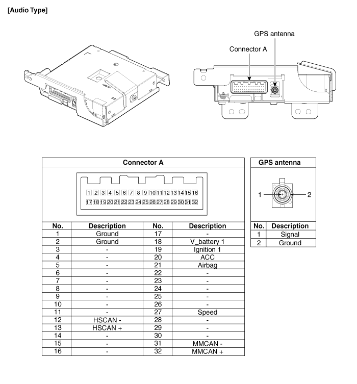
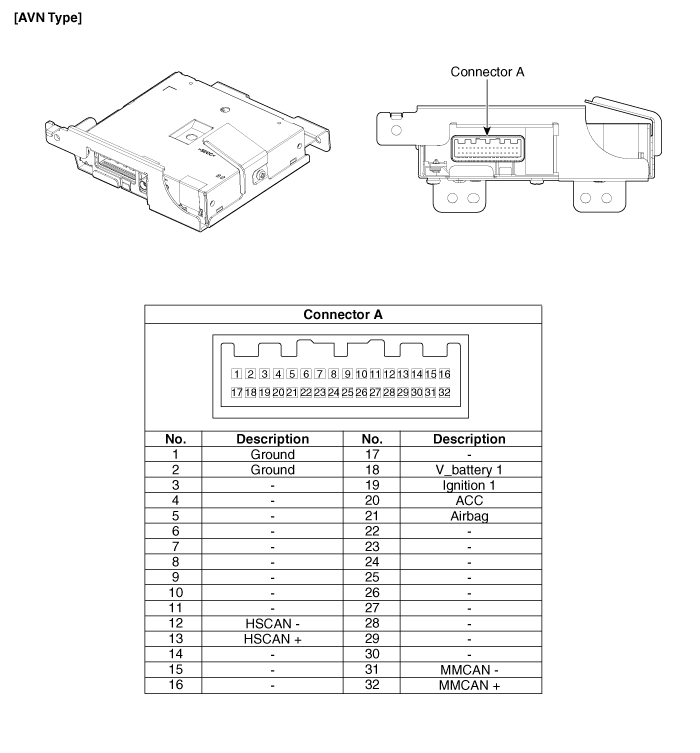

# Kia Sportage: Unidade Telemétrica (TMU): Componentes e Localização dos Componentes

[Home](../../index.md) / [Manual de Serviço e Reparo do Kia Sportage SL](../sportage-482.md) / [Sistema Elétrico do Corpo](sportage-984.md) / [Sistema MTS](sportage-1018.md) / Unidade Telemétrica (TMU): Componentes e Localização dos Componentes

## Componente

Especificação do Conector Pin

| Número | Nome do Pin | Tipo | De | Para | Descrição (Especificações de Conectividade) |
| --- | --- | --- | --- | --- | --- |
| 1 | GND | Terrestre DC | TMU | Bateria | Conectado à terra da bateria |
| 2 | GND | Terrestre DC | TMU | Bateria | Conectado à terra da bateria |
| 3 | - | - | - | - | - |
| 4 | - | - | - | - | - |
| 5 | - | - | - | - | - |
| 6 | - | - | - | - | - |
| 7 | - | - | - | - | - |
| 8 | - | - | - | - | - |
| 9 | - | - | - | - | - |
| 10 | - | - | - | - | - |
| 11 | - | - | - | - | - |
| 12 | HS CAN (-) | Dados I/O | BUS | BUS | Baixa do Bus High Speed CAN |
| 13 | HS CAN (+) | Dados I/O | BUS | BUS | Alta do Bus High Speed CAN |
| 14 | - | - | - | - | - |
| 15 | - | - | - | - | - |
| 16 | - | - | - | - | - |
| 17 | - | - | - | - | - |
| 18 | V bateria 1 | Entrada DC | Bateria | TMU | Nível DC de entrada da bateria. Suprimento de energia para o TMU |
| 19 | Ignição 1 | Entrada de Dados | Caixa de Conexões | TMU | Status do modo chave do veículo |
| 20 | ACC | Entrada de Dados | Caixa de Conexões | TMU | Status do modo chave do veículo |
| 21 | Airbag | Entrada de Dados | ACU | TMU | Dados do status do airbag da ACU |
| 22 | - | - | - | - | - |
| 23 | - | - | - | - | - |
| 24 | - | - | - | - | - |
| 25 | - | - | - | - | - |
| 26 | - | - | - | - | - |
| 27 | Velocidade | Entrada de Dados | - | TMU | Calibração GPS (apenas UVO) |
| 28 | - | - | - | - | - |
| 29 | - | - | - | - | - |
| 30 | - | - | - | - | - |
| 31 | MM CAN (-) | Dados I/O | BUS | BUS | Baixa do Bus Low Speed CAN |
| 32 | MM CAN (+) | Dados I/O | BUS | BUS | Alta do Bus Low Speed CAN |
