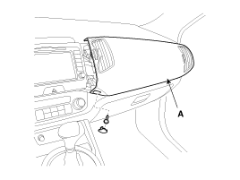
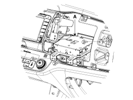
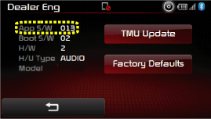
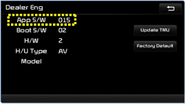
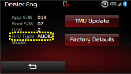
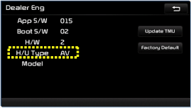
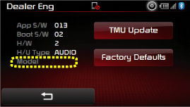
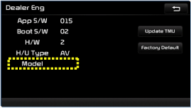

# Kia Sportage: Unidade Telemétrica (TMU): Procedimentos de Reparo

[Home](../../index.md) / [Manual de Serviço e Reparo do Kia Sportage SL](../sportage-482.md) / [Sistema Elétrico do Corpo](sportage-984.md) / [Sistema MTS](sportage-1018.md) / Procedimentos de Reparo da Unidade Telemétrica (TMU)

## Remoção

> **Nota**
>
> - Cuide para não arranhá-lo o tapete de impacto e as partes relacionadas.

1. Desconecte o terminal negativo (-) da bateria.

2. Remova o garnish do tapete de impacto (A) após soltar o parafuso.

   

3. Remova a unidade MTS (A) após soltar os parafusos de montagem.

   

## Instalação

1. Instale a unidade MTS.

2. Instale o garnish do tapete de impacto.

3. Conecte o terminal negativo (-) da bateria.

## Inspeção

1. Após substituir a unidade TMU, acesse o Modo de Engenharia do Vendedor na unidade de áudio.

   (Consulte o Sistema MTS - "Modo de Engenharia do Vendedor do TMU")

2. Verifique a versão da unidade TMU ("App S/W") na tela da unidade de áudio.

   [Tipo de áudio]

   

   [Tipo AVN]

   

3. Verifique o Tipo de H/U na tela da unidade de áudio.

   [Tipo de áudio]

   

   [Tipo AVN]

   

4. Verifique o Modelo na tela da unidade de áudio.

   [Tipo de áudio]

   

   [Tipo AVN]

   
