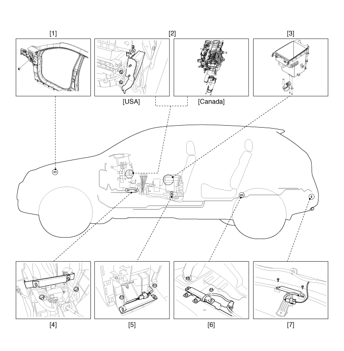
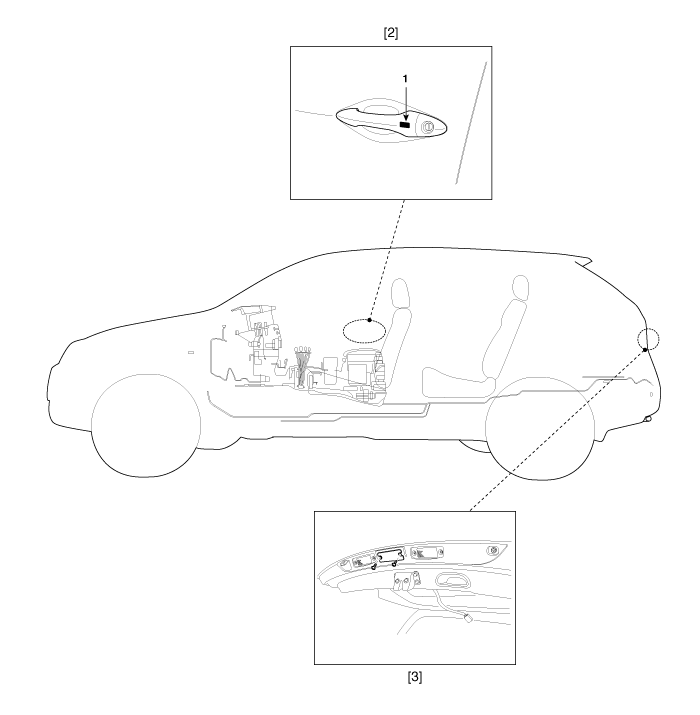

# Kia Sportage: Componentes e Localização dos Componentes

[Home](../../index.md) / [Manual de Serviço e Reparo do Kia Sportage SL](../sportage-482.md) / [Sistema Elétrico do Corpo](sportage-984.md) / [Sistema de Chave Inteligente](sportage-1023.md) / Componentes e Localização dos Componentes

## Localização dos Componentes (1)

| 1. Buzzer 2. Unidade de chave inteligente 3. Receptor de RF 4. Antena interna 1 | 5. Antena interna 2 6. Antena interna 3 7. Antena do bummper |
| --- | --- |

## Localização dos Componentes (2)

| 1. Botão do porta-malas externo 2. Porta-malas externo | 3. Interruptor do porta-malas |
| --- | --- |
