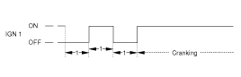

# Kia Sportage: Descrição e Operação

[Início](../../index.md) / [Manual de Serviço e Reparo do Kia Sportage SL](../sportage-482.md) / [Sistema Elétrico do Corpo](sportage-984.md) / [Sistema de Chave Inteligente](sportage-1023.md) / Descrição e Operação

## Descrição

O sistema SMART KEY é um sistema que permite ao usuário acessar e operar um veículo de forma muito conveniente. Para acessar o veículo, não é necessário usar uma chave tradicional ou um controle remoto.

O usuário carrega uma SMART KEY FOB que não requer nenhuma ação consciente do usuário (por exemplo, operar um botão RKE). O sistema SMART KEY é ativado ao pressionar um botão push na alça da porta.

Após ser ativado, o veículo envia uma solicitação em um alcance limitado. Se o SMART KEY FOB receber esta solicitação, ele automaticamente envia uma resposta ao veículo. Então, o sistema decide se deve executar uma ação específica (desbloqueio, bloqueio...) ou permanecer inativo.

Novamente, uma comunicação entre o veículo e o SMART KEY FOB é necessária antes que qualquer ação seja executada.

O sistema oferece as seguintes funcionalidades:

| • | Desbloqueio passivo pelo lado do condutor e do passageiro |
| --- | --- |

| • | Bloqueio passivo pelo lado do condutor e do passageiro |
| --- | --- |

| • | Início passivo |
| --- | --- |

| • | Máximo de 2 FOBs podem ser gerenciados pelo sistema |
| --- | --- |

| • | Antena de backup do imobilizador integrada no SSB para autenticação TP (ou seja, modo de casa arrasada) |
| --- | --- |

| • | Comunicação com o sistema de gerenciamento do motor |
| --- | --- |

| • | Comunicação com o SRX |
| --- | --- |

| • | Comunicação LF-RF |
| --- | --- |

1. Desbloqueio passivo

   O sistema permite ao usuário acessar (desbloquear) o veículo sem realizar nenhuma ação com o SMART KEY FOB. Esta funcionalidade pode ser diferente dependendo da plataforma, conforme segue:

   | • | Pressionar o botão push na alça da porta |
   | --- | --- |

2. Bloqueio passivo

   O sistema permite ao usuário bloquear o veículo pressionando um botão na alça da porta com o SMART KEY FOB.

3. Início por botão

   O sistema permite alternar os modos de energia (Desligado, Acessório, Ignição), bem como iniciar e parar o motor do veículo sem realizar nenhuma ação com o SMART KEY FOB. Consulte a especificação do sistema de início do motor por botão.

4. Modo de casa arrasada

   Adicionalmente, o sistema oferece o chamado "modo de casa arrasada", que permite ao usuário operar todas as funções do veículo inserindo a chave no SSB.

ECU SMART KEY (ECU SMK)

A ECU SMART KEY (ECU SMK) gerencia todas as funções relacionadas a "Desbloqueio passivo", "Bloqueio passivo" e "Autorização passiva para operação de início do motor".

Elle lê as entradas (botão push na alça da porta, botão de parada e início (SSB), posição do câmbio (P(A/T) ou N(M/T))), controla as saídas (por exemplo, antenas externas e internas), e comunica via CAN/LIN (dependendo do veículo) bem como uma interface de linha única para dispositivos adicionais do carro.

Elle lê as entradas (botão push na alça da porta, botão de parada e início (SSB), posição do câmbio (P(A/T) ou N(M/T))), controla as saídas (por exemplo, antenas externas e internas), e comunica via CAN bem como uma interface de linha única para dispositivos adicionais do carro.

Para a comunicação com o SMART KEY FOB, a ECU SMART KEY (ECU SMK) gera uma

Translate this Markdown chunk (3/8) para o português brasileiro.

 request (challenge) como sinal codificado e modulado de 125 kHz via
as saídas da antena inductiva e recebe a resposta do SMART KEY FOB via
o receptor de RF externo.

As principais blocos funcionais do SMK ECU são:

| • | Suprimento de energia |
| --- | --- |

| • | Microcontrolador com memória FLASH |
| --- | --- |

| • | Interface de linha única para SRX |
| --- | --- |

| • | Interface de linha única para EMS |
| --- | --- |

| • | Entrada de sinal |
| --- | --- |

| • | Amplificador/driver da antena LF |
| --- | --- |

| • | Comunicação CAN com BCM |
| --- | --- |

| • | Comunicação LIN com outro módulo (dependendo da plataforma) |
| --- | --- |

O amplificador/driver da antena LF gera um sinal senoidal de 125 kHz, que é distribuído para as diferentes antenas.

SMART KEY FOB

O sistema suporta até 2 SMART KEY FOBs.

As principais funções do SMART KEY FOB são:

| • | Função passiva: recebe desafio LF e envia automaticamente resposta RF. |
| --- | --- |

| • | Função RKE clássica por ação de até 6 botões push. |
| --- | --- |

| • | Função transponder em caso de bateria esgotada ou comunicação perturbada. |
| --- | --- |

| • | LED para feedback de operação e monitoramento da bateria. |
| --- | --- |

> **Nota**
>
> - O indicador LED do FOB pode continuar a brilhar mesmo com uma bateria de transmissor com baixa carga.
> - Se o desempenho ou o alcance do FOB for menor do que o esperado, verifique a bateria do transmissor.

Antenas

1. Antenas de Emissão LF:

   As antenas inductivas no veículo são utilizadas para
   transformar a corrente, impulsionada pelo driver da antena do SMK ECU, em um campo magnético de 125
   kHz, que é o portador do desafio SMART KEY.

   Três antenas cobrem a exterior do veículo: duas antenas
   nos Puxadores de Porta (DS e PS) cobrem a área ao redor das portas; uma
   antena no para-choque traseiro cobre a área ao redor do porta-malas.

   Duas antenas cobrem a exterior do veículo: duas antenas nos Puxadores de Porta (DS e PS) cobrem a área ao redor das portas.

   Até três antenas cobrem a interior do veículo e do porta-malas: duas no compartimento do passageiro e uma no porta-malas.

2. Antena Bilateral de Imobilizador (para Limp Home):

   A Antena de Backup do Imobilizador é utilizada para enviar e
   receber dados: emite um campo magnético (desafio de 125 - 135 kHz) e
   recebe mudanças na intensidade do campo (resposta do Transponder).

3. Receptor Externo

   A resposta do SMART KEY FOB é recebida via o receptor de RF externo, que está conectado ao SMK ECU por uma comunicação serial.

   O SMK ECU fornece um pinho de conector para a linha de comunicação serial.

Puxador de Porta

Os puxadores de porta das duas portas (porta do motorista / porta do passageiro) estão equipados com antenas de emissão LF para emitir os sinais de 125
kHz. Os puxadores de porta também estão equipados com um botão push.

Botão Push

O botão push no puxador de porta serve como gatilho para indicar a intenção do usuário de desbloquear ou bloquear o veículo.

Os botões push são instalados nas portas dianteiras, integrados nos puxadores das portas.

## Operação

Funções Passivas

O sistema permite que o usuário acesse o veículo sem
precisar realizar nenhuma ação (por exemplo, pressionar o botão RKE) com o SMART
KEY FOB. Basta que um SMART KEY FOB válido esteja localizado dentro de um
intervalo definido e limitado em relação ao veículo. Assim, o sistema é capaz de detectar e autenticar um SMART KEY FOB nos intervalos especificados abaixo.

Intervalo de Operação

O SMART KEY FOB recebe e interpreta um desafio enviado
pelo veículo através das antenas externas em um intervalo livre de espaço de
mínimo 0,7m medido ao redor das antenas externas integradas nas
portas; consulte a imagem abaixo.

O SMART KEY FOB recebe e interpreta um desafio enviado
pelo veículo através das antenas externas em um intervalo livre de espaço de
mínimo 0,7m medido ao redor das antenas externas integradas nas
portas; consulte a imagem abaixo

Acesso Passivo (Acesso Sem Chave)

Pressionar um dos botões de porta quando todas
as portas estiverem trancadas indica a intenção do operador de acessar o veículo
e, portanto, aciona o sistema para desbloqueio

Bloqueio Passivo (Saída)

Pressionar um dos botões de porta quando uma das seguintes condições for atendida:

| • | Pelo menos uma porta estiver desbloqueada e o temporizador de dois passos não estiver em execução ou |
| --- | --- |

| • | O temporizador de dois passos estiver em execução e um dos botões de porta, exceto o lado frontal esquerdo, for acionado |
| --- | --- |

indica a intenção do operador de trancar o veículo e, portanto, aciona o sistema para um bloqueio.

Abertura Passiva do Traveco

Pressionar o interruptor do capô do traveco quando o capô estiver fechado
indica a intenção do operador de abrir o traveco e, portanto, aciona o sistema. Subsequentemente, o SMK ECU envia um desafio LF ao SMART
KEY FOB através da antena do para-choque externo. O SMART KEY FOB responde com
uma resposta RF. Se a resposta recebida corresponder à resposta esperada,
o SMK ECU envia uma mensagem "abrir traveco" através da rede CAN.

Lembrete de Chave Inteligente 1

1. Pré-condições:

   Todos os terminais OFF & pelo menos uma porta aberta & o status de trancamento não for trancado verificado pelo SMK periodicamente a cada 100ms, enquanto
   CAN/LIN ativo.

2. Evento:

   O status de pelo menos 1 chave de porta mudou de desbloqueado para trancado.

3. Ações do SMK:

   | • | SE NENHUM FOB-IN ATIVO, o SMK realiza uma busca pelos FOBs no interior do
   veículo. A mesma estratégia LF deve ser usada como é definida para o aviso de identificação (registrando apenas, sem autenticação) |
   | --- | --- |

   | • | SE FOB-IN ATIVO, o SMK busca pelos TP válidos |
   | --- | --- |

   Se nenhum FOB ou TP for encontrado, nenhuma ação é necessária.

   Se qualquer FOB ou TP válido for encontrado, o SMK desbloqueia o
   veículo enviando uma mensagem CAN Key Reminder unlock com o número do FOB.

   Se qualquer FOB válido for encontrado, o SMK desbloqueia o
   veículo enviando uma mensagem CAN/LIN Key Reminder unlock com o número do FOB.

Lembrete de Chave Inteligente 2

1. Pré-condições:

All terminais OFF & qualquer porta aberta (inclusive porta traseira) & sem FOB-IN & sem status de bloqueio (verificado periodicamente pelo SMK a cada 100ms, enquanto o CAN/LIN estiver ativo)

2. Ação do veículo:

   Fechamento da última porta ou porta traseira com estado de bloqueio das alavancas, ou com bloqueio em progresso

3. Ações do SMK:

   Antes do término de 500ms após o fechamento, se todas as portas estiverem bloqueadas, então:

   | • | SE NÃO HÁ FOB-IN ATIVO, o SMK realiza uma busca pelos FOBs no interior do veículo. A mesma estratégia LF deve ser usada como definida para o aviso de ID out (apenas registro, sem autenticação) |
   | --- | --- |

   | • | SE HÁ FOB-IN ATIVO, o SMK busca TP válidos |
   | --- | --- |

   Se nenhum FOB for encontrado, nenhuma ação é necessária.

   Se qualquer FOB válido ou TP válido for encontrado, o SMK envia comando de desbloqueio via CAN e ativa o buzzer externo de aviso.

   Se qualquer FOB válido for encontrado, o SMK envia comando de desbloqueio via CAN/LIN e ativa o buzzer externo de aviso.

Aviso de Bloqueio com Chave Inteligente

Aviso de Bloqueio 1

1. Pré-condições:

   Enquanto (pelo menos um cabo de porta está desbloqueado) & (ACC ON ou IGN ON) & (sem FOB-IN) :

   | • | (Todas as portas estão fechadas) & (porta traseira fechada) |
   | --- | --- |

2. Evento:

   Usuário pressiona o botão de porta no porta-malas.

3. Ações do SMK:

   O SMK realiza uma busca pelos FOBs fora do veículo; a mesma estratégia LF deve ser usada como definida para "Cenário Acesso com Diferenciação de Entrada/Saída".

Aviso de Bloqueio 2

1. Pré-condições:

   As mesmas pré-condições do bloqueio passivo, mas com pelo menos uma porta aberta.

2. Evento:

   Usuário pressiona o botão de porta.

3. Ações do SMK:

   O SMK realiza uma busca pelos FOBs fora do veículo; a mesma estratégia LF deve ser usada como definida para "Cenário Acesso com Diferenciação de Entrada/Saída".

   Se nenhum FOB for encontrado, nenhuma ação é necessária.

   Se as pré-condições não forem mais válidas durante o tempo de ativação do buzzer (3 segundos), o ECU do SMK para imediatamente o buzzer.

Aviso de Bloqueio 3

1. Pré-condições:

   As mesmas pré-condições do bloqueio passivo

2. Ação do usuário:

   | • | Usuário pressiona o botão de porta |
   | --- | --- |

3. Ações do ECU do SMK:

   | • | Se o ATWS (Sistema de Alerta Antifurto) estiver em status DESARMADO, o ECU do SMK realiza uma busca pelos FOBs no interior do veículo (utilize o "Cenário Aviso de Bloqueio 3") |
   | --- | --- |

Se nenhum FOB for encontrado, o bloqueio passivo é realizado.

Se qualquer FOB válido for encontrado, o ECU do SMK ativa o buzzer externo.

Se o temporizador de atividade expirar ou ACC ON ou IGN1 ON ou NÃO Todas as portas fechadas ou FOB-IN, o ECU do SMK para imediatamente o buzzer.

Depois da busca do FOB interno, o ECU do SMK também realiza uma busca pelos FOBs fora do veículo.

Aviso de Lâmpada com Chave Inteligente

1. Ações do SMK:

   Enquanto as pré-condições forem válidas, o ECU do SMK realiza uma busca periódica pelos FOBs no interior do veículo; a mesma estratégia LF deve ser usada como definida para o aviso de ID out

(registrando apenas, sem autenticação); o processo é periódico, ou seja, a busca é realizada a cada 3 segundos.

   Se nenhum FOB FOB não for encontrado, o ECU SMK iniciará a ativação da lâmpada indicadora de chave fora, uma vez que todas as condições prévias são válidas, e realizará outra busca 3 segundos depois.

Se algum FOB válido for encontrado, o ECU SMK parará a lâmpada indicadora de chave fora e, se uma porta estiver aberta, realizará outra busca 3 segundos depois; se nenhuma porta estiver aberta, a busca só ocorrerá na próxima abertura de uma porta.

Funções de Segurança (Backup para Viagem com Problemas)

Em caso de bateria descarregada do FOB SMART KEY ou transmissão perturbada, as seguintes funções estão disponíveis:

| • | Desbloqueio / bloqueio das portas ou porta traseira (ou porta traseira dependendo da configuração do veículo): uso de chave mecânica |

User Information Functions

Aviso ID OUT

1. Condições prévias:

   | • | (ACC ou IGN1) & (qualquer porta aberta ou porta traseira aberta) |

2. Evento:

   A porta mais recentemente aberta é fechada

3. Ação do SMK:

   O SMK busca um FOB SMART KEY no interior.

   | • | Se nenhum FOB SMART KEY válido for encontrado, o SMK ativa
   buzzer externo e também envia ID OUT WNG via CAN (aviso com buzzer externo e aviso com buzzer interno). |
   | --- | --- |

   | • | Se uma porta é aberta e fechada novamente durante o terminal ligado e
   um FOB válido, o SMK reabilita a autenticação e para o aviso. Se o terminal estiver em ACC, o SMK ligará o lampião de imobilizador. |
   | --- | --- |

> **Nota**
>
> - Se houver erro LF (LF aquecimento excessivo ou falha na antena LF), o sistema terá o mesmo comportamento que se não fosse encontrado nenhum FOB.

Lampião de Imobilizador

Removendo o PIF do MSL e reinsertando o PIF e pressionando o MSL Knob, o lampião será ligado novamente.

Detecção de Bateria Baixa do FOB

Para detectar a condição de baixa bateria do FOB, uma estratégia de medição de tensão da bateria e detecção de baixa tensão foi implementada no FOB. A medição da tensão da bateria será realizada se o botão do FOB for pressionado ou se um comando de medição LF for recebido.

Se o FOB detectar uma tensão da bateria baixa, a LED não será ligada ao pressionar o botão.

Descrição de Aprendizado

Neste capítulo, o procedimento de aprendizado para SMK e FOBs é descrito.

Para a aprendizagem do SMK e FOBs, é necessário uma conexão com a ferramenta diagnóstica.

Modo de Aprendizado

Qualquer que seja o modo, os procedimentos de aprendizado são gerenciados pelo SMK.

Antes de iniciar o serviço de aprendizado, o sinal Fob-In deve estar ativo e o código secreto do veículo (chamado de código PIN) deve ser conhecido.

Modo de Ensino

Este modo é usado pelos revendedores para substituir o SMK
e/ou o conjunto de chaves, ou para registrar chaves adicionais para um sistema existente. Isso significa que o sistema já foi aprendido com um certo código PIN. O código PIN é fixo durante a vida do veículo, portanto, o mesmo código PIN deve ser usado neste modo. Caso contrário, o aprendizado falhará.

Teaching MODE Procedure Descrição (Passo a Passo)

Objetivo: Procedimento chave de ensino na estação de serviço

Estado inicial:

| – | Substituição de SMK: SMK não foi aprendido, SMART FOB já foi aprendido com o mesmo código PIN |
| --- | --- |

| – | Ensino adicional ou de nova chave: SMK já foi aprendido com o mesmo código PIN |
| --- | --- |

Início após Substituição (Início Virgem)

É possível iniciar o veículo após a substituição do novo módulo de chave inteligente e do FOB, seguindo o processo a seguir.

| • | É para iniciar em condição virgem |
| --- | --- |

| • | Todas as partes relacionadas estão em condição virgem (chave inteligente, IPM, ECM) |
| --- | --- |

| • | Quando a chave inteligente virgem é inserida no suporte da chave inteligente, é possível iniciar, posições IG ON e ACC |
| --- | --- |

| • | Pressione o pedal do freio na faixa P ou N |
| --- | --- |

| • | Após inserir a chave inteligente virgem no suporte, pressione o botão de start uma vez. |
| --- | --- |

