# Kia Sportage: Procedimentos de Reparo

[Início](../../index.md) / [Manual de Serviço e Reparo do Kia Sportage SL](../sportage-482.md) / [Sistema Elétrico do Corpo](sportage-984.md) / [Sistema de Chave Inteligente](sportage-1023.md) / Procedimentos de Reparo

## Inspeção

Diagnóstico Autônomo com Ferramenta de Escaneamento

Defeitos no sistema de chave inteligente podem ser diagnosticados rapidamente com o GDS. O GDS opera o atuador rapidamente para monitorar, verificar valores de entrada/saída e realizar diagnóstico autônomo.

As três seguintes características serão os principais problemas no sistema SMART KEY.

1. Problema na entrada do unitário SMART KEY.

2. Problema no unitário SMART KEY.

3. Problema na saída do unitário SMART KEY.

As três soluções de diagnóstico seguintes serão o principal processo de solução para a maioria das preocupações.

1. Problema na entrada do unitário SMART KEY: diagnóstico de interruptor

2. Problema no unitário SMART KEY: diagnóstico de comunicação

3. Problema na saída do unitário SMART KEY: diagnóstico de antena e saída de interruptor

Diagnóstico de Interruptor

1. Conecte o cabo do GDS à conexão de dados no painel inferior do crash pad do lado do motorista, ligue o GDS.

2. Selecione o modelo do veículo e, em seguida, o sistema SMART KEY.

   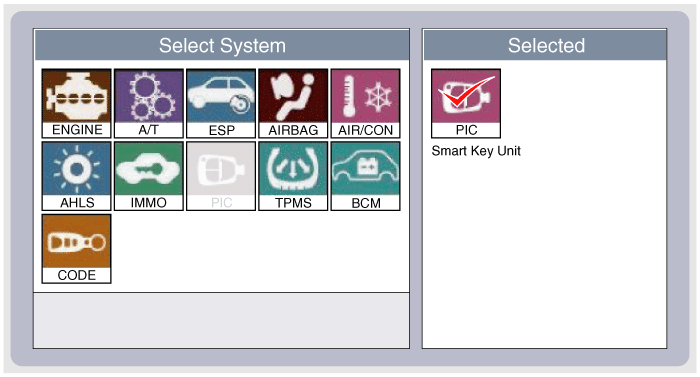

3. Selecione o "unitário SMART KEY".

4. Após IG ON, selecione o "dados atuais".

   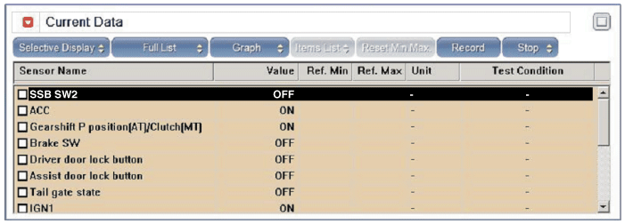

5. Você pode ver a situação de cada interruptor no escaner após o processo de "dados atuais".

   | Exibição | Descrição |
   | --- | --- |
   | FL Toggle SW | ON : O botão push está ON no porta-malas do motorista. |
   | FR Toggle SW | ON : O botão push está ON no porta-malas do assistente. |
   | Trunk SW | ON : O botão do porta-malas está ON. |
   | Posição do Mando de Marcha | ON : O mando de marcha está na posição P. |
   | IGN 1 | ON : O interruptor IGN está na posição IG. |
   | ACC | ON : O interruptor IGN está na posição ACC. |
   | Push Knob SW | ON : O interruptor de roda push está ON. |
   | Buzina externa | ON : A buzina está ON. |

Diagnóstico de Comunicação com GDS (Diagnóstico Autônomo)

1. O diagnóstico de comunicação verifica que cada componente ligado está operando normalmente.

2. Conecte o cabo do GDS à conexão de dados no painel inferior do crash pad do lado do motorista.

3. Após IG ON, selecione o "DTC".

   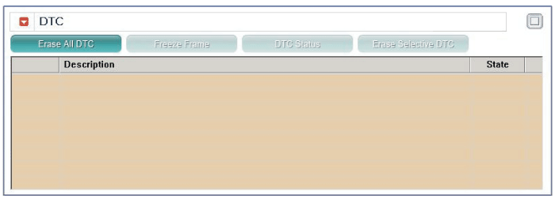

Diagnóstico de Ativação da Antena com GDS

1. Conecte o cabo do GDS à conexão de dados no painel inferior do crash pad do lado do motorista.

2. Após IG ON, selecione o "TESTE DE ATIVAÇÃO".

   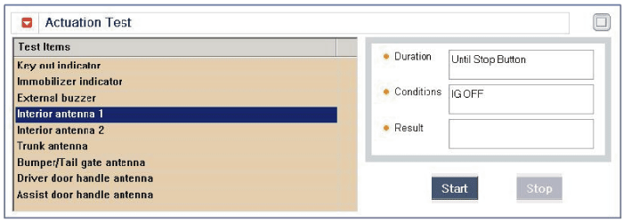

3. Posicione a chave inteligente perto da antena relacionada e operacionalize-a com o GDS.

   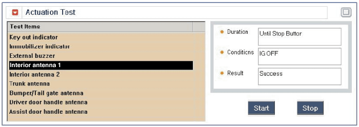

4. Se a LED da chave inteligente estiver piscando, a chave inteligente está normal.

5. Se a LED da chave inteligente não estiver piscando, verifique a tensão da bateria da chave inteligente.

6. Ativação da antena

   | – | Antena Interna 1 |
   | --- | --- |

   | – | Antena Interna 2 |
   | --- | --- |

   | – | Antena Interna 3 |
   | --- | --- |

   | – | Antena do Bumper |
   | --- | --- |

   | – | Antena DRV_DR |
   | --- | --- |

   | – | Antena AST_DR |
   | --- | --- |

Verificação do Status da Antena

1. Conecte o cabo do GDS à conexão de dados no painel inferior do crash pad do lado do motorista.

2. Selecione o "Verificação do Status da Antena".

   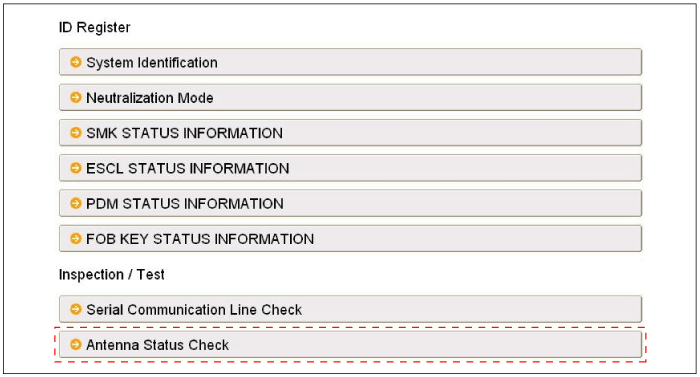

3. Após IG ON, selecione o "Verificação do Status da Antena".

   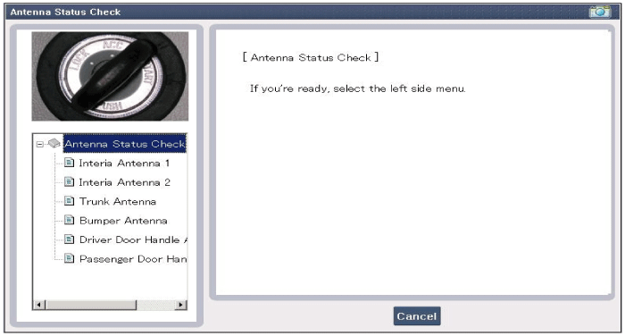

4. Posicione a chave inteligente perto da antena relacionada e operá-la com um GDS.

   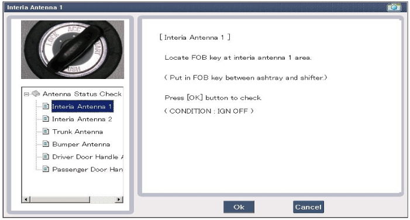

   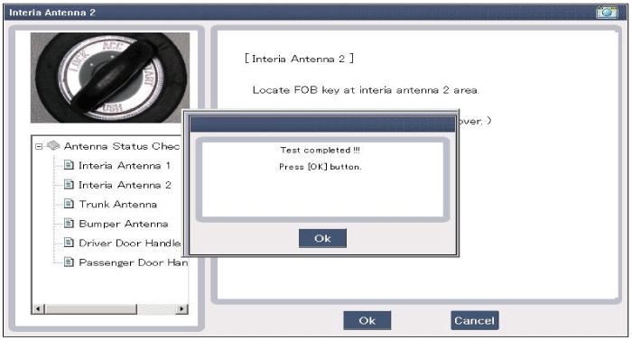

5. Se a chave inteligente funcionar normalmente, a antena relacionada, a chave inteligente (transmissão, recepção) e o receptor externo estão normais.

6. Status da antena

   | – | Antena Interna 1 |
   | --- | --- |

   | – | Antena Interna 2 |
   | --- | --- |

   | – | Antena Interna 3 |
   | --- | --- |

   | – | Antena do Bumper |
   | --- | --- |

   | – | Antena DRV_DR |
   | --- | --- |

   | – | Antena AST_DR |
   | --- | --- |

Verificação do Comunicação Série

1. Conecte o cabo do GDS ao conector de dados no painel inferior do painel de colisão do condutor.

2. Selecione "Verificação da Linha de Comunicação Série".

   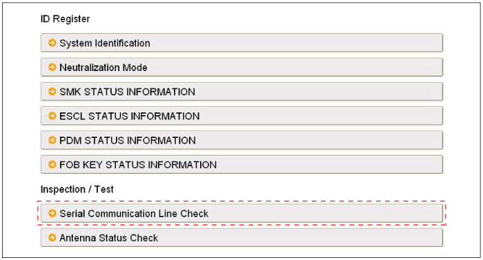

3. Após o acionamento do IGN, selecione "Verificação da Linha de Comunicação do Receptor".

   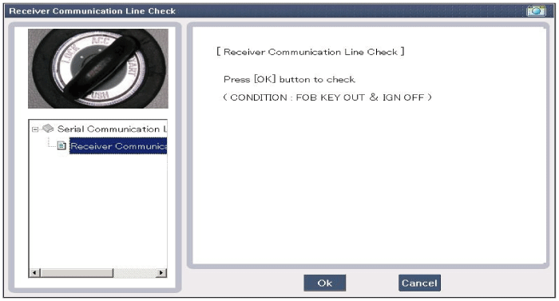

4. Verifique a linha de comunicação série com um GDS.

5. Se a chave inteligente funcionar normalmente, a comunicação da unidade de chave inteligente e o receptor externo estão normais.

6. Se o sistema de chave inteligente não funcionar corretamente, verifique os seguintes itens.

   | – | Desconexão ou não resposta da linha de comunicação do receptor externo. |
   | --- | --- |

   | – | Conexão e conexão de solo da linha de comunicação do receptor externo. |
   | --- | --- |

Verificação da Ativação da Antena Interna

1. Posicione a chave inteligente na área sombreada a seguir e verifique o IG ON.

   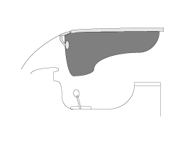

2. Se o acionamento estiver ligado, a antena está funcionando normalmente.

3. Verifique o modo de acionamento do acionamento do acionamento do acionamento do acionamento do acionamento do acionamento do acionamento do acionamento do acionamento do acionamento do acionamento do acionamento do acionamento do acionamento do acionamento do acionamento do acionamento do acionamento do acionamento do acionamento do acionamento do acionamento do acionamento do acionamento do acionamento do acionamento do acionamento do acionamento do acionamento do acionamento do acionamento do acionamento do acionamento do acionamento do acionamento do acionamento do acionamento do acionamento do acionamento do acionamento do acionamento do acionamento do acionamento do acionamento do acionamento do acionamento do acionamento do acionamento do acionamento do acionamento do acionamento do acionamento do acionamento do acionamento do acionamento do acionamento do acionamento do acionamento do acionamento do acionamento do acionamento do acionamento do acionamento do acionamento do acionamento do acionamento do acionamento do acionamento do acionamento do acionamento do acionamento do acionamento do acionamento do acionamento do acionamento do acionamento do acionamento do acionamento do acionamento do acionamento do acionamento do acionamento do acionamento do acionamento do acionamento do acionamento do acionamento do acionamento do acionamento do acionamento do acionamento do acionamento do acionamento do acionamento do acionamento do acionamento do acionamento do acionamento do acionamento do acionamento do acionamento do acionamento do acionamento do acionamento do acionamento do acionamento do acionamento do acionamento do acionamento do acionamento do acionamento do acionamento do acionamento do acionamento do acionamento do acionamento do acionamento do acionamento do acionamento do acionamento do acionamento do acionamento do acionamento do acionamento do acionamento do acionamento do acionamento do acionamento do acionamento do acionamento do acionamento do acionamento do acionamento do acionamento do acionamento do acionamento do acionamento do acionamento do acionamento do acionamento do acionamento do acionamento do acionamento do acionamento do acionamento do acionamento do acionamento do acionamento do acionamento do acionamento do acionamento do acionamento do acionamento do acionamento do acionamento do acionamento do acionamento do acionamento do acionamento do acionamento do acionamento do acionamento do acionamento do acionamento do acionamento do acionamento do acionamento do acionamento do acionamento do acionamento do acionamento do acionamento do acionamento do acionamento do acionamento do acionamento do acionamento do acionamento do acionamento do acionamento do acionamento do acionamento do acionamento do acionamento do acionamento do acionamento do acionamento do acionamento do acionamento do acionamento do acionamento do acionamento do acionamento do acionamento do acionamento do acionamento do acionamento do acionamento do acionamento do acionamento do acionamento do acionamento do acionamento do acionamento do acionamento do acionamento do acionamento do acionamento do acionamento do acionamento do acionamento do acionamento do acionamento do acionamento do acionamento do acionamento do acionamento do acionamento do acionamento do acionamento do acionamento do acionamento do acionamento do acionamento do acionamento do acionamento do acionamento do acionamento do acionamento do acionamento do acionamento do acionamento do acionamento do acionamento do acionamento do acionamento do acionamento do acionamento do acionamento do acionamento do acionamento do acionamento do acionamento do acionamento do acionamento do acionamento do acionamento do acionamento do acionamento do acionamento do acionamento do acionamento do acionamento do acionamento do acionamento do acionamento do acionamento do acionamento do acionamento do acionamento do acionamento do acionamento do acionamento do acionamento do acionamento do acionamento do acionamento do acionamento do acionamento do acionamento do acionamento do acionamento do acionamento do acionamento do acionamento do acionamento do acionamento do acionamento do acionamento do acionamento do acionamento do acionamento do acionamento do acionamento do acionamento do acionamento do acionamento do acionamento do acionamento do acionamento do acionamento do acionamento do acionamento do acionamento do acionamento do acionamento do acionamento do acionamento do acionamento do acionamento do acionamento do acionamento do acionamento do acionamento do acionamento do acionamento do acionamento do acionamento do acionamento do acionamento do acionamento do acionamento do acionamento do acionamento do acionamento do acionamento do acionamento do acionamento do acionamento do acionamento do acionamento do acionamento do acionamento do acionamento do acionamento do acionamento do acionamento do acionamento do acionamento do acionamento do acionamento do acionamento do acionamento do acionamento do acionamento do acionamento do acionamento do acionamento do acionamento do acionamento do acionamento do acionamento do acionamento do acionamento do acionamento do acionamento do acionamento do acionamento do acionamento do acionamento do acionamento do acionamento do acionamento do acionamento do acionamento do acionamento do acionamento do acionamento do acionamento do acionamento do acionamento do acionamento do acionamento do acionamento do acionamento do acionamento do acionamento do acionamento do acionamento do acionamento do acionamento do acionamento do acionamento do acionamento do acionamento do acionamento do acionamento do ac

| 6 | Botão de Bloqueio da Porta TRF | - |
| 7 | Botão de Bloqueio da Porta TFR | - |
| 8 | SW do Capotamento | - |
| 9 | Tensão da Bateria | - |
| 10 | Tensão do Alternador | - |
| 11 | Lâmpada de Indicação de Chave fora | - |
| 12 | Lâmpada do Imobilizador | - |
| 13 | Zumbido Externo | - |

Lista de Executores

| N° | Nome do Item | Condição |
| --- | --- | --- |
| 1 | Lâmpada de Indicação de Chave fora | Interruptor de Ignição ON Motor desligado |
| 2 | Lâmpada do Imobilizador | Interruptor de Ignição ON Motor desligado |
| 3 | Antena Interna 1 Ativa | Interruptor de Ignição ON Motor desligado |
| 4 | Antena Interna 2 Ativa | Interruptor de Ignição ON Motor desligado |
| 5 | Antena Interna 3 Ativa | Interruptor de Ignição ON Motor desligado |
| 6 | Antena do Bumpier Ativa | Interruptor de Ignição ON Motor desligado |
| 7 | Antena DRV_DR Ativa | Interruptor de Ignição ON Motor desligado |
| 8 | Antena AST_DR Ativa | Interruptor de Ignição ON Motor desligado |
