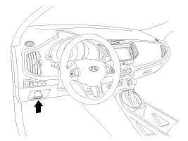
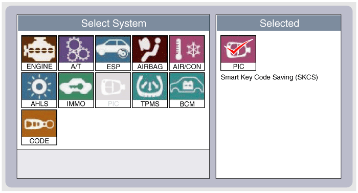
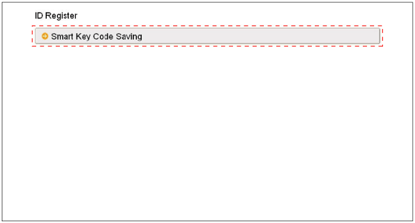
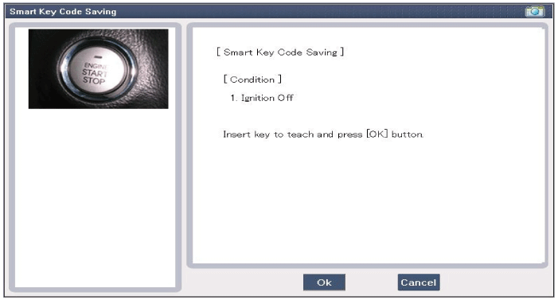
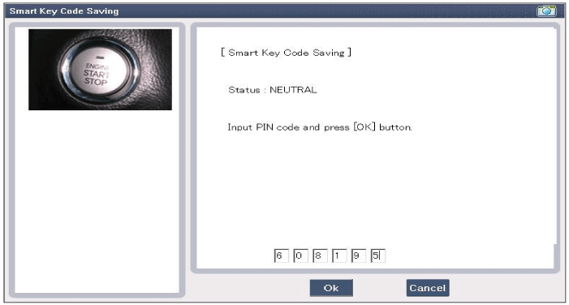
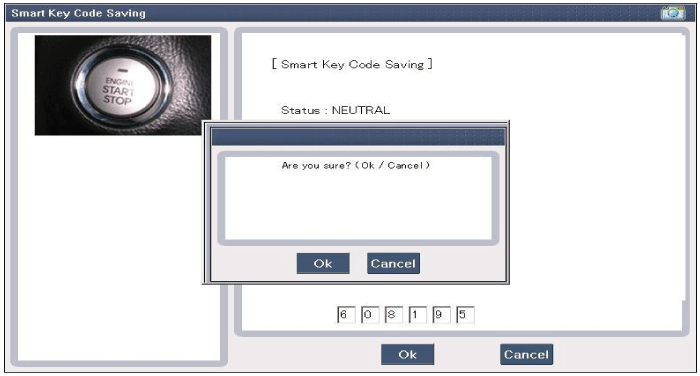
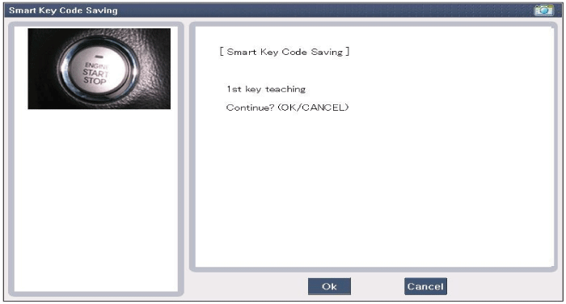
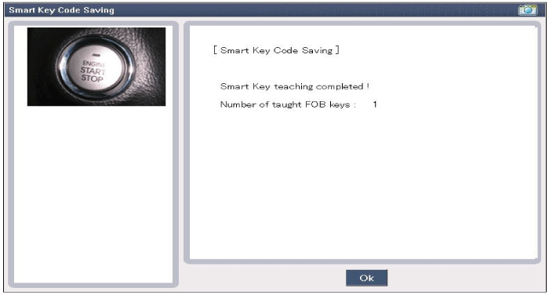
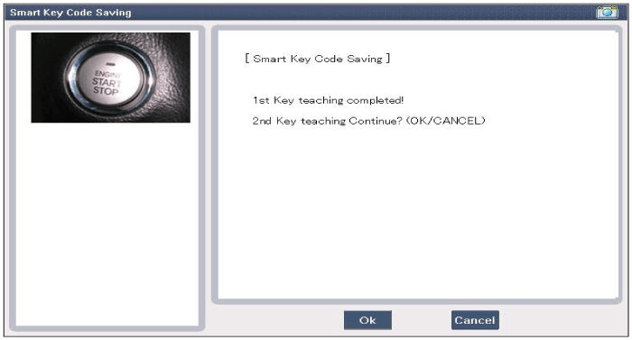

# Kia Sportage: Smart key: Procedimentos de reparo

[Home](../../index.md) / [Manual de Serviço e Reparo do Kia Sportage SL](../sportage-482.md) / [Sistema Elétrico do Corpo](sportage-984.md) / [Sistema de Chave Inteligente](sportage-1023.md) / Procedimentos de reparo da chave inteligente

## Chave Inteligente

Salvamento do Código da Chave Inteligente

1. Conecte o cabo DLC do GDS ao conector de dados (16 pinos) na placa inferior do painel do lado do motorista, ligue o GDS.

   

2. Selecione o modelo do veículo e, em seguida, faça "Salvamento do código da chave inteligente".

   

   

3. Após selecionar o menu "Ensino de chave inteligente", pressione a tecla "Enter", então a tela será exibida como abaixo.

   

4. Após inserir a chave de ensino, pressione a tecla "ENTER".

5. Insira o "Código de acesso" para o ensino da primeira chave.

   

   

6. Confirme a mensagem "Ensino da primeira chave concluído".

   

   

7. Insira o "Código de acesso" para o ensino da segunda chave.

   

   

8. Confirme a mensagem "Ensino da segunda chave concluído".

   

9. Então a tela será exibida como abaixo quando o processo de ensino de chaves estiver concluído.
