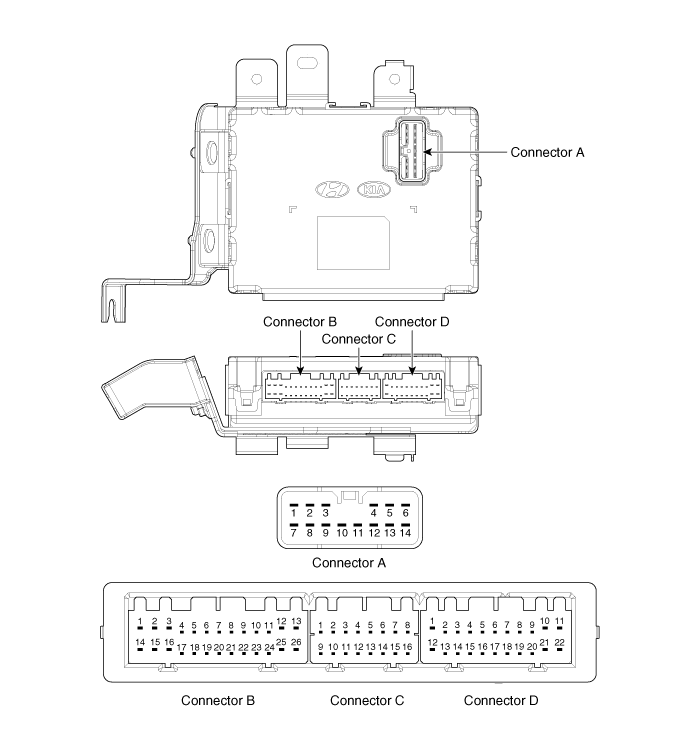

# Unidade de Chave Inteligente — Componentes e localização

[Home](../../index.md) / [Manual de Serviço e Reparo](../sportage-482.md) / [Sistema Elétrico do Corpo](sportage-984.md) / [Sistema de Chave Inteligente](sportage-1023.md) / Componentes e localização

## Diagrama

## Informações de Conector

| No | Conector A (14 pinos) | No | Conector B (26 pinos) |  |  |
| --- | --- | --- | --- | --- | --- |
| 1 | Terreno 1 | 1 | - | 15 | Botão de travamento passageiro, botão de troca de passageiro |
| 2 | A_ACC | 2 | Botão de travamento do motorista, botão de troca do motorista | 16 | - |
| 3 | A_IGN2 | 3 | - | 17 | - |
| 4 | A_IGN1 | 4 | - | 18 | - |
| 5 | VBAT_CPU | 5 | - | 19 | Entrada da chave remota |
| 6 | VBAT_LOAD | 6 | Interruptor1_SSB | 20 | F_RPM |
| 7 | Terreno 2 | 7 | F_Velocímetro | 21 | Feedback de partida |
| 8 | - | 8 | Interruptor2_SSB | 22 | - |
| 9 | O_Buzina externa | 9 | - | 23 | - |
| 10 | O_Rele ACC | 10 | - | 24 | - |
| 11 | O_Rele IGN1 | 11 | - | 25 | - |
| 12 | O_Rele IGN2 | 12 | B_CAN_H | 26 | Interruptor da porta traseira |
| 13 | O_Rele do Arranque | 13 | B_CAN_L | ? | ? |
| 14 | - | 14 | - |  |  |

## Informações de Conector

| No | Conector C (16 pinos) | No | Conector D (22 pinos) |
| --- | --- | --- | --- |
| 1 | C_CAN_L | 1 | Luz de advertência do sistema de segurança |
| 2 | C_CAN_H | 2 | LED Amarelo do SSB |
| 3 | - | 3 | Poder de iluminação do SSB |
| 4 | Iluminação do suporte | 4 | Poder de antena interna 2 do motorista |
| 5 | - | 5 | Poder de antena interna 1 do motorista |
| 6 | Diagnóstico K | 6 | - |
| 7 | Interruptor do freio | 7 | - |
| 8 | Dados do sistema de segurança | 8 | Poder de antena interna 3 do motorista |
| 9 | RF_COM | 9 | Poder de antena do bico de refletores |
| 10 | EMS_COM | 10 | Poder de antena do lado do passageiro |
| 11 | - | 11 | Poder de antena do lado do motorista |
| 12 | - | 12 | - |
| 13 | Fusível da luz de parada | 13 | LED Azul do SSB |
| 14 | - | 14 | Poder de iluminação do SSB |
| 15 | Interruptor de parada, interruptor da embreagem | 15 | Poder de antena interna 2 do motorista |
| 16 | Relógio do sistema de segurança | 16 | Poder de antena interna 1 do motorista |
|  |  | 17 | - |
| 18 | - |  |  |
| 19 | Poder de antena interna 3 do motorista |  |  |
| 20 | Poder de antena do bico de refletores |  |  |
| 21 | Poder de antena do lado do passageiro |  |  |
| 22 | Poder de antena do lado do motorista |  |  |
