# Kia Sportage: Unidade de Chave Inteligente: Procedimentos de Reparo

[Início](../../index.md) / [Manual de Serviço e Reparo do Kia Sportage SL](../sportage-482.md) / [Sistema Elétrico do Corpo](sportage-984.md) / [Sistema de Chave Inteligente](sportage-1023.md) / Procedimentos de Reparo da Unidade de Chave Inteligente

## Remoção

Unidade de Chave Inteligente

1. Desconecte o terminal negativo (-) da bateria.

2. Remova a gaveta do painel de instrumentos.

   (Consulte o grupo BD - "Painel de Impacto")

3. Após desconectar os conectores da unidade de chave inteligente (A), desloque as varetas de fixação da unidade de chave inteligente (2EA) e remova a unidade de chave inteligente (B).

   [Estados Unidos]

   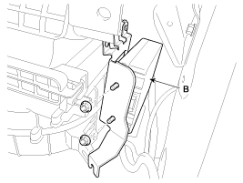

   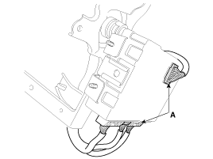

   [Canadá]

   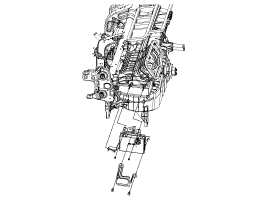

Receptor RF

1. Desconecte o terminal negativo (-) da bateria.

2. Remova o painel central do carro.

   (Consulte o grupo BD - "Painel Central")

3. Desconecte o conector do receptor RF e remova as varetas de fixação do receptor RF. Remova o receptor RF.

   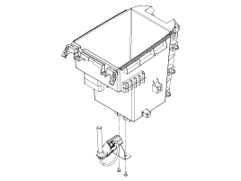

Antena Interna 1

1. Desconecte o terminal negativo (-) da bateria.

2. Remova o painel central do carro.

   (Consulte o grupo BD - "Painel Central")

3. Após deslocar as varetas de fixação da antena (2EA) e o conector (B), remova a antena interna 1 (A).

   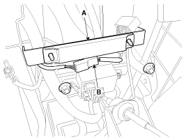

   > **Nota**
   >
   > - Libere o travamento do conector (A) conforme indicado pela seta, e então empurre o travamento.
   > - Certifique-se de que o conector esteja completamente travado ao instalar.

Antena Interna 2

1. Desconecte o terminal negativo (-) da bateria.

2. Remova a parte traseira do painel central do carro usando a ferramenta apropriada.

   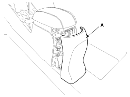

   > **Nota**
   >
   > - Cuide para não danificar e arranhar a parte traseira do painel central do carro e suas partes relacionadas.
   > - Cuide para não danificar a garrilha ao remover a parte traseira do painel central do carro.

3. Após deslocar as varetas de fixação da antena (2EA) e o conector, remova a antena interna 2 (A).

   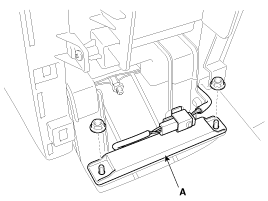

   > **Nota**
   >
   > - Libere o travamento do conector (A) conforme indicado pela seta, e então empurre o travamento.
   > - Certifique-se de que o conector esteja completamente travado ao instalar.

Antena Interna 3

1. Desconecte o terminal negativo (-) da bateria.

2. Após deslocar as varetas de fixação, remova a montagem do assento traseiro.

   (Consulte o grupo BD - "Assento Traseiro")

3. Remova o acabamento lateral do porta-malas (RH, LH), e então remova o tapete do chão traseiro.

   (Consulte o grupo BD - "Acabamento Interno")

4. Após deslocar as varetas de fixação da antena (2EA) e o conector (A), remova a antena interna 3 (B).

   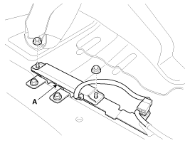

   > **Nota**
   >
   > - Libere o travamento do conector (A) conforme indicado pela seta, e então empurre o travamento.
   > - Certifique-se de que o conector esteja completamente travado ao instalar.

Antena do Para-choque Externo

1. Desconecte o terminal negativo (-) da bateria.

2. Levante o veículo usando o elevador.

   (Consulte o grupo GI - "Pontos de Elevação e Suporte")

3. Remova o para-choque traseiro.

   (Consulte o grupo BD - "Para-choque Traseiro")

4. Desconecte o conector da antena (A) no centro do para-choque traseiro.

   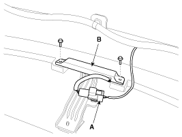

5. Após deslocar as varetas de fixação (2EA), remova a antena do para-choque externo (B).

Buzina

1. Desconecte o terminal negativo (-) da bateria.

2. Remova o fender dianteiro esquerdo.

   (Consulte o grupo BD - "Fender")

3. Desconecte o conectador, depois remova o buzador (A).

   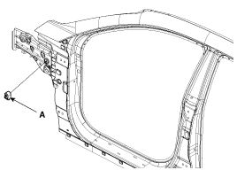

Handle Externo da Porta

1. Desconecte o terminal negativo (-) da bateria.

2. Desconecte o conectador após remover o revestimento da porta.

   (Consulte o grupo BD - "Porta dianteira")

3. Depois de soltar o parafuso de montagem, remova o suporte da chave (A).

   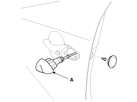

4. Remova o handle externo (A) deslizando-o para trás.

   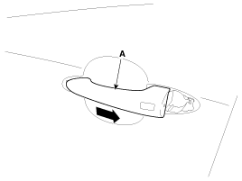

Interruptor do Porta-malas

1. Desconecte o terminal negativo (-) da bateria.

2. Remova o revestimento do porta-malas.

   (Consulte o grupo BD - "Revestimento do porta-malas")

3. Desconecte o conectador do farol do porta-malas e do interruptor do porta-malas (A). Desconecte o conectador da câmera de ré (B).

   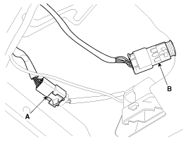

4. Remova as varetas (2EA) e os clips (4EA). Remova o garnish do porta-malas (A).

   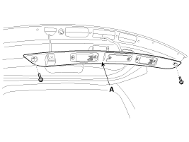

5. Solte o parafuso de montagem do handle externo do porta-malas. Remova o handle externo e o farol do porta-malas (A).

   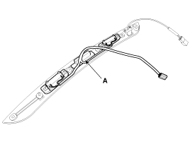

## Inspeção

Unidade de Chave Inteligente

| – | Consulte o grupo BE - Sistema de chave inteligente - inspeção / diagnóstico automático com ferramenta de escaneamento. |
| --- | --- |

Interruptor de Chave Inteligente

| – | Consulte o grupo BE - Sistema de chave inteligente - inspeção / diagnóstico automático com ferramenta de escaneamento. |
| --- | --- |

Antena

| – | Consulte o grupo BE - Sistema de chave inteligente - inspeção / diagnóstico automático com ferramenta de escaneamento. |
| --- | --- |

Interruptor do Porta-malas

1. Verifique a continuidade entre os terminais do interruptor do porta-malas.

   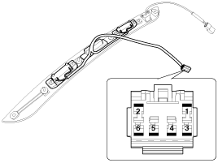

   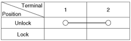

2. Se necessário, substitua o interruptor.

## Instalação

Unidade de Chave Inteligente

1. Instale a unidade de chave inteligente.
2. Instale as parafusos de montagem da unidade de chave inteligente e, em seguida, conecte o conectador.
3. Instale o porta-malas.
4. Instale o terminal negativo (-) da bateria e verifique o sistema de chave inteligente.

Receptor RF

1. Instale o receptor RF.
2. Instale o console do chão.
3. Instale o terminal negativo (-) da bateria e verifique o sistema de chave inteligente.

Antena Interna 1

1. Instale a antena interna 1.
2. Instale o console do chão.
3. Instale o terminal negativo (-) da bateria e verifique o sistema de chave inteligente.

Antena Interna 2

1. Instale a antena interna 2.
2. Instale o capô do console do chão após conectar o conectador.
3. Instale o terminal negativo (-) da bateria e verifique o sistema de chave inteligente.

Antena Interna 3

1. Instale a antena interna 3.
2. Instale a montagem do banco traseiro.
3. Instale o terminal negativo (-) da bateria e verifique o sistema de chave inteligente.

Antena do Para-choque Externo

1. Instale a antena do para-choque externo.
2. Instale o terminal negativo (-) da bateria e verifique o sistema de chave inteligente.

Buzina

1. Instale a buzina.
2. Instale o para-choque dianteiro esquerdo.
3. Instale o terminal negativo (-) da bateria e verifique o sistema de chave inteligente.

Alça da Porta Externa

1. Instale a alça da porta externa.
2. Instale o trim da porta.
3. Instale o terminal negativo (-) da bateria e verifique o sistema de chave inteligente.

Interruptor do Porta-malas

1. Instale o interruptor do porta-malas.
2. Instale o adorno do porta-malas.
3. Instale o trim do porta-malas.
4. Instale o terminal negativo (-) da bateria e verifique o sistema de chave inteligente.
