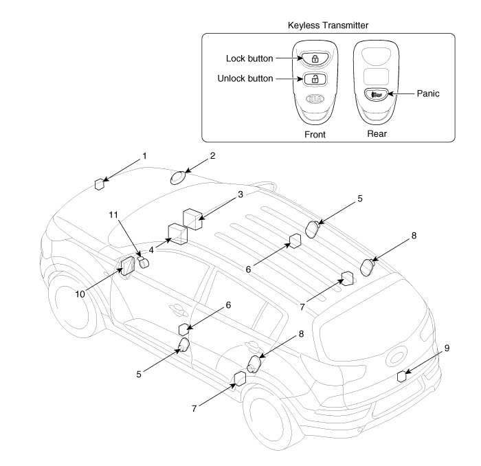
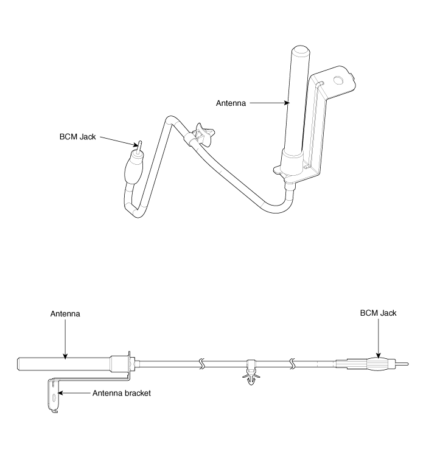

# Kia Sportage: Componentes e Localização dos Componentes

[Home](../../index.md) / [Manual de Serviço e Reparo do Kia Sportage SL](../sportage-482.md) / [Sistema Elétrico do Corpo](sportage-984.md) / [Entrada Sem Chave e Alarme Antifurto](sportage-1032.md) / Componentes e Localização dos Componentes

## Localização dos Componentes (1)

| 1. Interruptor do capô 2. Alarme antifurto 3. Receptor de RKE 4. Módulo de Controle do Corpo (BCM) 5. Interruptor do porta-malas dianteiro 6. Atuador e interruptor do travamento do porta-malas dianteiro | 7. Atuador e interruptor do travamento do porta-malas traseiro 8. Interruptor do porta-malas traseiro 9. Interruptor de liberação do portão traseiro 10. Caixa de Condução Inteligente (SJB) 11. Interruptor de advertência da chave |
| --- | --- |

## Localização dos Componentes (2)

