# Kia Sportage: Descrição e Operação

[Início](../../index.md) / [Manual de Serviço e Reparo do Kia Sportage SL](../sportage-482.md) / [Sistema Elétrico do Corpo](sportage-984.md) / [Entrada Sem Chave e Alarme antifurto](sportage-1032.md) / Descrição e Operação

## Descrição

Sistema de Entrada Sem Chave

A função descrita é um controle remoto por rádio-frequência para o fechamento/abertura central das portas, liberação do porta-malas e atividade de pânico de um veículo automotivo sem o uso de uma chave mecânica.

Este sistema confirma o fechamento/abertura com uma luz de flash ou/ e sinal de buzina.

Esta será uma parte do equipamento dos veículos no caso da variante Non-SMK.

| – | Transmissor com 3 botões (fechamento, abertura e pânico) |
| --- | --- |

| – | O receptor está integrado no BCM. |
| --- | --- |

| – | BCM, unidade de controle onde a decodificação do controle remoto é realizada |
| --- | --- |

Fluxo de Função do Sistema RF

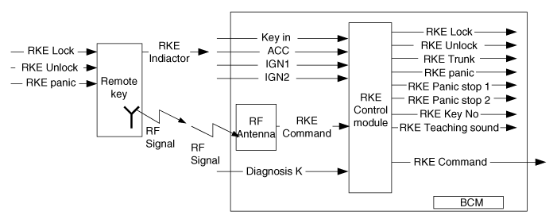

Operação do Botão (Chave)

1. Um novo evento de botão é detectado no estado "botão-off".

2. O tempo de estalos do botão de fechamento/abertura é de 100 ms e do botão do porta-malas é de 1 s, e do botão de pânico é de 500 ms.

3. Se o interruptor do botão for desligado antes de determinar o valor do interruptor do botão (100 ms), a transmissão RF é interrompida.

4. Se mais de dois botões forem pressionados simultaneamente, o mais antigo é rejeitado.

   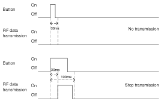

   Diagrama de Transmissão Abnormal do Botão (Chave)

Indicador (LED)

Cada transmissor tem um LED vermelho na parte superior do corpo. Ele indica a atividade de transmissão. O LED piscará o mesmo número de vezes que os dados RF. O primeiro envio de frame válido segue o caso "frame normal".

Caso de frame normal são os frames de fechamento, abertura, pânico e porta-malas. É também um caso válido e o primeiro frame de detecção.

Existe uma exceção a essa regra, o frame de parada de pânico deve ser ignorado para piscar o LED.

Para saber outros casos, consulte o gráfico no capítulo para Entrada de Chave (botão) Validada para Proteção do Ruído de Pânico.

Quando os dados RF são transmitidos, o LED piscará como na figura abaixo.

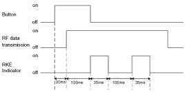

Função do Receptor e BCM

Esta função descreve as seguintes características

| – | Fechamento RKE |
| --- | --- |

| – | Abertura RKE |
| --- | --- |

| – | Pânico RKE |
| --- | --- |

| – | Parada de Pânico RKE1/ Parada de Pânico RKE2 |
| --- | --- |

| – | Ordem de Memória pelo Fechamento RKE |
| --- | --- |

| – | Aprendizado da Chave |
| --- | --- |

| – | Sincronização / Resincronização |
| --- | --- |

Aprendizado da Chave

A aprendizagem da chave é que o BCM identifica a chave remota e a sincronização do código de rolagem entre o BCM e a chave remota

1. Aprendizado da chave com Ferramenta de Diagnóstico GDS

   | • | Os passos de aprendizado da chave se referem à Especificação de Diagnóstico. |
   | --- | --- |

   | Passo | Ação do Usuário | Ação do BCM |
   | --- | --- | --- |
   | 1 | Conecte a Ferramenta de Diagnóstico ao BCM | ? |
   | 2 | Inicie o Modo de Aprendizado RKE na Ferramenta de Diagnóstico | O BCM está pronto para a Aprendizado RKE |
   | 3 | Pressione qualquer botão da chave remota | – O BCM salva o código de identificação e o código de rolagem da chave remota. – Se a aprendizagem da chave remota for bem-sucedida, o BCM toca o buzzer interno uma vez. |
   | – | O BCM salva o código de identificação e o código de rolagem da chave remota. | |
   | – | Se a aprendizagem da chave remota for bem-sucedida, o BCM toca o buzzer interno uma vez. | |

| 4 | Se o usuário desejar ensinar um RKE adicional, entre no modo de ensino adicional RKE do Diag-Tool | Ensino RKE pronto no BCM |
| 5 | Pressione qualquer botão do RKE | – O BCM salva o código ID e o código de rolagem do RKE atual. – Se o ensino RKE for bem-sucedido, o BCM toca o buzzer interno uma vez. |
| – | O BCM salva o código ID e o código de rolagem do RKE atual. | |
| – | Se o ensino RKE for bem-sucedido, o BCM toca o buzzer interno uma vez. | |
| 6 | Se o usuário desejar ensinar um RKE adicional, repita os passos 4 e 5 | É possível ensinar até 4 RKE. |
| 7 | Se o usuário não desejar ensinar RKE, entre no modo de parada de ensino RKE do Diag-Tool | O BCM termina o modo de ensino RKE. |

2. Som de Ensino de Chave

   Somente para informações: (o som de ensino de chave está descrito na especificação da função de alerta)

   | • | Quando o ensino de cada chave terminar, o buzzer magnético será operado uma vez. |
   | --- | --- |

   | • | Características do Som do Buzzer de Ensino de Chave |
   | --- | --- |

   | Tipo | Buzzer Magnético |
   | --- | --- |
   | Frequência do Som do Buzzer de Ensino de Chave : | 800 Hz |
   | Relação de Duração do Sinal do Som do Buzzer de Ensino de Chave : | 50% Duty |
   | Período do Som do Buzzer de Ensino de Chave : | 0,6 seg |
   | Duração do Som do Buzzer de Ensino de Chave : | 0,6 seg |

   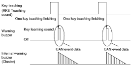

Sistema de Alarme Antirroubo

| • | O Sistema de Alarme Antirroubo é uma função usada para prevenir ou
deter a apropriação não autorizada do veículo. A função de prevenção de
roubo ou alarme antirroubo foi introduzida para afirmar a propriedade
quando o proprietário legítimo estiver fisicamente presente. Para
discouragem de roubos, o alarme antirroubo funciona ao emitir um som
de alto volume (corneta) quando ativado por uma violação da circuito. Este sistema de alarme do veículo está projetado para ser ativado ao abrir interruptores especiais (por exemplo, interruptores de porta, capô, porta-malas abertos). |
| --- | --- |

| • | Este sistema também impede que o carro seja ligado desabilitando o relé do starter se uma intrusão for detectada. |
| --- | --- |

| • | Para indicar que o veículo está protegido contra roubos, um indicador piscante localizado em uma área visível no veículo é fornecido (isto faz parte da ação de prevenção de roubos). O grupo de funções do Sistema de Alarme inclui a função de alarme antirroubo, que oferece funções de proteção contra roubos. |
| --- | --- |

1. Armado por

   | • | Interruptor de fechadura mecânica no porta-malas do lado do motorista se a opção mecânica estiver configurada |
   | --- | --- |

   | • | Com comando de fechadura RKE ou SMK |
   | --- | --- |

   | • | Fechamento de todas as portas e então fechamento de todas as portas se a opção mecânica estiver configurada |
   | --- | --- |

2. Triggers an alarm when

   | • | Qualquer porta aberta |
   | --- | --- |

   | • | Capô aberto |
   | --- | --- |

   | • | Trunk open by unknown event |
   | --- | --- |

3. Desarmado por

   | • | Girando o interruptor de desbloqueio mecânico no porta-malas do lado do motorista se a opção mecânica estiver configurada |
   | --- | --- |

   | • | Com comando de desbloqueio RKE ou SMK |
   | --- | --- |

Fluxo de Dados da Função de Alarme Antirroubo

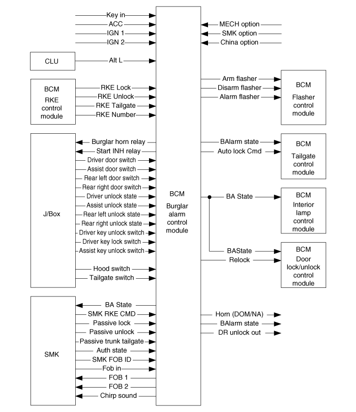

| Função | Características | Nome |  |
| --- | --- | --- | --- |
| Rótulo de Hardware | Designação Específica |  |  |
| Entrada | Lógica | L_ACC | Sinal de Acessório |
| L_IGN2 | Poder da Ignição 2 |  |  |
| L_KeyIn | Sinal de Entrada da Chave |  |  |
| Analógico | A_IGN1 | Poder da Ignição 1 |  |
| Comunicação | C_ASTDRSW | Status do Interruptor de Porta Auxiliar |  |
| C_AltL | Motor em funcionamento |  |  |
| C_ASTUnlockState | Estado de Desbloqueio da Porta Auxiliar |  |  |
| C_DRVDRSW | Status do Interruptor de Porta do Motorista |  |  |
| C_DRVKeyLockSW | Sinal de Bloqueio da Chave do Motorista |  |  |
| C_DRVKeyUnlockSW | Sinal de Desbloqueio da Chave do Motorista |  |  |
| C_ASTKeyUnlockSW | Sinal de Desbloqueio da Cilindro da Chave na Porta Auxiliar |  |  |
| C_DRVUnlockState | Estado de Desbloqueio da Porta do Motorista |  |  |
| C_FobIn | Sinal de Presença da Chave Remota |  |  |
| C_HoodSW | Status do Fechamento do Capô |  |  |
| C_PassiveTrunk_TG | PIC Acesso Passivo ao Tronco / Porta-malas |  |  |
| C_PassiveLock | PIC Bloqueio Passivo para Módulo da Porta |  |  |
| C_PassiveUnlock | PIC Desbloqueio Passivo para Módulo da Porta |  |  |
| C_AuthState | Estado de Autenticação |  |  |
| C_RLDRSW | Status do Interruptor da Porta do Lado Esquerdo Traseiro |  |  |
| C_RLUnlockState | Estado de Desbloqueio da Porta do Lado Esquerdo Traseiro |  |  |
| C_RRDRSW | Status do Interruptor da Porta do Lado Direito Traseiro |  |  |
| C_RRUnlockState | Estado de Desbloqueio da Porta do Lado Direito Traseiro |  |  |
| C_SMK_FOB_ID | ID de Comando RKE ou ID de Acesso Passivo |  |  |
| C_SMKRKECMD | Comando RKE da Chave Remota SMK |  |  |
| C_TGSW | Status do Fechamento do Tronco |  |  |
| Interno | b_RKELock | Comando de Bloqueio RKE: (Variante Não-SMK) |  |
| b_RKETGate | Comando de Abertura do Tronco RKE: (Variante Não-SMK) |  |  |
| b_RKEUnlock | Comando de Desbloqueio RKE: (Variante Não-SMK) |  |  |
| RKENumber | Número de Bloqueio RKE |  |  |
| b_MECHOption | Opção de Bloqueio/Desbloqueio por Chave Mecânica |  |  |
| b_SMKOption | Opção de Chave Inteligente |  |  |
| b_ChinaOption | Opção China |  |  |
| Interno | b_HornAnsCmd | Comando de Saída do Corno por Função Resposta ao Corno (Sinal de Evento) | Após a criação do evento, automaticamente desligado. |  |
| b_RKELockCmd | Comando de Bloqueio RKE (Sinal de Evento) |  |  |
| Saída | Interno | b_BAlarmState | Informação do Estado do Alarme de Roubos (todos os estados indicados) |
| b_AlarmFlasher | Solicitação de Flasher do Alarme |  |  |
| b_ArmFlasher | Solicitação de Flasher de ARM |  |  |
| b_BAState | Informação do Estado do Alarme de Roubos |  |  |
| b_AutoLockCmd | Comando de Bloqueio Automático (Sinal de Evento) |  |  |
| b_DisarmFlasher | Solicitação de Flasher de DISARM |  |  |
| b_Relock | Bloqueio por Bloqueio Automático |  |  |
| Comunicação | C_BAlarmState* | Estado do Alarme de Roubos do BCM |  |
| C_BAState | Estado do Alarme de Roubos (Para: SMK) |  |  |
| C_StartINHRly | Controle do Relé de Inibição do Start (Sem Imobilizador e Sem Opção de Chave Inteligente) |  |  |
| C_BurglarHornRly | Controle do Alarme de Roubos do Corno |  |  |
| C_ChirpSound | Comando de Som de Bloqueio para Unidade da Chave Remota para Buzina Externa |  |  |
| C_FOB1 | ID do FOB1 na origem do mudança de DISARM para ARM |  |  |
| C_FOB2 | ID do FOB2 na origem do mudança de DISARM para ARM |  |  |
| Lógica | O_DRUnlockOUT | Comando de Desbloqueio para Unidade AV |  |

| O_HornRly | Saída do Alarme Antifurto no Área Norte-Americana |  |  |

Função de Controle do Alarme Antifurto

Esta especificação da função descreve os seguintes estados do Controle do Alarme Antifurto

| • | Modo ARM |
| --- | --- |

| • | Modo DESARMADO |
| --- | --- |

| • | Modo ARMWAIT |
| --- | --- |

| • | Modo ALARM |
| --- | --- |

| • | Modo ARMHOLD |
| --- | --- |

| • | Modo AutoLockTimer1 |
| --- | --- |

| • | Modo AutoLockTimer2 |
| --- | --- |

| • | Modo PREARM |
| --- | --- |

| • | Modo REARM |
| --- | --- |

| Número | Pré-condição | Evento | Resultado | Observação |
| --- | --- | --- | --- | --- |
| 1 | Todas as Entradas Fechadas | Qualquer Tipo de Bloqueio | Flash de ARM Buzzer de ARM | Permanecer no Modo ARMWAIT durante 30 segundos e ir para o Modo ARM |
| 2 | Todas as Entradas Fechadas | Qualquer Tipo de Desbloqueio | Flash de DESARMADO Buzzer de DESARMADO | ? |
| 3 | Qualquer Entrada Aberta |  |  |  |
| 4 | Todas as Entradas Fechadas, Após Bloqueio do Trunk ou Capô Aberto | Trunk ou Capô Aberto > Fechado | Flash de ARM | ? |
| 5 | Qualquer Porta Desbloqueada |  |  |  |
| 6 | Qualquer Porta Aberta, Trunk ou Capô Aberto | Desbloqueio RKE | Flash de DESARMADO Buzzer de DESARMADO | ? |
| 7 | MTS, Desbloqueio Passivo | Flash de DESARMADO | ? |  |
| 8 | Modo ARM | Qualquer Entrada Aberta | Flash de ALARM Buzzer de ALARM | ? |

## Descrição da Função

Atividade do Sinal

O Sistema de Alarme Antirroubo fornece a função que inibe o uso do veículo quando uma intrusão no veículo for detectada

1. O Estado do Alarme Antirroubo é gerenciado pela função de Controle do Alarme Antirroubo para SMK, e depende do estado do Controle do Alarme Antirroubo conforme segue:

   | • | Estado do Alarme Antirroubo = 1: O estado do Controle do Alarme Antirroubo está em ARM, ALARM, REARM ou ARMWAIT |
   | --- | --- |

   | • | Estado do Alarme Antirroubo = 0: O estado do Controle do Alarme Antirroubo está em DISARM, AUTOLOCKTIMER1, AUTOLOCKTIMER2, ARMHOLD ou PREARM |
   | --- | --- |

2. Ao enviar o sinal CAN para o estado ARM do tipo a partir do estado DISARM do tipo, o módulo BCM deve enviar os sinais CAN FOB1 e FOB2 definidos em relação ao número de ID da chave memorizado.

   | • | Se o Número da Chave = 1 estiver sendo enviado, FOB1 = 1, caso contrário, FOB1 = 0 |
   | --- | --- |

   | • | Se o Número da Chave = 2 estiver sendo enviado, FOB2 = 1, caso contrário, FOB2 = 0 |
   | --- | --- |

3. Disponibilizar ao outras funções internas do BCM o estado atual do Controle do Alarme Antirroubo

4. O Estado do Alarme Antirroubo é atualizado a cada vez que o estado do Controle do Alarme Antirroubo for alterado.

Atividade de Condição de Energização

Estado pelo Condição de RESET

| Estado Atual | Após RESET | Ação pelo RESET |
| --- | --- | --- |
| DISARM | DISARM | Nenhuma Ação |
| ARMWAIT | ARMWAIT | Nenhuma Ação |
| ARM | ARM | Nenhuma Ação |
| ALARM | ALARM | Alarme Flashando |
| REARM | ALARM | Alarme Flashando |
| PREARM | DISARM | Nenhuma Ação |
| AUTOLOCKTIMER1 | DISARM | Nenhuma Ação |
| AUTOLOCKTIMER2 | DISARM | Nenhuma Ação |
| ARMHOLD | DISARM | Nenhuma Ação |

1. RESET significa reinício da entrada da bateria.

2. Só no estado ALARM ou REARM, quando ocorre o RESET, ocorre o Alarme Flashando.

3. Após o RESET, todos os temporizadores devem ser reiniciados.

## Descrição do Estado

Parâmetro Valor

| Nome | Valor Padrão | Descrição |
| --- | --- | --- |
| Tempo de Alarme | Não NA: 27 seg +0/-2,7 seg | Tempo para Flashing do Alarme de Furtos |
| NA: 101 seg ±1 seg |  |  |
| Tempo de Alarme Único | 27 seg ± 2 seg | Tempo de Ativação Única do Alarme de Furtos |
| Tempo de Pausa do Alarme | 10 seg ± 1 seg | Tempo de Pausa após Ativação Única do Alarme de Furtos |
| Tempo ON | DOM, NA: 0,5 seg ± 0,05 seg | Tempo ON do Pulsador do Alarme de Furtos |
| Outros: 0,45 seg ± 0,045 seg |  |  |
| Tempo OFF | DOM, NA: 1,0 seg ± 0,1 seg | Tempo OFF do Pulsador do Alarme de Furtos |
| Outros: 0,45 seg ± 0,045 seg |  |  |
| AutoLock1Time | 30 seg ±3seg | Tempo para AUTOLOCKTIMER1 ARMAR EM ESPERA |
| AutoLock2Time | 30 seg ±3seg | Tempo para AUTOLOCKTIMER2 PREARMAR |
| AutoLock3Time | 30 seg ±3seg | Tempo para ARMHOLD PREARMAR |
| Tempo de ESPERA para ARMAR | Não China: 30 seg ±3seg | Tempo para ESPERA para ARMAR |
| China: 8 + 0,1 seg |  |  |
| Tempo de Confirmação de Falha do Bloqueio | 5 seg ± 0,5 seg | Tempo máximo para receber o status de bloqueio das portas |
| Tempo de Ignição do Chaveiro | 30 seg ±3seg | Tempo mínimo na posição IGN antes de sair do estado ALARM |
| Tempo de Liberação do Alarme com Alternador | 3 seg ±0,3 seg | Tempo mínimo com o alternador ativo antes de sair do estado ALARM |
| Duração do Som do Desarmamento | 0,1 seg ±10ms | Duração do padrão de som de chirp |

DESARMA

1. DESARMA para DESARMA

   Condição 1

   | Estado | Descrição |
   | --- | --- |
   | Condição Inicial | • ESTADO DESARMA • Estado Chave Fora (Key On = Off) • Qualquer Porta Aberta (All Doors Close = Off) ou Porta Traseira Aberta (TG SWITCH = On) |
   | • | ESTADO DESARMA |
   | • | Estado Chave Fora (Key On = Off) |
   | • | Qualquer Porta Aberta (All Doors Close = Off) ou Porta Traseira Aberta (TG SWITCH = On) |
   | Evento | Desbloqueio por RKE (RKE Unlock command = Off > On) |
   | Ação | • Flashing DESARMA (Disarm Flasher = On) • Ativação do Som DESARMA (Disarm Buzzer = On) • O estado não deve ser alterado |
   | • | Flashing DESARMA (Disarm Flasher = On) |
   | • | Ativação do Som DESARMA (Disarm Buzzer = On) |
   | • | O estado não deve ser alterado |

   Condição 2

   | Estado | Descrição |
   | --- | --- |
   | Condição Inicial | • Qualquer Porta Aberta (All Doors Close = Off) ou Porta Traseira Aberta (TG SWITCH = On) |
   | • | Qualquer Porta Aberta (All Doors Close = Off) ou Porta Traseira Aberta (TG SWITCH = On) |
   | Evento | Desbloqueio
    por SMK (Comando de Desbloqueio Passivo = Off > On) |
   | Ação | • Flashing DESARMA (Disarm Flasher = On) • Ativação do Som DESARMA (Disarm Buzzer = On) • O estado não deve ser alterado |
   | • | Flashing DESARMA (Disarm Flasher = On) |
   | • | Ativação do Som DESARMA (Disarm Buzzer = On) |
   | • | O estado não deve ser alterado |

   Condição 3

   | Estado | Descrição |
   | --- | --- |
   | Condição Inicial | • ESTADO DESARMA |
   | • | ESTADO DESARMA |
   | Evento | Estado Chave Ligada (Key On = On) |
   | Ação | • IND de Segurança Desligado (Security IND = Off) • O estado não deve ser alterado |
   | • | IND de Segurança Desligado (Security IND = Off) |
   | • | O estado não deve ser alterado |

   Condição 4

   | Estado | Descrição |

| --- | --- |
   | Condição Inicial | • ESTADO DESARMADES |
   | • | ESTADO DESARMADES |
   | Evento | Estado de Desligamento (Chave Ligar = Desligada) |
   | Ação | • O INDICADOR DE SEGURANÇA está piscando (INDICADOR DE SEGURANÇA = Piscando; 0,32s:ligado/2s:desligado) • O estado não deve ser alterado |
   | • | O INDICADOR DE SEGURANÇA está piscando (INDICADOR DE SEGURANÇA = Piscando; 0,32s:ligado/2s:desligado) |
   | • | O estado não deve ser alterado |

   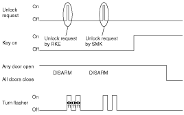

2. DESARMADES para DESARMADES

   Condição 1

   | Estado | Descrição |
   | --- | --- |
   | Condição Inicial | • ESTADO DESARMADES |
   | • | ESTADO DESARMADES |
   | Evento | 1. Chave no interior (Chave no interior = Sim) ou 2. Chave remota no interior (Chave remota no interior = Sim) ou 3. Qualquer porta aberta (Todas as portas fechadas = Não) ou 4. Capô aberto (Capô = Sim) ou 5. Porta-malas aberto (Porta-malas = Sim) ou 6. Qualquer porta desbloqueada (Todas as portas bloqueadas = Não) ou 7. Autenticação pelo SMK (Estado de autenticação = Autenticação) ou 8. Pré-autenticação pelo SMK (Estado de autenticação = Pré-autenticação) |
   | 1. | Chave no interior (Chave no interior = Sim) ou |
   | 2. | Chave remota no interior (Chave remota no interior = Sim) ou |
   | 3. | Qualquer porta aberta (Todas as portas fechadas = Não) ou |
   | 4. | Capô aberto (Capô = Sim) ou |
   | 5. | Porta-malas aberto (Porta-malas = Sim) ou |
   | 6. | Qualquer porta desbloqueada (Todas as portas bloqueadas = Não) ou |
   | 7. | Autenticação pelo SMK (Estado de autenticação = Autenticação) ou |
   | 8. | Pré-autenticação pelo SMK (Estado de autenticação = Pré-autenticação) |
   | Ação | • Cancelar temporizador de espera de armazenamento • O estado deve ir para o estado DESARMADES |
   | • | Cancelar temporizador de espera de armazenamento • O estado deve ir para o estado DESARMADES |

   Condição 2

   | Estado | Descrição |
   | --- | --- |
   | Condição Inicial | • ESTADO DESARMADES • Opção mecânica de armazenamento/desarmazenamento habilitada (Opção Mecânica = Sim) |
   | • | ESTADO DESARMADES |
   | • | Opção mecânica de armazenamento/desarmazenamento habilitada (Opção Mecânica = Sim) |
   | Evento | Desbloqueio por chave mecânica (Chave de motorista desbloqueada = Desligada > Ligada ou Chave assistente desbloqueada = Desligada > Ligada) |
   | Ação | • Cancelar temporizador de espera de armazenamento • O estado deve ir para o estado DESARMADES |
   | • | Cancelar temporizador de espera de armazenamento |
   | • | O estado deve ir para o estado DESARMADES |

   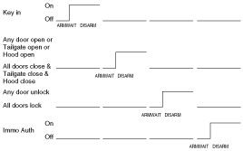

3. ARM para DESARMADES

   Condição 1

   | Estado | Descrição |
   | --- | --- |
   | Condição Inicial | • ESTADO ARMADO |
   | • | ESTADO ARMADO |
   | Evento | 1. Autenticação pelo SMK (Estado de autenticação = Autenticação) ou 2. Pré-autenticação pelo SMK (Estado de autenticação = Pré-autenticação) |
   | 1. | Autenticação pelo SMK (Estado de autenticação = Autenticação) ou |
   | 2. | Pré-autenticação pelo SMK (Estado de autenticação = Pré-autenticação) |
   | Ação | • O estado deve ir para o estado DESARMADES |
   | • | O estado deve ir para o estado DESARMADES |

   Condição 2

   | Estado | Descrição |
   | --- | --- |
   | Condição Inicial | • ESTADO ARMADO • Opção China desabilitada (Opção China = Não) |
   | • | ESTADO ARMADO |
   | • | Opção China desabilitada (Opção China = Não) |
   | Evento | Entrada de chave e ignição 1 e ignição 2 ligadas (Chave ignição ligada = Sim) |
   | Ação | • O estado deve ir para o estado DESARMADES |
   | • | O estado deve ir para o estado DESARMADES |

   Condição 3

   | Estado | Descrição |

| --- | --- |
   | Condição Inicial | • ESTADO DE ARMADURA • Opção de Armadura/Meta-Desarmar com Chave Mecânica está habilitada (Opção MECH = Ativa) |
   | • | ESTADO DE ARMADURA |
   | • | Opção de Armadura/Meta-Desarmar com Chave Mecânica está habilitada (Opção MECH = Ativa) |
   | Evento | Desbloqueio com Chave Mecânica (DRV KeyUnlock Switch = Off > On ou AST KeyUnlock Switch = Off > On) |
   | Ação | • O estado deve passar para o Estado DE META-DESARMAR |
   | • | O estado deve passar para o Estado DE META-DESARMAR |

   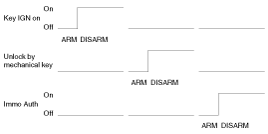

4. AUTO LOCK TIMER1 para META-DESARMAR

   Condição 1

   | Estado | Descrição |
   | --- | --- |
   | Condição Inicial | • ESTADO DE AUTOLOCKTIMER1 |
   | • | ESTADO DE AUTOLOCKTIMER1 |
   | Evento | 1. Entrada de Chave (Key In = On) ou 2. Entrada de Chave-Remoto (Fob In = On) ou 3. Qualquer Porta Aberta (All Doors Close = Off) ou 4. Capô Aberto (Hood switch = On) ou 5. Porta Traseira Aberta (TG SWITCH = On) ou 6. Autenticação pela Chave (Auth State = Authentication) ou 7. Pré-Autenticação pela Chave (Auth State = Preauthentication) ou 8. Solicitação de Bloqueio pelo Chave-Remoto/Chave ou Auto-Bloqueio, mas bloqueio falhou (Lock Confirm Fail = Off > On) |
   | 1. | Entrada de Chave (Key In = On) ou |
   | 2. | Entrada de Chave-Remoto (Fob In = On) ou |
   | 3. | Qualquer Porta Aberta (All Doors Close = Off) ou |
   | 4. | Capô Aberto (Hood switch = On) ou |
   | 5. | Porta Traseira Aberta (TG SWITCH = On) ou |
   | 6. | Autenticação pela Chave (Auth State = Authentication) ou |
   | 7. | Pré-Autenticação pela Chave (Auth State = Preauthentication) ou |
   | 8. | Solicitação de Bloqueio pelo Chave-Remoto/Chave ou Auto-Bloqueio, mas bloqueio falhou (Lock Confirm Fail = Off > On) |
   | Ação | • Cancelar AUTOLOCK1Timer • O estado deve passar para o Estado DE META-DESARMAR |
   | • | Cancelar AUTOLOCK1Timer |
   | • | O estado deve passar para o Estado DE META-DESARMAR |

   Condição 2

   | Estado | Descrição |
   | --- | --- |
   | Condição Inicial | • ESTADO DE AUTOLOCKTIMER1 • Opção de Armadura/Meta-Desarmar com Chave Mecânica está habilitada (Opção MECH = Ativa) |
   | • | ESTADO DE AUTOLOCKTIMER1 |
   | • | Opção de Armadura/Meta-Desarmar com Chave Mecânica está habilitada (Opção MECH = Ativa) |
   | Evento | Solicitação de Bloqueio pela Chave Mecânica, mas bloqueio falhou (Lock Confirm Fail = Off > On) |
   | Ação | • Cancelar AUTOLOCK1Timer • O estado deve passar para o Estado DE META-DESARMAR |
   | • | Cancelar AUTOLOCK1Timer |
   | • | O estado deve passar para o Estado DE META-DESARMAR |

5. AUTO LOCK TIMER2 para META-DESARMAR

   Condição 1

   | Estado | Descrição |
   | --- | --- |
   | Condição Inicial | • ESTADO DE AUTOLOCKTIMER2 |
   | • | ESTADO DE AUTOLOCKTIMER2 |
   | Evento | 1. Entrada de Chave (Key In = On) ou 2. Entrada de Chave-Remoto (Fob In = On) ou 3. Qualquer Porta Aberta (All Doors Close = Off) ou 4. Porta Traseira Aberta (TG SWITCH = On) ou 5. Autenticação pela Chave (Auth State = Authentication) ou 6. Pré-Autenticação pela Chave (Auth State = Preauthentication) ou 7. Solicitação de Bloqueio pelo Chave-Remoto/Chave ou Auto-Bloqueio, mas bloqueio falhou (Lock Confirm Fail = Off > On) |
   | 1. | Entrada de Chave (Key In = On) ou |
   | 2. | Entrada de Chave-Remoto (Fob In = On) ou |
   | 3. | Qualquer Porta Aberta (All Doors Close = Off) ou |
   | 4. | Porta Traseira Aberta (TG SWITCH = On) ou |
   | 5. | Autenticação pela Chave (Auth State = Authentication) ou |
   | 6. | Pré-Autenticação pela Chave (Auth State = Preauthentication) ou |

| 7. | Solicitação de bloqueio por RKE/SMK/Auto Lock, mas bloqueio falhou (Lock Confirm Fail = Off > On) |
   | Ação | • Cancelar AutoLock2Timer • Estado deve ir para o Estado DISARM |
   | • | Cancelar AutoLock2Timer |
   | • | Estado deve ir para o Estado DISARM |

   Condição 2

   | Estado | Descrição |
   | --- | --- |
   | Condição Inicial | • AUTOLOCKTIMER2 STATE • Opção de chave mecânica ARM/DISARM habilitada (MECH Option = On) |
   | • | AUTOLOCKTIMER2 STATE |
   | • | Opção de chave mecânica ARM/DISARM habilitada (MECH Option = On) |
   | Evento | Solicitação de bloqueio pela chave mecânica, mas bloqueio falhou (Lock Confirm Fail = Off > On) |
   | Ação | • Cancelar AutoLock2Timer • Estado deve ir para o Estado DISARM |
   | • | Cancelar AutoLock2Timer |
   | • | Estado deve ir para o Estado DISARM |

6. ARMHOLD para DISARM

   Condição 1

   | Estado | Descrição |
   | --- | --- |
   | Condição Inicial | • ARMHOLD STATE |
   | • | ARMHOLD STATE |
   | Evento | 1. Entrada de chave (Key In = On) ou 2. Entrada de chaves removíveis (Fob In = On) ou 3. Qualquer porta aberta (All Doors Close = Off) ou 4. Capô aberto (Hood switch = On) ou 5. Autenticação por SMK (Auth State = Authentication) ou 6. Pré-autenticação por SMK (Auth State = Preauthentication) ou 7. Solicitação de bloqueio por RKE/SMK/Auto Lock, mas bloqueio falhou (Lock Confirm Fail = Off > On) |
   | 1. | Entrada de chave (Key In = On) ou |
   | 2. | Entrada de chaves removíveis (Fob In = On) ou |
   | 3. | Qualquer porta aberta (All Doors Close = Off) ou |
   | 4. | Capô aberto (Hood switch = On) ou |
   | 5. | Autenticação por SMK (Auth State = Authentication) ou |
   | 6. | Pré-autenticação por SMK (Auth State = Preauthentication) ou |
   | 7. | Solicitação de bloqueio por RKE/SMK/Auto Lock, mas bloqueio falhou (Lock Confirm Fail = Off > On) |
   | Ação | • Cancelar timer de ArmHold • Estado deve ir para o Estado DISARM |
   | • | Cancelar timer de ArmHold |
   | • | Estado deve ir para o Estado DISARM |

   Condição 2

   | Estado | Descrição |
   | --- | --- |
   | Condição Inicial | • ARMHOLD STATE • Opção de chave mecânica ARM/DISARM habilitada (MECH Option = On) |
   | • | ARMHOLD STATE |
   | • | Opção de chave mecânica ARM/DISARM habilitada (MECH Option = On) |
   | Evento | 1. Desbloqueio pela chave mecânica (DRV Key Unlock Switch = Off > On ou AST Key Unlock Switch = Off > On) ou 2. Solicitação de bloqueio pela chave mecânica, mas bloqueio falhou (Lock Confirm Fail = Off > On) |
   | 1. | Desbloqueio pela chave mecânica (DRV Key Unlock Switch = Off > On ou AST Key Unlock Switch = Off > On) ou |
   | 2. | Solicitação de bloqueio pela chave mecânica, mas bloqueio falhou (Lock Confirm Fail = Off > On) |
   | Ação | • Cancelar timer de ArmHold • Estado deve ir para o Estado DISARM |
   | • | Cancelar timer de ArmHold |
   | • | Estado deve ir para o Estado DISARM |

   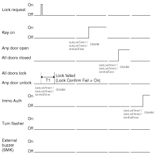

   T1 : Tempo de confirmação de bloqueio falho

7. PREARM para DISARM

   Condição 1

   | Estado | Descrição |
   | --- | --- |
   | Condição Inicial | • PREARM STATE |
   | • | PREARM STATE |

| Evento | 1. Chave In On (Key In = On) ou 2. Fob In (Fob In = On) ou 3. Autenticar pelo SMK (Auth State = Authentication) ou 4. Pré-autenticar pelo SMK (Auth State = Preauthentication) ou 5. Todas as Portas Fechadas (All Doors Close = On) e Capô Fechado (Hood switch = Off) e Porta Traseira Fechada (TG SWITCH = Off) e Qualquer Porta Desbloqueada (All Doors Lock = Off) |
   | 1. | Chave In On (Key In = On) ou |
   | 2. | Fob In (Fob In = On) ou |
   | 3. | Autenticar pelo SMK (Auth State = Authentication) ou |
   | 4. | Pré-autenticar pelo SMK (Auth State = Preauthentication) ou |
   | 5. | Todas as Portas Fechadas (All Doors Close = On) e Capô Fechado (Hood switch = Off) e Porta Traseira Fechada (TG SWITCH = Off) e Qualquer Porta Desbloqueada (All Doors Lock = Off) |
   | Ação | • Estado deve ir para o Estado DISARM |
   | • | Estado deve ir para o Estado DISARM |

   Condição 2

   | Estado | Descrição |
   | --- | --- |
   | Condição Inicial | • PREARM STATE • Opção de chave mecânica ARM/DISARM ativada (MECH Option = On) |
   | • | PREARM STATE |
   | • | Opção de chave mecânica ARM/DISARM ativada (MECH Option = On) |
   | Evento | 1. Desbloquear com chave mecânica (DRV Key Unlock Switch = Off > On ou AST Key Unlock Switch = Off > On) |
   | 1. | Desbloquear com chave mecânica (DRV Key Unlock Switch = Off > On ou AST Key Unlock Switch = Off > On) |
   | Ação | • Estado deve ir para o Estado DISARM |
   | • | Estado deve ir para o Estado DISARM |

   Condição 3

   | Estado | Descrição |
   | --- | --- |
   | Condição Inicial | • PREARM STATE • Qualquer Porta Aberta (All Doors Close = Off) ou Porta Traseira Aberta (TG SWITCH = On) |
   | • | PREARM STATE |
   | • | Qualquer Porta Aberta (All Doors Close = Off) ou Porta Traseira Aberta (TG SWITCH = On) |
   | Evento | 1. Desbloquear com RKE (RKE Unlock command = Off > On) ou 2. Desbloquear pelo SMK (Passive Unlock command = Off > On) |
   | 1. | Desbloquear com RKE (RKE Unlock command = Off > On) ou |
   | 2. | Desbloquear pelo SMK (Passive Unlock command = Off > On) |
   | Ação | • Flashing de Desarmamento (Disarm Flasher = On) • Ativação do Som de Desarmamento (Disarm Buzzer = On) • Estado deve ir para o Estado DISARM |
   | • | Flashing de Desarmamento (Disarm Flasher = On) |
   | • | Ativação do Som de Desarmamento (Disarm Buzzer = On) |
   | • | Estado deve ir para o Estado DISARM |

8. REARM para DISARM

   Condição 1

   | Estado | Descrição |
   | --- | --- |
   | Condição Inicial | • REARM STATE |
   | • | REARM STATE |
   | Evento | 1. Liberar a porta traseira com RKE (RKE TGate command = Off > On) ou 2. Liberar a porta traseira pelo SMK (Passive Trunk_TG = Off > On) ou 3. Bloquear com RKE/SMK mas bloqueio falhou (Lock Confirm Fail = Off > On) ou 4. Nível de alternador acima de 3 segundos (ALTL Alarm Release Timer ? ALTL AlarmReleaseTime) ou 5. Autenticar pelo SMK (Auth State = Authentication) ou 6. Pré-autenticar pelo SMK (Auth State = Preauthentication) |
   | 1. | Liberar a porta traseira com RKE (RKE TGate command = Off > On) ou |
   | 2. | Liberar a porta traseira pelo SMK (Passive Trunk_TG = Off > On) ou |

| 3. | Bloqueio por RKE/SMK mas Falha no Bloqueio (Falha no Confirmação do Bloqueio = Off > On) ou |
   | 4. | Nível de Atividade do Alternador acima de 3s (ALTL Alarm Release Timer ? ALTL AlarmReleaseTime) ou |
   | 5. | Autenticação por SMK (Estado de Autenticação = Autenticação) ou |
   | 6. | Pré-Autenticação por SMK (Estado de Autenticação = Pré-Autenticação) |
   | Ação | • Cancelar Timer do Ignition da Chave • Cancelar Timer de Liberação do ALTL • Estado de Inibição do Start do Motor é liberado (Relay Start INH = Off) • Estado deve ir para o Estado DISARM |
   | • | Cancelar Timer do Ignition da Chave • Cancelar Timer de Liberação do ALTL |
   | • | Estado de Inibição do Start do Motor é liberado (Relay Start INH = Off) |
   | • | Estado deve ir para o Estado DISARM |

   Condição 2

   | Estado | Descrição |
   | --- | --- |
   | Estado Inicial | • REARM STATE em Opção Não China (Opção China = Off) |
   | • | REARM STATE em Opção Não China (Opção China = Off) |
   | Evento | Ignição da Chave On e IGN1 On e IGN2 On por mais de 30s (Timer do Ignition da Chave ? Tempo do Ignition da Chave) |
   | Ação | • Cancelar Timer do Ignition da Chave • Cancelar Timer de Liberação do ALTL • Estado de Inibição do Start do Motor é liberado (Relay Start INH = Off) • Estado deve ir para o Estado DISARM |
   | • | Cancelar Timer do Ignition da Chave |
   | • | Cancelar Timer de Liberação do ALTL |
   | • | Estado de Inibição do Start do Motor é liberado (Relay Start INH = Off) |
   | • | Estado deve ir para o Estado DISARM |

   Condição 3

   | Estado | Descrição |
   | --- | --- |
   | Estado Inicial | • REARM STATE • Opção Mecânica de ARM/DESARM da Chave Mecânica está habilitada (Opção MEC = On) |
   | • | REARM STATE |
   | • | Opção Mecânica de ARM/DESARM da Chave Mecânica está habilitada (Opção MEC = On) |
   | Evento | 1. Desbloqueio por Chave Mecânica (DRV Key Unlock Switch = Off > On ou AST Key Unlock Switch = Off > On) ou 2. Bloqueio por Chave Mecânica mas Falha no Bloqueio (Falha no Confirmação do Bloqueio = Off > On) |
   | 1. | Desbloqueio por Chave Mecânica (DRV Key Unlock Switch = Off > On ou AST Key Unlock Switch = Off > On) ou |
   | 2. | Bloqueio por Chave Mecânica mas Falha no Bloqueio (Falha no Confirmação do Bloqueio = Off > On) |
   | Ação | • Cancelar Timer do Ignition da Chave • Cancelar Timer de Liberação do ALTL • Estado de Inibição do Start do Motor é liberado (Relay Start INH = Off) • Estado deve ir para o Estado DISARM |
   | • | Cancelar Timer do Ignition da Chave |
   | • | Cancelar Timer de Liberação do ALTL |
   | • | Estado de Inibição do Start do Motor é liberado (Relay Start INH = Off) |
   | • | Estado deve ir para o Estado DISARM |

9. ALARM para DISARM

   Condição 1

   | Estado | Descrição |
   | --- | --- |
   | Estado Inicial | • Estado de ALARM |
   | • | Estado de ALARM |
   | Evento | 1. Liberação do Porta-malas por RKE (Comando RKE do Porta-malas = Off > On) ou 2. Liberação do Porta-malas por SMK (Passivo Trunk_TG = Off > On) ou 3. Bloqueio por RKE/SMK mas Falha no Bloqueio (Falha no Confirmação do Bloqueio = Off > On) ou 4. Nível de Inatividade do Alternador acima de 3s (ALTL Alarm Release Timer ? ALTL AlarmReleaseTime) ou 5. Autenticação por SMK (Estado de Autenticação = Autenticação) ou 6. Pré-Autenticação por SMK (Estado de Autenticação = Pré-Autenticação) |

| 1. | Liberar porta traseira por RKE (RKE Tail Gate command= Off > On) ou |
   | 2. | Liberar porta traseira por SMK (Passive Trunk_TG = Off > On) ou |
   | 3. | Bloquear por RKE/SMK mas Bloqueio Falhou (Lock Confirm Fail = Off > On) ou |
   | 4. | Nível do alternador inativo por mais de 3s (ALTL Alarm Release Timer ? ALTL AlarmReleaseTime) ou |
   | 5. | Autenticar por SMK (Auth State = Authentication) ou |
   | 6. | Pré-autenticar por SMK (Auth State = Preauthentication) |
   | Ação | • Cancelar temporizador de alarme • Cancelar temporizador de ignição da chave • Cancelar temporizador de liberação de alarme ALTL • Parar piscada do alarme (Alarm Flasher = Off) • Parar buzina do alarme antirroubo (Burglar Horn Relay = Off / Horn Relay = OFF) • Estado de inibição do start do motor é liberado (Start INH Relay = Off) • Estado deve ir para o estado DESARMA |
   | • | Cancelar temporizador de alarme |
   | • | Cancelar temporizador de ignição da chave |
   | • | Cancelar temporizador de liberação de alarme ALTL |
   | • | Parar piscada do alarme (Alarm Flasher = Off) |
   | • | Parar buzina do alarme antirroubo (Burglar Horn Relay = Off / Horn Relay = OFF) |
   | • | Estado de inibição do start do motor é liberado (Start INH Relay = Off) |
   | • | Estado deve ir para o estado DESARMA |

   Condição 2

   | Estado | Descrição |
   | --- | --- |
   | Condição Inicial | • ESTADO DE ALARME em Opção Não Chinês (China Option = Off) |
   | • | ESTADO DE ALARME em Opção Não Chinês (China Option = Off) |
   | Evento | Entrada da chave no ON e IGN1 no ON e IGN2 no ON por mais de 30s (Key IGN Timer ? Key IGN Time) |
   | Ação | • Cancelar temporizador de alarme • Cancelar temporizador de ignição da chave • Cancelar temporizador de liberação de alarme ALTL • Parar piscada do alarme (Alarm Flasher = Off) • Parar buzina do alarme antirroubo (Burglar Horn Relay = Off / Horn Relay = OFF) • Estado de inibição do start do motor é liberado (Start INH Relay = Off) • Estado deve ir para o estado DESARMA |
   | • | Cancelar temporizador de alarme |
   | • | Cancelar temporizador de ignição da chave |
   | • | Cancelar temporizador de liberação de alarme ALTL |
   | • | Parar piscada do alarme (Alarm Flasher = Off) |
   | • | Parar buzina do alarme antirroubo (Burglar Horn Relay = Off / Horn Relay = OFF) |
   | • | Estado de inibição do start do motor é liberado (Start INH Relay = Off) |
   | • | Estado deve ir para o estado DESARMA |

   Condição 3

   | Estado | Descrição |
   | --- | --- |
   | Condição Inicial | • ESTADO DE ALARME • Opção de chave mecânica ARM/DISARM habilitada (MECH Option = On) |
   | • | ESTADO DE ALARME |
   | • | Opção de chave mecânica ARM/DISARM habilitada (MECH Option = On) |
   | Evento | 1. Desbloquear com chave mecânica (DRV Key Unlock Switch = Off > On ou AST Key Unlock Switch = Off > On) ou 2. Bloquear com chave mecânica mas Bloqueio Falhou (Lock Confirm Fail = Off > On) |
   | 1. | Desbloquear com chave mecânica (DRV Key Unlock Switch = Off > On ou AST Key Unlock Switch = Off > On) ou |
   | 2. | Bloquear com chave mecânica mas Bloqueio Falhou (Lock Confirm Fail = Off > On) |

| Ação | • Cancelar Timer de Alarme • Cancelar Timer de Ignição da Chave • Cancelar Timer de Liberação de Alarme ALTL • Parar o piscar do alarme (Alarm Flasher = Off) • Parar o Som do Alarme de Furto (Relay de Som do Alarme de Furto = Off / Relay do Som do Alarmo = OFF) • Estado de Inibição do Motor de Startagem é Liberado (Relay de Inibição de Startagem = Off) • Estado deve ir para o Estado DISARM |
   | • | Cancelar Timer de Alarme |
   | • | Cancelar Timer de Ignição da Chave |
   | • | Cancelar Timer de Liberação de Alarme ALTL |
   | • | Parar o piscar do alarme (Alarm Flasher = Off) |
   | • | Parar o Som do Alarme de Furto (Relay de Som do Alarme de Furto = Off / Relay do Som do Alarmo = OFF) |
   | • | Estado de Inibição do Motor de Startagem é Liberado (Relay de Inibição de Startagem = Off) |
   | • | Estado deve ir para o Estado DISARM |

   Condição 4

   | Estado | Descrição |
   | --- | --- |
   | Condição Inicial | • ESTADO DE ALARME • Qualquer Porta Aberta (All Doors Close = Off) ou Garrafa Aberta (TG SWITCH = On) |
   | • | ESTADO DE ALARME |
   | • | Qualquer Porta Aberta (All Doors Close = Off) ou Garrafa Aberta (TG SWITCH = On) |
   | Evento | 1. Desbloqueio por RKE (RKE Unlock command = Off > On) ou 2. Desbloqueio por SMK (Passive Unlock command = Off > On) |
   | 1. | Desbloqueio por RKE (RKE Unlock command = Off > On) ou |
   | 2. | Desbloqueio por SMK (Passive Unlock command = Off > On) |
   | Ação | • Cancelar Timer de Alarme • Cancelar Timer de Ignição da Chave • Cancelar Timer de Liberação de Alarme ALTL • Parar o piscar do alarme (Alarm Flasher = Off) • Parar o Som do Alarme de Furto (Relay de Som do Alarme de Furto = Off / Relay do Som do Alarmo = Off) • Ativação do Piscar de Desarmamento (Disarm Flasher = On) • Ativação do Som do Desarmamento (Disarm Buzzer = On) • Estado de Inibição do Motor de Startagem é Liberado (Relay de Inibição de Startagem = Off) • Estado deve ir para o Estado DISARM |
   | • | Cancelar Timer de Alarme |
   | • | Cancelar Timer de Ignição da Chave |
   | • | Cancelar Timer de Liberação de Alarme ALTL |
   | • | Parar o piscar do alarme (Alarm Flasher = Off) |
   | • | Parar o Som do Alarme de Furto (Relay de Som do Alarme de Furto = Off / Relay do Som do Alarmo = Off) |
   | • | Ativação do Piscar de Desarmamento (Disarm Flasher = On) |
   | • | Ativação do Som do Desarmamento (Disarm Buzzer = On) |
   | • | Estado de Inibição do Motor de Startagem é Liberado (Relay de Inibição de Startagem = Off) |
   | • | Estado deve ir para o Estado DISARM |

   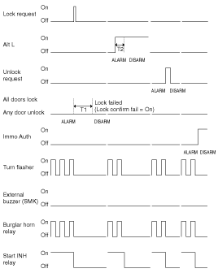

   T1 : Tempo de Confirmação de Falha de Bloqueio,

   T2 : Tempo de Liberação de Alarme ALTL

ARM WAIT

1. DISARM para ARMWAIT

   Condição 1

   | Estado | Descrição |
   | --- | --- |
   | Condição Inicial | • ESTADO DE DESARMAMENTO • Estado de Chave fora (Key On = Off) • Todas as Portas Fechadas (All Doors Close = On) • Capô Fechado (Hood switch = Off) • Garrafa Fechada (TG SWITCH = Off) |
   | • | ESTADO DE DESARMAMENTO |
   | • | Estado de Chave fora (Key On = Off) |
   | • | Todas as Portas Fechadas (All Doors Close = On) |
   | • | Capô Fechado (Hood switch = Off) |
   | • | Garrafa Fechada (TG SWITCH = Off) |
   | Evento | 1. Bloqueio por RKE e Bloqueio é bem-sucedido (RKE Lock Confirm Success = Off > On) ou 2. Bloqueio por SMK e Bloqueio é bem-sucedido (Passive Lock Confirm Success = Off > On) |
   | 1. | Bloqueio por RKE e Bloqueio é bem-sucedido (RKE Lock Confirm Success = Off > On) ou |

| 2. | Bloqueio por SMK e Bloqueio com Sucesso (Confirmação de Bloqueio do SMK = Off > On) |
   | Ação | • Flashagem ARM (Flashador ARM = On) • Ativação do Buzina ARM (Buzina ARM = On) • Início do Timer de Espera para ARM • O estado deve ir para o estado ARMWAIT |
   | • | Flashagem ARM (Flashador ARM = On) |
   | • | Ativação do Buzina ARM (Buzina ARM = On) |
   | • | Início do Timer de Espera para ARM |
   | • | O estado deve ir para o estado ARMWAIT |

   Condição 2

   | Estado | Descrição |
   | --- | --- |
   | Condição Inicial | • ESTADO DESARMADO • Estado de Chave fora (Key On = Off) • Todas as Portas Fechadas (All Doors Close = On) • Capô Fechado (Hood switch = Off) • Porta Traseira Fechada (TG SWITCH = Off) • Opção de ARM/DESARMA com Chave Mecânica habilitada (MECH Option = On) |
   | • | ESTADO DESARMADO |
   | • | Estado de Chave fora (Key On = Off) |
   | • | Todas as Portas Fechadas (All Doors Close = On) |
   | • | Capô Fechado (Hood switch = Off) |
   | • | Porta Traseira Fechada (TG SWITCH = Off) |
   | • | Opção de ARM/DESARMA com Chave Mecânica habilitada (MECH Option = On) |
   | Evento | Bloqueio por Chave Mecânica e Bloqueio com Sucesso (Confirmação de Bloqueio da Chave Mecânica = Off > On) |
   | Ação | • Início do Timer de Espera para ARM • O estado deve ir para o estado ARMWAIT |
   | • | Início do Timer de Espera para ARM |
   | • | O estado deve ir para o estado ARMWAIT |

   Condição 3

   | Estado | Descrição |
   | --- | --- |
   | Condição Inicial | • ESTADO DESARMADO • Estado de Chave fora (Key On = Off) • Todas as Portas Bloqueadas (All Doors Lock = On) • Qualquer Porta Aberta (All Doors Close = Off) • Capô Fechado (Hood switch = Off) • Porta Traseira Fechada (TG SWITCH = Off) • Opção de ARM/DESARMA com Chave Mecânica habilitada (MECH Option = On) |
   | • | ESTADO DESARMADO |
   | • | Estado de Chave fora (Key On = Off) |
   | • | Todas as Portas Bloqueadas (All Doors Lock = On) |
   | • | Qualquer Porta Aberta (All Doors Close = Off) |
   | • | Capô Fechado (Hood switch = Off) |
   | • | Porta Traseira Fechada (TG SWITCH = Off) |
   | • | Opção de ARM/DESARMA com Chave Mecânica habilitada (MECH Option = On) |
   | Evento | Todas as Portas Fechadas (All Doors Close = Off > On) |
   | Ação | • Início do Timer de Espera para ARM • O estado deve ir para o estado ARMWAIT |
   | • | Início do Timer de Espera para ARM |
   | • | O estado deve ir para o estado ARMWAIT |

   Condição 4

   | Estado | Descrição |
   | --- | --- |
   | Condição Inicial | • ESTADO DESARMADO • Estado de Chave fora (Key On = Off) • Todas as Portas Bloqueadas (All Doors Lock = On) • Todas as Portas Fechadas (All Doors Close = On) • Capô Fechado (Hood switch = Off) • Porta Traseira Aberta (TG SWITCH = On) • Opção de ARM/DESARMA com Chave Mecânica habilitada (MECH Option = On) |
   | • | ESTADO DESARMADO |
   | • | Estado de Chave fora (Key On = Off) |
   | • | Todas as Portas Bloqueadas (All Doors Lock = On) |
   | • | Todas as Portas Fechadas (All Doors Close = On) |
   | • | Capô Fechado (Hood switch = Off) |
   | • | Porta Traseira Aberta (TG SWITCH = On) |
   | • | Opção de ARM/DESARMA com Chave Mecânica habilitada (MECH Option = On) |
   | Evento | Porta Traseira Fechada (TG SWITCH = On > Off) |
   | Ação | • Início do Timer de Espera para ARM • O estado deve ir para o estado ARMWAIT |
   | • | Início do Timer de Espera para ARM |
   | • | O estado deve ir para o estado ARMWAIT |

Translate this Markdown chunk (16/33) para o português brasileiro.

   | • | O estado deve ir para o estado ARMWAIT |

2. ARMWAIT para ARMWAIT

   Condição 1

   | Estado | Descrição |
   | --- | --- |
   | Condição Inicial | • qualquer estado |
   | • | qualquer estado |
   | Evento | entrar no estado ARMWAIT |
   | Ação | • O indicador de segurança (Security IND = On) está ligado • O estado não deve ser alterado |
   | • | O indicador de segurança (Security IND = On) está ligado |
   | • | O estado não deve ser alterado |

   Condição 2

   | Estado | Descrição |
   | --- | --- |
   | Condição Inicial | • estado ARMWAIT |
   | • | estado ARMWAIT |
   | Evento | 1. Bloqueio por RKE e bloqueio bem-sucedido (RKE Lock Confirm Success = Off > On) ou 2. Bloqueio por SMK e bloqueio bem-sucedido (Passive Lock Confirm Success = Off > On) |
   | 1. | Bloqueio por RKE e bloqueio bem-sucedido (RKE Lock Confirm Success = Off > On) ou |
   | 2. | Bloqueio por SMK e bloqueio bem-sucedido (Passivo Lock Confirm Success = Off > On) |
   | Ação | • Flashing de ARM (Arm Flasher = On) • Ativação do buzzer de ARM (Arm Buzzer = On) • O estado não deve ser alterado |
   | • | Flashing de ARM (Arm Flasher = On) |
   | • | Ativação do buzzer de ARM (Arm Buzzer = On) |
   | • | O estado não deve ser alterado |

3. AUTO LOCK TIMER1 para ARMWAIT

   Condição 1

   | Estado | Descrição |
   | --- | --- |
   | Condição Inicial | • estado AUTOLOCKTIMER1 • estado de chave fora (Key On = Off) • todas as portas fechadas (All Doors Close = On) • capô fechado (Hood switch = Off) • porta-mala fechado (TG SWITCH = Off) |
   | • | estado AUTOLOCKTIMER1 |
   | • | estado de chave fora (Key On = Off) |
   | • | todas as portas fechadas (All Doors Close = On) |
   | • | capô fechado (Hood switch = Off) |
   | • | porta-mala fechado (TG SWITCH = Off) |
   | Evento | 1. Bloqueio por RKE e bloqueio bem-sucedido (RKE Lock Confirm Success = Off > On) ou 2. Bloqueio por SMK e bloqueio bem-sucedido (Passive Lock Confirm Success = Off > On) |
   | 1. | Bloqueio por RKE e bloqueio bem-sucedido (RKE Lock Confirm Success = Off > On) ou |
   | 2. | Bloqueio por SMK e bloqueio bem-sucedido (Passivo Lock Confirm Success = Off > On) |
   | Ação | • Cancelar AutoLock1Timer • Flashing de ARM (Arm Flasher = On) • Ativação do buzzer de ARM (Arm Buzzer = On) • Iniciar temporizador de espera ARM • O indicador de segurança (Security IND = On) está ligado • O estado deve ir para o estado ARMWAIT |
   | • | Cancelar AutoLock1Timer |
   | • | Flashing de ARM (Arm Flasher = On) |
   | • | Ativação do buzzer de ARM (Arm Buzzer = On) |
   | • | Iniciar temporizador de espera ARM |
   | • | O indicador de segurança (Security IND = On) está ligado |
   | • | O estado deve ir para o estado ARMWAIT |

   Condição 2

   | Estado | Descrição |
   | --- | --- |
   | Condição Inicial | • estado AUTOLOCKTIMER1 • estado de chave fora (Key On = Off) • todas as portas fechadas (All Doors Close = On) • capô fechado (Hood switch = Off) • porta-mala fechado (TG SWITCH = Off) • opção de armazenamento mecânico ARM/DISARM ativada (MECH Option = On) |
   | • | estado AUTOLOCKTIMER1 |
   | • | estado de chave fora (Key On = Off) |
   | • | todas as portas fechadas (All Doors Close = On) |
   | • | capô fechado (Hood switch = Off) |
   | • | porta-mala fechado (TG SWITCH = Off) |

| • | A opção MECÂNICA DE ARMAMENTO/DESARMAMENTO está habilitada (MECH Option = On) |
   | Evento | Bloqueio por Chave Mecânica e Bloqueio foi sucesso (Confirmação de Bloqueio pela Chave Mecânica = Off > On) |
   | Ação | • Cancelar AutoLock1Timer • Iniciar Timer de Espera para Armamento • IND de Segurança está Ativado (Security IND = On) • Estado deve ir para o Estado ARMWAIT |
   | • | Cancelar AutoLock1Timer |
   | • | Iniciar Timer de Espera para Armamento |
   | • | IND de Segurança está Ativado (Security IND = On) |
   | • | Estado deve ir para o Estado ARMWAIT |

   Condição 3

   | Estado | Descrição |
   | --- | --- |
   | Condição Inicial | • AUTOLOCKTIMER1 STATE • Estado com Chave Fora (Key On = Off) • Todas as Portas Fechadas (All Doors Close = On) • Capô Fechado (Hood switch = Off) • Garrafa de Trás Fechada (TG SWITCH = Off) |
   | • | AUTOLOCKTIMER1 STATE |
   | • | Estado com Chave Fora (Key On = Off) |
   | • | Todas as Portas Fechadas (All Doors Close = On) |
   | • | Capô Fechado (Hood switch = Off) |
   | • | Garrafa de Trás Fechada (TG SWITCH = Off) |
   | Evento | • Bloqueio por Auto-Lock (AutoLock1Timer ? AutoLock1Time) e Bloqueio foi sucesso (AutoLockConfirmSuccess = Off > On) |
   | • | Bloqueio por Auto-Lock (AutoLock1Timer ? AutoLock1Time) e Bloqueio foi sucesso (AutoLockConfirmSuccess = Off > On) |
   | Ação | • Cancelar AutoLock1Timer • Flash de Armamento (Arm Flasher = On) • Iniciar Timer de Espera para Armamento • IND de Segurança está Ativado (Security IND = On) • Estado deve ir para o Estado ARMWAIT |
   | • | Cancelar AutoLock1Timer |
   | • | Flash de Armamento (Arm Flasher = On) |
   | • | Iniciar Timer de Espera para Armamento |
   | • | IND de Segurança está Ativado (Security IND = On) |
   | • | Estado deve ir para o Estado ARMWAIT |

4. ARMHOLD para ARMWAIT

   Condição 1

   | Estado | Descrição |
   | --- | --- |
   | Condição Inicial | • ARMHOLD STATE • Estado com Chave Fora (Key On = Off) • Todas as Portas Fechadas (All Doors Close = On) • Capô Fechado (Hood switch = Off) • Garrafa de Trás Fechada (TG SWITCH = Off) |
   | • | ARMHOLD STATE |
   | • | Estado com Chave Fora (Key On = Off) |
   | • | Todas as Portas Fechadas (All Doors Close = On) |
   | • | Capô Fechado (Hood switch = Off) |
   | • | Garrafa de Trás Fechada (TG SWITCH = Off) |
   | Evento | 1. Bloqueio por RKE e Bloqueio foi sucesso (RKE Lock Confirm Success = Off > On) ou 2. Bloqueio por SMK e Bloqueio foi sucesso (Passive Lock Confirm Success = Off > On) |
   | 1. | Bloqueio por RKE e Bloqueio foi sucesso (RKE Lock Confirm Success = Off > On) ou |
   | 2. | Bloqueio por SMK e Bloqueio foi sucesso (Passive Lock Confirm Success = Off > On) |
   | Ação | • Cancelar Timer de Armamento (ArmHold Timer) • Flash de Armamento (Arm Flasher = On) • Ativação do Buzina de Armamento (Arm Buzzer = On) • Iniciar Timer de Espera para Armamento • IND de Segurança está Ativado (Security IND = On) • Estado deve ir para o Estado ARMWAIT |
   | • | Cancelar Timer de Armamento (ArmHold Timer) |
   | • | Flash de Armamento (Arm Flasher = On) |
   | • | Ativação do Buzina de Armamento (Arm Buzzer = On) |
   | • | Iniciar Timer de Espera para Armamento |
   | • | IND de Segurança está Ativado (Security IND = On) |
   | • | Estado deve ir para o Estado ARMWAIT |

Translate this Markdown chunk (18/33) para o português do Brasil.

   | Condição Inicial | • ESTADO DE ARMHOLD· Estado com Chave Fora (Key On = Off) • Todas as Portas Fechadas (All Doors Close = On) • Capô Fechado (Hood switch = Off) • Porta-mala Fechado (TG SWITCH = Off) • Opção de Armamento/Desarmamento com Chave Mecânica está habilitada (MECH Option = On) |
   | • | ESTADO DE ARMHOLD· Estado com Chave Fora (Key On = Off) |
   | • | Todas as Portas Fechadas (All Doors Close = On) |
   | • | Capô Fechado (Hood switch = Off) |
   | • | Porta-mala Fechado (TG SWITCH = Off) |
   | • | Opção de Armamento/Desarmamento com Chave Mecânica está habilitada (MECH Option = On) |
   | Evento | Desbloqueio com Chave Mecânica e Desbloqueio foi bem-sucedido (Mechanical Key Lock Confirm Success = Off > On) |
   | Ação | • Cancelar Timer de Armamento • Iniciar Timer de Espera de Armamento • IND de Segurança está Ligado (Security IND = On) • Estado deve ir para o Estado ARMWAIT |
   | • | Cancelar Timer de Armamento |
   | • | Iniciar Timer de Espera de Armamento |
   | • | IND de Segurança está Ligado (Security IND = On) |
   | • | Estado deve ir para o Estado ARMWAIT State |

5. PREARM para ARMWAIT

   Condição 1

   | Estado | Descrição |
   | --- | --- |
   | Condição Inicial | • ESTADO PREARM |
   | • | ESTADO PREARM |
   | Evento | Todas as Portas Fechadas (All Doors Close = On) e Capô Fechado (Hood switch = Off) e Porta-mala Fechado (TG SWITCH = Off) e Todas as Portas Bloqueadas (All Doors Lock = On) |
   | Ação | • Flash de Armamento (Arm Flasher = On) • Iniciar Timer de Espera de Armamento • IND de Segurança está Ligado (Security IND = On) • Estado deve ir para o Estado ARMWAIT |
   | • | Flash de Armamento (Arm Flasher = On) |
   | • | Iniciar Timer de Espera de Armamento |
   | • | IND de Segurança está Ligado (Security IND = On) |
   | • | Estado deve ir para o Estado ARMWAIT |

6. REARM para ARMWAIT

   Condição 1

   | Estado | Descrição |
   | --- | --- |
   | Condição Inicial | • ESTADO REARM • Estado com Chave Fora (Key On = Off) • Todas as Portas Fechadas (All Doors Close = On) • Capô Fechado (Hood switch = Off) • Porta-mala Fechado (TG SWITCH = Off) |
   | • | ESTADO REARM |
   | • | Estado com Chave Fora (Key On = Off) |
   | • | Todas as Portas Fechadas (All Doors Close = On) |
   | • | Capô Fechado (Hood switch = Off) |
   | • | Porta-mala Fechado (TG SWITCH = Off) |
   | Evento | 1. Desbloqueio com RKE e Desbloqueio foi bem-sucedido (RKE Lock Confirm Success = Off > On) ou 2. Desbloqueio com SMK e Desbloqueio foi bem-sucedido (Passive Lock Confirm Success = Off > On) |
   | 1. | Desbloqueio com RKE e Desbloqueio foi bem-sucedido (RKE Lock Confirm Success = Off > On) ou |
   | 2. | Desbloqueio com SMK e Desbloqueio foi bem-sucedido (Passive Lock Confirm Success = Off > On) |
   | Ação | • Cancelar Timer de Ignição da Chave • Cancelar Timer de Liberação do Alarme ALTL • Estado de Inibição do Início do Motor é Liberado (Start INH Relay = Off) • Flash de Armamento (Arm Flasher = On) • Ativação do Buzina de Armamento (Arm Buzzer = On) • Iniciar Timer de Espera de Armamento • IND de Segurança está Ligado (Security IND = On) • Estado deve ir para o Estado ARMWAIT |
   | • | Cancelar Timer de Ignição da Chave |
   | • | Cancelar Timer de Liberação do Alarme ALTL |
   | • | Estado de Inibição do Início do Motor é Liberado (Start INH Relay = Off) |
   | • | Flash de Armamento (Arm Flasher = On) |
   | • | Ativação do Buzina de Armamento (Arm Buzzer = On) |
   | • | Iniciar Timer de Espera de Armamento |
   | • | IND de Segurança está Ligado (Security IND = On) |
   | • | Estado deve ir para o Estado ARMWAIT |

Translate this Markdown chunk (19/33) para o português do Brasil.

   | • | IND de Segurança está Ativado (IND de Segurança = Ativado) |
   | • | Estado deve ir para o Estado ARMWAIT |

   Condição 2

   | Estado | Descrição |
   | --- | --- |
   | Condição Inicial | • ESTADO DE REARMAMENTO • Estado de Chave fora (Key On = Off) • Todas as Portas Fechadas (All Doors Close = On) • Capô Fechado (Hood switch = Off) • Porta Traseira Fechada (TG SWITCH = Off) • Opção de Armamento/Desarmamento com Chave Mecânica está habilitada (MECH Option = On) |
   | • | ESTADO DE REARMAMENTO |
   | • | Estado de Chave fora (Key On = Off) |
   | • | Todas as Portas Fechadas (All Doors Close = On) |
   | • | Capô Fechado (Hood switch = Off) |
   | • | Porta Traseira Fechada (TG SWITCH = Off) |
   | • | Opção de Armamento/Desarmamento com Chave Mecânica está habilitada (MECH Option = On) |
   | Evento | Bloqueio com Chave Mecânica e Bloqueio bem-sucedido (Mechanical Key Lock Confirm Success = Off > On) |
   | Ação | • Cancelar Timer de Ignição da Chave • Cancelar Timer de Liberação do Alarme ALTL • Estado de Inibição do Início do Motor é liberado (Start INH Relay = Off) • Timer de Espera de Armamento iniciado • IND de Segurança está Ativado (IND de Segurança = Ativado) • Estado deve ir para o Estado ARMWAIT |
   | • | Cancelar Timer de Ignição da Chave |
   | • | Cancelar Timer de Liberação do Alarme ALTL |
   | • | Estado de Inibição do Início do Motor é liberado (Start INH Relay = Off) |
   | • | Timer de Espera de Armamento iniciado |
   | • | IND de Segurança está Ativado (IND de Segurança = Ativado) |
   | • | Estado deve ir para o Estado ARMWAIT |

   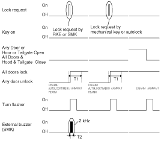

   T1 : Tempo de Confirmação de Bloqueio Falha, T2 : Duração do Buzina de Armamento/Desarmamento

7. ALARM para ARMWAIT

   Condição 1

   | Estado | Descrição |
   | --- | --- |
   | Condição Inicial | • ESTADO DE ALARME • Estado de Chave fora (Key On = Off) • Todas as Portas Fechadas (All Doors Close = On) • Capô Fechado (Hood switch = Off) • Porta Traseira Fechada (TG SWITCH = Off) |
   | • | ESTADO DE ALARME |
   | • | Estado de Chave fora (Key On = Off) |
   | • | Todas as Portas Fechadas (All Doors Close = On) |
   | • | Capô Fechado (Hood switch = Off) |
   | • | Porta Traseira Fechada (TG SWITCH = Off) |
   | Evento | 1. Bloqueio com RKE e Bloqueio bem-sucedido (RKE Lock Confirm Success = Off > On) ou 2. Bloqueio com SMK e Bloqueio bem-sucedido (Passive Lock Confirm Success = Off > On) |
   | 1. | Bloqueio com RKE e Bloqueio bem-sucedido (RKE Lock Confirm Success = Off > On) ou |
   | 2. | Bloqueio com SMK e Bloqueio bem-sucedido (Passive Lock Confirm Success = Off > On) |
   | Ação | • Cancelar Timer de Alarme • Cancelar Timer de Ignição da Chave • Cancelar Timer de Liberação do Alarme ALTL • Parar o piscar do alarme. (Alarm Flasher = Off) • Parar o Alarme de Roubos (Burglar Horn Relay = Off / Horn Relay = Off) • Estado de Inibição do Início do Motor é liberado (Start INH Relay = Off) • Flashing de Armamento (Arm Flasher = On) • Ativação do Buzina de Armamento (Arm Buzzer = On) • Timer de Espera de Armamento iniciado • IND de Segurança está Ativado (IND de Segurança = Ativado) • Estado deve ir para o Estado ARMWAIT |
   | • | Cancelar Timer de Alarme |
   | • | Cancelar Timer de Ignição da Chave |
   | • | Cancelar Timer de Liberação do Alarme ALTL |
   | • | Parar o piscar do alarme. (Alarm Flasher = Off) |
   | • | Parar o Alarme de Roubos (Burglar Horn Relay = Off / Horn Relay = Off) |

Translate this Markdown chunk (20/33) para o português do Brasil.

   | • | Estado de Inibição do Motor de Start liberado (Relay Start INH = Desligado) |
   | • | Flashing ARM (Flasher ARM = Ligado) |
   | • | Ativação do Buzina ARM (Buzina ARM = Ligada) |
   | • | Aguardando Armamento |
   | • | Indicador de Segurança está Ligado (Security IND = Ligado) |
   | • | Estado deve ir para o Estado ARMWAIT |

   Condição 2

   | Estado | Descrição |
   | --- | --- |
   | Condição Inicial | • ESTADO DE ALARME • Estado de Chave fora (Key On = Desligado) • Todas as Portas Fechadas (All Doors Close = Ligado) • Capô Fechado (Hood switch = Desligado) • Garrafa de Trás Fechada (TG SWITCH = Desligado) • Opção de Armamento/Desarmamento com Chave Mecânica está Ativa (MECH Option = Ligado) |
   | • | ESTADO DE ALARME |
   | • | Estado de Chave fora (Key On = Desligado) |
   | • | Todas as Portas Fechadas (All Doors Close = Ligado) |
   | • | Capô Fechado (Hood switch = Desligado) |
   | • | Garrafa de Trás Fechada (TG SWITCH = Desligado) |
   | • | Opção de Armamento/Desarmamento com Chave Mecânica está Ativa (MECH Option = Ligado) |
   | Evento | Bloqueio por Chave Mecânica e Bloqueio bem-sucedido (Mechanical Key Lock Confirm Success = Desligado > Ligado) |
   | Ação | • Cancelar Timer de Alarma • Cancelar Timer de Ignição da Chave • Cancelar Timer de Liberação do Alarma ALTL • Parar o Flash do Alarma (Alarm Flasher = Desligado) • Parar o Som do Alarme de Furto (Burglar Horn Relay = Desligado / Horn Relay = Desligado) • Estado de Inibição do Motor de Start liberado (Start INH Relay = Desligado) • Aguardando Armamento • Indicador de Segurança está Ligado (Security IND = Ligado) • Estado deve ir para o Estado ARMWAIT |
   | • | Cancelar Timer de Alarma |
   | • | Cancelar Timer de Ignição da Chave |
   | • | Cancelar Timer de Liberação do Alarma ALTL |
   | • | Parar o Flash do Alarma. (Alarm Flasher = Desligado) |
   | • | Parar o Som do Alarme de Furto (Burglar Horn Relay = Desligado / Horn Relay = Desligado) |
   | • | Estado de Inibição do Motor de Start liberado (Start INH Relay = Desligado) |
   | • | Aguardando Armamento |
   | • | Indicador de Segurança está Ligado (Security IND = Ligado) |
   | • | Estado deve ir para o Estado ARMWAIT |

   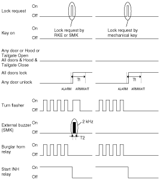

   T1 : Tempo de Confirmação de Falha de Bloqueio,

   T2 : Duração da Buzina de Armamento/Desarmamento

ARM

1. ARMWAIT para ARM

   Condição 1

   | Estado | Descrição |
   | --- | --- |
   | Condição Inicial | • ESTADO ARMWAIT |
   | • | ESTADO ARMWAIT |
   | Evento | Timer de Aguardo de Armamento ? Tempo de Aguardo de Armamento (ArmWait Time) |
   | Ação | • Cancelar Timer de Aguardo de Armamento • Estado deve ir para o Estado ARM |
   | • | Cancelar Timer de Aguardo de Armamento |
   | • | Estado deve ir para o Estado ARM |

2. ARM para ARM

   Condição 1

   | Estado | Descrição |
   | --- | --- |
   | Condição Inicial | • Qualquer Estado |
   | • | Qualquer Estado |
   | Evento | Entrar no Estado ARM |
   | Ação | • Indicador de Segurança está piscando (Security IND = Piscando; 0.32seg:ligado/2seg:desligado) • Estado não deve ser alterado |
   | • | Indicador de Segurança está piscando (Security IND = Piscando; 0.32seg:ligado/2seg:desligado) |
   | • | Estado não deve ser alterado |

   Condição 2

   | Estado | Descrição |
   | --- | --- |
   | Condição Inicial | • ESTADO ARM |
   | • | ESTADO ARM |
   | Evento | 1. Bloqueio por RKE e Bloqueio bem-sucedido (RKE Lock Confirm Success = Desligado > Ligado) ou 2. Bloqueio por SMK e Bloqueio bem-sucedido (Passive Lock Confirm Success = Desligado > Ligado) |

| 1. | Lock by RKE e Locking é sucesso (RKE Lock Confirm Success = Off > On) ou |
   | 2. | Lock by SMK e Locking é sucesso (Passive Lock Confirm Success = Off > On) |
   | Ação | • ARM Flashando (Arm Flasher = On) • Ativação do Som do ARM (Arm Buzzer = On) • Estado não deve ser alterado |
   | • | ARM Flashando (Arm Flasher = On) |
   | • | Ativação do Som do ARM (Arm Buzzer = On) |
   | • | Estado não deve ser alterado |

   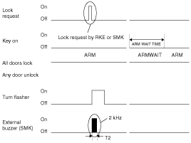

ARMHOLD

1. ARMWAIT para ARMHOLD

   Condição 1

   | Estado | Descrição |
   | --- | --- |
   | Condição Inicial | • ARMWAIT STATE |
   | • | ARMWAIT STATE |
   | Evento | 1. Abertura do porta-malas por RKE (RKE Tail Gate command= Off > On) ou 2. Abertura do porta-malas por SMK (Passive Trunk_TG = Off > On) |
   | 1. | Abertura do porta-malas por RKE (RKE Tail Gate command= Off > On) ou |
   | 2. | Abertura do porta-malas por SMK (Passive Trunk_TG = Off > On) |
   | Ação | • Cancelamento do Timer de ARM Wait • Flashando DISARM (Disarm Flasher = On) • Início do Timer de ArmHold • O IND de Segurança está piscando (Security IND = Piscando; 0.32seg:On/2seg:Off) • Estado deve ir para o Estado ARMHOLD |
   | • | Cancelamento do Timer de ARM Wait |
   | • | Flashando DISARM (Disarm Flasher = On) |
   | • | Início do Timer de ArmHold |
   | • | O IND de Segurança está piscando (Security IND = Piscando; 0.32seg:On/2seg:Off) |
   | • | Estado deve ir para o Estado ARMHOLD |

2. ARM para ARMHOLD

   Condição 1

   | Estado | Descrição |
   | --- | --- |
   | Condição Inicial | • ARM STATE |
   | • | ARM STATE |
   | Evento | 1. Abertura do porta-malas por RKE (RKE Tail Gate command= Off > On) ou 2. Abertura do porta-malas por SMK (Passive Trunk_TG = Off > On) |
   | 1. | Abertura do porta-malas por RKE (RKE Tail Gate command= Off > On) ou |
   | 2. | Abertura do porta-malas por SMK (Passive Trunk_TG = Off > On) |
   | Ação | • Flashando DISARM (Disarm Flasher = On) • Início do Timer de ArmHold • Estado deve ir para o Estado ARMHOLD |
   | • | Flashando DISARM (Disarm Flasher = On) |
   | • | Início do Timer de ArmHold |
   | • | Estado deve ir para o Estado ARMHOLD |

3. ARMHOLD para ARMHOLD

   Condição 1

   | Estado | Descrição |
   | --- | --- |
   | Condição Inicial | Qualquer Estado |
   | Evento | 1. Entrar no Estado ARMHOLD |
   | 1. | Entrar no Estado ARMHOLD |
   | Ação | • O IND de Segurança está piscando (Security IND = Piscando; 0.32seg:On/2seg:Off) • Estado não deve ser alterado |
   | • | O IND de Segurança está piscando (Security IND = Piscando; 0.32seg:On/2seg:Off) |
   | • | Estado não deve ser alterado |

   Condição 2

   | Estado | Descrição |
   | --- | --- |
   | Condição Inicial | • ARMHOLD State |
   | • | ARMHOLD State |
   | Evento | 1. Abertura do porta-malas por RKE (RKE Tail Gate command= Off > On) ou 2. Abertura do porta-malas por SMK (Passive Trunk_TG = Off > On) |
   | 1. | Abertura do porta-malas por RKE (RKE Tail Gate command= Off > On) ou |
   | 2. | Abertura do porta-malas por SMK (Passive Trunk_TG = Off > On) |
   | Ação | • Flashando DISARM (Disarm Flasher = On) • Reinício do Timer de ArmHold • Estado não deve ser alterado |
   | • | Flashando DISARM (Disarm Flasher = On) |

| • | Reiniciar Timer de ArmHold |
   | • | O estado não deve ser alterado |

AUTOLOCKTIMER1

1. DESARMA para AUTOLOCKTIMER1

   Condição 1

   | Estado | Descrição |
   | --- | --- |
   | Condição Inicial | • DESARMA ESTADO • Estado da Chave fora(Chave On = Off) • Todas as Portas Fechadas(Todas as Portas Fechadas = On) • Capô Fechado(Capô Switch = Off) • Garrafa Traseira Fechada(TG SWITCH = Off) |
   | • | DESARMA ESTADO |
   | • | Estado da Chave fora(Chave On = Off) |
   | • | Todas as Portas Fechadas(Todas as Portas Fechadas = On) |
   | • | Capô Fechado(Capô Switch = Off) |
   | • | Garrafa Traseira Fechada(TG SWITCH = Off) |
   | Evento | 1. Desbloqueio por RKE(RKE Unlock command = Off > On) ou 2. Desbloqueio por SMK(Comando de Desbloqueio Passivo = Off > On) |
   | 1. | Desbloqueio por RKE(RKE Unlock command = Off > On) ou |
   | 2. | Desbloqueio por SMK(Comando de Desbloqueio Passivo = Off > On) |
   | Ação | • Flashing DESARMA(Flasher DESARMA = On) • Ativação do Som DESARMA(Som DESARMA = On) • Iniciar AutoLock1Timer • O estado deve ir para o Estado AUTOLOCKTIMER1 |
   | • | Flashing DESARMA(Flasher DESARMA = On) |
   | • | Ativação do Som DESARMA(Som DESARMA = On) |
   | • | Iniciar AutoLock1Timer |
   | • | O estado deve ir para o Estado AUTOLOCKTIMER1 |

2. ESPERAARM para AUTOLOCKTIMER1

   Condição 1

   | Estado | Descrição |
   | --- | --- |
   | Condição Inicial | • ESPERAARM ESTADO • Todas as Portas Fechadas(Todas as Portas Fechadas = On) • Capô Fechado(Capô Switch = Off) • Garrafa Traseira Fechada(TG SWITCH = Off) |
   | • | ESPERAARM ESTADO |
   | • | Todas as Portas Fechadas(Todas as Portas Fechadas = On) |
   | • | Capô Fechado(Capô Switch = Off) |
   | • | Garrafa Traseira Fechada(TG SWITCH = Off) |
   | Evento | 1. Desbloqueio por RKE(RKE Unlock command = Off > On) ou 2. Desbloqueio por SMK(Comando de Desbloqueio Passivo = Off > On) |
   | 1. | Desbloqueio por RKE(RKE Unlock command = Off > On) ou |
   | 2. | Desbloqueio por SMK(Comando de Desbloqueio Passivo = Off > On) |
   | Ação | • Cancelar Timer de Espera de Armamento • Flashing DESARMA(Flasher DESARMA = On) • Ativação do Som DESARMA(Som DESARMA = On) • Iniciar AutoLock1Timer • O estado deve ir para o Estado AUTOLOCKTIMER1 |
   | • | Cancelar Timer de Espera de Armamento |
   | • | Flashing DESARMA(Flasher DESARMA = On) |
   | • | Ativação do Som DESARMA(Som DESARMA = On) |
   | • | Iniciar AutoLock1Timer |
   | • | O estado deve ir para o Estado AUTOLOCKTIMER1 |

   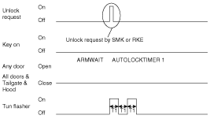

   T1 : 0.5 ± 0.05 seg

3. ARMA para AUTOLOCKTIMER1

   Condição 1

   | Estado | Descrição |
   | --- | --- |
   | Condição Inicial | • ARMA ESTADO • Todas as Portas Fechadas(Todas as Portas Fechadas = On) • Capô Fechado(Capô Switch = Off) • Garrafa Traseira Fechada(TG SWITCH = Off) |
   | • | ARMA ESTADO |
   | • | Todas as Portas Fechadas(Todas as Portas Fechadas = On) |
   | • | Capô Fechado(Capô Switch = Off) |
   | • | Garrafa Traseira Fechada(TG SWITCH = Off) |
   | Evento | 1. Desbloqueio por RKE(RKE Unlock command = Off > On) ou 2. Desbloqueio por SMK(Comando de Desbloqueio Passivo = Off > On) |
   | 1. | Desbloqueio por RKE(RKE Unlock command = Off > On) ou |
   | 2. | Desbloqueio por SMK(Comando de Desbloqueio Passivo = Off > On) |

Translate this Markdown chunk (23/33) para o português do Brasil.

   | Ação | • DESARMA Flashando(Desarmar Flashador = Ativado) • Inicia TimerAutoLock1 • DESARMA Ativação do Somador(Desarmar Somador = Ativado) • Estado deve passar para o Estado AUTOLOCKTIMER1 |
   | • | DESARMA Flashando(Desarmar Flashador = Ativado) |
   | • | Inicia TimerAutoLock1 |
   | • | DESARMA Ativação do Somador(Desarmar Somador = Ativado) |
   | • | Estado deve passar para o Estado AUTOLOCKTIMER1 |

4. AUTOLOCKTIMER1 para AUTOLOCKTIMER1

   Condição 1

   | Estado | Descrição |
   | --- | --- |
   | Condição Inicial | • qualquer estado |
   | • | qualquer estado |
   | Evento | 1. entrar no Estado AUTOLOCKTIMER1 |
   | 1. | entrar no Estado AUTOLOCKTIMER1 |
   | Ação | • O IND de Segurança está piscando (IND de Segurança = Piscando; 0,32s:ligado/2s:desligado) • O estado não deve ser alterado |
   | • | O IND de Segurança está piscando (IND de Segurança = Piscando; 0,32s:ligado/2s:desligado) |
   | • | O estado não deve ser alterado |

   Condição 2

   | Estado | Descrição |
   | --- | --- |
   | Condição Inicial | • Estado AUTOLOCKTIMER1 • Todas as Portas Fechadas(Todas as Portas Fechadas = Ativado) • Capô Fechado(Interruptor do Capô = Desativado) • Porta Traseira Fechada(Interruptor da Porta Traseira = Desativado) |
   | • | Estado AUTOLOCKTIMER1 |
   | • | Todas as Portas Fechadas(Todas as Portas Fechadas = Ativado) |
   | • | Capô Fechado(Interruptor do Capô = Desativado) |
   | • | Porta Traseira Fechada(Interruptor da Porta Traseira = Desativado) |
   | Evento | 1. Desbloqueio por RKE(RKE Desbloqueio comando = Desativado > Ativado) ou 2. Desbloqueio por SMK(Desbloqueio Passivo comando = Desativado > Ativado) |
   | 1. | Desbloqueio por RKE(RKE Desbloqueio comando = Desativado > Ativado) ou |
   | 2. | Desbloqueio por SMK(Desbloqueio Passivo comando = Desativado > Ativado) |
   | Ação | • DESARMA Flashando(Desarmar Flashador = Ativado) • DESARMA Ativação do Somador(Desarmar Somador = Ativado) • Inicia TimerAutoLock1 • O estado não deve ser alterado |
   | • | DESARMA Flashando(Desarmar Flashador = Ativado) |
   | • | DESARMA Ativação do Somador(Desarmar Somador = Ativado) |
   | • | Inicia TimerAutoLock1 |
   | • | O estado não deve ser alterado |

   Condição 3

   | Estado | Descrição |
   | --- | --- |
   | Condição Inicial | • Estado AUTOLOCKTIMER1 |
   | • | Estado AUTOLOCKTIMER1 |
   | Evento | TimerAutoLock1 em execução e expirado (TimerAutoLock1 ? AutoLock1Time) |
   | Ação | • Cancela TimerAutoLock1 • Bloqueio automático (Comando de Bloqueio = Ativado; Relock = Ativado) • O estado não deve ser alterado |
   | • | Cancela TimerAutoLock1 |
   | • | Bloqueio automático (Comando de Bloqueio = Ativado; Relock = Ativado) |
   | • | O estado não deve ser alterado |

5. ARMHOLD para AUTOLOCKTIMER1

   Condição 1

   | Estado | Descrição |
   | --- | --- |
   | Condição Inicial | • Estado ARMHOLD • Todas as Portas Fechadas(Todas as Portas Fechadas = Ativado) • Capô Fechado(Interruptor do Capô = Desativado) • Porta Traseira Fechada(Interruptor da Porta Traseira = Desativado) |
   | • | Estado ARMHOLD |
   | • | Todas as Portas Fechadas(Todas as Portas Fechadas = Ativado) |
   | • | Capô Fechado(Interruptor do Capô = Desativado) |
   | • | Porta Traseira Fechada(Interruptor da Porta Traseira = Desativado) |
   | Evento | 1. Desbloqueio por RKE(RKE Desbloqueio comando = Desativado > Ativado) ou 2. Desbloqueio por SMK(Desbloqueio Passivo comando = Desativado > Ativado) |
   | 1. | Desbloqueio por RKE(RKE Desbloqueio comando = Desativado > Ativado) ou |
   | 2. | Desbloqueio por SMK(Desbloqueio Passivo comando = Desativado > Ativado) |

Translate this Markdown chunk (24/33) para o português do Brasil.

   | Ação | • Cancelar Timer ArmHold • DESARMA Flashing(Desarmar Flasher = Ativado) • DESARMA Ativação do Som (Desarmar Som = Ativado) • Iniciar Timer AutoLock1 • Estado deve ir para Estado AUTOLOCKTIMER1 |
   | • | Cancelar Timer ArmHold |
   | • | DESARMA Flashing(Desarmar Flasher = Ativado) |
   | • | DESARMA Ativação do Som (Desarmar Som = Ativado) |
   | • | Iniciar Timer AutoLock1 |
   | • | Estado deve ir para Estado AUTOLOCKTIMER1 |

6. REARM para AUTOLOCKTIMER1

   Condição 1

   | Estado | Descrição |
   | --- | --- |
   | Condição Inicial | • REARM STATE • Todas as Portas Fechadas (Todas as Portas Fechadas = Ativado) • Capô Fechado (Interruptor do Capô = Desativado) • Porta-malas Fechado (TG SWITCH = Desativado) |
   | • | REARM STATE |
   | • | Todas as Portas Fechadas (Todas as Portas Fechadas = Ativado) |
   | • | Capô Fechado (Interruptor do Capô = Desativado) |
   | • | Porta-malas Fechado (TG SWITCH = Desativado) |
   | Evento | 1. Desbloqueio por RKE (Comando de Desbloqueio RKE = Desativado > Ativado) ou 2. Desbloqueio por SMK (Comando de Desbloqueio Passive = Desativado > Ativado) |
   | 1. | Desbloqueio por RKE (Comando de Desbloqueio RKE = Desativado > Ativado) ou |
   | 2. | Desbloqueio por SMK (Comando de Desbloqueio Passive = Desativado > Ativado) |
   | Ação | • Cancelar Timer Key IGN • Cancelar Timer ALTL • Estado de Inibição do Start é liberado (Relay Start INH = Desativado) • DESARMA Flashing(Desarmar Flasher = Ativado) • DESARMA Ativação do Som (Desarmar Som = Ativado) • Iniciar Timer AutoLock1 • Estado deve ir para Estado AUTOLOCKTIMER1 |
   | • | Cancelar Timer Key IGN |
   | • | Cancelar Timer ALTL |
   | • | Estado de Inibição do Start é liberado (Relay Start INH = Desativado) |
   | • | DESARMA Flashing(Desarmar Flasher = Ativado) |
   | • | DESARMA Ativação do Som (Desarmar Som = Ativado) |
   | • | Iniciar Timer AutoLock1 |
   | • | Estado deve ir para Estado AUTOLOCKTIMER1 |

   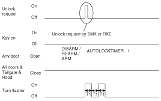

   T1 : 0,5 ± 0,05 seg

7. ALARM para AUTOLOCKTIMER1

   Condição 1

   | Estado | Descrição |
   | --- | --- |
   | Condição Inicial | • ALARM STATE • Todas as Portas Fechadas (Todas as Portas Fechadas = Ativado) • Capô Fechado (Interruptor do Capô = Desativado) • Porta-malas Fechado (TG SWITCH = Desativado) |
   | • | ALARM STATE |
   | • | Todas as Portas Fechadas (Todas as Portas Fechadas = Ativado) |
   | • | Capô Fechado (Interruptor do Capô = Desativado) |
   | • | Porta-malas Fechado (TG SWITCH = Desativado) |
   | Evento | 1. Desbloqueio por RKE (Comando de Desbloqueio RKE = Desativado > Ativado) ou 2. Desbloqueio por SMK (Comando de Desbloqueio Passive = Desativado > Ativado) |
   | 1. | Desbloqueio por RKE (Comando de Desbloqueio RKE = Desativado > Ativado) ou |
   | 2. | Desbloqueio por SMK (Comando de Desbloqueio Passive = Desativado > Ativado) |
   | Ação | • Cancelar Timer Key IGN • Cancelar Timer Alarm • Cancelar Timer ALTL • Parar o sinal de alarme (Flasher Alarm = Desativado) • Parar o Som do Alarme de Furto (Relay Horn Burglar = Desativado / Relay Horn = Desativado) • Estado de Inibição do Start é liberado (Relay Start INH = Desativado) • DESARMA Flashing(Desarmar Flasher = Ativado) • DESARMA Ativação do Som (Desarmar Som = Ativado) • Iniciar Timer AutoLock1 • Estado deve ir para Estado AUTOLOCKTIMER1 |
   | • | Cancelar Timer Key IGN |
   | • | Cancelar Timer Alarm |
   | • | Cancelar Timer ALTL |
   | • | Parar o sinal de alarme (Flasher Alarm = Desativado) |

| • | Silagem do Alarme Antifurto (Relé de Alarme Antifurto = Desligado / Relé de Corneta = Desligado) |
   | • | Estado de Inibição de Início do Motor é Liberado (Relé de Inibição de Início do Motor = Desligado) |
   | • | Flashing DESARMA (Desarmador de Flasher = Ligado) |
   | • | Ativação do Som do DESARMA (Som do DESARMA = Ligado) |
   | • | Início do Timer AUTOLOCK1 |
   | • | O estado deve passar para o Estado AUTOLOCKTIMER1 |

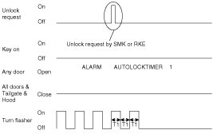

T1 : 0,5 ± 0,05 seg

AUTOLOCKTIMER2

1. DESARMA para AUTOLOCKTIMER2

   Condição 1

   | Estado | Descrição |
   | --- | --- |
   | Condição Inicial | • Estado DESARMA • Estado com Chave Fora (Key On = Desligado) • Todas as Portas Fechadas (All Doors Close = Ligado) • Capô Aberto (Hood switch = Ligado) • Garrafa de Trás Fechada (TG SWITCH = Desligado) |
   | • | Estado DESARMA |
   | • | Estado com Chave Fora (Key On = Desligado) |
   | • | Todas as Portas Fechadas (All Doors Close = Ligado) |
   | • | Capô Aberto (Hood switch = Ligado) |
   | • | Garrafa de Trás Fechada (TG SWITCH = Desligado) |
   | Evento | 1. Desbloqueio por RKE (RKE Unlock command = Desligado > Ligado) ou 2. Desbloqueio por SMK (Passivo Unlock command = Desligado > Ligado) |
   | 1. | Desbloqueio por RKE (RKE Unlock command = Desligado > Ligado) ou |
   | 2. | Desbloqueio por SMK (Passivo Unlock command = Desligado > Ligado) |
   | Ação | • Flashing DESARMA (Desarmador de Flasher = Ligado) • Ativação do Som do DESARMA (Som do DESARMA = Ligado) • Início do Timer AUTOLOCK2 • O estado deve passar para o Estado AUTOLOCKTIMER2 |
   | • | Flashing DESARMA (Desarmador de Flasher = Ligado) |
   | • | Ativação do Som do DESARMA (Som do DESARMA = Ligado) |
   | • | Início do Timer AUTOLOCK2 |
   | • | O estado deve passar para o Estado AUTOLOCKTIMER2 |

2. AUTOLOCKTIMER2 para AUTOLOCKTIMER2

   Condição 1

   | Estado | Descrição |
   | --- | --- |
   | Condição Inicial | • Qualquer Estado |
   | • | Qualquer Estado |
   | Evento | Entrada no Estado AUTOLOCKTIMER2 |
   | Ação | • Indicador de Segurança está piscando (Security IND = Piscando; 0,32seg:ligado/2seg:desligado) • O estado não deve ser alterado |
   | • | Indicador de Segurança está piscando (Security IND = Piscando; 0,32seg:ligado/2seg:desligado) |
   | • | O estado não deve ser alterado |

   Condição 2

   | Estado | Descrição |
   | --- | --- |
   | Condição Inicial | • Estado AUTOLOCKTIMER2 • Estado com Chave Fora (Key On = Desligado) • Todas as Portas Fechadas (All Doors Close = Ligado) • Capô Aberto (Hood switch = Ligado) • Garrafa de Trás Fechada (TG SWITCH = Desligado) |
   | • | Estado AUTOLOCKTIMER2 |
   | • | Estado com Chave Fora (Key On = Desligado) |
   | • | Todas as Portas Fechadas (All Doors Close = Ligado) |
   | • | Capô Aberto (Hood switch = Ligado) |
   | • | Garrafa de Trás Fechada (TG SWITCH = Desligado) |
   | Evento | 1. Desbloqueio por RKE (RKE Unlock command = Desligado > Ligado) ou 2. Desbloqueio por SMK (Passivo Unlock command = Desligado > Ligado) |
   | 1. | Desbloqueio por RKE (RKE Unlock command = Desligado > Ligado) ou |
   | 2. | Desbloqueio por SMK (Passivo Unlock command = Desligado > Ligado) |
   | Ação | • Flashing DESARMA (Desarmador de Flasher = Ligado) • Ativação do Som do DESARMA (Som do DESARMA = Ligado) • Reinício do Timer AUTOLOCK2 • O estado não deve ser alterado |
   | • | Flashing DESARMA (Desarmador de Flasher = Ligado) |
   | • | Ativação do Som do DESARMA (Som do DESARMA = Ligado) |
   | • | Reinício do Timer AUTOLOCK2 |
   | • | O estado não deve ser alterado |

   Condição 3

Translate this Markdown chunk (26/33) para o português do Brasil.

   | Estado | Descrição |
   | --- | --- |
   | Condição Inicial | • AUTOLOCKTIMER2 STATE |
   | • | AUTOLOCKTIMER2 STATE |
   | Evento | AutoLock2Timer
    temporizador em execução e expirou (AutoLock2Timer ?
   AutoLock2Time) |
   | Ação | • Cancelar AutoLock2Timer • Bloquear por automático (Comando Auto Lock = On; Relock = On) • O estado não deve ser alterado |
   | • | Cancelar AutoLock2Timer |
   | • | Bloquear por automático (Comando Auto Lock = On; Relock = On) |
   | • | O estado não deve ser alterado |

3. PREARM para AUTOLOCKTIMER2

   Condição 1

   | Estado | Descrição |
   | --- | --- |
   | Condição Inicial | • PREARM STATE • Estado Chave fora (Key On = Off) • Todas as Portas Fechadas (All Doors Close = On) • Capô aberto (Hood switch = On) • Garrafa de Trás Fechada (TG SWITCH = Off) |
   | • | PREARM STATE |
   | • | Estado Chave fora (Key On = Off) |
   | • | Todas as Portas Fechadas (All Doors Close = On) |
   | • | Capô aberto (Hood switch = On) |
   | • | Garrafa de Trás Fechada (TG SWITCH = Off) |
   | Evento | 1. Desbloquear por RKE (RKE Unlock command = Off > On) ou 2. Desbloquear por SMK (Passive Unlock command = Off > On) |
   | 1. | Desbloquear por RKE (RKE Unlock command = Off > On) ou |
   | 2. | Desbloquear por SMK (Passive Unlock command = Off > On) |
   | Ação | • Desarmar Flashing (Disarm Flasher = On) • Ativar Desarmar Buzzer (Disarm Buzzer = On) • Iniciar AutoLock2Timer • O estado deve ir para o estado AUTOLOCKTIMER2 |
   | • | Desarmar Flashing (Disarm Flasher = On) |
   | • | Ativar Desarmar Buzzer (Disarm Buzzer = On) |
   | • | Iniciar AutoLock2Timer |
   | • | O estado deve ir para o estado AUTOLOCKTIMER2 |

   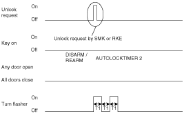

   T1 : 0,5 ± 0,05 seg

4. ALARM para AUTOLOCKTIMER2

   Condição 1

   | Estado | Descrição |
   | --- | --- |
   | Condição Inicial | • ALARM STATE· Estado Chave fora (Key On = Off) • Todas as Portas Fechadas (All Doors Close = On) • Capô aberto (Hood switch = On) • Garrafa de Trás Fechada (TG SWITCH = Off) |
   | • | ALARM STATE· Estado Chave fora (Key On = Off) |
   | • | Todas as Portas Fechadas (All Doors Close = On) |
   | • | Capô aberto (Hood switch = On) |
   | • | Garrafa de Trás Fechada (TG SWITCH = Off) |
   | Evento | 1. Desbloquear por RKE (RKE Unlock command = Off > On) ou 2. Desbloquear por SMK (Passive Unlock command = Off > On) |
   | 1. | Desbloquear por RKE (RKE Unlock command = Off > On) ou |
   | 2. | Desbloquear por SMK (Passive Unlock command = Off > On) |
   | Ação | • Cancelar Timer de Alarme • Cancelar Timer de Ignição da Chave • Cancelar Timer de Liberação de ALTL • Parar o piscar do alarme. (Alarm Flasher = Off) • Parar o Som do Alarme de Roubos (Burglar Horn Relay = Off / Horn Relay = Off) • O estado de Inibição do Start do Motor é liberado (Start INH Relay = Off) • Desarmar Flashing (Disarm Flasher = On) • Ativar Desarmar Buzzer (Disarm Buzzer = On) • Iniciar AutoLock2Timer • O estado deve ir para o estado AUTOLOCKTIMER2 |
   | • | Cancelar Timer de Alarme |
   | • | Cancelar Timer de Ignição da Chave |
   | • | Cancelar Timer de Liberação de ALTL • Parar o piscar do alarme. (Alarm Flasher = Off) |
   | • | Parar o Som do Alarme de Roubos (Burglar Horn Relay = Off / Horn Relay = Off) |

| • | O estado de Inibição do Motor é liberado (Relé Start INH = Desligado) |
   | • | Flashing DISARM (Flasher DISARM = Ligado) |
   | • | Ativação do Som DISARM (Som DISARM = Ligado) |
   | • | Início do Timer AUTOLOCK2 |
   | • | O estado deve passar para o estado AUTOLOCKTIMER2 |

   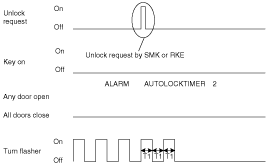

   T1 : 0,5 ± 0,05 seg

PREARM

1. DISARM para PREARM

   Condição 1

   | Estado | Descrição |
   | --- | --- |
   | Condição Inicial | • DISARM STATE • Estado com Chave fora (Key On = Off) • Qualquer Porta Aberta (All Doors Close = Off) ou Capô Aberto (Hood switch = On) ou Porta Traseira Aberta (TG SWITCH = On) |
   | • | DISARM STATE |
   | • | Estado com Chave fora (Key On = Off) |
   | • | Qualquer Porta Aberta (All Doors Close = Off) ou Capô Aberto (Hood switch = On) ou Porta Traseira Aberta (TG SWITCH = On) |
   | Evento | 1. Bloqueio por RKE e Bloqueio bem-sucedido (RKE Lock Confirm Success = Off > On) ou 2. Bloqueio por SMK e Bloqueio bem-sucedido (Passive Lock Confirm Success = Off > On) |
   | 1. | Bloqueio por RKE e Bloqueio bem-sucedido (RKE Lock Confirm Success = Off > On) ou |
   | 2. | Bloqueio por SMK e Bloqueio bem-sucedido (Passive Lock Confirm Success = Off > On) |
   | Ação | • O estado deve passar para o estado PREARM |
   | • | O estado deve passar para o estado PREARM |

   Condição 2

   | Estado | Descrição |
   | --- | --- |
   | Condição Inicial | • DISARM STATE • Estado com Chave fora (Key On = Off) • Qualquer Porta Aberta (All Doors Close = Off) ou (Capô Aberto (Hood switch = On) ou Porta Traseira Aberta (TG SWITCH = On) • Opção de Chave Mecânica ARM/DISARM ativada (MECH Option = On) |
   | • | DISARM STATE |
   | • | Estado com Chave fora (Key On = Off) |
   | • | Qualquer Porta Aberta (All Doors Close = Off) ou (Capô Aberto (Hood switch = On) ou Porta Traseira Aberta (TG SWITCH = On) |
   | • | Opção de Chave Mecânica ARM/DISARM ativada (MECH Option = On) |
   | Evento | Bloqueio por Chave Mecânica e Bloqueio bem-sucedido (Mechanical Key Lock Confirm Success = Off > On) |
   | Ação | • O estado deve passar para o estado PREARM |
   | • | O estado deve passar para o estado PREARM |

   Condição 3

   | Estado | Descrição |
   | --- | --- |
   | Condição Inicial | • DISARM STATE • Estado com Chave fora (Key On = Off) • Capô Aberto (Hood switch = On) • Qualquer Porta Aberta (All Doors Close = Off) • Porta Traseira Fechada (TG SWITCH = Off) • Todas as Portas Bloqueadas (All Doors Lock = On) • Opção de Chave Mecânica ARM/DISARM ativada (MECH Option = On) |
   | • | DISARM STATE |
   | • | Estado com Chave fora (Key On = Off) |
   | • | Capô Aberto (Hood switch = On) |
   | • | Qualquer Porta Aberta (All Doors Close = Off) |
   | • | Porta Traseira Fechada (TG SWITCH = Off) |
   | • | Todas as Portas Bloqueadas (All Doors Lock = On) |
   | • | Opção de Chave Mecânica ARM/DISARM ativada (MECH Option = On) |
   | Evento | Todas as Portas Fechadas (All Doors Close = On) |
   | Ação | • O estado deve passar para o estado PREARM |
   | • | O estado deve passar para o estado PREARM |

   Condição 4

   | Estado | Descrição |

| Condição Inicial | • ESTADO DESARMAZADO • Chave fora do veículo (Key On = Off) • Capô aberto (Capô switch = On) • Todas as portas fechadas (All Doors Close = On) • Prateleira traseira aberta (TG SWITCH = On) • Todas as portas trancadas (All Doors Lock = On) • Opção de armazenamento/Desarmazenamento com chave mecânica habilitada (MECH Option = On) |
   | • | ESTADO DESARMAZADO |
   | • | Chave fora do veículo (Key On = Off) |
   | • | Capô aberto (Capô switch = On) |
   | • | Todas as portas fechadas (All Doors Close = On) |
   | • | Prateleira traseira aberta (TG SWITCH = On) |
   | • | Todas as portas trancadas (All Doors Lock = On) |
   | • | Opção de armazenamento/Desarmazenamento com chave mecânica habilitada (MECH Option = On) |
   | Evento | Prateleira traseira
    fechada (TG SWITCH =
   Off) |
   | Ação | • O estado deve ir para o estado DE PRÉ-ARMAZENAMENTO |
   | • | O estado deve ir para o estado DE PRÉ-ARMAZENAMENTO |

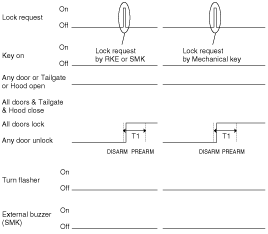

2. AUTOLOCKTIMER2 para DE PRÉ-ARMAZENAMENTO

   Condição 1

   | Estado | Descrição |
   | --- | --- |
   | Condição Inicial | • ESTADO AUTOLOCKTIMER2 |
   | • | ESTADO AUTOLOCKTIMER2 |
   | Evento | 1. Trancar por RKE e travamento bem-sucedido (RKE Lock Confirm Success = Off > On) ou 2. Trancar por SMK e travamento bem-sucedido (Passive Lock Confirm Success = Off > On) ou 3. Trancar por Auto Lock (AutoLock1Timer ? AutoLock1Time) e travamento bem-sucedido (AutoLockConfirmSuccess = Off > On) |
   | 1. | Trancar por RKE e travamento bem-sucedido (RKE Lock Confirm Success = Off > On) ou |
   | 2. | Trancar por SMK e travamento bem-sucedido (Passive Lock Confirm Success = Off > On) ou |
   | 3. | Trancar por Auto Lock (AutoLock1Timer ? AutoLock1Time) e travamento bem-sucedido (AutoLockConfirmSuccess = Off > On) |
   | Ação | • Cancelar AutoLock2Timer • O estado deve ir para o estado DE PRÉ-ARMAZENAMENTO |
   | • | Cancelar AutoLock2Timer |
   | • | O estado deve ir para o estado DE PRÉ-ARMAZENAMENTO |

   Condição 2

   | Estado | Descrição |
   | --- | --- |
   | Condição Inicial | • ESTADO AUTOLOCKTIMER2 • Opção de armazenamento/Desarmazenamento com chave mecânica habilitada (MECH Option = On) |
   | • | ESTADO AUTOLOCKTIMER2 |
   | • | Opção de armazenamento/Desarmazenamento com chave mecânica habilitada (MECH Option = On) |
   | Evento | Trancar por chave mecânica e travamento bem-sucedido (Mechanical Key Lock Confirm Success = Off > On) |
   | Ação | • Cancelar AutoLock2Timer • O estado deve ir para o estado DE PRÉ-ARMAZENAMENTO |
   | • | Cancelar AutoLock2Timer |
   | • | O estado deve ir para o estado DE PRÉ-ARMAZENAMENTO |

3. ESTADO DE ARMAZENAMENTO para DE PRÉ-ARMAZENAMENTO

   Condição 1

   | Estado | Descrição |
   | --- | --- |
   | Condição Inicial | • ESTADO DE ARMAZENAMENTO |
   | • | ESTADO DE ARMAZENAMENTO |
   | Evento | 1. Expiração do temporizador AutoLock3Timer (ArmHold Timer ? AutoLock3Time) ou 2. Prateleira traseira aberta (TG SWITCH = On |
   | 1. | Expiração do temporizador AutoLock3Timer (ArmHold Timer ? AutoLock3Time) ou |
   | 2. | Prateleira traseira aberta (TG SWITCH = On |
   | Ação | • Cancelar temporizador ArmHold • O estado deve ir para o estado DE PRÉ-ARMAZENAMENTO |
   | • | Cancelar temporizador ArmHold |
   | • | O estado deve ir para o estado DE PRÉ-ARMAZENAMENTO |

4. ALARME para DE PRÉ-ARMAZENAMENTO

   Condição 1

   | Estado | Descrição |
   | --- | --- |

| Condição Inicial | • ESTADO DE ALARME • Estado de Chave Ausente (Estado de Chave = Desligado) • Qualquer Porta Aberta (Todas as Portas Fechadas = Desligado) ou Capô Aberto (Capô = Ligado) ou Porta Traseira Aberta (TG SWITCH = Ligado) |
   | • | ESTADO DE ALARME |
   | • | Estado de Chave Ausente (Estado de Chave = Desligado) |
   | • | Qualquer Porta Aberta (Todas as Portas Fechadas = Desligado) ou Capô Aberto (Capô = Ligado) ou Porta Traseira Aberta (TG SWITCH = Ligado) |
   | Evento | 1. Bloqueio por RKE e Bloqueio bem-sucedido (RKE Lock Confirm Success = Desligado > Ligado) ou 2. Bloqueio por SMK e Bloqueio bem-sucedido (Passive Lock Confirm Success = Desligado > Ligado) |
   | 1. | Bloqueio por RKE e Bloqueio bem-sucedido (RKE Lock Confirm Success = Desligado > Ligado) ou |
   | 2. | Bloqueio por SMK e Bloqueio bem-sucedido (Passive Lock Confirm Success = Desligado > Ligado) |
   | Ação | • Cancelar Timer do Alarme • Cancelar Timer do Ignição da Chave • Cancelar Timer de Liberação do Alarme ALTL • Parar o piscar do alarme. (Alarm Flasher = Desligado) • Estado de Inibição do Início do Motor é liberado (Start INH Relay = Desligado) • Parar o Horn do Alarme de Furtos (Burglar Horn Relay = Desligado / Horn Relay = Desligado) • O estado deve ir para o Estado PREARM |
   | • | Cancelar Timer do Alarme |
   | • | Cancelar Timer do Ignição da Chave |
   | • | Cancelar Timer de Liberação do Alarme ALTL |
   | • | Parar o piscar do alarme. (Alarm Flasher = Desligado) |
   | • | Estado de Inibição do Início do Motor é liberado (Start INH Relay = Desligado) |
   | • | Parar o Horn do Alarme de Furtos (Burglar Horn Relay = Desligado / Horn Relay = Desligado) |
   | • | O estado deve ir para o Estado PREARM |

   Condição 2

   | Estado | Descrição |
   | --- | --- |
   | Condição Inicial | • ESTADO DE ALARME • Estado de Chave Ausente (Estado de Chave = Desligado) • Qualquer Porta Aberta (Todas as Portas Fechadas = Desligado) ou Capô Aberto (Capô = Ligado) ou Porta Traseira Aberta (TG SWITCH = Ligado) • Opção de Armazenamento/Moagem pela Chave Mecânica está habilitada (MECH Option = Ligado) |
   | • | ESTADO DE ALARME |
   | • | Estado de Chave Ausente (Estado de Chave = Desligado) |
   | • | Qualquer Porta Aberta (Todas as Portas Fechadas = Desligado) ou Capô Aberto (Capô = Ligado) ou Porta Traseira Aberta (TG SWITCH = Ligado) |
   | • | Opção de Armazenamento/Moagem pela Chave Mecânica está habilitada (MECH Option = Ligado) |
   | Evento | Armazenamento pela Chave Mecânica e Armazenamento bem-sucedido (Mechanical Key Lock Confirm Success = Desligado > Ligado) |
   | Ação | • Cancelar Timer do Alarme • Cancelar Timer do Ignição da Chave • Cancelar Timer de Liberação do Alarme ALTL • Parar o piscar do alarme. (Alarm Flasher = Desligado) • Estado de Inibição do Início do Motor é liberado (Start INH Relay = Desligado) • Parar o Horn do Alarme de Furtos (Burglar Horn Relay = Desligado / Horn Relay = Desligado) • O estado deve ir para o Estado PREARM |
   | • | Cancelar Timer do Alarme |
   | • | Cancelar Timer do Ignição da Chave |
   | • | Cancelar Timer de Liberação do Alarme ALTL |
   | • | Parar o piscar do alarme. (Alarm Flasher = Desligado) |
   | • | Estado de Inibição do Início do Motor é liberado (Start INH Relay = Desligado) |
   | • | Parar o Horn do Alarme de Furtos (Burglar Horn Relay = Desligado / Horn Relay = Desligado) |
   | • | O estado deve ir para o Estado PREARM |

   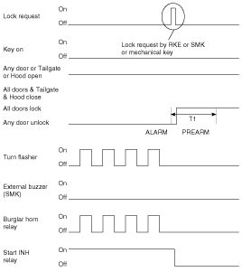

   T1 : Tempo de Confirmação de Falha de Bloqueio

5. PREARM para PREARM

   Condição 1

   | Estado | Descrição |
   | --- | --- |
   | Condição Inicial | Qualquer Estado |
   | Evento | 1. Entrar no Estado PREARM |

Translate this Markdown chunk (30/33) para o português do Brasil.

   | 1. | Entrar no Estado PREARM |
   | Ação | • O IND de Segurança está piscando (IND de Segurança = piscando; 0,32s:ligado/2s:desligado) • O estado não deve ser alterado |
   | • | O IND de Segurança está piscando (IND de Segurança = piscando; 0,32s:ligado/2s:desligado) |
   | • | O estado não deve ser alterado |

REARM

1. ALARM para REARM

   Condição 1

   | Estado | Descrição |
   | --- | --- |
   | Condição Inicial | • ESTADO ALARM • Opção China = Desligada (Opção China = Desligada) |
   | • | ESTADO ALARM |
   | • | Opção China = Desligada (Opção China = Desligada) |
   | Evento | Todas as Portas Fechadas (Todas as Portas Fechadas = Ligado) e Capô Fechado (Capô switch = Desligado) e Porta Traseira Fechada (TG SWITCH = Desligado) e Alarme Final Parado (Alarme Flasher = Desligado) |
   | Ação | • O estado deve ir para o Estado REARM |
   | • | O estado deve ir para o Estado REARM |

   Condição 2

   | Estado | Descrição |
   | --- | --- |
   | Condição Inicial | • ESTADO ALARM • Opção China = Ligada (Opção China = Ligada) |
   | • | ESTADO ALARM |
   | • | Opção China = Ligada (Opção China = Ligada) |
   | Evento | Chave Ligar = Desligado e Todas as Portas Fechadas (Todas as Portas Fechadas = Ligado) e Capô Fechado (Capô switch = Desligado) e Porta Traseira Fechada (TG SWITCH = Desligado) e Alarme Final Parado (Alarme Flasher = Desligado) |
   | Ação | • O estado deve ir para o Estado REARM |
   | • | O estado deve ir para o Estado REARM |

2. REARM para REARM

   Condição 1

   | Estado | Descrição |
   | --- | --- |
   | Condição Inicial | • ESTADO REARM • Chave In = Desligado || A_IGN1 = Desligado || IGN2 = Desligado |
   | • | ESTADO REARM |
   | • | Chave In = Desligado || A_IGN1 = Desligado || IGN2 = Desligado |
   | Evento | Chave In = Ligado & A_IGN1 = Ligado & IGN2 = Ligado |
   | Ação | • Iniciar Contador de Tempo de Ignição da Chave • O estado não deve ser alterado |
   | • | Iniciar Contador de Tempo de Ignição da Chave |
   | • | O estado não deve ser alterado |

   Condição 2

   | Estado | Descrição |
   | --- | --- |
   | Condição Inicial | • ESTADO REARM • Contador de Tempo de Ignição da Chave em execução e Contador de Tempo de Ignição da Chave < Tempo de Ignição de Chave |
   | • | ESTADO REARM |
   | • | Contador de Tempo de Ignição da Chave em execução e Contador de Tempo de Ignição da Chave < Tempo de Ignição de Chave |
   | Evento | Chave In = Desligado || A_IGN1 = Desligado || IGN2 = Desligado |
   | Ação | • Cancelar Contador de Tempo de Ignição da Chave • O estado não deve ser alterado |
   | • | Cancelar Contador de Tempo de Ignição da Chave |
   | • | O estado não deve ser alterado |

   Condição 3

   | Estado | Descrição |
   | --- | --- |
   | Condição Inicial | • ESTADO REARM • AltL = Desligado |
   | • | ESTADO REARM |
   | • | AltL = Desligado |
   | Evento | AltL = Ligado |
   | Ação | • Iniciar Contador de Tempo de Liberação do Alarme AltL • O estado não deve ser alterado |
   | • | Iniciar Contador de Tempo de Liberação do Alarme AltL |
   | • | O estado não deve ser alterado |

   Condição 4

   | Estado | Descrição |
   | --- | --- |
   | Condição Inicial | • ESTADO REARM • Contador de Tempo de Liberação do Alarme AltL em execução e Contador de Tempo de Liberação do Alarme AltL < Tempo de Liberação do Alarme AltL |
   | • | ESTADO REARM |
   | • | Contador de Tempo de Liberação do Alarme AltL em execução e Contador de Tempo de Liberação do Alarme AltL < Tempo de Liberação do Alarme AltL |
   | Evento | AltL = Desligado |
   | Ação | • Cancelar Contador de Tempo de Liberação do Alarme AltL • O estado não deve ser alterado |
   | • | Cancelar Contador de Tempo de Liberação do Alarme AltL |

| • | O estado não deve ser alterado |

   Condição 5

   | Estado | Descrição |
   | --- | --- |
   | Condição Inicial | • Qualquer Estado |
   | • | Qualquer Estado |
   | Evento | Entrar no ESTADO REARM |
   | Ação | • O indicador de segurança (Security IND) está piscando (Security IND = piscando; 0,32s:ligado/2s:desligado) • O estado não deve ser alterado |
   | • | O indicador de segurança (Security IND) está piscando (Security IND = piscando; 0,32s:ligado/2s:desligado) |
   | • | O estado não deve ser alterado |

   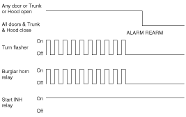

ALERTA

| • | Padrão de alarme: MID/China 1 vez Alarme piscando e Ativação do Sinal de Alarme (Tempo de Alarme Ativo 1 vez). |
| --- | --- |

| • | Padrão de alarme: GEN 3 vezes Alarme piscando e Ativação do Sinal de Alarme (Tempo de Alarme Ativo / Tempo de Alarme Inativo, 3 vezes). |
| --- | --- |

1. ARM para ALARM

   Condição 1

   | Estado | Descrição |
   | --- | --- |
   | Condição Inicial | • ESTADO ARM |
   | • | ESTADO ARM |
   | Evento | 1. Qualquer Porta Aberta (Fechar Todas as Portas = Desligado) ou 2. Capô Aberto (Capô = Ligado) ou 3. Porta Traseira Aberta (TG SWITCH = Ligado) |
   | 1. | Qualquer Porta Aberta (Fechar Todas as Portas = Desligado) ou |
   | 2. | Capô Aberto (Capô = Ligado) ou |
   | 3. | Porta Traseira Aberta (TG SWITCH = Ligado) |
   | Ação | • Iniciar Piscamento do Alarme (Alarm Flasher = Ligado) • Iniciar Buzina do Alarme (Burglar Horn Relay = Ligado / Horn Relay = Ligado) • Iniciar Contador do Alarme • Inibição do Início do Motor está Ativa (Start INH Relay = Ligado) • O estado deve ir para o ESTADO ALARM |
   | • | Iniciar Piscamento do Alarme (Alarm Flasher = Ligado) |
   | • | Iniciar Buzina do Alarme (Burglar Horn Relay = Ligado / Horn Relay = Ligado) |
   | • | Iniciar Contador do Alarme |
   | • | Inibição do Início do Motor está Ativa (Start INH Relay = Ligado) |
   | • | O estado deve ir para o ESTADO ALARM |

   Condição 2

   | Estado | Descrição |
   | --- | --- |
   | Condição Inicial | • ESTADO ARM na Opção China (China Option = Ligado) • Variante sem SMK (SMKOption = Desligado) |
   | • | ESTADO ARM na Opção China (China Option = Ligado) |
   | • | Variante sem SMK (SMKOption = Desligado) |
   | Evento | Botão de Ignição ligado = Ligado |
   | Ação | • Iniciar Piscamento do Alarme (Alarm Flasher = Ligado) • Iniciar Buzina do Alarme (Burglar Horn Relay = Ligado / Horn Relay = Ligado) • Iniciar Contador do Alarme • Inibição do Início do Motor está Ativa (Start INH Relay = Ligado) • O estado deve ir para o ESTADO ALARM |
   | • | Iniciar Piscamento do Alarme (Alarm Flasher = Ligado) |
   | • | Iniciar Buzina do Alarme (Burglar Horn Relay = Ligado / Horn Relay = Ligado) |
   | • | Iniciar Contador do Alarme |
   | • | Inibição do Início do Motor está Ativa (Start INH Relay = Ligado) |
   | • | O estado deve ir para o ESTADO ALARM |

   Condição 3

   | Estado | Descrição |
   | --- | --- |
   | Condição Inicial | • ESTADO ARM na Opção China (China Option = Ligado) • Variante SMK (SMKOption = Ligado) |
   | • | ESTADO ARM na Opção China (China Option = Ligado) |
   | • | Variante SMK (SMKOption = Ligado) |
   | Evento | Botão de Chave inserido = Ligado |
   | Ação | • Iniciar Piscamento do Alarme (Alarm Flasher = Ligado) • Iniciar Buzina do Alarme (Burglar Horn Relay = Ligado / Horn Relay = Ligado) • Iniciar Contador do Alarme • Inibição do Início do Motor está Ativa (Start INH Relay = Ligado) • O estado deve ir para o ESTADO ALARM |

| • | Alarm Flashando (Alarm Flasher = On) |
   | • | Alarm Buzina (Burglar Horn Relay = On / Horn Relay = On) |
   | • | Timer do Alarme Iniciado |
   | • | Inibição do Motor ao Iniciar está Ativa (Start INH Relay = On) |
   | • | Estado deve ir para o Estado de Alarme |

2. REARM para ALARM

   Condição 1

   | Estado | Descrição |
   | --- | --- |
   | Condição Inicial | • REARM STATE |
   | • | REARM STATE |
   | Evento | 1. Qualquer Porta Aberta (All Doors Close = Off) ou 2. Capô Aberto (Hood switch = On) ou 3. Porta Traseira Aberta (TG SWITCH = On) |
   | 1. | Qualquer Porta Aberta (All Doors Close = Off) ou |
   | 2. | Capô Aberto (Hood switch = On) ou |
   | 3. | Porta Traseira Aberta (TG SWITCH = On) |
   | Ação | • Alarm Flashando (Alarm Flasher = On) • Alarm Buzina (Burglar Horn Relay = On / Horn Relay = On) • Timer do Alarme Iniciado • Estado deve ir para o Estado de Alarme |
   | • | Alarm Flashando (Alarm Flasher = On) |
   | • | Alarm Buzina (Burglar Horn Relay = On / Horn Relay = On) |
   | • | Timer do Alarme Iniciado |
   | • | Estado deve ir para o Estado de Alarme |

   Condição 2

   | Estado | Descrição |
   | --- | --- |
   | Condição Inicial | • REARM STATE na Opção China (China Option = On) • Versão Não SMK (SMKOption = Off) |
   | • | REARM STATE na Opção China (China Option = On) |
   | • | Versão Não SMK (SMKOption = Off) |
   | Evento | Chave Ligada = On |
   | Ação | • Alarm Flashando (Alarm Flasher = On) • Alarm Buzina (Burglar Horn Relay = On / Horn Relay = On) • Timer do Alarme Iniciado • Estado deve ir para o Estado de Alarme |
   | • | Alarm Flashando (Alarm Flasher = On) |
   | • | Alarm Buzina (Burglar Horn Relay = On / Horn Relay = On) |
   | • | Timer do Alarme Iniciado |
   | • | Estado deve ir para o Estado de Alarme |

   Condição 3

   | Estado | Descrição |
   | --- | --- |
   | Condição Inicial | • REARM STATE na Opção China (China Option = On) • Versão SMK (SMKOption = On) |
   | • | REARM STATE na Opção China (China Option = On) |
   | • | Versão SMK (SMKOption = On) |
   | Evento | Chave no Lacre = On |
   | Ação | • Alarm Flashando (Alarm Flasher = On) • Alarm Buzina (Burglar Horn Relay = On / Horn Relay = On) • Timer do Alarme Iniciado • Estado deve ir para o Estado de Alarme |
   | • | Alarm Flashando (Alarm Flasher = On) |
   | • | Alarm Buzina (Burglar Horn Relay = On / Horn Relay = On) |
   | • | Timer do Alarme Iniciado |
   | • | Estado deve ir para o Estado de Alarme |

3. ALARM para ALARM

   Condição 1

   | Estado | Descrição |
   | --- | --- |
   | Condição Inicial | • Estado de Alarme |
   | • | Estado de Alarme |
   | Evento | Timer do Alarme está em execução e Timer do Alarme ? AlarmTime |
   | Ação | • Cancelar Timer do Alarme • Parar Flashando do Alarme (Alarm Flasher = Off) • Parar Buzina do Alarme (Burglar Horn Relay = Off / Horn Relay = Off) • Estado não deve ser alterado |
   | • | Cancelar Timer do Alarme |
   | • | Parar Flashando do Alarme (Alarm Flasher = Off) |
   | • | Parar Buzina do Alarme (Burglar Horn Relay = Off / Horn Relay = Off) |
   | • | Estado não deve ser alterado |

Translate this Markdown chunk (33/33) para o português do Brasil.

   Condição 2

   | Estado | Descrição |
   | --- | --- |
   | Condição Inicial | • ESTADO DE ALARME • Key In = Off || A_IGN1 = Off || IGN2 = Off |
   | • | ESTADO DE ALARME |
   | • | Key In = Off || A_IGN1 = Off || IGN2 = Off |
   | Evento | Key In = On & A_IGN1 = On & IGN2 = On |
   | Ação | • Iniciar Timer de Ignição pelo Botão • O estado não deve ser alterado |
   | • | Iniciar Timer de Ignição pelo Botão |
   | • | O estado não deve ser alterado |

   Condição 3

   | Estado | Descrição |
   | --- | --- |
   | Condição Inicial | • ESTADO DE ALARME • Key IGN Timer < Key IGN Time |
   | • | ESTADO DE ALARME |
   | • | Key IGN Timer < Key IGN Time |
   | Evento | Key In = Off || A_IGN1 = Off || IGN2 = Off |
   | Ação | • Cancelar Timer de Ignição pelo Botão • O estado não deve ser alterado |
   | • | Cancelar Timer de Ignição pelo Botão |
   | • | O estado não deve ser alterado |

   Condição 4

   | Estado | Descrição |
   | --- | --- |
   | Condição Inicial | • ESTADO DE ALARME • AltL = Off |
   | • | ESTADO DE ALARME |
   | • | AltL = Off |
   | Evento | AltL = On |
   | Ação | • Iniciar Timer de Liberação do Alarme AltL • O estado não deve ser alterado |
   | • | Iniciar Timer de Liberação do Alarme AltL |
   | • | O estado não deve ser alterado |

   Condição 5

   | Estado | Descrição |
   | --- | --- |
   | Condição Inicial | • ESTADO DE ALARME • ALTL Alarm Release Timer < ALTL AlarmReleaseTime |
   | • | ESTADO DE ALARME |
   | • | ALTL Alarm Release Timer < ALTL AlarmReleaseTime |
   | Evento | AltL = Off |
   | Ação | • Cancelar Timer de Liberação do Alarme AltL • O estado não deve ser alterado |
   | • | Cancelar Timer de Liberação do Alarme AltL |
   | • | O estado não deve ser alterado |

   Condição 6

   | Estado | Descrição |
   | --- | --- |
   | Condição Inicial | • Qualquer Estado |
   | • | Qualquer Estado |
   | Evento | Entrar no ESTADO DE ALARME |
   | Ação | • Indicador de Segurança está piscando (Security IND = Piscando; 0.32s:On/2s:Off) • O estado não deve ser alterado |
   | • | Indicador de Segurança está piscando (Security IND = Piscando; 0.32s:On/2s:Off) |
   | • | O estado não deve ser alterado |

   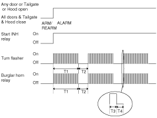

   T1 : Tempo único de alarme, T2 : Tempo de pausa do alarme,

   T3 : Tempo de atividade, T4 : Tempo de desatividade

   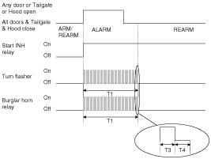

   T1 : Tempo único de alarme, T3 : Tempo de atividade, T4 : Tempo de desatividade
