# Kia Sportage: Procedimentos de Reparo

[Início](../../index.md) / [Manual de Serviço e Reparo do Kia Sportage SL](../sportage-482.md) / [Sistema Elétrico do Corpo](sportage-984.md) / [Entrada Sem Chave e Alarme antifurto](sportage-1032.md) / Procedimentos de Reparo

## Inspeção

### Actuador de Fechadura do Pneu Dianteiro

1. Remova o trim do pneu dianteiro.

   (Consulte o grupo BD - "Pneu dianteiro")

2. Remova o módulo do pneu dianteiro.

3. Desconecte o conector 7P do actuador.

   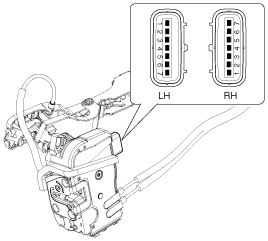

4. Verifique a operação do actuador conectando o fornecimento de energia e a massa conforme a tabela. Para prevenir danos ao actuador, aplique apenas um curto momento de tensão da bateria.

   [Central Lock]

   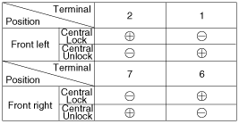

### Actuador de Fechadura do Pneu Traseiro

1. Remova o trim do pneu traseiro.

   (Consulte o grupo BD - "Pneu traseiro")

2. Remova o módulo do pneu traseiro.

3. Desconecte o conector 7P do actuador.

   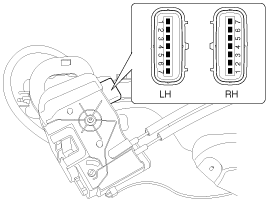

4. Verifique a operação do actuador conectando o fornecimento de energia e a massa conforme a tabela. Para prevenir danos ao actuador, aplique apenas um curto momento de tensão da bateria.

   [Central Lock]

   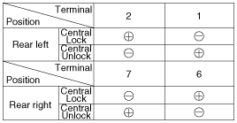

### Actuador de Liberação do Pneu Traseiro

1. Remova o trim do pneu traseiro.

   (Consulte o grupo BD - "Pneu traseiro")

2. Desconecte o conector 4P do actuador.

   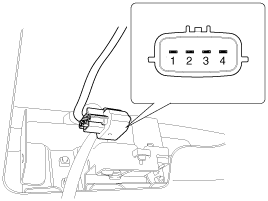

3. Verifique a operação do actuador conectando o fornecimento de energia e a massa conforme a tabela. Para prevenir danos ao actuador, aplique apenas um curto momento de tensão da bateria.

   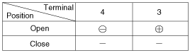

### Interruptor de Fechadura do Pneu Dianteiro

1. Remova o trim do pneu dianteiro.

   (Consulte o grupo BD - "Pneu dianteiro")

2. Remova o módulo do pneu dianteiro.

3. Desconecte o conector 7P do actuador.

   

4. Verifique a continuidade entre os terminais em cada posição do interruptor ao inserir a chave no pneu conforme a tabela.

   [Central Lock]

   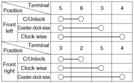

### Interruptor de Fechadura do Pneu Traseiro

1. Remova o trim do pneu traseiro.

   (Consulte o grupo BD - "Pneu traseiro")

2. Remova o módulo do pneu traseiro.

3. Desconecte o conector 7P do actuador.

   

4. Verifique a continuidade entre os terminais em cada posição do interruptor conforme a tabela.

   [Central Lock]

   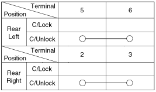

### Interruptor de Abertura do Pneu Traseiro

1. Remova o trim do pneu traseiro.

   (Consulte o grupo BD - "Pneu traseiro")

2. Desconecte o conector 4P do actuador.

   

3. Verifique a continuidade entre os terminais em cada posição do interruptor conforme a tabela.

   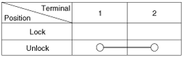

### Inspeção do Interruptor de Pneu

Remova o interruptor de pneu e verifique a continuidade entre os terminais.

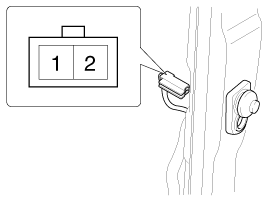

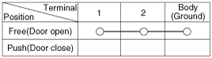

### Inspeção do Interruptor do Capô

1. Desconecte o conector do interruptor do capô (A).

   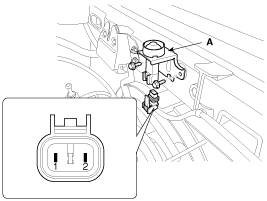

2. Verifique a continuidade entre os terminais e a massa conforme a tabela.

   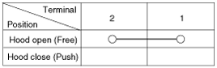

### Inspeção do Sirene de Furto

1. Remova o alarme de assalto (A) após remover 1 parafuso e desconecte o conector 2P do alarme de assalto.

   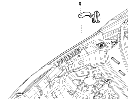

2. Teste o alarme de assalto conectando o poder da bateria ao terminal 1 e conectando o terminal 2 à massa.

3. O alarme de assalto deve fazer algum som. Se o alarme de assalto não fizer nenhum som, substitua-o.
