# Kia Sportage: Transmissor: Procedimentos de Reparo

[Home](../../index.md) / [Manual de Serviço e Reparo do Kia Sportage SL](../sportage-482.md) / [Sistema Elétrico do Corpo](sportage-984.md) / [Entrada Sem Chave e Alarme Antifurto](sportage-1032.md) / Procedimentos de Reparo do Transmissor

## Inspeção

1. Verifique se a luz vermelha piscar quando o botão de travamento ou desbloqueio da porta no transmissor for pressionado.

2. Remova a bateria (A) e verifique a tensão se a luz vermelha não piscar.

   ```
   Tensão padrão: 3V
   ```

   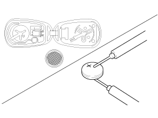

3. Insira a bateria (A) no teste (09954-2p100).

   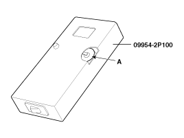

4. Pressione o botão de teste e, se "0.00" aparecer na tela, significa que a tensão da bateria é 2V ou menos.

5. Se "L" aparecer na tela, significa que a bateria está com baixa carga e precisa ser substituída.

6. Para prevenir a descarga de energia, desligue o teste.

7. Substitua a bateria do transmissor por uma nova, se a tensão estiver com baixa carga, tente travar e desbloquear as portas pressionando o botão de travamento ou desbloqueio cinco ou seis vezes.

8. Se as portas travarem e desblocarem, o transmissor está ok, mas se as portas não travarem e desblocarem, registre o código do transmissor, depois tente travar e desbloquear as portas.

9. Se as portas travarem e desblocarem, o transmissor está ok, mas se as portas não travarem e desblocarem, substitua o transmissor.

   > **Aviso**
   >
   > - Uma bateria descartada incorretamente pode ser prejudicial ao meio ambiente e à saúde humana.
   > - Descarte a bateria de acordo com a lei(s) ou regulamento(s) locais.

## Registro do Código do Transmissor (Usando GDS)

1. Conecte o cabo DLC do GDS à conexão de dados (16 pinos) no painel inferior do crash pad do lado do motorista, ligue o GDS.

   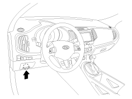

2. Selecione o modelo do veículo e, em seguida, faça "SAVE CODE"

   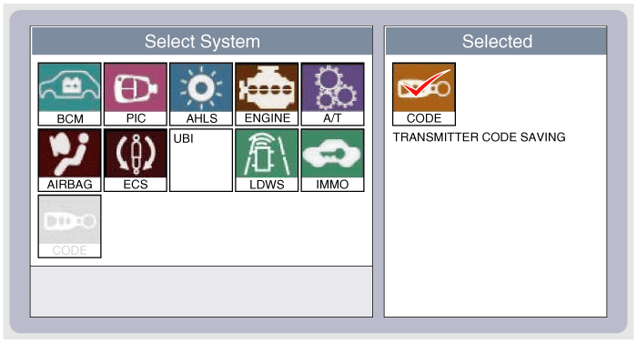

3. Após selecionar o menu "SAVE CODE", pressione a tecla "ENTER", então a tela será exibida como abaixo.

   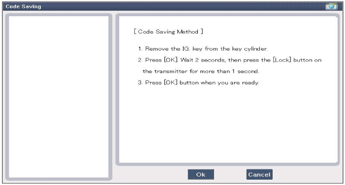

4. Após remover a chave de ignição da coluna de direção, pressione a tecla "ENTER" para prosseguir para o próximo modo para o salvamento do código. Segue-se os passos 1 a 4 e, então, o salvamento do código está concluído.

   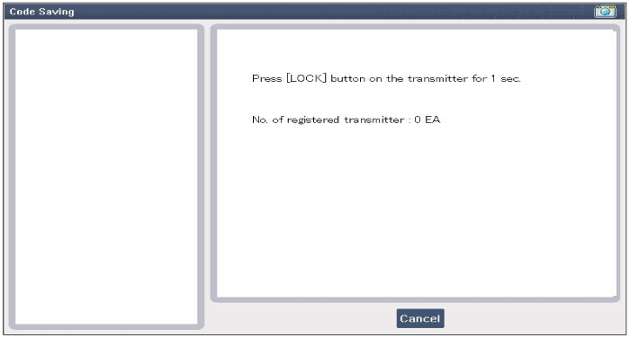

   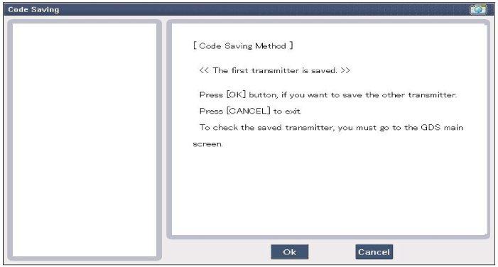

   

   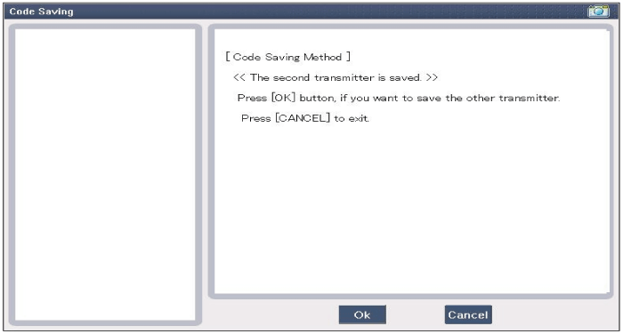

   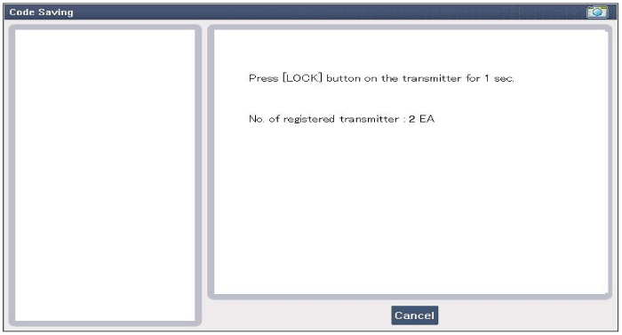

   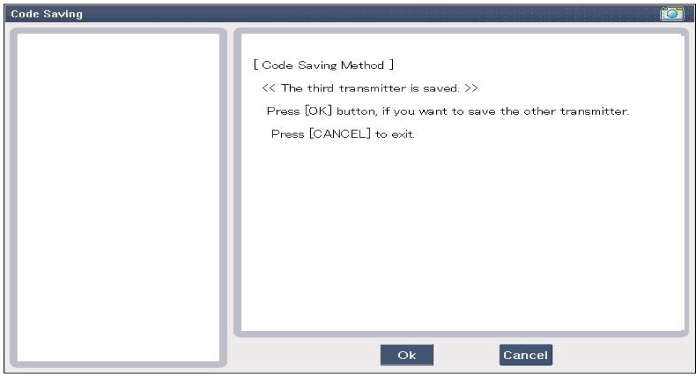

   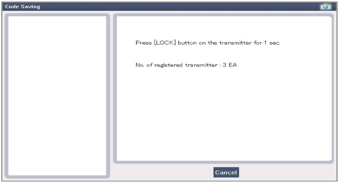

   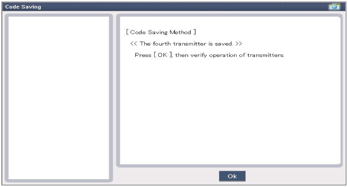

   
