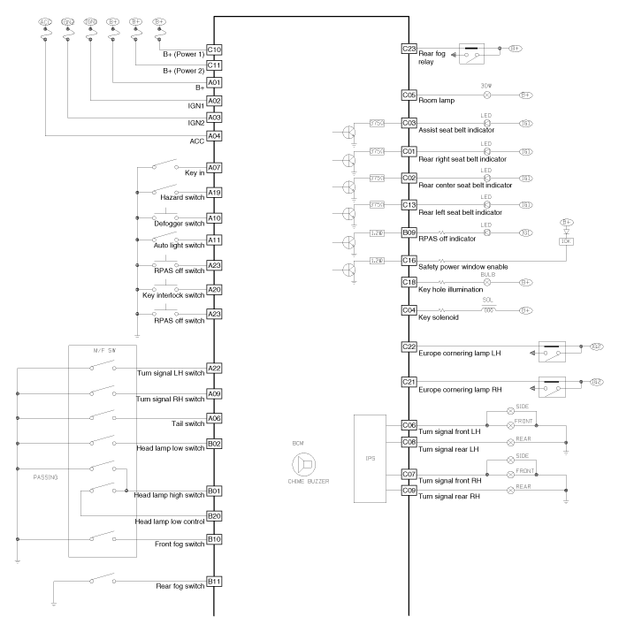
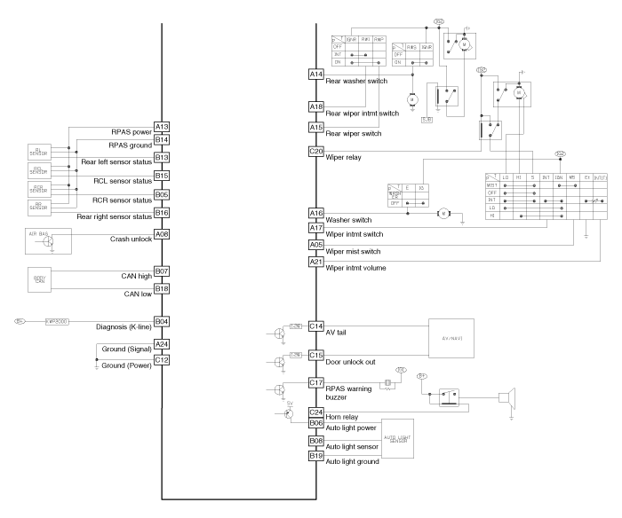

# Kia Sportage: Módulo de Controle do Corpo (MCC): Diagramas Schematicos

[Home](../../index.md) / [Manual de Serviço e Revisão do Kia Sportage SL](../sportage-482.md) / [Sistema Elétrico do Corpo](sportage-984.md) / [MCC (Módulo de Controle do Corpo)](sportage-1039.md) / Diagramas Schematicos do Módulo de Controle do Corpo (MCC)

## Diagrama Elétrico

