# Kia Sportage: Module de Controle do Corpo (BCM): Descrição e Operação

[Home](../../index.md) / [Manual de Serviço e Reparo do Kia Sportage SL](../sportage-482.md) / [Sistema Elétrico do Corpo](sportage-984.md) / [BCM (Module de Controle do Corpo)](sportage-1039.md) / Module de Controle do Corpo (BCM): Descrição e Operação

## Descrição

| O módulo de controle do corpo recebe sinais de entrada de interruptores controlando o tempo e as funções de alarme para limpador de para-brisas interligado com o limpador de vidros, limpador de vidros intermitente frontal, limpador de neblina, limpador de para-brisas interligado com o limpador de vidros, limpador de vidros intermitente traseiro, alerta do cinto de segurança, alerta com chave, alerta de partida do estacionamento, som de ensino do RKE, alerta do SMK, temporizador do vidro elétrico, vidro elétrico de segurança, temporizador do desfogador traseiro, temporizador do desgelador do vidro do para-brisas, lâmpada do lampião decrépito (map), corte automático da luz do farol traseiro, luzes DRL, escort, farol alto/baixo, luz do farol traseiro, lampião de sinalização de mudança de direção, lampião de emergência, luz ESS, mudança de faixa, luz automática, farol de neblina dianteiro, luz AV traseira, travamento/abertura central das portas, sinal de desbloqueio AV, 2º desbloqueio de travamento de direção, travamento/abertura automática das portas, alerta com chave IGN, desbloqueio de porta em caso de colisão, interlock com chave, controle de alarme antifurto. |  |
| --- | --- |

Abreviações e Definições

| Abreviações | Definições |
| --- | --- |
| IPM | Plataforma Modular Inteligente Integrada (= Módulo de Controle do Corpo) |
| DRL | Luzes de Frente Diurnas |
| MFSW | Interruptores Multifuncional |
| IPS | Interruptor de Potência Inteligente |
| ALS | Sensor de Luz Automático |
| SW | Interruptor |
| J/Box | (Inteligente) Caixa de Conexão |
| BCM | Módulo de Controle do Corpo |
| SMK | Unidade de Chave Inteligente |
| CLU | Cluster |
| SBW | Alerta do Cinto de Segurança |
| DRV | Lado do Motorista |
| AST | Lado do Assistente |
| RPAS | Assistente de Estacionamento Rápido |

A classificação das características de sinal

| Símbolo | Descrição | Observações |
| --- | --- | --- |
| L_ | Entrada Lógica | ? |
| A_ | Entrada Analógica | ? |
| O_ | Saída Lógica | ? |
| C_ | Sinal CAN | ? |
| S_ | Comunicação Serial | ? |
| P_ | Sinal PWM e Frequência | ? |
| D_ | Sinal de Dados | Formato de Dados Especiais |
| V_ | Suprimento de Energia e Chão | ? |
| b_ | Variável Interna | ? |
| B_ | Corpo | ? |

## Função

Controle de Limpador e Desumidificador

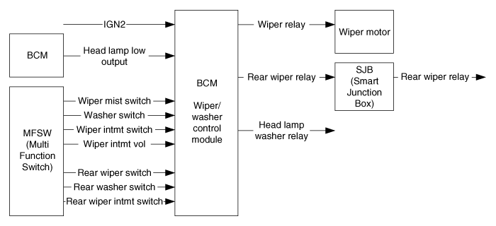

| Função | Características | Nome |  |
| --- | --- | --- | --- |
| Rótulo Físico | Designação Específica |  |  |
| Entrada | Lógica | L_IGN2 | Entrada de Ignição 2 |
| L_WiperMistSW | Interruptor de Mistura do Limpador da Frente |  |  |
| L_WasherSW | Interruptor do Limpador da Frente |  |  |
| L_WiperIntmtSW | Interruptor Intermittente do Limpador da Frente |  |  |
| L_RearWiperSW | Interruptor do Limpador da Traseira |  |  |
| L_RearWasherSW | Interruptor do Limpador da Traseira |  |  |
| L_RearWiperIntmtSW | Interruptor Intermittente do Limpador da Traseira |  |  |
| Interno | b_HeadLampLowOutput | Estado de Ligar/Desligar da Luz da Cabeça Baixa |  |
| Analógico | A_WiperIntmtVol | Valor do Intervalo de Tempo do Limpador Intermittente da Frente |  |
| Saída | Lógica | O_WiperRly | Saída do Limpador da Frente |
| O_HeadLampWasherRly | Saída do Limpador da Luz da Cabeça |  |  |
| Comunicação CAN | C_RearWiperRly | Saída do Limpador da Traseira |  |

Descrição Geral do Limpador e Líquido do Limpador da Frente

1. O Controle do Interruptor de Limpador Baixo e do Interruptor de Limpador Alto são controles diretos.

   | – | As saídas do Interruptor de Limpador Baixo e do Interruptor de Limpador Alto do MFSW estão conectadas diretamente ao Motor do Limpador. |
   | --- | --- |

   | – | O BCM controla apenas o Líquido do Limpador, o Líquido do Limpador e o Limpador Intermittente. |
   | --- | --- |

   | – | Prioridade da Função do Limpador: Líquido do Limpador > Líquido do Limpador > Limpador Intermittente |
   | --- | --- |

Controle do Líquido do Limpador da Frente

| – | Em caso de Ignição 2 Ligada (L_IGN2 = ON), se ligar o Interruptor de Líquido do Limpador da Frente (L_WiperMistSwitch = ON), então o Limpador será controlado, dependendo do tempo de ligar o interruptor. |
| --- | --- |

| – | O operação do Líquido do Limpador não funciona no Líquido do Limpador. |
| --- | --- |

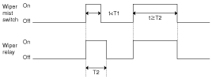

T1: Um limpador, T2: Um líquido do limpador

Controle Intermittente do Limpador da Frente

| – | Em caso de Ignição 2 Ligada (L_IGN2 = ON), se ligar o Interruptor Intermittente do Limpador (L_WiperIntmtswitch = ON), então a saída do Limpador Baixo será ligada dependendo do tempo de Limpador Intermittente (WiperIntmtTime, este valor é definido pelo valor de entrada A_WiperIntmtVol). |
| --- | --- |

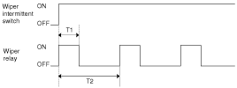

T1: Um limpador, T2: Tempo de Limpador Intermittente

| Nome do Valor | Valor |
| --- | --- |
| Um Limpador | 0,7 seg ± 70 ms |
| Tempo de Limpador | 2 seg |

Controle do Líquido do Limpador da Frente

1. Em caso de Ignição 2 Ligada (L_IGN2 = ON), se o usuário ligar o Interruptor do Líquido do Limpador (L_Washerswitch = ON) por um tempo determinado, então a saída do Limpador será controlada dependendo do modo do Limpador.

   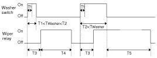

   T1: Tempo de DET do Interruptor do Líquido, T2: Tempo do Modo de Líquido,

   T3: Tempo de Atraso de Saída, T4: Um Limpador,

   T5: Tempo do Modo de Líquido

   | Nome do Valor | Valores |
   | --- | --- |
   | Tempo de DET do Interruptor do Líquido | 0 seg (Tempo de Filtragem de Entrada) |
   | Tempo do Modo de Líquido | 0,2 seg ± 20 ms |
   | Tempo de Atraso de Saída | 0,3 seg ± 30 ms |
   | Um Limpador | 0,7 seg ± 70 ms |
   | Tempo do Modo de Líquido | 3 seg ± 0,3 seg |

2. Durante o controle do Limpador Intermittente, se o Interruptor do Líquido for ligado, o BCM para o controle Intermittente e entra no modo de controle do Líquido e, após o término do controle do Líquido, retorna ao controle Intermittente do Limpador.

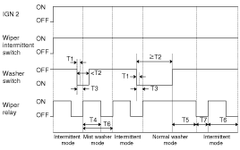

T1 : Tempo de Washer SW DET, T2 : Tempo de modo de neblina,

T3 : Tempo de atraso de desligamento, T4 : Uma passada,

T5 : Tempo de modo Washer, T6 : Tempo de intervalo do limpador,

T7 : (Tempo de intervalo do limpador - Uma passada)

Limpador de Para-brisas Traseiro & Washer Geral

1. O BCM possui lógica de controle do limpador traseiro.

   | – | O BCM envia o sinal de controle do limpador traseiro (C_RearWiperRly) para o J/Box via CAN. |
   | --- | --- |

   | – | O J/Box controla o motor do limpador traseiro. |
   | --- | --- |

   | – | Prioridade de Função do Limpador Traseiro : Interruptor de Limpador Traseiro > Washer do Limpador Traseiro > Intervalo do Limpador Traseiro |
   | --- | --- |

Controle de Função do Interruptor de Limpador Traseiro

| – | Em caso de IGN2 ON (L_IGN2 = On), se o usuário acionar o Interruptor de Limpador Traseiro (L_RearWiperswitch = On), o BCM controlará a Saída do Limpador Traseiro (C_RearWiperRly = On) até que o Interruptor de Limpador Traseiro seja desligado (L_RearWiperswitch = Off) ou IGN2 seja desligado (L_IGN2 = Off). |
| --- | --- |

Controle do Limpador Traseiro em Intervalo

| – | Em caso de IGN2 ON (L_IGN2 = ON), se o usuário acionar o Interruptor de Limpador Traseiro em Intervalo (L_RearWiperIntmtswitch = On), então a Saída do Limpador Traseiro em Baixa será ativada conforme o Tempo de Intervalo do Limpador Traseiro (RearWiperIntmtTime). T1 : Tempo de uma passada do limpador traseiro, T2 : Valor do Tempo de Intervalo do Limpador Traseiro. |
| --- | --- |
| Valor Nome | Valor |
| Tempo de uma passada do limpador traseiro | 0,7 seg ± 70 ms |
| Tempo de Intervalo do Limpador Traseiro | 6,7 seg ± 0,67 seg |

Controle do Washer do Limpador Traseiro

| – | Em caso de IGN2 ON (L_IGN2 = ON), se o usuário acionar o Interruptor de Washer do Limpador Traseiro (L_RearWasherswitch = On) por um tempo determinado, então a Saída do Limpador será controlada conforme o Modo do Limpador. T1 : Tempo de Washer do Limpador ligado, T2 : Tempo de modo neblina do Limpador, T3 : Tempo de atraso de desligamento do Washer do Limpador, T4 : Tempo de uma passada do limpador traseiro, T5 : Tempo de modo Washer do Limpador. |
| --- | --- |
| Valor Nome | Valores |
| Tempo de Washer do Limpador ligado | 0,2 seg ± 20 ms |
| Tempo de modo neblina do Limpador | 0,6 seg ± 100 ms |
| Tempo de atraso de desligamento do Washer do Limpador | 0,3 seg ± 100 ms |
| Tempo de uma passada do limpador traseiro | 0,7 seg ± 70 ms |
| Tempo de modo Washer do Limpador | 3 seg ± 0,3 seg |

| – | Durante o Controle do Limpador Traseiro em Intervalo, se o Interruptor de Washer do Limpador for acionado, o BCM parará o Controle em Intervalo e entrará no Modo de Washer do Limpador. Após o término do Controle de Washer do Limpador, retornará ao Controle do Limpador Traseiro em Intervalo. |
| --- | --- |

Função de Washer dos Faróis

1. Em caso de IGN2 ON (L_IGN2 = On) & Farol ON (b_HeadLampLowOutput = On), se a entrada do interruptor de Washer (L_Washerswitch = On) for detectada e mantida por um tempo maior que "WasherSWTime", a Saída do Washer dos Faróis será ativada.

Translate this Markdown chunk (4/28) para o português brasileiro.

   (O_HeadLampWasher = Ativado) durante “Tempo de Ativação do Lavador de Farol”. Se
   “HeadLampWasherNumber” for maior que 1, o lavador de farol ativa-se em On e Off por “Tempo de Ativação do Lavador de Farol” e “Tempo de Desativação do Lavador de Farol” e “HeadLampWasherNumber” vezes.

2. Quando outro lavador de farol é solicitado durante a ativação do lavador de farol, o segundo é ignorado.

3. Após a ativação da saída do lavador de farol, há um tempo de inibição de “HeadLampWasherInhibitTime”. Durante o tempo de inibição, a solicitação de lavador de farol é ignorada.

4. Após o início da saída, mesmo que a condição prévia não seja satisfeita (farol desligado), a saída não para. Mas em IGN2 off, a saída para.

   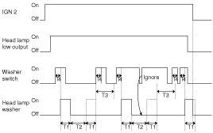

   T1 : Tempo de ativação do lavador de farol,

   T2 : Tempo de desativação do lavador de farol,

   T3 : Tempo de inibição do lavador de farol,

   T4 : Tempo de SW do lavador

   | Nome | Valor |
   | --- | --- |
   | Número de Lavadores de Farol | 1 (a definir) |
   | Tempo de Ativação do Lavador de Farol | 1,2 ± 0,1 seg (a definir) |
   | Tempo de Desativação do Lavador de Farol | 1,2 ± 0,1 seg (a definir) |
   | Tempo de SW do Lavador | 0 seg |
   | Tempo de Inibição do Lavador de Farol | 5 seg |

Controle da Iluminação Externa

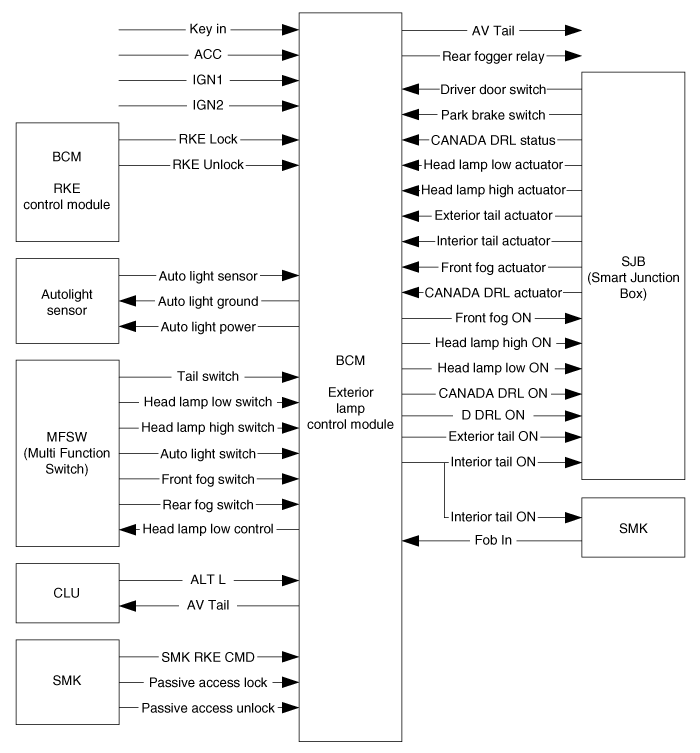

| Função | Características | Nome |  |
| --- | --- | --- | --- |
| Rótulo de Hardware | Designação Específica |  |  |
| Entrada | Lógica | L_KeyIn | Sinal de Entrada da Chave |
| L_ACC | Sinal de Acessório |  |  |
| L_IGN2 | Energia da Ignição 2 |  |  |
| L_AutoLightSW | Interruptor de Farol Automático |  |  |
| L_HeadLampLowSW | Interruptor de Farol Baixo |  |  |
| L_TailSW | Interruptor de Farol Traseiro |  |  |
| L_FrontFogSW | Interruptor de Farol de Neblina Frente |  |  |
| L_HeadLampHighSW | Interruptor de Farol Alto |  |  |
| L_RearFogSW | Interruptor de Farol de Neblina Traseira |  |  |
| Analógico | A_AutoLightSnsr | Entrada Analógica do Sensor de Luz Automática |  |
| A_IGN1 | Energia da Ignição 1 |  |  |
| Comunicação CAN | C_FobIn | Estado de Inserção da Chave Fob |  |
| C_ALT_L | Motor em funcionamento |  |  |
| C_PassiveAccessLock | Bloqueio Passivo de Acesso para Módulo da Porta |  |  |
| C_PassiveAccessUnlock | Desbloqueio Passivo de Acesso para Módulo da Porta |  |  |
| C_SMKRKECMD | Comando Fob SMK Keyless |  |  |
| C_DRVDRSW | Interruptor da Porta do Motorista |  |  |
| C_ParkBrakeSW | Interruptor do Freio de Estacionamento |  |  |
| C_CANADA_DRLSts | Opção CANADA DRL |  |  |
| C_HLampLOW_Act | Atividade do Farol Baixo |  |  |
| C_HLampHIGH_Act | Atividade do Farol Alto |  |  |
| C_EXTTail_Act | Atividade do Farol Traseiro Externo |  |  |
| C_INTTail_Act | Atividade do Farol Traseiro Interno |  |  |
| C_FrontFog_Act | Atividade do Farol de Neblina Frente |  |  |
| C_CANADA_DRL_Act | Atividade CANADA DRL (50% de Farol Alto) |  |  |
| Interno | b_RKELock | Solicitação de Bloqueio por RKE em Variante Não SMK |  |
| b_RKEUnlock | Solicitação de Desbloqueio por RKE em Variante Não SMK |  |  |
| Saída | Lógica | O_HeadLampLowCTRL | Status de Saída do Farol Baixo (Ativo Baixo) |
| O_RearFogRLY | Controle do Farol de Neblina Traseira |  |  |
| O_AVTail | Saída de Luz Automática para Módulo AV |  |  |
| V_AutoLightPwr | Suprimento de Energia para Módulo de Luz Automática |  |

| V_AutoLightGND | Suprimento de Terra para Modulo de Luz Automóvel |  |  |
| CAN Communication | C_INTTailON | Comando de Ligação Interna da Luz Traseira |  |
| C_EXTTailON | Comando de Ligação Externa da Luz Traseira |  |  |
| C_HeadLampLowON | Comando de Luz da Cabeça Baixa |  |  |
| C_HeadLampHighON | Comando de Luz da Cabeça Alta |  |  |
| C_FrontFogON | Comando de Luz de Nevoeiro da Frente |  |  |
| C_CANADA_DRLON | Comando de DRL CANADA (50% de lâmpada de farol alto) |  |  |
| C_AV_Tail | AV Traseira |  |  |
| C_D_DRL_ON | Comando de DRL Dedicado |  |  |

Controle da Luz Traseira

1. Esta função descreve as seguintes características.

   | – | Ligar e desligar a Luz Traseira pelo input do interruptor. |
   | --- | --- |

   | – | Ligar e desligar a Luz Traseira pelo comando de controle de luz automática. |
   | --- | --- |

   | – | Desligar automaticamente a Luz Traseira se o condutor esquecer de desligá-la. |
   | --- | --- |

   | – | Controle de saída da Luz Traseira |
   | --- | --- |

2. Condições do Controle Automático da Luz Traseira

   | – | A estratégia "Controle Automático da Luz Traseira" garante que as luzes traseiras sejam desligadas mesmo se o condutor esquecer de desligá-las. |
   | --- | --- |

   | – | Quando a Luz Traseira é ligada pelo interruptor de Luz Traseira, após a inserção da chave, e se o usuário remover a chave e abrir a porta do lado do motorista (ou vice-versa), as luzes traseiras são automaticamente desligadas. |
   | --- | --- |

   | – | Enquanto o "Controle Automático da Luz Traseira" está ativo, se o usuário desligar o interruptor de Luz Traseira ou inserir a chave, o "Controle Automático da Luz Traseira" será desativado. |
   | --- | --- |

   > **Nota**
   >
   > - Durante a ativação da função de acompanhamento, não é possível o modo de Controle Automático da Luz Traseira e só é aplicável após a desativação da função de acompanhamento.

Controle da Luz da Cabeça

1. Esta função descreve as seguintes características.

   | – | Ligar e desligar a Luz da Cabeça Baixa pelo input do interruptor de Luz da Cabeça Baixa. |
   | --- | --- |

   | – | Ligar e desligar a Luz da Cabeça Baixa pela função de acompanhamento. |
   | --- | --- |

   | – | Ligar e desligar a Luz da Cabeça Baixa pelo pedido de controle de luz automática. |
   | --- | --- |

   | – | Ligar e desligar a Luz da Cabeça Alta pelo input do interruptor de Luz da Cabeça Alta. |
   | --- | --- |

   | – | Ligar e desligar a Luz da Cabeça Alta e Baixa pelo input do interruptor de passagem. |
   | --- | --- |

   | – | Controle de saída da Luz da Cabeça Baixa. |
   | --- | --- |

   | – | Controle de saída da Luz da Cabeça Alta. |
   | --- | --- |

   | – | Controle de saída do indicador da Luz da Cabeça Alta. |
   | --- | --- |

   | – | Controle de saída da lâmpada EC DRL. |
   | --- | --- |

2. Controle da Luz da Cabeça Baixa

   | – | No estado do terminal IGN (b_IGN = ON), se ligar o interruptor de Luz da Cabeça Baixa (L_HeadLampLowSW = ON) ou se o sensor de luz automática indicar que a luz da cabeça está ligada, os saídos da Luz da Cabeça Baixa são ligados (C_HLampLowON = ON). |
   | --- | --- |

   | – | Quando as condições de Luz Traseira Desligada e Luz da Cabeça Desligada são satisfeitas simultaneamente, a Luz da Cabeça Baixa e a Luz Traseira são desligadas imediatamente. |
   | --- | --- |

3. Controle da Luz da Cabeça Alta

   | – | No estado do terminal IGN (b_IGN = ON) e Luz da Cabeça Baixa Ligada (O_HeadLampLowCTRL = ON), se ligar o interruptor de Luz da Cabeça Alta |

Translate this Markdown chunk (6/28) para o português brasileiro.

   SW(L_HeadLampHighSW = ON), Saídas da Luz Alta dos Faróis são ativadas
   (C_HLampHighON = ON). |
   | --- | --- |

   | – | Em modo de luz automática, se o interruptor de luz alta for ativado
   e a luz baixa estiver "ligada", a ativação da luz alta será ativada. |
   | --- | --- |

   | – | Neste caso, será utilizado o sinal de controle da luz baixa.
   [O_HeadLampLowCTRL] este sinal é ativo baixo, quando a luz baixa estiver
   ligada [O_HeadLampLowCTRL = On], ele pode obter o estado do interruptor
   de luz alta. |
   | --- | --- |

   | – | Quando a luz baixa estiver desligada [O_HeadLampLowCTRL = Off],
   o interruptor de luz alta não será ativado, mesmo que o interruptor multifuncional
   de luz alta esteja ligado. |
   | --- | --- |

4. Controle de Passageiro

   | – | No estado do terminal IGN (b_IGN = ON), se o sinal de entrada de luz
   de passagem (b_PassingSW = ON) for detectado, então as saídas da luz alta
   (C_HLampHighON = ON) serão ativadas e a saída da luz baixa (C_HLampLowON= ON)
   simultaneamente. |
   | --- | --- |

5. CANADA DRL (NA DRL)

   | – | Se o alternador estiver ativo (C_AltL = On), o BCM ativará a funcionalidade
   CANADA DRL e ligará os faróis de luz alta (C_CANADA_DRLON=On). |
   | --- | --- |

   | – | Condição de desativação |
   | --- | --- |

   a. Solicitação de luz baixa pelo interruptor de luz ou controle de luz automática

   b. Solicitação de luz alta pelo interruptor de passagem

   c. Interruptor do freio de estacionamento ligado

   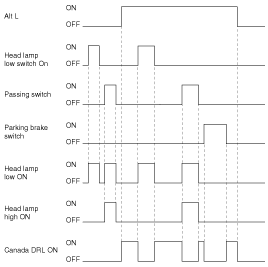

6. Função de Assistência

   | – | Após o usuário gerar a solicitação de luz baixa
   (b_HeadLampLowSWOn = ON), se o acionamento do interruptor de ignição
   (b_IGN =Off e b_START=Off) e manter a saída da luz baixa (C_HLampLowON= ON)
   durante 20 minutos. |
   | --- | --- |

   | – | E após abrir e fechar a porta do passageiro (C_DRVDRSW = ON >
   C_DRVDRSW = Off), o usuário terá, consequentemente, a iluminação da luz baixa
   (C_HLampLowON = ON) durante apenas 30 segundos. |
   | --- | --- |

   | – | Durante a ativação da "Função de Assistência", se recebermos
   solicitação de travamento 2 vezes (b_2LOCK =2) ou cancelar a solicitação
   de iluminação da luz baixa (L_HeadLampLowSW = Off & L_AutoLightSW = Off),
   esta função será liberada. |
   | --- | --- |

   > **Nota**
   >
   > - Enquanto a "Função de Assistência" estiver ativa, o farol traseiro permanecerá
   ligado e não entrará no Autocut e após terminar a "Função de Assistência" e o usuário
   remover a chave, pode entrar no modo Autocut.
   - Enquanto a "Função de Assistência" for ativada pelo "Interruptor de Luz Baixa",
   se mudar do "Interruptor de Luz Baixa" para "Interruptor de Luz Automática",
   a "Função de Assistência" será desativada, pois o modo de luz automática é
   a condição "Luz Desligada".
   - Enquanto a "Função de Assistência" for ativada pelo "Interruptor de Luz Automática",
   se mudar do "Interruptor de Luz Automática" para "Interruptor de Luz Baixa",
   a "Função de Assistência" manterá o estado de ativação,
   devido à condição "Luz Ligada".
   - Após o terminal IGN desligado, o temporizador de 20 minutos é iniciado,
   mas assim que a porta é aberta e fechada, o temporizador de 30 segundos é ativado.

   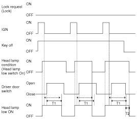

T1 : Ecsort 20m time, T2 : Ecsort 30s time

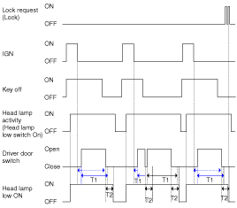

T1 : Ecsort 20m time, T2 : Ecsort 30s time

Controle de Luz do Automóvel

1. Esta função descreve as seguintes características.

   | – | Detecção de entrada pelo Sensor de Luz do Automóvel. |
   | --- | --- |

   | – | Geração do Status de Saída de Luz do Automóvel. |
   | --- | --- |

   | – | Envio do Status de Saída de Luz do Automóvel. |
   | --- | --- |

   | – | Controle de Luz Traseira pelo Modo de Luz do Automóvel. |
   | --- | --- |

   | – | Controle de Luz da Frente Baixa pelo Modo de Luz do Automóvel. |
   | --- | --- |

   | – | Controle de Luz Traseira AV pelo Nível do Sensor de Luz. |
   | --- | --- |

2. Variante

   | Variante | NA | |
   | --- | --- | --- |
   | Descrição | Nível de Luz Traseira ON | 1,57V ± 0,10V |
   | Nível de Luz Traseira OFF | 2,56V ± 0,10V | |
   | Nível de Luz da Frente ON | 1,57V ± 0,10V | |
   | Nível de Luz da Frente OFF | 2,56V ± 0,10V | |
   | Nível de Luz Traseira AV ON | 0,41V ± 0,10V | |
   | Nível de Luz Traseira AV OFF | 0,9V ± 0,10V | |
   | Tempo de Filtragem ON | 12 + 0,1 sec | |
   | Tempo de Filtragem OFF | 12 + 0,1 sec | |

Controle de Saída de Luz Traseira AV

1. Em estados de terminal ACC, IGN, START, a monitorização do intervalo de suprimento do sensor de luz do automóvel (AutoLightPwr) é realizada e uma falha é levantada (falha de luz do automóvel) quando a tensão do suprimento está fora do intervalo (fora do intervalo [4V :6V]).

   Se ocorrer uma falha de luz do automóvel e enquanto esta falha estiver presente, as luzes traseiras e as luzes da frente baixa devem ser ligadas independentemente do nível de luz fornecido pelo sensor.

   Quando ocorre uma falha física no sensor de luz do automóvel, as lâmpadas são ligadas, pois um nível de tensão zero é fornecido pelo sensor quando uma falha interna está presente.

   Isso está projetado para prevenir qualquer corte de luz da frente durante a noite.

   O Controle de Saída de Luz Traseira AV é iniciado em ACC, IGN, START independentemente do MFSW de Luz do Automóvel.

   O sinal CAN AV_Tail é definido/redefinido ao mesmo tempo que AV Tail.

Controle de Luz de Neblina da Frente

| – | Em caso de Saída de Luz Traseira LIGADA (b_TailLamp = On), se for detectado entrada do Interruptor de Luz de Neblina da Frente (L_FrontFogSW = On), a Saída de Luz de Neblina da Frente (C_FrontFogON = On) é ligada. |
| --- | --- |

Controle de Luz Interna

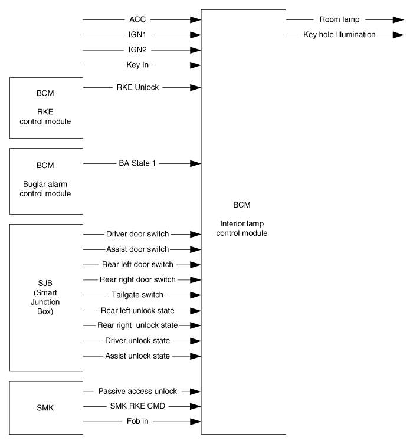

| Função | Características | Nome |  |
| --- | --- | --- | --- |
| Rótulo de Hardware | Designação Específica |  |  |
| Entrada | Lógica | L_ACC | Entrada ACC |
| L_IGN2 | Entrada de Ignição 2 |  |  |
| L_KeyIn | Sinal de Entrada da Chave |  |  |
| Analógico | A_IGN1 | Entrada de Ignição 1 |  |
| Comunicação CAN | C_FobIn | Interruptor Fob In |  |
| C_DRVDRSW | Abertura/Fechamento da Porta do Motorista |  |  |
| C_ASTDRSW | Abertura/Fechamento da Porta do Assistente |  |  |
| C_RLDRSW | Abertura/Fechamento da Porta do Lado Esquerdo Traseiro |  |  |
| C_RRDRSW | Abertura/Fechamento da Porta do Lado Direito Traseiro |  |  |
| C_DRVUnlockState | Estado de Desbloqueio da Porta do Motorista |  |  |
| C_ASTUnlockState | Estado de Desbloqueio da Porta do Assistente |  |  |
| C_RLUnlockState | Estado de Desbloqueio da Porta do Lado Esquerdo Traseiro |  |  |
| C_RRUnlockState | Estado de Desbloqueio da Porta do Lado Direito Traseiro |  |  |
| C_PassiveAccessUnlock | Desbloqueio de Acesso Passivo |  |  |

| Saída | Lógica | O_HeadLampLowCTRL | Status de Saída do Farol Baixo (Ativo Baixo) |
| O_RearFogRLY | Controle de Farol Traseiro |  |  |
| O_AVTail | Saída para o Módulo AV |  |  |
| V_AutoLightPwr | Suprimento de Energia para o Módulo de Luz Automática |  |  |
| V_AutoLightGND | Suprimento de Chão para o Módulo de Luz Automática |  |  |
| Comunicação CAN | C_INTTailON | Comando Interno de Farol Traseiro ON |  |
| C_EXTTailON | Comando Externo de Farol Traseiro ON |  |  |
| C_HeadLampLowON | Comando de Farol Baixo |  |  |
| C_HeadLampHighON | Comando de Farol Alto |  |  |
| C_FrontFogON | Comando de Farol de Nevoeiro Traseiro |  |  |
| C_CANADA_DRLON | Comando CANADA DRL ON (50% de farol alto) |  |  |
| C_AV_Tail | AV Traseiro |  |  |
| C_D_DRL_ON | Comando Dedicado de DRL |  |  |

Controle da Lampada de Aquecimento

1. Transições do estado "Lampada de Aquecimento Desligada":

   | Estado | Descrição |
   | --- | --- |
   | Condição Inicial | Estado "Lampada de Aquecimento Desligada" : A_IGN1 = Off & b_AllDoorsClose = On & C_TGSW = Off |
   | Evento | 1. b_KeyOn = Off & b_Unlock = Off >On : (Desbloqueio por RKE ou Passive) 2. b_KeyOn = On>Off |
   | 1. | b_KeyOn = Off & b_Unlock = Off >On : (Desbloqueio por RKE ou Passive) |
   | 2. | b_KeyOn = On>Off |
   | Ação | • Estado alterado para "Lampada de Aquecimento 30 seg ON" • Iniciar RoomLamp30Timer • O_RoomLamp = On (durante RoomLamp30Time) |
   | • | Estado alterado para "Lampada de Aquecimento 30 seg ON" |
   | • | Iniciar RoomLamp30Timer |
   | • | O_RoomLamp = On (durante RoomLamp30Time) |

   | Estado | Descrição |
   | --- | --- |
   | Condição Inicial | Estado "Lampada de Aquecimento Desligada" : A_IGN1 = Off |
   | Evento | 1. b_AnyDoorOpen = Off > On ou 2. Reset & b_AnyDoorOpen = On |
   | 1. | b_AnyDoorOpen = Off > On ou |
   | 2. | Reset & b_AnyDoorOpen = On |
   | Ação | • Estado alterado para "Lampada de Aquecimento 20 min ON" • Iniciar RoomLamp20Timer • O_RoomLamp = On (durante RoomLamp20Time) |
   | • | Estado alterado para "Lampada de Aquecimento 20 min ON" |
   | • | Iniciar RoomLamp20Timer |
   | • | O_RoomLamp = On (durante RoomLamp20Time) |

   | Estado | Descrição |
   | --- | --- |
   | Condição Inicial | Estado "Lampada de Aquecimento Desligada" : |
   | Evento | A_IGN1 = On & b_AnyDoorOpen = On |
   | Ação | • Estado alterado para "Lampada de Aquecimento ON" • O_RoomLamp = On |
   | • | Estado alterado para "Lampada de Aquecimento ON" |
   | • | O_RoomLamp = On |

   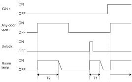

   T1 : Tempo de Lampada de Aquecimento 30 seg, T2 : Tempo de Lampada de Aquecimento 20 min

   | Nome do Valor | Valor |
   | --- | --- |
   | Tempo de Lampada de Aquecimento 30 seg | 30 seg ± 3 seg |
   | Tempo de Lampada de Aquecimento 20 min | 20 min ± 1 min |

2. Transições do estado "Lampada de Aquecimento 30 seg ON":

   | Estado | Descrição |
   | --- | --- |
   | Condição Inicial | Estado "Lampada de Aquecimento 30 seg ON" : |
   | Evento | 1. A_IGN1 == On ou 2. RoomLamp30Timer ? RoomLamp30Time ou 3. C_TGSW == Off & b_AllDoorsLock == Off > On ou 4. b_ATWSARM == On |
   | 1. | A_IGN1 == On ou |
   | 2. | RoomLamp30Timer ? RoomLamp30Time ou |
   | 3. | C_TGSW == Off & b_AllDoorsLock == Off > On ou |
   | 4. | b_ATWSARM == On |

| Ação | • Estado alterado para “Lâmpada do Aquecimento Decadendo” • Cancelar RoomLamp30Timer • Iniciar RoomLampDecayTimer • O_RoomLamp = Decadendo (Tempo de decadência : RoomLampDecayTime) |
   | • | Estado alterado para “Lâmpada do Aquecimento Decadendo” |
   | • | Cancelar RoomLamp30Timer |
   | • | Iniciar RoomLampDecayTimer |
   | • | O_RoomLamp = Decadendo (Tempo de decadência : RoomLampDecayTime) |

   | Estado | Descrição |
   | --- | --- |
   | Condição Inicial | Estado “Lâmpada do Aquecimento 30 seg On” : A_IGN1 == Off & b_AllDoorsClose == On & C_TGSW == Off |
   | Evento | 1. b_KeyOn == Off & b_Unlock == Off >On : (Desbloqueio por RKE ou Passive) 2. b_KeyOn == On>Off |
   | 1. | b_KeyOn == Off & b_Unlock == Off >On : (Desbloqueio por RKE ou Passive) |
   | 2. | b_KeyOn == On>Off |
   | Ação | • Estado permanece “Lâmpada do Aquecimento 30 seg On” • Reiniciar RoomLamp30Timer (reiniciar para mais RoomLamp30Time) |
   | • | Estado permanece “Lâmpada do Aquecimento 30 seg On” |
   | • | Reiniciar RoomLamp30Timer (reiniciar para mais RoomLamp30Time) |

   | Estado | Descrição |
   | --- | --- |
   | Condição Inicial | Estado “Lâmpada do Aquecimento 30 seg On” : A_IGN1 == Off |
   | Evento | b_AnyDoorOpen == Off>On |
   | Ação | • Estado alterado para “Lâmpada do Aquecimento 20 min On” • Cancelar RoomLamp30Timer • Iniciar RoomLamp20Timer • O_RoomLamp = Ligar (durante RoomLamp20Time) |
   | • | Estado alterado para “Lâmpada do Aquecimento 20 min On” |
   | • | Cancelar RoomLamp30Timer |
   | • | Iniciar RoomLamp20Timer |
   | • | O_RoomLamp = Ligar (durante RoomLamp20Time) |

   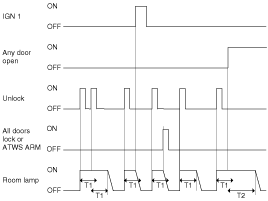

   T1 : Tempo da lâmpada do aquecimento 30 seg, T2 : Tempo da lâmpada do aquecimento 20 min

   | Nome do valor | Valor |
   | --- | --- |
   | Tempo da Lâmpada do Aquecimento 30 seg | 30 seg ± 3 seg |
   | Tempo da Lâmpada do Aquecimento 20 min | 20 min ± 1 min |

3. Transições do estado “Lâmpada do Aquecimento 20 min On”:

   | Estado | Descrição |
   | --- | --- |
   | Condição Inicial | Estado “Lâmpada do Aquecimento 20 min On” : |
   | Evento | • RoomLamp20Timer ? 20 min ou • A_IGN1 == Off & b_AllDoorsClose == On & C_TGSW == Off & b_AllDoorsLock == On |
   | • | RoomLamp20Timer ? 20 min ou |
   | • | A_IGN1 == Off & b_AllDoorsClose == On & C_TGSW == Off & b_AllDoorsLock == On |
   | Ação | • Estado alterado para “Lâmpada do Aquecimento Decadendo” • Cancelar RoomLamp20Timer • Iniciar RoomLampDecayTimer • O_RoomLamp = Decadendo (Tempo de decadência : RoomLampDecayTime) |
   | • | Estado alterado para “Lâmpada do Aquecimento Decadendo” |
   | • | Cancelar RoomLamp20Timer |
   | • | Iniciar RoomLampDecayTimer |
   | • | O_RoomLamp = Decadendo (Tempo de decadência : RoomLampDecayTime) |

   | Estado | Descrição |
   | --- | --- |
   | Condição Inicial | Estado “Lâmpada do Aquecimento 20 min On” : A_IGN1 == Off |
   | Evento | b_AllDoorsClose == On & C_TGSW == Off & b_AllDoorsLock == Off |
   | Ação | • Estado alterado para “Lâmpada do Aquecimento 30 seg On” • Cancelar RoomLamp20Timer • Iniciar RoomLamp30Timer • O_RoomLamp = Ligar (durante RoomLamp30Time) |
   | • | Estado alterado para “Lâmpada do Aquecimento 30 seg On” |
   | • | Cancelar RoomLamp20Timer |
   | • | Iniciar RoomLamp30Timer |
   | • | O_RoomLamp = Ligar (durante RoomLamp30Time) |

   | Estado | Descrição |
   | --- | --- |

| Condição Inicial | "Estado Lampada de Sala 20 Minutos Ligada" : |
   | Evento | A_IGN1 = Ligar |
   | Ação | • Estado mudou para "Lampada de Sala Ligada" • Cancelar RoomLamp20Timer • O_RoomLamp = Ligar |
   | • | Estado mudou para "Lampada de Sala Ligada" |
   | • | Cancelar RoomLamp20Timer |
   | • | O_RoomLamp = Ligar |

   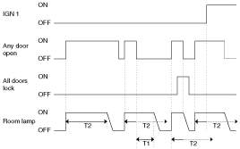

   T1 : Tempo de Lampada de Sala 30, T2 : Tempo de Lampada de Sala 20

   | Nome do Valor | Valor |
   | --- | --- |
   | Tempo de Lampada de Sala 30 | 30 seg ± 3 seg |
   | Tempo de Lampada de Sala 20 | 20 min ± 1 min |

4. Transições do estado "Decaimento da Lampada de Sala" :

   | Estado | Descrição |
   | --- | --- |
   | Condição Inicial | "Estado Decaimento da Lampada de Sala" : |
   | Evento | RoomLampDecayTimer ? RoomLampDecayTime |
   | Ação | • Estado mudou para "Lampada de Sala Desligada" • Cancelar RoomLampDecayTimer • O_RoomLamp = Desligada |
   | • | Estado mudou para "Lampada de Sala Desligada" |
   | • | Cancelar RoomLampDecayTimer |
   | • | O_RoomLamp = Desligada |

   | Estado | Descrição |
   | --- | --- |
   | Condição Inicial | "Estado Decaimento da Lampada de Sala" : A_IGN1 == Desligado & b_AllDoorsClose == Fechado & C_TGSW == Desligado |
   | Evento | 1. b_KeyOn == Desligado & b_Unlock == Desligado > Ligar : (Desbloqueio por RKE ou Passive) 2. b_KeyOn == Ligar > Desligado |
   | 1. | b_KeyOn == Desligado & b_Unlock == Desligado > Ligar : (Desbloqueio por RKE ou Passive) |
   | 2. | b_KeyOn == Ligar > Desligado |
   | Ação | • Estado mudou para "Lampada de Sala 30 seg Ligar" • Cancelar RoomLampDecayTimer • Iniciar RoomLamp30Timer • O_RoomLamp = Ligar (durante RoomLamp30Time) |
   | • | Estado mudou para "Lampada de Sala 30 seg Ligar" |
   | • | Cancelar RoomLampDecayTimer |
   | • | Iniciar RoomLamp30Timer |
   | • | O_RoomLamp = Ligar (durante RoomLamp30Time) |

   | Estado | Descrição |
   | --- | --- |
   | Condição Inicial | "Estado Decaimento da Lampada de Sala" : |
   | Evento | A_IGN1 == Ligar & b_AnyDoorOpen == Aberto |
   | Ação | • Estado mudou para "Lampada de Sala Ligada" • Cancelar RoomLampDecayTimer • O_RoomLamp = Ligar |
   | • | Estado mudou para "Lampada de Sala Ligada" |
   | • | Cancelar RoomLampDecayTimer |
   | • | O_RoomLamp = Ligar |

   | Estado | Descrição |
   | --- | --- |
   | Condição Inicial | "Estado Decaimento da Lampada de Sala" : A_IGN1 == Desligado |
   | Evento | b_AnyDoorOpen == Fechado > Aberto |
   | Ação | • Estado mudou para "Lampada de Sala 20 min Ligar" • Cancelar RoomLampDecayTimer • Iniciar RoomLamp20Timer • O_RoomLamp = Ligar (durante RoomLamp20Time) |
   | • | Estado mudou para "Lampada de Sala 20 min Ligar" |
   | • | Cancelar RoomLampDecayTimer |
   | • | Iniciar RoomLamp20Timer |
   | • | O_RoomLamp = Ligar (durante RoomLamp20Time) |

   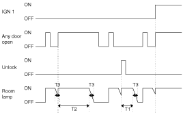

   T1 : Tempo de Lampada de Sala 30, T2 : Tempo de Lampada de Sala 20,

   T3 : Tempo de Decaimento da Lampada de Sala

   | Nome do Valor | Valor |
   | --- | --- |
   | Tempo de Lampada de Sala 30 | 30 seg ± 3 seg |
   | Tempo de Lampada de Sala 20 | 20 min ± 1 min |
   | Tempo de Decaimento da Lampada de Sala | 2 seg ± 0.2 seg |

5. Transições do estado "Lampada de Sala Ligada" :

   | Estado | Descrição |
   | --- | --- |
   | Condição Inicial | "Estado Lampada de Sala Ligada" : A_IGN1 == Ligar |
   | Evento | b_AllDoorsClose == Fechado & C_TGSW == Desligado |

| Ação | • Estado alterado para “Lâmpada do Quarto Decaindo” • Iniciar RoomLampDecayTimer • O_RoomLamp = Decaindo (tempo de decaindo : RoomLampDecayTime) |
   | • | Estado alterado para “Lâmpada do Quarto Decaindo” |
   | • | Iniciar RoomLampDecayTimer |
   | • | O_RoomLamp = Decaindo (tempo de decaindo : RoomLampDecayTime) |

   | Estado | Descrição |
   | --- | --- |
   | Condição Inicial | Estado “Lâmpada do Quarto Ligada” : |
   | Evento | A_IGN1 == Off & b_AllDoorsClose == On & C_TGSW == Off |
   | Ação | • Estado alterado para “Lâmpada do Quarto 30 Segundos Ligada” • Iniciar RoomLamp30Timer • O_RoomLamp = Ligada (durante RoomLamp30Time) |
   | • | Estado alterado para “Lâmpada do Quarto 30 Segundos Ligada” |
   | • | Iniciar RoomLamp30Timer |
   | • | O_RoomLamp = Ligada (durante RoomLamp30Time) |

   | Estado | Descrição |
   | --- | --- |
   | Condição Inicial | Estado “Lâmpada do Quarto Ligada” : |
   | Evento | A_IGN1 == Off & b_AnyDoorOpen == On |
   | Ação | • Estado alterado para “Lâmpada do Quarto 20 Minutos Ligada” • Iniciar RoomLamp20Timer • O_RoomLamp = Ligada (durante RoomLamp20Time) |
   | • | Estado alterado para “Lâmpada do Quarto 20 Minutos Ligada” |
   | • | Iniciar RoomLamp20Timer |
   | • | O_RoomLamp = Ligada (durante RoomLamp20Time) |

Controle da Lâmpada de Iluminação da Chave

1. Descrição Geral

   | – | Iluminação da chave fornece uma iluminação conveniente ao redor da área onde o motorista precisa inserir sua chave de ignição para ligar os terminais. |
   | --- | --- |

   | – | A iluminação da chave é ativada pelo motorista ou pela porta do passageiro, e permanece iluminada durante 30 segundos após o fechamento. |
   | --- | --- |

2. Transição de "Iluminação da Chave Desligada"

   | Estado | Descrição |
   | --- | --- |
   | Condição Inicial | Estado “Iluminação da Chave Desligada” : A_IGN1 == Off |
   | Evento | • C_DRVDRSW == On Ou • C_ASTDRSW == On |
   | • | C_DRVDRSW == On Ou |
   | • | C_ASTDRSW == On |
   | Ação | • Estado alterado para “Iluminação da Chave Ligada” • O_KeyHoleIllum = Ligada |
   | • | Estado alterado para “Iluminação da Chave Ligada” |
   | • | O_KeyHoleIllum = Ligada |

3. Transição de "Iluminação da Chave Ligada"

   | Estado | Descrição |
   | --- | --- |
   | Condição Inicial | Estado “Iluminação da Chave Ligada” : |
   | Evento | • A_IGN1 == On ou • b_BAState1 == On & C_DRVDRSW == Off & C_ASTDRSW == Off |
   | • | A_IGN1 == On ou |
   | • | b_BAState1 == On & C_DRVDRSW == Off & C_ASTDRSW == Off |
   | Ação | • Estado alterado para “Iluminação da Chave Desligada” • O_KeyHoleIllum = Desligada |
   | • | Estado alterado para “Iluminação da Chave Desligada” |
   | • | O_KeyHoleIllum = Desligada |

   | Estado | Descrição |
   | --- | --- |
   | Condição Inicial | Estado “Iluminação da Chave Ligada” : • A_IGN1 == Off & b_BAState1 == Off |
   | • | A_IGN1 == Off & b_BAState1 == Off |
   | Evento | C_DRVDRSW == Off & C_ASTDRSW == Off |
   | Ação | • Estado alterado para “Iluminação da Chave 30” • Iniciar TimerIllumi30 • O_KeyHoleIllum = Ligada (durante Illumi30Time) |
   | • | Estado alterado para “Iluminação da Chave 30” |
   | • | Iniciar TimerIllumi30 |
   | • | O_KeyHoleIllum = Ligada (durante Illumi30Time) |

4. Transição de "Key Hole Illu mination 30"

   | Estado | Descrição |
   | --- | --- |
   | Condição Inicial | "Key Hole Illu mination 30" state : |
   | Evento | • A_IGN1 == On ou • Illumi30Timer ? Illumi30Time • b_BAState1 == On |
   | • | A_IGN1 == On ou |
   | • | Illumi30Timer ? Illumi30Time |
   | • | b_BAState1 == On |
   | Ação | • Estado alterado para “Key Hole Illu mination Off” • Cancelar Illumi30Timer • O_KeyHoleIllum = Off |
   | • | Estado alterado para “Key Hole Illu mination Off” |
   | • | Cancelar Illumi30Timer |
   | • | O_KeyHoleIllum = Off |

   | Estado | Descrição |
   | --- | --- |
   | Condição Inicial | "Key Hole Illu mination 30" state : A_IGN1 == Off |
   | Evento | • C_DRVDRSW == On Ou • C_ASTDRSW == On |
   | • | C_DRVDRSW == On Ou |
   | • | C_ASTDRSW == On |
   | Ação | • Estado alterado para “Key Hole Illu mination On” • Cancelar Illumi30Timer • O_KeyHoleIllum = On |
   | • | Estado alterado para “Key Hole Illu mination On” |
   | • | Cancelar Illumi30Timer |
   | • | O_KeyHoleIllum = On |

   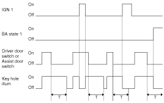

   T1 : Tempo de Illumi 30

   | Nome do Valor | Valor |
   | --- | --- |
   | Tempo de Illumi 30 | 30 seg ± 3 seg |

Aviso de Controle

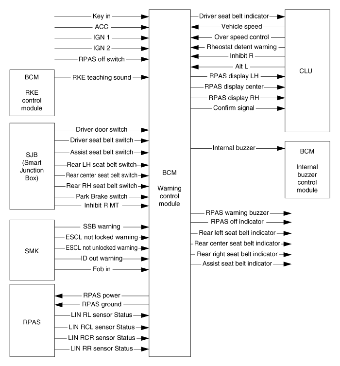

| Função | Características | Nome |  |
| --- | --- | --- | --- |
| Rótulo de Hardware | Designação Específica |  |  |
| Entrada | Lógica | L_KeyIn | Sinal de Entrada do Botão |
| L_ACC | Entrada de Acessório |  |  |
| L_IGN2 | Entrada de Ignição 2 |  |  |
| L_RPASOffSW | Interruptor de Desativação do RPAS. |  |  |
| Analógico | A_IGN1 | Entrada de Ignição 1 |  |
| Comunicação CAN | C_FobIn | Sinal de Entrada do Fob |  |
| C_10km | Velocidade do veículo de 10km/h que o CLU calcula |  |  |
| C_VelocidadeVeiculo | Velocidade do veículo do CAN de Potência Alta |  |  |
| C_InhibitR | Estado de Inhibit R |  |  |
| C_AltL | Nível do Alternador |  |  |
| C_ControlOverSpeed | Comando de Controle de Aviso de Velocidade Excedida |  |  |
| C_SDSB_Sinal | Sinal do Interruptor do Cinto do Condutor |  |  |
| C_SASB_Sinal | Sinal do Interruptor do Cinto do Assistente |  |  |
| C_CDSB_Sinal | Sinal do Interruptor do Cinto do Lado Esquerdo Traseiro |  |  |
| C_CCSB_Sinal | Sinal do Interruptor do Cinto do Centro Traseiro |  |  |
| C_CRSB_Sinal | Sinal do Interruptor do Cinto do Lado Direito Traseiro |  |  |
| C_RHEOSTAT_Detent_Warning | Comando de Aviso de Detentão do RHEOSTAT |  |
| C_BloqueioParque_SW | Sinal do Interruptor do Bloqueio Parque |  |
| C_SDSW_AbrirFechar | Estado de Abertura e Fechamento da Porta do Condutor |  |  |
| C_SSB_Aviso | Estado do Aviso SSB |  |
| C_IDOUT_Aviso | Estado do Aviso ID Out |  |
| C_ESCL_NaoBloqueado_Aviso | Estado do Aviso ESCL não Bloqueado |  |
| C_ESCL_NaoDesbloqueado_Aviso | Estado do Aviso ESCL não Desbloqueado |  |
| Comunicação LIN | LIN_RLSnsrStatus | Estado do Sensor RPAS Lateral Esquerda |  |
| LIN_RCLSnsrStatus | Estado do Sensor RPAS Centro Esquerdo |  |  |
| LIN_RCRSnsrStatus | Estado do Sensor RPAS Centro Direito |  |  |
| LIN_RRSnsrStatus | Estado do Sensor RPAS Lateral Direita |  |  |
| Interno | b_RKETeachingSound | Quando o ensinamento de cada chave RKE terminar, este evento é disparado. |  |

| Saída | Comunicação CAN | C_DRVSeatBeltIND | Estado do Indicador do Cinto de Segurança do Motorista |
| C_RPASDisplayLH | Status do Sensor ES |  |  |
| C_RPASDisplayCTR | Status do Sensor ES e CTR |  |  |
| C_RPASDisplayRH | Status do Sensor ER |  |  |
| C_R_Confirm_Signal | "R" Posição do Mãozinhas Status para Exibição no Cluster |  |  |
| Lógica | O_InternalBuzzer | Saída do Buzzer Interno |  |
| V_RPASPwr | Saída de Poder do RPAS |  |  |
| V_RPASGND | RPAS GND |  |  |
| O_ASTSeatBeltIND | Indicador do Cinto de Segurança do Assento do Passageiro |  |  |
| O_RLSeatBeltIND | Indicador do Cinto de Segurança do Assento do Lado Esquerdo do Traseiro |  |  |
| O_RCSeatBeltIND | Indicador do Cinto de Segurança do Assento do Centro do Traseiro |  |  |
| O_RRSeatBeltIND | Indicador do Cinto de Segurança do Assento do Lado Direito do Traseiro |  |  |
| O_RPASOffIND | Indicador do RPAS Desligado |  |  |
| O_RPASWarningBuzzer | Saída do Buzzer Externo do RPAS |  |  |

Aviso de Controle

1. A função de Aviso oferece as seguintes características

   | – | Aviso do Cinto de Segurança |
   | --- | --- |

   | – | Aviso de Recordação do Cinto de Segurança |
   | --- | --- |

   | – | Aviso de Velocidade Excedida |
   | --- | --- |

   | – | Aviso de Recordação da Chave |
   | --- | --- |

   | – | Aviso do Freio de Estacionamento |
   | --- | --- |

   | – | Som de Aprendizado da Chave RKE |
   | --- | --- |

   | – | Aviso do Sistema SMK |
   | --- | --- |

   | – | Aviso do RAPS |
   | --- | --- |

   | – | Aviso do Detent do Rheostat |
   | --- | --- |

2. Operação do Buzzer

   | – | Para o Controle de Som de Aviso, são utilizados dois tipos de Buzzer. Um é o Buzzer Interno, localizado no BCM. O outro é o Buzzer Externo, localizado no SMK. |
   | --- | --- |

   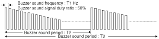

   | Nome | Características |
   | --- | --- |
   | Frequência de Som do Buzzer Interno | T1 Hz |
   | Relação de Duração do Sinal do Buzzer Interno | 50% |
   | Período de Som do Buzzer Interno | T2 seg + 5% seg |
   | Duração do Som do Buzzer Interno | T3 seg + 5% seg |

3. Prioridade das Condições de Aviso do Buzzer

   | – | Se existirem múltiplas condições de aviso simultaneamente, o aviso ativar-se-á com base na prioridade pré-definida: (1º é a prioridade mais alta) |
   | --- | --- |

   | Prioridade | Nome | Lógica de Controle | Controle do Buzzer Interno |
   | --- | --- | --- | --- |
   | 1 | Som de Diagnóstico | BCM | BCM |
   | 2 | Aviso do Cinto de Segurança / Recordação do Cinto de Segurança |  |  |
   | 3 | Aviso de Velocidade Excedida | CLU |  |
   | 4 | Aviso de Recordação (Operada) do Cinto de Segurança | BCM |  |
   | 5 | Aviso do Freio de Estacionamento |  |  |
   | 6 | Aviso do Coluno do Volante Não Bloqueado | SMK |  |
   | 7 | Aviso ID Out |  |  |
   | 8 | Aviso do Coluno do Volante Não Desbloqueado |  |  |
   | 9 | Aviso do Botão SSB |  |  |
   | 10 | Som de Aprendizado da Chave RKE | BCM |  |
   | 11 | Aviso do Detent do Rheostat | CLU |  |

Descrição do Som do Buzzer Interno

| – | O BCM possui um Buzzer Interno e o Cluster possui um Indicador de Aviso. |
| --- | --- |

| 1) | Nova solicitação enquanto buzzer está ativo por uma solicitação anterior |
| --- | --- |

| 2) | Se um buzzer estiver ativo por uma solicitação anterior, uma nova solicitação com |

higher prioridade não pode interromper a solicitação anterior. A nova solicitação ativará o buzzer assim que o período de som da solicitação anterior for concluído. |
| --- | --- |

| 3) | Sincronização do Som do Buzzer Interno e do Indicador. Para sincronizar o indicador e o buzzer interno, o BCM envia o piscar do indicador e ativa o buzzer interno. O cluster verifica a solicitação recebida e opera o indicador. |
| --- | --- |

Aviso do Cinto de Segurança

1. Quando o motorista ou passageiros deixarem o cinto de segurança desafivelado durante a viagem, o aviso sonoro ou indicador os lembrará de avelar o cinto de segurança.

2. Esta função oferece as seguintes características

   | (1) | Ligar/desligar e piscar do indicador do cinto de segurança do lado do motorista dependendo da entrada do interruptor do cinto de segurança do lado do motorista. |
   | --- | --- |

   | (2) | Ligar/desligar e piscar do indicador do cinto de segurança do lado do passageiro dependendo da entrada do interruptor do cinto de segurança do lado do passageiro. |
   | --- | --- |

   | (3) | Ligar/desligar o buzzer interno dependendo da entrada do interruptor do cinto de segurança do lado do motorista ou do lado do passageiro. |
   | --- | --- |

   | (4) | Se a velocidade do veículo ultrapassar um valor específico, o indicador do cinto de segurança e o buzzer interno devem ser ativados de acordo com o padrão definido. |
   | --- | --- |

3. Descrição Geral

   | (1) | Quando o motorista desafivelar o cinto de segurança durante a viagem, o BCM avisa o motorista por meio de um som de aviso ou indicador. |
   | --- | --- |

   | (2) | Ligar/desligar e piscar do indicador do cinto de segurança do lado do motorista dependendo da entrada do interruptor do cinto de segurança do lado do motorista. |
   | --- | --- |

   | (3) | Ligar/desligar o buzzer interno dependendo da entrada do interruptor do cinto de segurança do lado do motorista. |
   | --- | --- |

   | (4) | Logo após o A_IGN1 ligado (IGN1 On), para obter a informação de cinto de segurança avelado/desafivelado, leva-se cerca de "SBIGN1Time" (típico 100msec) para verificar. Durante este tempo, a J/Box indica que o cinto de segurança está avelado via CAN. Portanto, a lógica do cinto de segurança/avelamento pode começar a partir do momento em que A_IGN1 está ligado (IGN1 On) e após "SBIGN1Time". |
   | --- | --- |

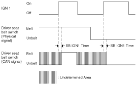

4. Descrição da Função de Aviso do Cinto de Segurança

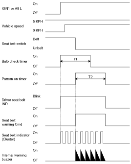

T1: Tempo de verificação do bulbo, T2: Tempo de padrão ativo

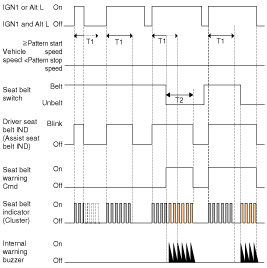

T1: Tempo de verificação do bulbo, T2: Tempo de padrão ativo

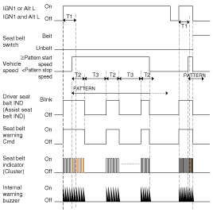

T1: Tempo de verificação do bulbo, T2: Tempo de padrão ativo, T3: Tempo de padrão inativo

PATTERN: Número de vezes do padrão (T2 ON / T3 OFF)

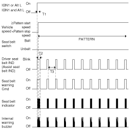

T1: Tempo de verificação do bulbo, T2: Tempo de padrão ativo, T3: Tempo de padrão inativo

PATTERN: Número de vezes do padrão (T2 ON / T3 OFF)

| Nome | Valor |
| --- | --- |
| SB IGN1 Time | 100 ±10msec |
| Tempo de verificação do bulbo | 6 ± 0.1 sec |
| Tempo de padrão ativo | 6 ± 0.1 sec |
| Tempo de padrão inativo | 24 ± 0.1 sec |
| Velocidade de início do padrão | 10 km/h |
| Velocidade de parada do padrão | 5 km/h |
| Número de padrões | 11 |

Aviso de Lembrete do Botão (Aviso Operado pelo Botão) Função

1. Controle do Buzzer Interno pela Função de Aviso de Lembrete do Botão

2. Se o motorista abrir a porta do lado do motorista e se afastar do carro
   durante a inserção da chave ou estado ACC, um som de advertência lembra o motorista
   que a chave deve ser removida ou o estado ACC deve ser alterado para o estado Off.

3. Esta função de advertência não opera na Variante China.

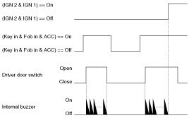

Advertência do Freio de Estacionamento

1. Controle do Buzzer Interno pela Função de Advertência do Freio de Estacionamento

2. Se o motorista dirigir o veículo com o freio de estacionamento ligado ou não
   completamente solto e a velocidade do veículo ultrapassar o valor específico de
   10km/h, um som de advertência lembra o motorista que o freio de estacionamento deve ser
   solto.

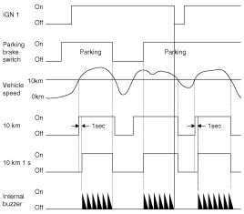

Advertência Sonora do RKE

1. Controle do Buzzer Interno pela Função de Ensino do RKE

2. Quando cada ensino do RKE terminar, o buzzer de advertência é operado uma vez.

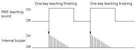

Advertência Sonora do Sistema SMK

1. Controle do Buzzer Interno para a advertência do Sistema SMK

2. As condições de ativação das advertências do Sistema SMK são controladas
   pelo módulo SMK. Quando uma condição é satisfeita, o módulo SMK envia
   uma solicitação de advertência correspondente para o BCM e o cluster por CAN.

3. O BCM opera apenas o Buzzer Interno.

4. O buzzer interno é controlado pelo BCM e a duração do som é controlada pelo SMK.

   | (1) | Advertência de Coluna de Direção Não Bloqueada • Esta advertência requer a ativação do Buzzer Interno durante C_ESCL_Notlocked_Warning = On. • Período de Som do Buzzer de Advertência do SMK: 0,6s + 0,06s |
   | --- | --- |
   | • | Esta advertência requer a ativação do Buzzer Interno durante C_ESCL_Notlocked_Warning = On. |
   | • | Período de Som do Buzzer de Advertência do SMK: 0,6s + 0,06s |

   | (2) | Advertência ID1 • Esta advertência requer a ativação do Buzzer Interno durante C_IDOUT_WNG = On. • Período de Som do Buzzer de Advertência do SMK: 5s + 0,1s |
   | --- | --- |
   | • | Esta advertência requer a ativação do Buzzer Interno durante C_IDOUT_WNG = On. |
   | • | Período de Som do Buzzer de Advertência do SMK: 5s + 0,1s |

   | (3) | Advertência de Coluna de Direção Não Desbloqueada • Esta advertência requer a ativação do Buzzer Interno durante C_ESCL_Notunlocked_Warning = On. • Período de Som do Buzzer de Advertência do SMK: 1s + 0,1s |
   | --- | --- |
   | • | Esta advertência requer a ativação do Buzzer Interno durante C_ESCL_Notunlocked_Warning = On. |
   | • | Período de Som do Buzzer de Advertência do SMK: 1s + 0,1s |

   | (4) | Advertência do Botão SSB • Esta advertência requer a ativação do Buzzer Interno durante C_SSB_Warning = On. • Período de Som do Buzzer de Advertência do SMK: 0,6s + 0,06s |
   | --- | --- |
   | • | Esta advertência requer a ativação do Buzzer Interno durante C_SSB_Warning = On. |
   | • | Período de Som do Buzzer de Advertência do SMK: 0,6s + 0,06s |

Advertência Sonora do Sistema de Detentos do Rheostat

1. Controle do Buzzer Interno para a advertência de Detentos do Rheostat

2. As condições de ativação das advertências do Sistema de Detentos do Rheostat são
   controladas pelo módulo CLU. Quando uma condição é satisfeita, o módulo CLU envia
   uma solicitação de advertência correspondente ao BCM por CAN.

3. O BCM opera apenas o Zumbido Interno

4. O zumbido interno é controlado pelo BCM e a duração do som é controlada pelo BCM.

Controle de Girador e Sinalizador de Hazards

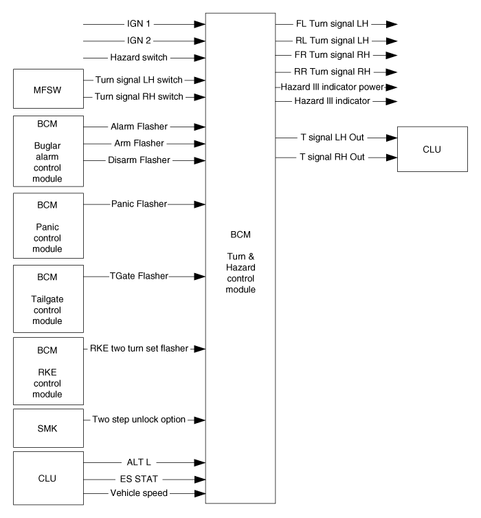

| Função | Características | Nome |  |
| --- | --- | --- | --- |
| Rótulo de Hardware | Designação Específica |  |  |
| Entrada | Lógico | L_IGN2 | Entrada Ignição 2 |
| L_HazardSW | Interruptor de Hazard |  |  |
| L_TurnSigLHSW | Interruptor de Sinal de Girador Esquerdo |  |  |
| L_TurnSigRHSW | Interruptor de Sinal de Girador Direito |  |  |
| Analógico | A_IGN1 | Entrada Ignição 1 |  |
| Comunicação CAN | C_TwoStepUnlockOption | Configuração de Modo de Desbloqueio em Dois Passos SMK RKE |  |
| C_ALT_L | Motor em funcionamento |  |  |
| C_ES_STAT | Status do Sistema ESS |  |  |
| C_VehicleSpeed | Velocidade do veículo do Tração Alta CAN |  |  |
| Interno | b_AlarmFlasher | Solicitação de Zumbido do Alarme |  |
| b_ArmFlasher | Solicitação de Zumbido do Armamento |  |  |
| b_DisarmFlasher | Solicitação de Zumbido do Desarmamento |  |  |
| b_PanicFlasher | Solicitação de Zumbido do Pânico |  |  |
| b_TGateFlasher | Solicitação de Zumbido da Porta Traseira |  |  |
| b_RKETwoTurnSetFlasher | Configuração de Modo de Desbloqueio em Dois Passos SMK RKE |  |  |
| Saída | Lógico | O_TurnSigFLH | Saída do Girador FLeft |
| O_TurnSigRLH | Saída do Girador RLeft |  |  |
| O_TurnSigFRH | Saída do Girador FRight |  |  |
| O_TurnSigRRH | Saída do Girador RRight |  |  |
| V_HazardIllINDPwr | Saída de Energia do Indicador de Hazard |  |  |
| O_HazardIllIND | Saída do Indicador de Hazard |  |  |
| Comunicação CAN | C_TSigLHOut | Status da Saída do Sinal de Girador Esquerdo para indicador no CLU |  |
| C_TSigRHOut | Status da Saída do Sinal de Girador Direito para indicador no CLU |  |  |

Função de Controle do Zumbido do Girador

1. Para fornecer um feedback auditivo ao motorista quando o girador está ativo, é usado um Zumbido do Girador.

2. Enquanto o girador estiver operando, o zumbido do girador será ativado no momento da transição de Saída On/Off.

3. O zumbido do girador é controlado pelo Cluster.

4. O BCM liga/desliga o girador do esquerdo ou/ou direito,
   o cluster controla o zumbido do girador seguindo a solicitação de ativação do BCM.

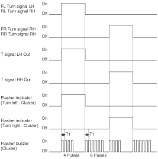

T1 : 2 [KHz], 50% duty

Função de Controle de Hazard

1. Ativar o interruptor de hazard gera o sinal de hazard,
   independentemente da posição da chave de ignição. O sinal de hazard é uma sequência permanente. Ele se apaga quando o interruptor de hazard é desativado.
   O sinal atinge ambos os lados.

2. Se for detectado falha da lâmpada, o girador começa a piscar em falha.
   Mas isso é possível apenas no estado IGN1 e IGN2 (A_IGN1 = On & L_IGN2 = On).

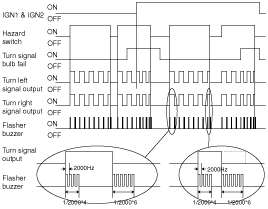

Função de Controle de Sinalizador de Girador

1. Se o interruptor de girador esquerdo (ou direito) estiver ativo e a IGN2 estiver ligada, as saídas de sinalizador de girador esquerdo (ou direito) serão ativadas.

2. O sinalizador de girador está ativo enquanto ambas as condições
   ((L_TurnSigLHSW ou L_TurnSigRHSW = On) e L_IGN2 = On) são verdadeiras e é desligado quando uma dessas condições não é mais detectada.

3. Se uma falha na lâmpada (falha de sinalização ou carga aberta) for detectada no lado do sinal de direção ativado, o flasher será operado com piscadas de falha.

4. Esta falha pode ser detectada apenas quando IGN1 e IGN2 Estão Ligados (A_IGN1 == On e L_IGN2 == On).

5. Enquanto o interruptor de direção estiver ligado e uma falha for detectada, mesmo que a falha na lâmpada não seja mais detectada, mantenha as piscadas de falha e, após a próxima transição do interruptor de direção ou do sistema de ignição, o flasher será ativado com piscadas normais.

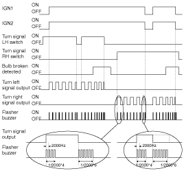

Controle da Função de Sinal de Mudança de Faixa

1. A função de flasher de mudança de faixa significa que uma ativação momentânea do interruptor de direção causará 3 piscadas no circuito do indicador.

2. Esta função de mudança de faixa opera sob as seguintes condições:

   A. Modo de mudança de faixa habilitado (b_LaneEnable = On)

   B. Ignição 2 deve estar ligada, e a função de mudança de faixa não está disponível se a Ignição 2 estiver desligada.

   C. Durante o piscar pelo modo de mudança de faixa, deve-se detectar o modo de falha na lâmpada.

   D. Durante a operação do modo de mudança de faixa, se o usuário mover o interruptor de direção para a outra direção, então o modo de mudança de faixa termina e o piscar da outra direção (normal ou piscar de mudança de faixa) começará dependendo do período de ativação do interruptor de direção.

   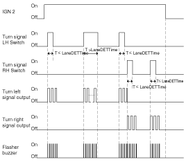

Controle da Função de Falha do Flasher

1. Esta função descreve as seguintes características:

   A. Detecção de Falha na Lâmpada

   B. Detecção de Falha SCG (Curto a GND)

2. O BCM está monitorando a saída do sinal de direção.

3. Durante o controle do sinal de direção ou do sinal de perigo, se uma falha na lâmpada for detectada, o flasher será operado com piscadas de falha.

4. Condição de Detecção de Falha na Lâmpada

Controle de Piscadas de Alarme pelo Sistema de Segurança

1. Esta função descreve as seguintes características:

   | – | Gerenciamento da solicitação de piscadas de alarme pelo Gerenciador de Segurança Antifurto |
   | --- | --- |

   | – | Controle de Piscadas de Alarme |
   | --- | --- |

   | – | Controle de Armazenamento de Piscadas de Alarme |
   | --- | --- |

   | – | Controle de Desarmamento de Piscadas de Alarme |
   | --- | --- |

2. Controle de Piscadas de Alarme

   | – | Se houver uma solicitação de ter o alarme piscando
   (b_AlarmFlasher == On), um padrão de piscadas das lâmpadas de sinal de esquerda e direita será executado. |
   | --- | --- |

   | – | Quando a solicitação não estiver mais presente (b_AlarmFlasher == Off)
   o controle de piscadas das lâmpadas de sinal de esquerda e direita pelo alarme será parado sem atraso. |
   | --- | --- |

   | – | As piscadas devem ser sincronizadas com a ativação do alarme do buzina. |
   | --- | --- |

   | – | Dependendo da configuração da variante, o padrão de piscadas consiste em 1 ou 3 grupos de piscadas conforme descrito na figura abaixo. |
   | --- | --- |

   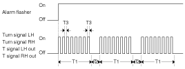

   T1 : 27 seg + 0 seg / -2,7 seg,

   T2 : 10 seg ± 1 seg,

   T3 : 450 ms ± 45 ms

   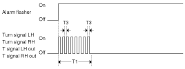

   T1 : 27 seg + 0 seg / -2,7 seg,

   T3 : 450 ms ± 45 ms

3. Controle de Armazenamento/Desarmamento de Piscadas

   | – | Se houver uma solicitação de ter o armazenamento de piscadas

Translate this Markdown chunk (18/28) para o português brasileiro.

   (b_ArmFlasher == Off > On) ou desarmar piscadas (b_DisarmFlasher == Off
   > On), um padrão de piscadas dos faróis de direção à esquerda e à direita é
   executado. |
   | --- | --- |

   | • | Padrão de Piscadas ao Armar T : 1 sec ± 0,1 sec |
   | --- | --- |

   | • | Padrão de Piscadas ao Desarmar T : 500 msec ± 50 msec |
   | --- | --- |

Controle de Função de Piscadas em Emergência

1. Se houver uma solicitação para realizar piscadas em emergência
   (b_PanicFlasher == On), um padrão de piscadas dos faróis de direção à
   esquerda e à direita é executado.

2. Quando a solicitação não estiver mais presente (b_PanicFlasher == Off)
    o piscar dos faróis de direção à esquerda e à direita por emergência é
   parado sem atraso.

3. As piscadas devem estar sincronizadas com a ativação do buzina.

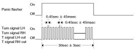

Controle de Função de Piscadas da Porta Traseira

1. Se houver uma solicitação para realizar piscadas da porta traseira
   (b_TGateFlasher == Off > On), um padrão de piscadas dos faróis de
   direção à esquerda e à direita é executado.

2. As piscadas da porta traseira são duas vezes, cada operação dura 500ms
   com um intervalo de 500ms.

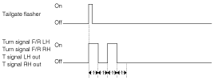

T : 500 msec ± 50 msec

Controle de Função de Piscadas do RKE Two Turn Unlock Set

1. Esta função descreve as seguintes características :

   | – | Gerenciamento da solicitação para piscadas completas de RKE Two Turn Unlock Set/Reset pelo gerenciador de controle RKE e pelo SMK |
   | --- | --- |

2. Descrição da Função

   | – | Se houver uma solicitação para realizar piscadas de RKE Two Turn Unlock
   Set/Reset (b_RKETwoTurnSetFlasher = Off > On) ou pelo SMK (C_TwoStepUnlockOption = Off > On), um padrão de piscadas dos faróis de
   direção à esquerda e à direita é executado. |
   | --- | --- |

   | – | As piscadas de RKE Two Turn Unlock Set/Reset têm quatro piscadas em 2s, cada operação tem 250ms de tempo ON e 250ms de tempo OFF. |
   | --- | --- |

   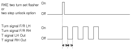

   T : 250 msec ± 25 msec

Controle de Prioridade da Função de Piscadas

1. Se as condições de ativação das piscadas conflitarem entre si, as prioridades funcionais são as seguintes :

   | Prioridade | Nome da Função de Piscadas |
   | --- | --- |
   | 1 | Armamento / Desarmamento de Piscadas (Sistema de Alarme) |
   | 2 | Piscadas do Alarme de Burglary (Sistema de Alarme) |
   | 3 | Piscadas em Emergência |
   | 4 | Piscadas de Alerta |
   | 5 | Piscadas de Sinal de Direção |
   | 6 | Piscadas da Porta Traseira |
   | 7 | Piscadas do RKE Two Turn Set/Reset |

2. Prioridade de Sinal de Direção e Alerta

   A. Durante a piscada de alerta, se houver uma solicitação para piscar de direção, mantenha a operação de alerta.

   B. Durante a piscada de direção, se houver uma solicitação para piscar de alerta, interrompa a operação de piscada de direção e inicie imediatamente a operação de alerta.

   C. Durante a operação de alerta, se o sinal de direção e o sinal de alerta estiverem ligados ao mesmo tempo, se o sinal de alerta for desligado, a operação de piscada de direção começa a funcionar, mas não interrompe o período de execução.

   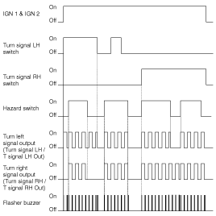

3. Prioridade do Alarme de Burglary e Emergência

| (1) | O Alarme de Pânico deve ser independente do estado do Alarme de Roubos (ARM, DESARMADO, ALARME,...), mas é interrompido ao entrar no modo ARM. A. Durante a execução do Alarme de Roubos, uma função de alarme de pânico pode ser iniciada e parada. B. Durante a execução do Alarme de Pânico (Flashando), um Alarme de Roubos pode ser iniciado. |
   | --- | --- |
   | A. | Durante a execução do Alarme de Roubos, uma função de alarme de pânico pode ser iniciada e parada. |
   | B. | Durante a execução do Alarme de Pânico (Flashando), um Alarme de Roubos pode ser iniciado. |

   | (2) | A ativação do buzzer e dos faróis de advertência pelo Alarme de Roubos tem prioridade sobre o modo de Pânico. |
   | --- | --- |

   | (3) | Se o Alarme estiver em progresso (padrão de 3 vezes) durante os 10 segundos de desligamento do padrão, o buzzer deve estar desligado. |
   | --- | --- |

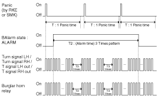

4. Autolock e Prioridade de Pânico

   | (1) | Durante a ativação do buzzer e dos faróis de advertência pelo Alarme de Pânico, se for solicitado um Autolock (b_AutoLockCmd) pelo Função de Alarme de Roubos, a ativação do buzzer e dos faróis de advertência pelo Alarme de Pânico é mantida, mas o piscar de bloqueio é ativado. |
   | --- | --- |

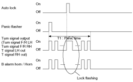

Controle de Bloqueio/Desbloqueio das Portas

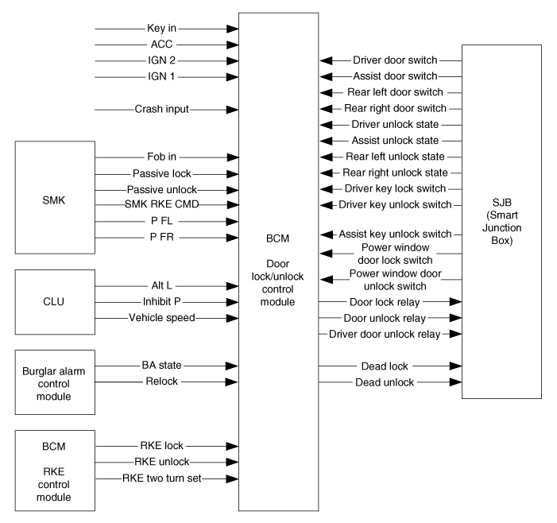

| Função | Características | Nome |  |
| --- | --- | --- | --- |
| Rótulo de Hardware | Designação Específica |  |  |
| Entrada | Lógica | L_ACC | ACC |
| L_IGN2 | Ignição 2 |  |  |
| L_KeyIn | Sinal de Chave Inserida |  |  |
| Análogo | A_IGN1 | Entrada de Ignição 1 |  |
| PWM | P_CrashInput | Pulsos de Desbloqueio em Emergência |  |
| Comunicação CAN | C_ASTDRSW | Status do Assistente de Abertura e Fechamento das Portas |  |
| C_AltL | Motor em funcionamento |  |  |
| C_ASTUnlockState | Status de Desbloqueio do Assistente de Portas |  |  |
| C_DRVDRSW | Status de Abertura e Fechamento da Porta do Motorista |  |  |
| C_DRVKeyLockSW | Sinal de Bloqueio da Cilindro da Chave na Porta do Motorista* |  |  |
| C_DRVKeyUnlockSW | Sinal de Desbloqueio da Cilindro da Chave na Porta do Motorista * |  |  |
| C_ASTKeyUnlockSW | Sinal de Desbloqueio da Cilindro da Chave na Porta do Assistente |  |  |
| C_DRVUnlockState | Status de Desbloqueio da Porta do Motorista |  |  |
| C_FobIn | Sinal de Chave Inserida |  |  |
| C_InhibitP | Estado de Inibição P |  |  |
| C_PassiveLock | PIC Bloqueio passivo para módulo da porta |  |
| C_PassiveUnlock | PIC Desbloqueio passivo para módulo da porta |  |
| C_P_FL | Comando passivo do lado frontal esquerdo |  |
| C_P_FR | Comando passivo do lado frontal direito |  |
| C_PwdwDRLockSW | Interruptor Central de Bloqueio das Portas |  |
| C_PwdwDRUnlockSW | Interruptor Central de Desbloqueio das Portas |  |
| C_RLDRSW | Status de Abertura e Fechamento da Porta Traseira Esquerda |  |
| C_RLUnlockState | Status de Desbloqueio da Porta Traseira Esquerda |  |
| C_RRDRSW | Status de Abertura e Fechamento da Porta Traseira Direita |  |
| C_RRUnlockState | Status de Desbloqueio da Porta Traseira Direita |  |
| C_SMKRKECMD | Comando SMK FOB RKE |  |
| C_VehicleSpeed | Velocidade do veículo do CAN do Tranco |  |  |
| Interno | b_BAState | Informação do Estado do Alarme de Roubos |  |
| b_PState | ? |  |  |
| b_Relock | Comando de Bloqueio pelo Alarme de Roubos |  |
| b_RKELock | Comando de Bloqueio RKE |  |
| b_RKEUnlock | Comando de Desbloqueio RKE |  |
| m_RKETwoTurnSet | Conjunto de Desbloqueio RKE em Dois Giros |  |

| Interno | b_AutoLockState | Marcador de Bloqueio Automático da Porta |  |
| b_CRASHSts | Estado de Desbloqueio em Emergência |  |  |
| b_CtrLockREQ | Ativação de Bloqueio em Progresso |  |  |
| b_CtrUnlockREQ | Solicitação Central de Desbloqueio |  |  |
| b_KeyLockREQ | Solicitação de Bloqueio por Chave Mecânica |  |  |
| b_KeyUnlockREQ | Solicitação de Desbloqueio por Chave Mecânica |  |  |
| b_RKELockREQ | Solicitação de Bloqueio por RKE |  |  |
| b_RKEUnlockREQ | Solicitação de Desbloqueio por RKE |  |  |
| b_SMKLockREQ | Solicitação de Bloqueio por SMK |  |  |
| b_SMKUnlockREQ | Solicitação de Desbloqueio por SMK |  |  |
| b_TwoTurnMarker | Status de Desbloqueio em Duas Voltas |  |  |
| LockOutTime | Tempo de Ativação de Bloqueio |  |  |
| OffDelayTime | Tempo de Atraso após Ativação de Bloqueio/Desbloqueio |  |  |
| TwoTurnTimer | Cronômetro de Desbloqueio em Duas Voltas |  |  |
| TwoTurnTime | Tempo de Desbloqueio em Duas Voltas |  |  |
| UnlockOutTime | Tempo de Ativação de Desbloqueio |  |  |
| b_DeadLockMarker | Status de Bloqueio Morto |  |  |
| b_TUnlockREQ | Solicitação de Desbloqueio por Duas Voltas |  |  |
| Saída | Interno | C_DEADLock | Comando de Bloqueio Morto |
| Comunicação | C_DEADUnlock | Comando de Desbloqueio Morto |  |
| C_DoorLockRly | Saída de Bloqueio Central da Porta |  |  |
| C_DoorUnlockRly | Saída de Desbloqueio Central da Porta |  |  |
| C_DRVDRUnlockRly | Saída de Desbloqueio da Porta do Motorista |  |  |

Função de Bloqueio e Desbloqueio Central da Porta

1. Se for detectada uma solicitação de bloqueio/desbloqueio central, a função de bloqueio central será operada e todas as portas serão bloqueadas/desbloqueadas durante o tempo de ativação de bloqueio/Desbloqueio (LockOutTime / UnlockOutTime). (Geralmente este valor é 500 ms).

   Em seguida, há um atraso para a próxima operação de bloqueio/desbloqueio após o tempo de atraso de desativação (OffDelayTime, geralmente este valor é 100 ms). No entanto, o bloqueio central será inibido enquanto o desbloqueio em emergência estiver ativo.

2. Condições de Operação de Bloqueio Central e Desbloqueio

   | Solicitação | Bloqueio Central | Desbloqueio Central |
   | --- | --- | --- |
   | Botão Central de Bloqueio/Desbloqueio | Em estado em que o desbloqueio em emergência não está ativo | b_BAState = Off |
   | (Desarmar, TimerAutoLock1, | | |
   | TimerAutoLock2, Hold, Pré-Armar) | | |
   | Bloqueio/Desbloqueio por Chave Mecânica | 1. Terminal Off (b_KeyOn = Off) | Todas |
   | 2. Em estado em que o desbloqueio em emergência não está ativo | | |
   | Bloqueio/Desbloqueio por RKE | Em estado em que o desbloqueio em emergência não está ativo | Todas |
   | Bloqueio/Desbloqueio Passivo | Em estado em que o desbloqueio em emergência não está ativo | Todas |

3. Ação do Atuador

   | – | Quando um comando de reversão (bloqueio/desbloqueio) ocorre durante a saída (bloqueio/desbloqueio). > O comando de saída é parado e um novo comando de saída é ativado. T1: Tempo de ativação de bloqueio, T2: Tempo de ativação de desbloqueio, T3: Tempo de atraso de desativação |
   | --- | --- |

   | – | Quando a mesma entrada ocorre durante a saída. > Ignorar a segunda solicitação. T1: Tempo de ativação de bloqueio, T2: Tempo de ativação de desbloqueio |
   | --- | --- |

   | – | Quando uma entrada ocorre durante o atraso de desativação. > Após o atraso, a saída. T1: Tempo de ativação de bloqueio, T2: Tempo de ativação de desbloqueio, T3: Tempo de atraso de desativação |
   | --- | --- |

Prioridade de Bloqueio e Desbloqueio da Porta

| Prioridade | Função | Nota |
| --- | --- | --- |
| 1 | Desbloqueio em Emergência | ? |
| 2 | Bloqueio Central e Desbloqueio Central | Solicitações de Bloqueio/Desbloqueio por SMK, RKE, Botão Central e Chave Mecânica têm a mesma prioridade. |

Translate this Markdown chunk (21/28) para o português do Brasil.

| 3 | AutoTravamento/Des travamento da Porta | ? |
| 4 | Des travamento da Porta pelo Alerta de Chave | ? |

Função Mecânica de Travamento/Des travamento da Porta

1. Solicitação de Travamento/Des travamento pela Chave Mecânica

   | – | Quando a Chave Mecânica é operada para um travamento, então
   durante um período de "MLockTimeoutTime" (3 seg) o BCM monitorará
   o estado do correspondente botão; se os botões estiverem em estado de
   travamento durante este MLockTimeoutTime, então um travamento central
   será emitido; se qualquer botão permanecer em estado de des travamento
   ao final deste MLockTimeoutTime, então nenhum travamento central será
   emitido. |
   | --- | --- |

   | – | Quando a Chave Mecânica é operada para um des travamento
   então durante um período de "MUnlockTimeoutTime" (3 seg) o BCM
   monitorará o estado do correspondente botão; se os botões estiverem em
   estado de des travamento durante este MLockTimeoutTime, então um
   des travamento central será emitido; se qualquer botão permanecer em
   estado de travamento ao final deste
   MLockTimeoutTime, então nenhum des travamento central será
   emitido. |
   | --- | --- |

   | – | A Chave Mecânica é aplicável às portas do lado do motorista e do passageiro. |
   | --- | --- |

   | – | Os espelhos externos passam para o estado de dobrar/desdobrar em relação à operação de travamento/des travamento pela Chave Mecânica. |
   | --- | --- |

   | Nome | Valor |
   | --- | --- |
   | MOffDelayTime | 100 ms ± 10 ms |
   | MLockTime | 500 ms ± 50 ms |
   | MUnlockTime | 500 ms ± 50 ms |
   | MLockTimeoutTime | 3 seg ± 0,3 seg |
   | MUnlockTimeoutTime | 3 seg ± 0,3 seg |

Função de Travamento/Des travamento da Porta pelo RKE / SMK FOB

1. Solicitação de Travamento/Des travamento pelo RKE

   | – | As operações de travamento/des travamento centrais pelo RKE estão habilitadas no estado Key Out (IGNSW = KeyOff), não gerenciadas neste módulo, mas nas unidades gerando os comandos RKE. |
   | --- | --- |

   | – | A função de travamento/des travamento central é operada na recepção do comando de travamento/des travamento pelo RKE. |
   | --- | --- |

   | – | Os espelhos externos passam para o estado de dobrar/desdobrar em relação à operação de travamento/des travamento pelo RKE / SMK FOB. |
   | --- | --- |

Função de Travamento da Porta pelo Alarme Antifurto

1. Solicitação de Travamento pelo Alarme Antifurto

   | – | O travamento central é possível pelo Alarme Antifurto, esta sinal é considerada equivalente a Travamento Antifurto. |
   | --- | --- |

Função de Travamento/Des travamento da Porta pelo SMK Passive Access

1. Solicitação de Travamento/Des travamento pelo SMK

   | – | As operações de travamento/des travamento centrais pelo SMK estão habilitadas no estado Key Out (IGNSW = KeyOff), não gerenciadas neste módulo, mas nas unidades gerando os comandos SMK. |
   | --- | --- |

   | – | A função de travamento/des travamento central é operada na recepção do comando de travamento/des travamento pelo SMK. |
   | --- | --- |

   | – | Os espelhos externos passam para o estado de dobrar/desdobrar em relação à operação de travamento/des travamento pelo SMK Passive Access. |
   | --- | --- |

Função de Travamento/Des travamento pelo Botão de Travamento Central

1. Solicitação de Travamento/Des travamento pelo Botão de Travamento Central

   | – | O travamento central será inibido nas seguintes condições |
   | --- | --- |

   A. Inibição de travamento central: Quando o travamento de emergência estiver ativo

B. Condição de Inibição de Desbloqueio Central: b_BAState está em (ARMWAIT, ARM, ALARM, REARM).

Função de Desbloqueio em Caso de Acidente (Sem Timer de 30 segundos)

1. Características do Comportamento

   | – | Esta função é para desbloquear as portas em caso de emergência. |
   | --- | --- |

   | – | Se ocorrer um acidente (b_Crash == On, quando o sinal P_CrashUnlock
   for alterado para o status de acidente), desbloqueie todas as portas durante
   “CrashUnlockTime”. |
   | --- | --- |

   | – | Após o desbloqueio em caso de acidente, se o estado do botão de segurança for alterado de desbloqueado para bloqueado, todas as portas serão desbloqueadas novamente. |
   | --- | --- |

   | – | Após o acidente ser ativado, a Função de Bloqueio Central e a Função de Bloqueio Automático das Portas não podem ser operadas até que a chave seja desligada. |
   | --- | --- |

2. Sinal P_CrashInput (PWM)

   | – | Antes do acidente: Quando a condição de acidente não estiver presente, o sinal será feito da seguinte forma (b_Crash == Off no evento do sinal P_CrashInput). |
   | --- | --- |

   | – | Após o acidente: |
   | --- | --- |

   a. Quando ocorre um acidente, o sinal será feito conforme indicado.

   b. O BCM deve ser habilitado (b_Crash == On) quando receber pelo menos uma pulsação durante a ocorrência do sinal P_CrashInput.

   c. O sinal P_CrashInput será ativado durante 200 ms após o acidente. (10 ciclos)

   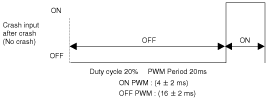

   | – | Descrição do Estado do Nome do Valor Acidente Desligado Tempo de Atraso 0 ms Acidente Finalizado Tempo 5 ± 0,5 s |
   | --- | --- |
   | Nome | Valor |
   | Tempo de Atraso Desligado | 0 ms |
   | Tempo de Acidente Finalizado | 5 ± 0,5 s |

Função de Bloqueio/Desbloqueio Automático das Portas

1. Esta função descreve as seguintes características

   | – | Desbloqueio das Portas pelo Mando |
   | --- | --- |

   | – | Desbloqueio das Portas pela Velocidade do Veículo |
   | --- | --- |

   | – | Desbloqueio das Portas pelo Mando |
   | --- | --- |

   | – | Desbloqueio das Portas ao Desligar a Chave |
   | --- | --- |

2. Durante a condução, ele coloca o estado de bloqueio e, após o fim da condução, coloca o estado de desbloqueio automaticamente

3. Desbloqueio Automático das Portas

   | – | Opção do Mando do Mecanismo de Marcha: Durante o acionamento da ignição e o motor em funcionamento, e quando todas as portas estão fechadas e qualquer porta está desbloqueada, se a posição do mando do mecanismo de marcha for alterada para a posição P para outra posição, todas as portas serão bloqueadas. T1: Tempo de Bloqueio Automático |
   | --- | --- |

   | – | Opção de Velocidade do Veículo |
   | --- | --- |

   A. Condição de Bloqueio Automático em Caso de Velocidade do Veículo

   a. Durante o acionamento da ignição e quando qualquer porta está desbloqueada, se a velocidade do veículo exceder a “AutoDoorLockSpeed” Km/h, desbloqueie todas as portas.

   b. Após desbloquear todas as portas, se qualquer porta não estiver bloqueada, desbloqueie todas as portas “AutoReLockNumber” vezes.

   c. Entre cada saída de bloqueio, há um intervalo de “AutoLockDelayTime”.

   d. Durante as “AutoReLockNumber” saídas de bloqueio, se o estado de todas as portas for alterado para bloqueado, pare esta saída.

   e. Durante a velocidade do veículo excedendo a “AutoDoorLockSpeed” Km/h, se qualquer porta estiver desbloqueada, desbloqueie todas as portas novamente.

   f. No entanto, após as “AutoReLockNumber” saídas de bloqueio, mesmo que qualquer porta esteja desbloqueada, antes do desligamento da ignição (b_IGNState == Off) ou que todas as portas estejam bloqueadas, não haverá saídas adicionais de bloqueio.

B. Estado de Liberação do Bloqueio Automático de Velocidade do Veículo

a. Após o bloqueio automático, não opera novamente. Mas, em condições abaixo, o estado de bloqueio automático é liberado e, se atingir a condição de Bloqueio Automático, o bloqueio automático opera novamente.

b. Qualquer estado do Knob é alterado para desbloquear (Portanto, quando a velocidade do veículo excede a "Velocidade de Bloqueio Automático" km/h, qualquer alteração de estado do Knob para desbloquear faz com que a função de bloqueio automático seja operada novamente.)

c. Após a saída de Liberação de Emergência (Mas, em estado de emergência ativo, o bloqueio automático não opera.)

d. Desligamento da ignição (b_IGNState == Desligado)

e. A velocidade do veículo está abaixo da "Velocidade de Bloqueio Automático" km/h (Portanto, se a velocidade do veículo excede a "Velocidade de Bloqueio Automático" km/h e quaisquer estados do Knob estão desbloqueados, a função de bloqueio automático é operada novamente)

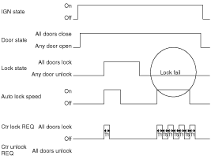

T1: Tempo de bloqueio automático, T5: Atraso de bloqueio automático

C. Condição de Falha do Knob Lock

a. Após a saída de "Número de Tentativas de Rebloqueio" vezes de bloqueio de todas as portas, o Knob falha entra no modo de falha do Knob.

b. Portanto, quando a condição de bloqueio automático de velocidade do veículo é atingida novamente, nessa ocasião, o Knob falha não é considerado (O bloqueio automático 3 vezes não opera.), no entanto, se outro Knob falhar, o bloqueio automático opera 3 vezes.

c. O estado do Knob falha é liberado nas condições abaixo.

d. O Knob falha é alterado de desbloqueado para bloqueado.

e. Desligamento da ignição (b_IGNState == Desligado)

4. Desbloqueio da Porta Automático

| – | Opção do Mecanismo de Mudança de Marcha: Durante o estado de ignição ligado e o motor em funcionamento, e quando todas as portas estão fechadas e qualquer porta está bloqueada, se a posição do mecanismo de mudança de marcha for alterada de outra posição para a posição P, todas as portas são desbloqueadas. T2: Tempo de bloqueio automático |
| --- | --- |

| – | Opção de Desbloqueio do Knob de Segurança do Condutor: Quando o bloqueio automático não está ativado e todas as portas estão fechadas, se o Knob de segurança do condutor for alterado de bloqueado para desbloqueado, todas as portas são desbloqueadas. T2: Tempo de bloqueio automático |
| --- | --- |

| – | Opção de Desligamento da Chave: Quando o estado da chave de ignição (ou Fob) não está desligado e qualquer porta está bloqueada, se o estado da chave de ignição (ou Fob) for alterado para desligado, todas as portas são desbloqueadas. T2: Tempo de bloqueio automático |
| --- | --- |

| Nome | Valor |
| --- | --- |
| Tempo de Bloqueio Automático | 500 ms ± 50 ms |
| Tempo de Desbloqueio Automático | 500 ms ± 50 ms |
| Número de Tentativas de Rebloqueio | 3 vezes |
| Atraso de Desligamento Automático | 500 ms ± 50 ms |
| Velocidade de Bloqueio Automático da Porta | 15 km/h |

Função de Desbloqueio de Chave de Lembrete

1. Esta função cria um estado de desbloqueio quando o usuário esquece a chave dentro do veículo e bloqueia a porta.

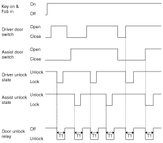

T1: Tempo de Desbloqueio de Primeira Chave

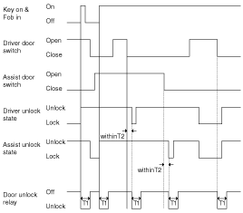

T1: Tempo de Desbloqueio de Primeira Chave, T2: 0,5 seg

| Nome | Valor |
| --- | --- |
| Tempo de Desbloqueio de Primeira Chave | 1 seg ± 0,1 seg |
| Tempo de Desbloqueio de Chave | 500 ms ± 50 ms |

Desbloqueio em Dois Giretos

No caso da variante NA, se uma solicitação de desbloqueio de chave mecânica, RKE ou Desbloqueio Passivo for detectada, a função de desbloqueio em dois giretos é operada.

1. Se desbloquear com chave mecânica (C_DRVKeyUnlockSW = On) no lado do motorista, a porta do motorista é desbloqueada mecanicamente e inicia um contagem de 4 segundos.

2. Se receber uma solicitação de desbloqueio por RKE ou Desbloqueio Passivo no lado do motorista, apenas a porta do motorista é desbloqueada e inicia um contagem de 4 segundos.

3. Dentro de 4 segundos, se for detectada uma solicitação de desbloqueio com chave mecânica ou Desbloqueio Passivo no lado do motorista, todas as portas são desbloqueadas.

4. Sem os 4 segundos, se for detectada uma solicitação de desbloqueio com chave mecânica, Desbloqueio Passivo no lado do motorista ou RKE, apenas a porta do motorista é desbloqueada novamente.

5. Mesmo dentro dos 4 segundos, se o status do Interruptor do Bloco do Motorista (C_DRVKnobSwitch) for alterado de desbloqueio para bloqueio, interrompe a contagem de 4 segundos. Nesse estado, se for detectada uma solicitação de desbloqueio com chave mecânica ou Desbloqueio Passivo no lado do motorista, apenas a porta do motorista é desbloqueada.

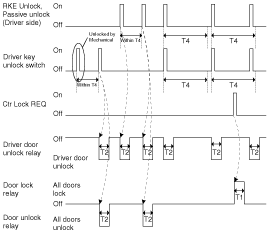

T1: Tempo de bloqueio, T2: Tempo de desbloqueio,

T4: Tempo de duas voltas

Controle de Liberacao da Porta Traseira

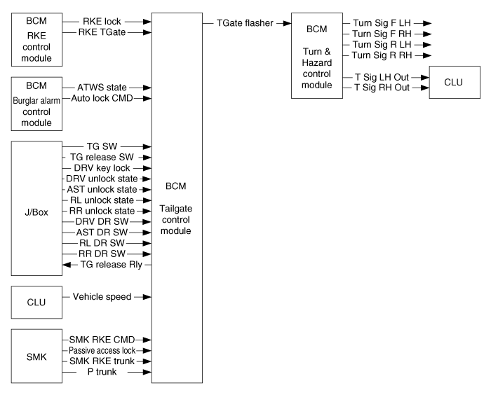

| Função | Caracteristicas | Nome |  |
| --- | --- | --- | --- |
| Rótulo de Hardware | Designação Específica |  |  |
| Entrada | Comunicação CAN | C_TGSW | Status de fechamento da porta traseira |
| C_TG_ReleaseSW | Interruptor de liberação da porta traseira |  |  |
| C_DRVUnlockState | Estado de desbloqueio da porta do motorista |  |  |
| C_ASTUnlockState | Estado de desbloqueio da porta auxiliar |  |  |
| C_RLUnlockState | Estado de desbloqueio da porta traseira esquerda |  |  |
| C_RRUnlockState | Estado de desbloqueio da porta traseira direita |  |  |
| C_DRVDRSW | Estado de fechamento da porta do motorista |  |  |
| C_ASTDRSW | Estado de fechamento da porta auxiliar |  |  |
| C_RLDRSW | Estado de fechamento da porta traseira esquerda |  |  |
| C_RRDRSW | Estado de fechamento da porta traseira direita |  |  |
| C_SMKRKECMD | Comando de chaveless SMK FOB |  |  |
| C_PassiveAccessUnlock | Desbloqueio passivo para módulo da porta |  |  |
| C_DRVKeyLock | Sinal de bloqueio da chave do motorista |  |  |
| C_SMKRKETrunk | Comando de traveleira/tampa traseira RKE |  |  |
| C_VehicleSpeed | Velocidade do veículo (de alta CAN do Trasmissor) |  |  |
| C_P_TRUNK | Comando passivo da traveleira ou tampa traseira |  |  |
| Interno | ATWSState | Informação do estado do alarme antirroubo (todos os estados indicados) |  |
| DESARMA, AUTOLOCKTIMER1, AUTOLOCKTIME2 |  |  |  |
| PREARMA, ARMWAIT, ARM, ARMHOLD |  |  |  |
| REARMA, ALARMA |  |  |  |
| b_AutoLockCmd | Comando de bloqueio automático (sinal de evento) |  |
| Desligado: Após criar o evento On, automaticamente desligado. |  |  |
| b_RKELock | Comando de bloqueio RKE: (versão não-SMK) |  |  |
| b_RKETailgate | Comando de liberação da tampa traseira RKE: (versão não-SMK) |  |  |
| b_AllDoorUnlockState | Estado de desbloqueio de todas as portas |  |  |
| b_AllDoorOpenState | Estado de abertura de todas as portas |  |  |
| Saída | Lógica | O_TurnSigFLH | Saída do farol de sinalização – frente esquerda |
| O_TurnSigRLH | Saída do farol de sinalização – traseira esquerda |  |  |
| O_TurnSigFRH | Saída do farol de sinalização – frente direita |  |  |
| O_TurnSigRRH | Saída do farol de sinalização – traseira direita |  |  |
| Interno | b_TailgateFlasher | Solicitação de farol de sinalização da tampa traseira (sinal de evento) |  |
| - Após criar o evento On, automaticamente desligado. |  |  |  |

Translate this Markdown chunk (25/28) para o português do Brasil.

| Comunicação CAN | C_TSigLHOut | Status da Luz de Indicação de Girassol Desligada para o indicador no CLU |  |
| C_TSigRHOut | Status da Luz de Indicação de Girassol Direito Desligada para o indicador no CLU |  |  |
| C_TGReleaseRly | Controle do Relé de Liberação Traseira |  |  |

Controle de Liberação Traseira

1. Estado "Tailgate_Release_Mode"

   | Estado | Descrição |
   | --- | --- |
   | Condição Inicial | Estado de Inibição da Porta Traseira |
   | Evento | Desbloqueio de Todas as Portas |
   | Ação | Estado alterado para Estado de Liberação da Porta Traseira |

   | Estado | Descrição |
   | --- | --- |
   | Condição Inicial | Estado de Liberação da Porta Traseira em 30 Segundos |
   | Evento | Desbloqueio de Todas as Portas |
   | Ação | • Cancelar Timer de 30 Segundos da Porta Traseira • Estado alterado para Estado de Liberação da Porta Traseira |
   | • | Cancelar Timer de 30 Segundos da Porta Traseira |
   | • | Estado alterado para Estado de Liberação da Porta Traseira |

   | Estado | Descrição |
   | --- | --- |
   | Condição Inicial | • Estado de Liberação da Porta Traseira • Desbloqueio de Todas as Portas |
   | • | Estado de Liberação da Porta Traseira |
   | • | Desbloqueio de Todas as Portas |
   | Evento | Comando de Liberação da Porta Traseira pelo RKE |
   | Ação | • Duas Flashs • Durante 0,5 segundos, acione o Relé de Liberação da Porta Traseira • Mantenha o Estado de Liberação da Porta Traseira |
   | • | Duas Flashs |
   | • | Durante 0,5 segundos, acione o Relé de Liberação da Porta Traseira |
   | • | Mantenha o Estado de Liberação da Porta Traseira |

   | Estado | Descrição |
   | --- | --- |
   | Condição Inicial | • Estado de Liberação da Porta Traseira • Velocidade do Veículo abaixo de 5km/h • Desbloqueio de Todas as Portas (b AllDoorUnlockState == Unlock) |
   | • | Estado de Liberação da Porta Traseira |
   | • | Velocidade do Veículo abaixo de 5km/h |
   | • | Desbloqueio de Todas as Portas (b AllDoorUnlockState == Unlock) |
   | Evento | Comando de Liberação da Porta Traseira pelo Interruptor de Liberação da Porta Traseira |
   | Ação | • Durante 0,5 segundos, acione o Relé de Liberação da Porta Traseira • Mantenha o Estado de Liberação da Porta Traseira |
   | • | Durante 0,5 segundos, acione o Relé de Liberação da Porta Traseira |
   | • | Mantenha o Estado de Liberação da Porta Traseira |

2. Estado "Tailgate_30Sec_Mode"

   | Estado | Descrição |
   | --- | --- |
   | Condição Inicial | Estado de Inibição da Porta Traseira |
   | Evento | Comando de Liberação da Porta Traseira pelo RKE |
   | Ação | • Iniciar Timer de 30 Segundos da Porta Traseira • Estado alterado para Estado de Liberação da Porta Traseira em 30 Segundos |
   | • | Iniciar Timer de 30 Segundos da Porta Traseira |
   | • | Estado alterado para Estado de Liberação da Porta Traseira em 30 Segundos |

   | Estado | Descrição |
   | --- | --- |
   | Condição Inicial | • Estado de Liberação da Porta Traseira em 30 Segundos • Estado de Desbloqueio de Todas as Portas = Desbloqueado |
   | • | Estado de Liberação da Porta Traseira em 30 Segundos |
   | • | Estado de Desbloqueio de Todas as Portas = Desbloqueado |
   | Evento | Comando de Liberação da Porta Traseira pelo RKE |
   | Ação | • Duas Flashs • Durante 0,5 segundos, acione o Relé de Liberação da Porta Traseira • Reiniciar Timer de 30 Segundos da Porta Traseira • Mantenha o Estado de Liberação da Porta Traseira em 30 Segundos |
   | • | Duas Flashs |
   | • | Durante 0,5 segundos, acione o Relé de Liberação da Porta Traseira |
   | • | Reiniciar Timer de 30 Segundos da Porta Traseira |
   | • | Mantenha o Estado de Liberação da Porta Traseira em 30 Segundos |

| Condição Inicial | • Estado de Modo de Liberar Traseira 30Seg • Velocidade do Veículo abaixo de 5km/h • Estado de Bloqueio de Todas as Portas = Desbloqueado |
   | • | Estado de Modo de Liberar Traseira 30Seg |
   | • | Velocidade do Veículo abaixo de 5km/h |
   | • | Estado de Bloqueio de Todas as Portas = Desbloqueado |
   | Evento | Comando de Liberar Traseira pelo Interruptor de Liberar Traseira |
   | Ação | • Durante 0,5 seg, ligue o Relé de Liberar Traseira • Estado mantido no Estado de Modo de Liberar Traseira 30Seg |
   | • | Durante 0,5 seg, ligue o Relé de Liberar Traseira |
   | • | Estado mantido no Estado de Modo de Liberar Traseira 30Seg |

3. "Modo_Inibição_Traseira"

   | Estado | Descrição |
   | --- | --- |
   | Condição Inicial | Estado de Modo de Liberar Traseira |
   | Evento | • Estado de Bloqueio de Todas as Portas = Desbloqueado |
   | • | Estado de Bloqueio de Todas as Portas = Desbloqueado |
   | Ação | Estado alterado para Estado de Inibição de Traseira |

   | Estado | Descrição |
   | --- | --- |
   | Condição Inicial | • Estado de Modo de Liberar Traseira 30Seg • Estado de Bloqueio de Todas as Portas = Desbloqueado |
   | • | Estado de Modo de Liberar Traseira 30Seg |
   | • | Estado de Bloqueio de Todas as Portas = Desbloqueado |
   | Evento | • Comando de Bloqueio pelo RKE ou SMK ou Chave Mecânica ou Comando AutoLock • Abertura da Traseira • Expiração do Timer de 30Seg da Traseira • Estado do Alarme Antifurto alterado para ARMWAIT |
   | • | Comando de Bloqueio pelo RKE ou SMK ou Chave Mecânica ou Comando AutoLock |
   | • | Abertura da Traseira |
   | • | Expiração do Timer de 30Seg da Traseira |
   | • | Estado do Alarme Antifurto alterado para ARMWAIT |
   | Ação | • Cancelar Timer de 30Seg da Traseira • Estado alterado para Estado de Inibição de Traseira |

   | Estado | Descrição |
   | --- | --- |
   | Condição Inicial | • Estado de Inibição de Traseira • Velocidade do Veículo abaixo de 5km/h • Estado de Bloqueio de Todas as Portas = Desbloqueado |
   | • | Estado de Inibição de Traseira |
   | • | Velocidade do Veículo abaixo de 5km/h |
   | • | Estado de Bloqueio de Todas as Portas = Desbloqueado |
   | Evento | Comando de Liberar Traseira pelo SMK |
   | Ação | • Duas Vezes de Acendimento • Durante 0,5 seg, ligue o Relé de Liberar Traseira • Estado mantido no Estado de Inibição de Traseira |
   | • | Duas Vezes de Acendimento |
   | • | Durante 0,5 seg, ligue o Relé de Liberar Traseira |
   | • | Estado mantido no Estado de Inibição de Traseira |

   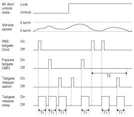

   T1 : Tempo de Liberar Traseira, T2 : Tempo de 30Seg da Traseira

   | Nome | Valor |
   | --- | --- |
   | Tempo de Liberar Traseira | 0,5 seg ± 50 ms |
   | Tempo de 30Seg da Traseira | 30 seg ± 3 seg |

Controle de Janela de Poder

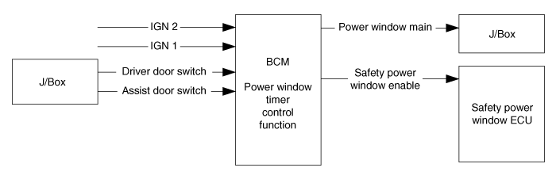

| Função | Características | Nome |  |
| --- | --- | --- | --- |
| Rótulo de Hardware | Designação Específica |  |  |
| Entrada | Lógica | L_IGN2 | Poder do Ignição 2 |
| L_IGN1 | Entrada de Ignição 1 |  |  |
| Comunicação CAN | C_DRVDRSW | Interruptor de Porta do Motorista |  |
| C_ASTDRSW | Interruptor de Porta Auxiliar |  |  |
| Interno | b_IGN1 | Ativo : A_IGN1 == Ativo || L_IGN2 == Ativo |  |
| Desativado : A_IGN1 == Desativado & L_IGN2 == Desativado |  |  |  |
| Saída | Comunicação CAN | C_PwdwMain | Timer de Janela de Poder |

Translate this Markdown chunk (27/28) para o português do Brasil.

| Lógica | O_SafetyPwdwEnable | Saída do ECU de Janelas de Segurança de Potência |  |

Controle do Timer das Janelas de Potência

1. Após o IGN1 estar ligado, as janelas de potência podem operar e, após o IGN1 estar desligado, é possível operar as janelas de potência por “PwdwTime” (30 segundos ± 3 segundos).

2. Durante a contagem de “PwdwTime” (30 segundos ± 3 segundos), se a porta do motorista ou do passageiro for aberta, o funcionamento das janelas de potência é interrompido.

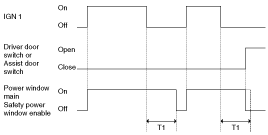

T1 : Tempo de Pwdw (30 segundos ± 3 segundos)

Controle do Desembaçador

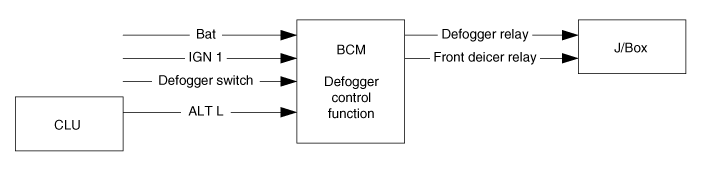

| Função | Características | Nome |  |
| --- | --- | --- | --- |
| Rótulo de Hardware | Designação Específica |  |  |
| Entrada | Lógica | L_DefoggerSW | Entrada do Desembaçador |
| Analog | A_IGN1 | Entrada do Ignição 1 |  |
| V_Bat | Tensão da Bateria |  |  |
| Comunicação CAN | C_ALT_L | Nível do Alternador (Motor em funcionamento) |  |
| Saída | Comunicação CAN | C_DefoggerRly | Controle do Relé do Desembaçador |
| C_FrontDeicerRly | Controle do Desembaçador Anterior |  |  |

Controle do Desembaçador

1. O desembaçador tem um retorno automático. Portanto, quando o interruptor é pressionado, a saída do desembaçador está ligada. E quando o usuário pressiona o interruptor novamente, a saída do desembaçador é desligada.

2. Não ocorre acidente em baixa tensão, o que significa que os desembaçadores não devem ser operados imediatamente após a detecção de baixa tensão.

3. A bateria é protegida contra descarga.

4. Descrição do Estado

   | Estado | Descrição |
   | --- | --- |
   | Condição Inicial | IGN1 = Ligado & ALT L = Ligado & (Relé do Desembaçador & Relé do Desembaçador Anterior) = Desligado & Bat ? Bateria Baixa |
   | Evento | Interruptor de Desembaçador = Desligado > Ligado |
   | Ação | Relé do Desembaçador = Ligado Desembaçador Anterior = Ligado |

   | Estado | Descrição |
   | --- | --- |
   | Condição Inicial | IGN1 = Ligado & ALT L = Ligado & (Relé do Desembaçador ou Relé do Desembaçador Anterior) = Ligado |
   | Evento | Bat < Bateria Baixa ou IGN1 = Desligado ou ALT L = Desligado ou Interruptor de Desembaçador = Desligado > Ligado ou Do Desembaçador, quando passar "Tempo de Desembaçador" |
   | Ação | Relé do Desembaçador = Desligado Desembaçador Anterior = Desligado |

   

   T1 : Tempo de Desembaçador (20 minutos ± 1 minuto)

   | Nome | Valor |
   | --- | --- |
   | Tempo de Desembaçador | 20 minutos ± 1 minuto |
   | Bateria Baixa | 9 Volts |

Controle do Solenoide de Interlock da Chave

| Função | Características | Nome |  |
| --- | --- | --- | --- |
| Rótulo de Hardware | Designação Específica |  |  |
| Entrada | Lógica | L_ACC | Entrada do Acessório |
| L_KeyInterlockSW | Estado da Posição do Mando de Marcha P |  |
| L_IGN1 | Entrada do Ignição 1 |  |
| Interno | b_KeyInterlockSW100 | On : L_KeyInterlockSW = Ligado após confirmação de 100ms |  |
| Off : L_KeyInterlockSW = Desligado após confirmação de 100ms |  |  |  |
| Saída | Lógica | O_KeySOL | Saída Real do Solenoide de Interlock da Chave |

Controle do Solenoide de Interlock da Chave

1. Descrição Geral

   | – | A função de Interlock da Chave é verificar a entrada do Interruptor de Interlock da Chave e a posição do terminal de ignição, e ligar ou desligar o solenoide de interlock da chave. |
   | --- | --- |

   | – | O solenoide de interlock é do tipo puxado. |
   | --- | --- |

| – | Quando IGN1 está ligado ou ACC está ligado, se o Interruptor de Interligação da Chave estiver ligado, o solenoide de interligação da chave está desligado |
   | --- | --- |

   | – | Quando IGN1 está ligado ou ACC está ligado, se o Interruptor de Interligação da Chave estiver desligado, o solenoide de interligação da chave está ligado |
   | --- | --- |

   | – | Durante a desligada de IGN1 e ACC, o solenoide de interligação da chave está desligado |
   | --- | --- |

   | – | O valor interno "b_KeyInterlockSW100" é o sinal que
   significa o valor do Interruptor de Interligação da Chave com um tempo de confirmação de 100 ms. Portanto, isso é
   diferente do tempo de filtragem. |
   | --- | --- |

   

   T : 100 ms

2. Ir para Condição de Desligamento de Interligação da Chave

   | Estado | Descrição |
   | --- | --- |
   | Condição Inicial | (IGN1 = Ligado ou ACC = Ligado) & b_KeyInterlockSW100 = Desligado |
   | Evento | • b_KeyInterlockSW100 = Ligado ou • IGN1 = Desligado e ACC = Desligado |
   | • | b_KeyInterlockSW100 = Ligado ou |
   | • | IGN1 = Desligado e ACC = Desligado |
   | Ação | Solenoide de Interligação da Chave = Desligado |

3. Ir para Condição de Ligamento de Interligação da Chave

   | Estado | Descrição |
   | --- | --- |
   | Condição Inicial | (IGN1 = Ligado ou ACC = Ligado) & b_KeyInterlockSW100 = Ligado |
   | Evento | b_KeyInterlockSW100 = Desligado |
   | Ação | Solenoide de Interligação da Chave = Ligado |

   
