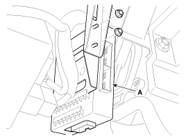
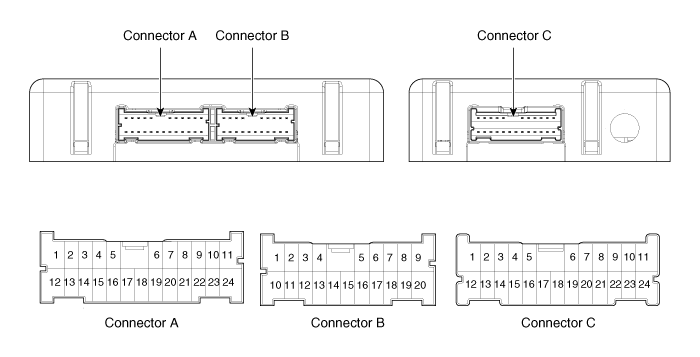
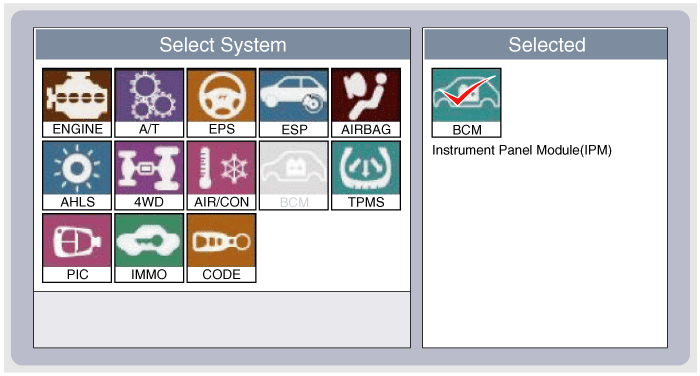
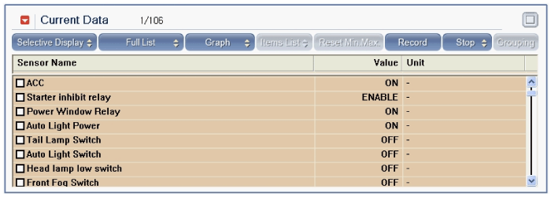
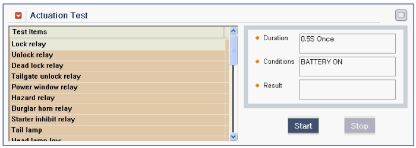
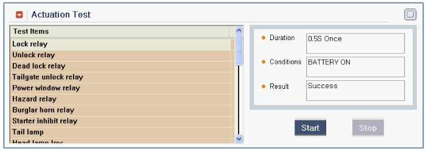

# Kia Sportage: Modulo de Controle do Corpo (MCC): Procedimentos de Reparo

[Home](../../index.md) / [Manual de Serviço e Reparo do Kia Sportage SL](../sportage-482.md) / [Sistema Elétrico do Corpo](sportage-984.md) / [MCC (Modulo de Controle do Corpo)](sportage-1039.md) / Modulo de Controle do Corpo (MCC): Procedimentos de Reparo

## Remoção

1. Desconecte o terminal negativo (-) da bateria.

2. Remova o painel inferior do crash pad.

   (Consulte o grupo BD - "Crash pad")

3. Remova o MCC (A) após remover as varetas, conectores e cabo do antena.

   

## Instalação

1. Instale o MCC após conectar os conectores e o cabo.

2. Instale o painel inferior do crash pad.

3. Conecte o terminal negativo (-) da bateria.

## Inspeção

BCM Pin Information

Conector (A/B/C)

| NO | Descrição | NO | Descrição | NO | Descrição |
| --- | --- | --- | --- | --- | --- |
| A1 | Suprimento de energia da bateria | B1 | Sinal de entrada do interruptor de farol alto | C1 | Controle do IND do cinto de segurança do assento traseiro direito |
| A2 | Suprimento de energia IGN1 | B2 | Sinal de entrada do interruptor de farol baixo | C2 | Controle do IND do cinto de segurança do assento traseiro esquerdo |
| A3 | Suprimento de energia IGN2 | B3 | Controle do IND de perigo | C3 | Controle do IND do cinto de segurança do assento traseiro central |
| A4 | Suprimento de energia ACC | B4 | Comunicação K-Line | C4 | Saída do SOL do chaveiro |
| A5 | Sinal de entrada do interruptor de limpador de vidros | B5 | Saída do status do sensor LIN_RCR | C5 | Saída do lampadário do compartimento |
| A6 | Sinal de entrada do interruptor de traseira | B6 | Suprimento de energia do AutoLight | C6 | Saída do indicador de direção esquerdo |
| A7 | Sinal de entrada do interruptor da chave | B7 | CAN HIGH | C7 | Saída do indicador de direção direito |
| A8 | Sinal de entrada do sinal de desencarceramento | B8 | Sinal de nível do sensor do AutoLight | C8 | Saída do indicador de direção traseiro esquerdo |
| A9 | Sinal de entrada do interruptor de indicador de direção direito | B9 | Controle do IND do RPAS desligado | C9 | Saída do indicador de direção traseiro direito |
| A10 | Sinal de entrada do interruptor de desembaçador | B10 | Sinal de entrada do interruptor de névoa dianteira | C10 | Suprimento de energia da bateria |
| A11 | Sinal de entrada do interruptor do AutoLight | B11 | Sinal de entrada do interruptor de névoa traseira | C11 | Suprimento de energia da bateria |
| A12 | Suprimento de energia do IND de perigo | B12 | Saída do LIN_BackUpSiren | C12 | GND |
| A13 | Suprimento de energia do RPAS | B13 | Saída do status do sensor LIN_RL | C13 | Controle do IND do cinto de segurança do assento traseiro esquerdo |
| A14 | Sinal de entrada do interruptor de lavador traseiro | B14 | GND do RPAS | C14 | Saída do AVTail |
| A15 | Sinal de entrada do interruptor de limpador traseiro | B15 | Saída do status do sensor LIN_RCL | C15 | Controle do sinal de desbloqueio da porta (para Navi) |
| A16 | Sinal de entrada do interruptor de limpador | B16 | Saída do status do sensor LIN_RR | C16 | Controle do bloqueio da janela traseira segura |
| A17 | Sinal de entrada do interruptor de limpador intermitente | B17 | - | C17 | Saída do buzzer de alerta do RPAS |
| A18 | Sinal de entrada do interruptor de limpador intermitente traseiro | B18 | CAN_LOW | C18 | Saída da iluminação do buraco da chave |
| A19 | Sinal de entrada do interruptor de perigo | B19 | Sinal de nível do sensor do AutoLight | C19 | Saída do relé do limpador de farol |
| A20 | Sinal de entrada do interruptor de interlock da chave | B20 | Saída do sinal de farol baixo | C20 | Saída do relé do limpador |
| A21 | Sinal de entrada do nível de voltagem do interruptor de limpador intermitente | ? | C21 | Saída do indicador de direção direito |  |
| A22 | Sinal de entrada do interruptor de indicador de direção esquerdo | C22 | Saída do indicador de direção esquerdo |  |  |
| A23 | Sinal de entrada do interruptor de desligamento do RPAS | C23 | Saída do relé do farol traseiro |  |  |
| A24 | GND | C24 | Controle da saída do buzzer do sino |  |  |

Descrição e Características dos Sinais de Entrada

| Nome do Sinal | Descrição | Características de Entrada (Condição Determinante do Conector) | Suprimento de Energia (Pull Up) |
| --- | --- | --- | --- |
| L_B+ | Suprimento de energia da bateria | Pull down (Analog) | - |
| L_IGN1 | Suprimento de energia IGN1 | Pull down (B+ Backup Line) (ON: VB, OFF: Open) | - |
| L_IGN2 | Suprimento de energia IGN2 | Pull down (ON: VB, OFF: Open) | - |
| A_ACC | Suprimento de energia ACC | Pull down (ON: VB, OFF: Open) | - |
| L_WiperMistSW | Sinal de entrada do interruptor de limpador de vidros | Pull down (ON: VB, OFF: Open) | - |
| L_TailSW | Sinal de entrada do interruptor de traseira | Pull up (ON: Gnd, OFF: Open) | B+ |

| L_KeyIn | KeyIn SW signal input | Pull up(ON:Gnd,OFF:Open) | B+ |
| P_CrashUnlock | CrashUnlock signal input | Pull up(ON:Gnd,OFF:Open) | B+ |
| L_TurnSigRHSW | TurnSigRHSW signal input | Pull up(ON:Gnd,OFF:Open) | IGN1 |
| L_DefoggerSW | DefoggerSW signal input | Pull up(ON:Gnd,OFF:Open) | IGN1 |
| L_AutoLightSW | AutoLightSW signal input | Pull up(ON:Gnd,OFF:Open) | IGN1 |
| L_RearWasherSW | RearWasherSW signal input | Pull down(ON:VB,OFF:Open) | - |
| L_RearWiperSW | RearWiperSW signal input | Pull down(ON:VB,OFF:Open) | - |
| L_WasherSW | WasherSW signal input | Pull down(ON:VB,OFF:Open) | - |
| L_WiperIntmtSW | WiperIntmtSW signal input | Pull down(ON:VB,OFF:Open) | - |
| L_RearWiperIntmtSW | RearWiperIntmtSW signal input | Pull down(ON:VB,OFF:Open) | - |
| L_HazardSW | HazardSW signal input | Pull up(ON:Gnd,OFF:Open) | B+ |
| L_KeyInterlockSW | KeyInterlockSW signal input | Pull up(ON:Gnd,OFF:Open) | B+ |
| A_WiperIntmtVol | WiperIntmtVol level signal input | Pull down(ON:VB,OFF:Open) | - |
| L_TurnSigLHSW | TurnSigLHSW signal input | Pull up(ON:Gnd,OFF:Open) | IGN1 |
| L_RPASOffSW | RPASOffSW signal input | Pull up(ON:Gnd,OFF:Open) | B+ |
| L_HeadLampHighSW | HeadLampHighSW signal input | Pull up(ON:Gnd,OFF:Open) | IGN1 |
| L_HeadLampLowSW | HeadLampLowSW signal input | Pull up(ON:Gnd,OFF:Open) | IGN1 |
| A_AutoLightSnsr | AutoLightSnsr level signal input | Pull down (Analog) | - |
| L_FrontFogSW | FrontFogSW signal input | Pull up(ON:Gnd,OFF:Open) | B+ |
| L_RearFogSW | RearFogSW signal input | Pull up(ON:Gnd,OFF:Open) | IGN1 |

Descrição e Características das Saídas

| Nome da Pin | Descrição | Carga | Diagnóstico |
| --- | --- | --- | --- |
| O_HazardIllIND | Controle do IND de HazardIll | LED | Não |
| O_RPASOffIND | Controle do IND de RPASOff | LED | Não |
| O_HeadLampLowCTRL | Saída do sinal HeadLampLow | - | Não |
| O_RRSeatBeltIND | Controle do IND de RRSeatBelt | LED | Não |
| O_RCSeatBeltIND | Controle do IND de RCSeatBelt | LED | Não |
| O_ASTSeatBeltIND | Controle do IND de ASTSeatBelt | LED | Não |
| O_KeySOL | Saída do KeySOL | Solenoid | Não |
| O_RoomLamp | Saída do RoomLamp | Lamp | Não |
| O_TurnSigFLH | Saída do TurnSig FLH | Lamp | Sim |
| O_TurnSigFRH | Saída do TurnSig FRH | Lamp | Sim |
| O_TurnSigRLH | Saída do TurnSig RLH | Lamp | Sim |
| O_TurnSigRRH | Saída do TurnSig RRH | Lamp | Sim |
| V_HazardIllINDPwr | Suprimento de energia do HazardIllIND | - |  |
| V_RPASPwr | Suprimento de energia do RPAS | - |  |
| V_AutoLightPwr | Suprimento de energia do AutoLight | - |  |

Descrição e Características da Interface do Modulo

| Nome da Pin | Descrição do Pin | Interface |
| --- | --- | --- |
| L_B+ | Suprimento de energia com ECU | 12V (Tensão da Bateria) |
| L_IGN1 | SW de alta tensão | ON=12V |
| L_IGN2 | SW de alta tensão | ON=12V |
| A_ACC | SW de alta tensão | ON=12V |
| L_WiperMistSW | SW de alta tensão | ON=12V |
| L_TailSW | SW de baixa tensão | ON=GND |
| L_KeyIn | SW de baixa tensão | ON=GND |
| P_CrashUnlock | Entrada PWM | H=12 L=0V |
| L_TurnSigRHSW | SW de baixa tensão | ON=GND |
| L_DefoggerSW | SW de baixa tensão | ON=GND |

| L_AutoLightSW | Low Side SW | ON=GND |
| V_HazardIllINDPwr | Saída de Potência | ON=12V |
| V_RPASPwr | Saída de Potência | ON=8,5V |
| L_RearWasherSW | High Side SW | ON=12V |
| L_RearWiperSW | High Side SW | ON=12V |
| L_WasherSW | High Side SW | ON=12V |
| L_WiperIntmtSW | High Side SW | ON=12V |
| L_RearWiperIntmtSW | High Side SW | ON=12V |
| L_HazardSW | Low Side SW | ON=GND |
| L_KeyInterlockSW | Low Side SW | ON=GND |
| A_WiperIntmtVol | Entrada Analógica | H=5V, L=0V |
| L_TurnSigLHSW | Low Side SW | ON=GND |
| L_RPASOffSW | Low Side SW | ON=GND |
| GND(Sinal) | GND |  |
| L_HeadLampHighSW | Low Side SW | ON=GND |
| L_HeadLampLowSW | Low Side SW | ON=GND |
| O_HazardIllIND | Saída (ativo baixo) |  |
| Diagnóstico(K-Line) | Comunicação K-LINE |  |
| LIN_RCRSnsrStatus | Comunicação LIN |  |
| V_AutoLightPwr | Saída de Potência | H=5V, L=0V |
| CAN_HIGH | Sinal CAN alto |  |
| A_AutoLightSnsr | Entrada Analógica | H=5V, L=0V |
| O_RPASOffIND | Saída (ativo baixo) |  |
| L_FrontFogSW | Low Side SW | ON=GND |
| L_RearFogSW | Low Side SW | ON=GND |
| LIN_BackUpSiren | Comunicação LIN |  |
| LIN_RLSnsrStatus | Comunicação LIN |  |
| V_RPASGND | GND |  |
| LIN_RCLSnsrStatus | Comunicação LIN |  |
| LIN_RRSnsrStatus | Comunicação LIN | - |
| NC | - | - |
| CAN_LOW | Sinal CAN baixo | - |
| V_AutoLightGND | GND | - |
| O_HeadLampLowCTRL | Saída (sinal) | - |
| O_RRSeatBeltIND | Saída (ativo baixo) | - |
| O_RCSeatBeltIND | Saída (ativo baixo) | - |
| O_ASTSeatBeltIND | Saída (ativo baixo) | - |
| O_KeySOL | Saída (ativo baixo) | - |
| O_RoomLamp | Saída (PWM) | - |
| O_TurnSigFLH | Saída (ativo alto) | - |
| O_TurnSigFRH | Saída (ativo alto) | - |
| O_TurnSigRLH | Saída (ativo alto) | - |
| O_TurnSigRRH | Saída (ativo alto) | - |
| B+(Pwr_1) | Suprimento de energia (indicador de sinal de direção) | - |
| B+(Pwr_2) | Suprimento de energia (indicador de sinal de direção) | - |
| GND(Poder) | GND | - |
| O_RLSeatBeltIND | Saída (ativo baixo) | - |
| O_AVTail | Saída (ativo baixo) | - |
| O_DRUnlockOUT | Saída (pulsante) | - |
| O_SafetyPwdwEnable | Saída (ativo baixo) | - |
| O_RPASWarningBuzzer | Saída (ativo baixo) | - |
| O_KeyHoleIllum | Saída (ativo baixo) | - |
| O_HeadLampWasherRly | Saída (ativo baixo) | - |
| O_WiperRly | Saída (ativo baixo) | - |
| O_EuropeCorneringLampRH | Saída (ativo baixo) | - |
| O_EuropeCorneringLampLH | Saída (ativo baixo) | - |
| O_RearFoggrRLY | Saída (ativo baixo) | - |
| O_Horn(NA) | Saída (ativo baixo) | - |

## Diagnóstico de Problemas ao Usar GDS

1. O BCM pode ser diagnosticado usando o GDS. O BCM comunica-se com o GDS, que então exibe entradas e saídas, bem como códigos.

2. Para diagnosticar a função do BCM, selecione o modelo do veículo e o BCM.

   

3. Para consultar o valor atual de entrada/saída do BCM, selecione "Dados Atuais". Fornece informações sobre as condições de entrada/saída do BCM de alimentação, sinais de direção/freio, farol, travas das portas, espelhos externos, limpador de vidros, iluminação automática e transmissores, entre outros.

   

4. Para realizar um teste funcional nas saídas do BCM, selecione "Teste de Ativação".

   

   
