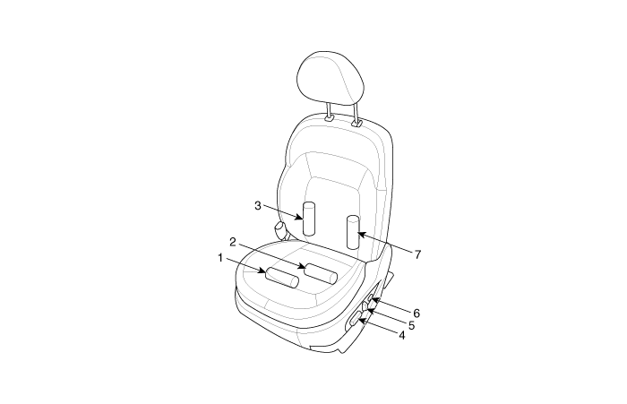

# Kia Sportage: Componentes e Localização dos Componentes

[Home](../../index.md) / [Manual de Serviço e Reparo do Kia Sportage SL](../sportage-482.md) / [Sistema Elétrico do Corpo](sportage-984.md) / [Eletrônica do Assento](sportage-1044.md) / Componentes e Localização dos Componentes

## Localização dos Componentes

| 1. Motor de滑动电机 2. 后部高度电机 3. 倾斜电机 4. 电动座椅开关 | 5. 倾斜开关 6. 腰部支撑开关 7. 腰部支撑电机 |
| --- | --- |
