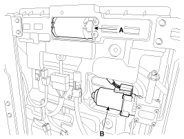
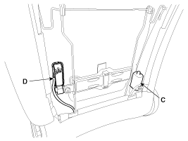
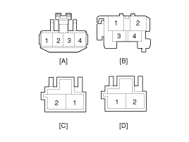
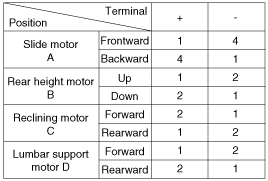

# Kia Sportage: Motor do Assento Elétrico: Procedimentos de Reparo

[Home](../../index.md) / [Manual de Serviço e Reparo do Kia Sportage SL](../sportage-482.md) / [Sistema Elétrico do Corpo](sportage-984.md) / [Elétrico do Assento](sportage-1044.md) / Motor do Assento Elétrico: Procedimentos de Reparo

## Inspeção

Motor do Assento Elétrico

1. Remova o assento dianteiro.

   (Consulte o grupo BD - "Assento dianteiro")

2. Desconecte os conectores de cada motor.

   

   

3. Com a bateria conectada diretamente aos terminais do motor, verifique se os motores funcionam suavemente.

   

   

4. Inverta as conexões e verifique se o motor gira em sentido contrário.

5. Se houver algum problema, substitua os motores.
