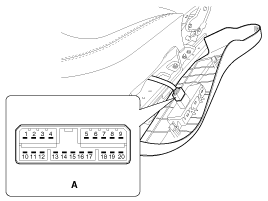
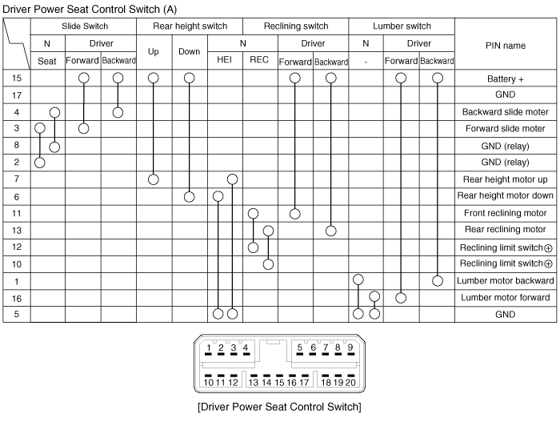
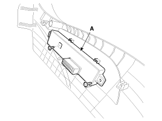

# Kia Sportage: Controle do Interruptor de Assento Elétrico: Procedimentos de Reparo

[Home](../../index.md) / [Manual de Serviço e Reparo do Kia Sportage SL](../sportage-482.md) / [Sistema Elétrico do Veículo](sportage-984.md) / [Elétrico do Assento](sportage-1044.md) / Procedimentos de Reparo do Interruptor de Assento Elétrico

## Inspeção

1. Com o interruptor de assento elétrico em cada posição, verifique a continuidade entre os terminais abaixo. Se a continuidade não for conforme especificado, substitua o interruptor de assento elétrico.

   

## Remoção

1. Desconecte o terminal negativo (-) da bateria.

2. Remova a capa do reclinador do assento elétrico.

   (Consulte o grupo BD - "Assento frontal")

3. Remova o interruptor de controle do assento elétrico (A).

   

## Instalação

1. Instale o interruptor de controle do assento elétrico após conectar o conectador.

2. Instale a capa do reclinador e o assento frontal elétrico.
