# Kia Sportage: Interruptor de Aquecimento do Assento: Procedimentos de Reparo

[Home](../../index.md) / [Manual de Serviço e Reparo do Kia Sportage SL](../sportage-482.md) / [Sistema Elétrico do Vidro](sportage-984.md) / [Elétrico do Assento](sportage-1044.md) / Procedimentos de Reparo do Interruptor de Aquecimento do Assento

## Inspeção

Assento Motorista / Auxiliar

1. Desconecte o terminal negativo (-) da bateria.

2. Remova a alavanca do câmbio. Remova o capô do console inferior (A) usando a ferramenta apropriada.

   (Consulte o grupo BD - "Console")

   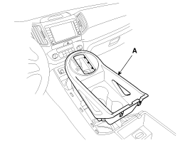

3. Remova a bandeja do console inferior (A).

   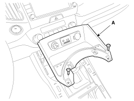

   > **Nota**
   >
   > - Cuide para não danificar a garrilha ao remover o interruptor.

4. Desconecte o conector do interruptor de aquecimento do assento motorista / auxiliar.

   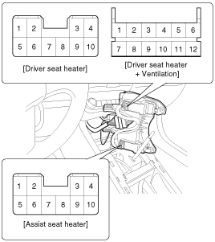

   Motorista [Aquecimento]

   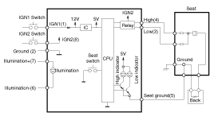

   | N° | Descrição |
   | --- | --- |
   | 1 | IGN 1 |
   | 2 | Terra |
   | 3 | Aquecimento do assento motorista (Baixo) |
   | 4 | Aquecimento do assento motorista (Alto) |
   | 5 | Indicador |
   | 6 | Iluminação (+) |
   | 7 | Iluminação (-) |
   | 8 | IGN 2 |
   | 9 | - |
   | 10 | - |

   Motorista [Ventilação + Aquecimento]

   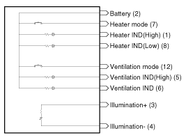

   | N° | Descrição |
   | --- | --- |
   | 1 | Indicador do Aquecimento (Alto) |
   | 2 | Bateria |
   | 3 | Iluminação (+) |
   | 4 | Iluminação (-) |
   | 5 | Indicador da Ventilação (Alto) |
   | 6 | Indicador da Ventilação (Baixo) |
   | 7 | Modo do Aquecimento |
   | 8 | Indicador do Aquecimento (Baixo) |
   | 9 | - |
   | 10 | - |
   | 11 | - |
   | 12 | Modo de Ventilação |

   Assista [Aquecimento]

   

   | N° | Descrição |
   | --- | --- |
   | 1 | IGN 1 |
   | 2 | Terra |
   | 3 | Aquecimento do assento auxiliar (Baixo) |
   | 4 | Aquecimento do assento auxiliar (Alto) |
   | 5 | Indicador |
   | 6 | Iluminação (+) |
   | 7 | Iluminação (-) |
   | 8 | IGN 2 |
   | 9 | - |
   | 10 | - |

5. Operacionalize cada interruptor de aquecimento do assento e verifique a continuidade entre os terminais.

   [Aquecimento]

   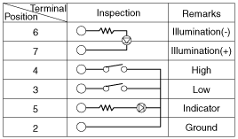

   Motorista [Ventilação + Aquecimento]

   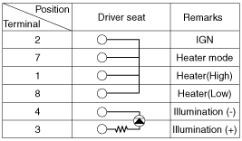

   Motorista [Ventilação + Aquecimento]

   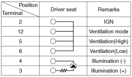

6. Inspeção do pinho do interruptor. Se necessário, substitua o interruptor de aquecimento do assento (A) após desafinar as varetas (3EA).

   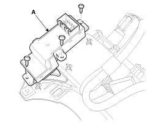

Interruptor de Aquecimento do Assento Traseiro

1. Desconecte o terminal negativo (-) da bateria.

2. Remova o interruptor do vidro traseiro da moldura da porta traseira.

   (Consulte o grupo BE - "Interruptor do vidro traseiro")

   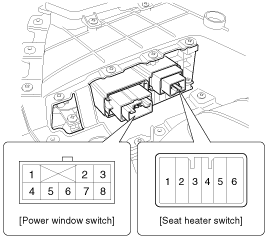

   | N° | Descrição |
   | --- | --- |
   | 1 | Indicador (+) |
   | 2 | Indicador (-) |
   | 3 | IGN 2 |
   | 4 | Aquecimento (+) |
   | 5 | Iluminação (-) |
   | 6 | Iluminação (+) |

3. Inspeção do pinho do interruptor. Se necessário, substitua o interruptor de aquecimento do assento.

   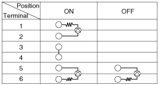
