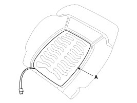
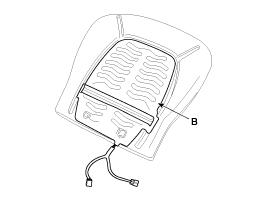
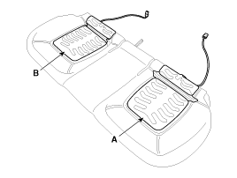
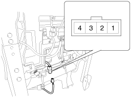
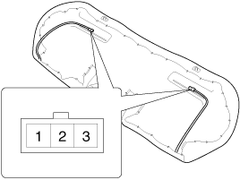

# Kia Sportage: Aquecedor do Assento: Procedimentos de Reparo

[Home](../../index.md) / [Manual de Serviço e Reparo do Kia Sportage SL](../sportage-482.md) / [Sistema Elétrico do Assento](sportage-984.md) / [Elétrico do Assento](sportage-1044.md) / Aquecedor do Assento: Procedimentos de Reparo

## Remoção

1. Remova a capa traseira do assento e a capa do assento.

   (Consulte o grupo BD - "Assento dianteiro")

2. Remova o aquecedor do assento traseiro (A) e o aquecedor do assento (B).

   

   

3. Remova a capa do assento traseiro.

   (Consulte o grupo BD - "Assento traseiro")

4. Remova o aquecedor (A) do assento traseiro (LH) e o aquecedor (B) do assento traseiro (RH).

   

## Instalação

1. Instale o aquecedor do assento traseiro (LH & RH).

   (Consulte o grupo BD - "Assento traseiro")

## Inspeção

Assento Dianteiro

1. Verifique a continuidade e mede a resistência entre os terminais conforme abaixo.

   

   | Número | Descrição | Número | Descrição |
   | --- | --- | --- | --- |
   | 1 | Indicador | 3 | Baixo |
   | 2 | Terra | 4 | Alto |

   ```
   Valor padrão
   Capa: 1,39? ± 10% (couro/fabrico)
   Traseira: 1,41? ± 10% (couro/fabrico)
   Definição: 2,8? ± 10% (couro/fabrico)
   ```

2. Operacionalize o aquecedor do assento após conectar o conectador 4P, e
   então verifique o termostato medindo a temperatura da superfície do assento.

   ```
   Valor padrão
   Capa: 104 ± 3,6 °F (40 ± 2 °C) (BAIXO)
   107,6 ± 3,6 °F (42 ± 2 °C) (ALTO)
   Traseira: 114,8 ± 3,6 °F (46 ± 2 °C) (BAIXO),
   125,6 ± 3,6 °F (52 ± 2 °C) (ALTO)
   ```

Assento Traseiro

1. Verifique a continuidade e mede a resistência entre os terminais 2 e 3.

   

   | Número | Descrição |
   | --- | --- |
   | 1 | Indicador |
   | 2 | Terra |
   | 3 | Aquecedor |

   ```
   Valor padrão
   Capa: 5,29? ± 10% (couro/fabrico)
   ```

2. Operacionalize o aquecedor do assento após conectar o conectador 4P, e
   então verifique o termostato medindo a temperatura da superfície do assento.

   ```
   Valor padrão
   Capa: 104 ± 3,6 °F (40 ± 2 °C)
   ```
