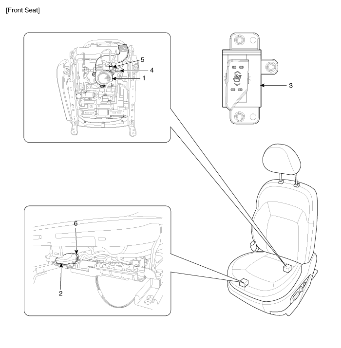

# Kia Sportage: Clima do Assento: Componentes e Localização dos Componentes

[Home](../../index.md) / [Manual de Serviço e Reparo do Kia Sportage SL](../sportage-482.md) / [Sistema Elétrico do Corpo](sportage-984.md) / [Elétrico do Assento](sportage-1044.md) / Clima do Assento: Componentes e Localização dos Componentes

## Componentes

| 1. Ventilador de ventilação 2. ECU de ventilação 3. Interruptor de assento de ventilação | 4. Conector do ventilador 5. Conector do aquecedor 6. Conector do ECU de ventilação |
| --- | --- |
