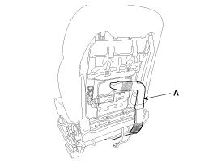
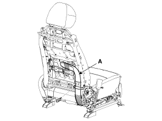
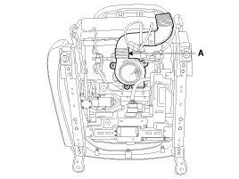
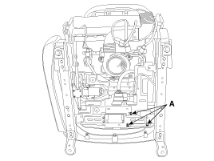
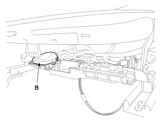

# Kia Sportage: Clima do Assento: Procedimentos de Reparo

[Home](../../index.md) / [Manual de Serviço e Reparo do Kia Sportage SL](../sportage-482.md) / [Sistema Elétrico do Corpo](sportage-984.md) / [Elétrico do Assento](sportage-1044.md) / Procedimentos de Reparo do Clima do Assento

## Remoção

1. Remova a montagem do assento dianteiro.

   (Consulte o grupo BD - "Assento Dianteiro")

2. Remova a cobertura do assento e a capa do assento.

   (Consulte o grupo BD - "Assento Dianteiro")

3. Remova o dutos de ventilação (A) do assento após desafivelar o parafuso e o prego.

   

   

4. Remova o dutos de ventilação e o ventilador (A) no assento após desafivelar o parafuso.

   

5. Remova o suporte e o ECU do assento de ventilação (B) após desafivelar os parafusos (A, 3EA).

   

   

## Instalação

1. Instale os conectores e o controle de ventilação de ar.

2. Instale o dutos de ventilação e o ventilador.

3. Instale a cobertura do assento.

4. Instale a montagem do assento e a capa do suporte do assento.
