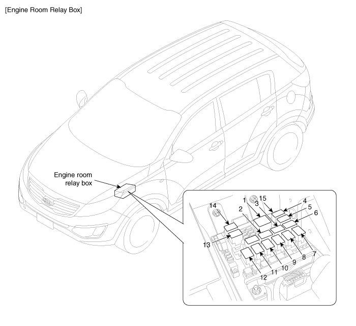
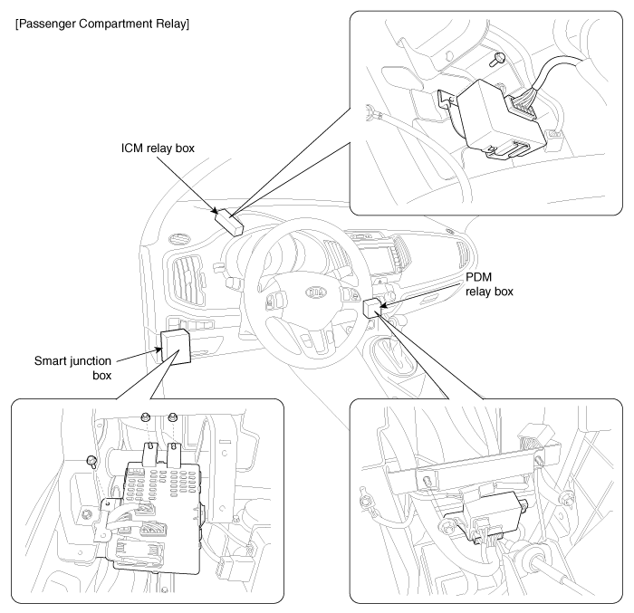

# Kia Sportage: Componentes e Localização dos Componentes

[Home](../../index.md) / [Manual de Serviço e Reparo do Kia Sportage SL](../sportage-482.md) / [Sistema Elétrico do Corpo](sportage-984.md) / [Fusíveis e Relays](sportage-1055.md) / Componentes e Localização dos Componentes

## Localização dos Componentes

| 1. Relé principal 2. Relé do ventilador de resfriamento (Alto) 3. Relé do desneve do para-brisa 4. Relé do limpador de para-brisa (Alto) 5. Relé do limpador de para-brisa (Baixo) | 6. Relé do ATM 7. Relé do desneve do vidro traseiro 8. Relé do sinaleiro antifurto 9. Relé do arranque 10. Relé do ventilador de resfriamento (Baixo) |
| --- | --- | --- |
| 11. Relé do sinaleiro 12. Relé do ventilador 13. Relé do ar condicionado 14. Relé do bomba de combustível 15. Relé do sistema de advertência de frenagem rápida |

| 1. Relé do ICM : Relé do limpador de vidro traseiro, relé DBC (Controle de Freio em Desce) 2. Relé do PDM : Relé ACC, relé IG1, relé IG2 |  |
| --- | --- |
| 1. | Relé do ICM : Relé do limpador de vidro traseiro, relé DBC (Controle de Freio em Desce) |
| 2. | Relé do PDM : Relé ACC, relé IG1, relé IG2 |
