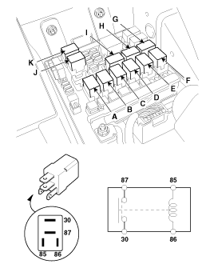
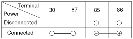
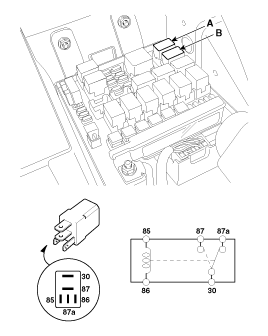
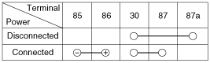
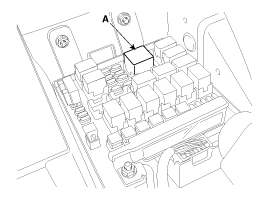
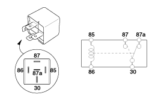
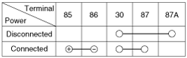
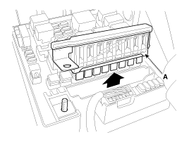

# Kia Sportage: Caixa de Relés (Balanço do Motor): Procedimentos de Reparo

[Home](../../index.md) / [Manual de Serviço e Reparo do Kia Sportage SL](../sportage-482.md) / [Sistema Elétrico do Corpo](sportage-984.md) / [Fusíveis e Relés](sportage-1055.md) / Procedimentos de Reparo da Caixa de Relés (Balanço do Motor)

## Inspeção

1. Desconecte o terminal negativo (-) da bateria.

2. Remova o relé da caixa de relés no balanço do motor.

Relé de Energia (Tipo A)

Verifique a continuidade entre os terminais.

A : Relé do ventilador

B : Relé do buzina

C : Relé do ventilador de resfriamento (Baixo)

D : Relé do arranque

E : Relé da buzina antifurto

F : Relé do desfogador de vidro traseiro

G : Relé do ATM

H : Relé do desentorpecedor de vidro

I : Relé do ventilador de resfriamento (Alto)

J : Relé do ar condicionado

K : Relé do bomba de combustível

1. Deverá haver continuidade entre os terminais No.30 e No.87 quando a energia e o terreno forem conectados aos terminais No.85 e No.86.

2. Não deverá haver continuidade entre os terminais No.30 e No.87 quando a energia for desligada.

   

   

Relé de Energia (Tipo B)

Verifique a continuidade entre os terminais.

A : Relé do limpador (Alto)

B : Relé do limpador (Baixo)

1. Deverá haver continuidade entre os terminais No.30 e No.87 quando a energia e o terreno forem conectados aos terminais No.85 e No.86.

2. Deverá haver continuidade entre os terminais No.30 e No.87 quando a energia for desligada.

   

   

Relé de Energia (Tipo C)

Verifique a continuidade entre os terminais.

A : Relé principal

1. Deverá haver continuidade entre os terminais No.30 e No.87 quando a energia e o terreno forem conectados aos terminais No.85 e No.86.

2. Não deverá haver continuidade entre os terminais No.30 e No.87 quando a energia for desligada.

   

   

   

Fusível

1. Certifique-se de que não há movimento nos suportes dos fusíveis e que os fusíveis estão seguramente fixados.

2. As capacidades dos fusíveis para cada circuito estão corretas?

3. Existe algum fusível queimado?

   Se um fusível precisar ser substituído, certifique-se de usar um novo fusível da mesma capacidade. Sempre determine o motivo pelo qual o fusível queimou e elimine completamente o problema antes de instalar um novo fusível.

Fusível Multifuncional

> **Nota**
>
> - O fusível multifuncional (A) é necessário para substituição em massa quando apenas um fusível estiver danificado.
> - Ao substituir o fusível multifuncional, consulte o diagrama "Localização dos componentes no balanço do motor" com precisão.
> - Use as capacidades corretas do fusível multifuncional para cada circuito.
