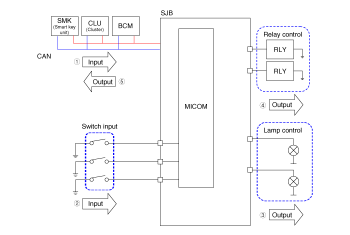
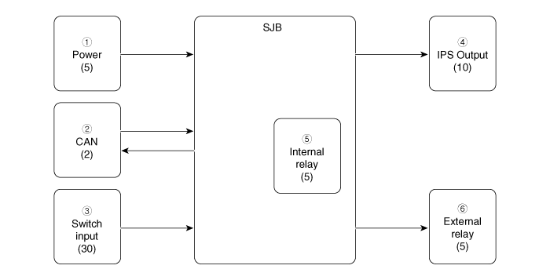
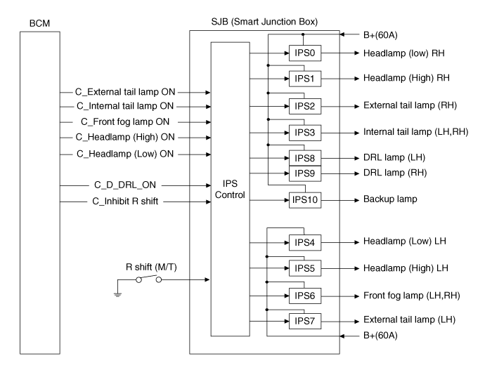
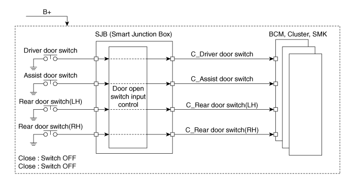
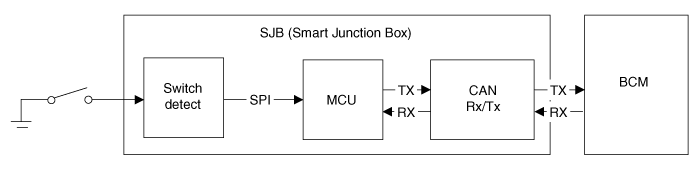
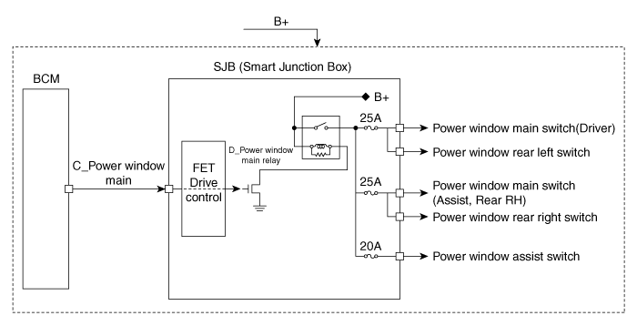
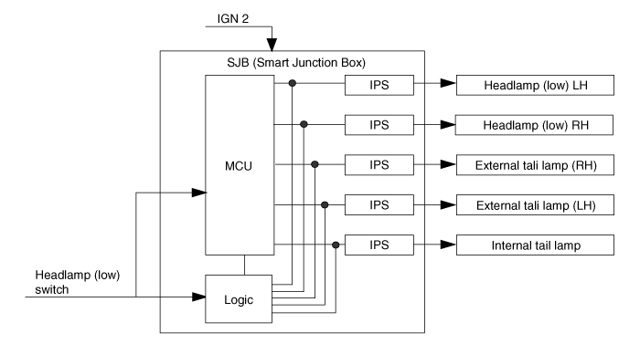

# Kia Sportage: Caixa de Relés (Compartimento do Passageiro): Descrição e Operação

[Home](../../index.md) / [Manual de Serviço e Reparo do Kia Sportage SL](../sportage-482.md) / [Sistema Elétrico do Corpo](sportage-984.md) / [Fusíveis e Relés](sportage-1055.md) / Caixa de Relés (Compartimento do Passageiro): Descrição e Operação

## Descrição

SJB (Caixa de Juntamento Inteligente)

1. Especificação

   | Item | Requisito | Observação |
   | --- | --- | --- |
   | Tensão nominal | DC 12V | ? |
   | Faixa de tensão | DC 9 ~ 16V | Operação normal nesta faixa |
   | Temperatura de armazenamento | -40°C ~ +80°C | ? |
   | Temperatura de operação | -30°C ~ +75°C | ? |
   | Umidade de operação | 85% | PCB, proteção contra umidade, revestimento, etc. |
   | Corrente de fundo | Máx. 200uA | Todas as cargas abertas |
   | Faixa de tensão de operação | DC 9 ~ 16V | Deve ativar normalmente no intervalo normal |
   | Máx. Umidade de uso | 85% | Regulado junto com partes que precisam de isolamento, como PCB, proteção contra umidade, revestimento, etc |
   | Resistência de isolamento | Deve não causar ignição por curto-circuito elétrico | |

2. Carga Nominal

   | Item | Carga Nominal |
   | --- | --- |
   | Luz da Frente Baixa LH | 55W |
   | Luz da Frente Baixa RH | 55W |
   | Luz da Frente Alta LH | 60W (Máx) |
   | Luz da Frente Alta RH | 60W (Máx) |
   | Luz Traseira Esquerda LH | 41W (Máx) |
   | Luz Traseira Direita RH | 31W (Máx) |
   | Farol de Neblina Frente LH+RH | 54W |
   | Luz Interna | 45W |
   | Controle do Relé do Alarme de Bateria/Alarme de Início | 0.9W |
   | Controle do Relé do Farol de Neblina Traseiro | 0.6W |
   | Controle do Relé do Travamento da Porta Traseira ou Luz do Bagageiro (Porta Traseira com Travamento Elétrico) | 0.6W |
   | Controle do Relé do Farol de Neblina Traseiro | 0.45W |
   | Controle do Relé do Limpador Traseiro (Externo) | 12W (Saída Máx) |
   | Controle do Relé do Alarme de Bateria/Alarme do Pito (Externo) | 12W (Saída Máx) |
   | Controle do Relé do Limpador Traseiro (Externo) | 12W (Saída Máx) |
   | Controle do Relé do Descongelador da Frente (Externo) | 12W (Saída Máx) |

3. Configuração do Sistema

   

   | ? | Divisão | Forma | Descrição |
   | --- | --- | --- | --- |
   | Entrada | | CAN | Comando do controle de lâmpadas e relés. |
   | | Interruptor | Entrada de sinal de interruptor | |
   | Saída | | Controle IPS | Controle de lâmpadas através de IPS |
   | | Controle FET | Controle de relés | |
   | | CAN | – Transferência do estado de controle de lâmpadas – Transferência do sinal de entrada | |
   | – | Transferência do estado de controle de lâmpadas | | |
   | – | Transferência do sinal de entrada | | |

4. Diagrama de Bloco do Sistema

   

   | N° | 1. Entrada de energia | N° | 2. CAN |
   | --- | --- | --- | --- |
   | 1 | B+1 | 1 | Tx |
   | 2 | B+2 | 2 | Rx |
   | 3 | B+3 | ? | ? |
   | 4 | IGN1 | | |
   | 5 | IGN2 | | |

   | N° | 3. Entrada de interruptor | | |
   | --- | --- | --- | --- |
   | 1 | Interruptor da porta do motorista | 16 | Estado de desbloqueio da porta traseira esquerda (LH) |
   | 2 | Interruptor da porta auxiliar | 17 | Estado de desbloqueio da porta traseira direita (RH) |
   | 3 | Interruptor da porta traseira esquerda (LH) | 18 | Interruptor do cinto de segurança do motorista |
   | 4 | Interruptor da porta traseira direita (RH) | 19 | Interruptor do cinto de segurança do assistente |
   | 5 | Interruptor de desbloqueio da chave da porta do motorista | 20 | Interruptor do cinto de segurança do passageiro traseiro esquerdo (LH) |
   | 6 | Interruptor de desbloqueio da chave da porta auxiliar | 21 | Interruptor do cinto de segurança do assento central traseiro |
   | 7 | Interruptor de bloqueio da chave da porta do motorista | 22 | Interruptor do cinto de segurança do passageiro traseiro direito (RH) |
   | 8 | Interruptor de bloqueio da chave da porta auxiliar | 23 | Interruptor do nível do líquido de freio |
   | 9 | Estado do travamento do capô | 24 | Interruptor do travamento do estacionamento |
   | 10 | Interruptor de liberação da porta traseira | 25 | Interruptor do travamento manual |

| 11 | Interruptor de porta traseira aberta | 26 | Marcha ré do câmbio (opcão MT) |
| 12 | Interruptor de bloqueio da janela elétrica | 27 | - |
| 13 | Interruptor de desbloqueio da janela elétrica | 28 | Interruptor de farol baixo (M/F) |
| 14 | Estado de desbloqueio da porta do motorista | 29 | Opção HID |
| 15 | Estado de desbloqueio assistido da porta | 30 | Sinal de parada do limpador de vidro |

| No | 4. Saída IPS | Potência |
| --- | --- | --- |
| 1 | Farol baixo (RH) | B+2 |
| 2 | Farol alto (RH) | |
| 3 | Farol traseiro externo (RH) | |
| 4 | Farol traseiro interno (LH, RH) | |
| 5 | DRL dedicado (LH/RH) | |
| 6 | Luz de ré | |
| 7 | Farol baixo (LH) | B+3 |
| 8 | Farol alto (LH) | |
| 9 | Farol de neblina (LH, RH) | |
| 10 | Farol traseiro externo (LH) | |

| No. | 5. Relé interno | No. | 6. Relé externo |
| --- | --- | --- | --- |
| 1 | Relé de travamento da porta | 1 | - |
| 2 | Relé de desbloqueio da porta | 2 | Relé defroste traseiro |
| 3 | Relé da janela elétrica | 3 | Relé desentorpecimento dianteiro |
| 4 | Relé de liberação da porta traseira | 4 | Relé do alarme antifurto |
| 5 | Relé de início do alarme antifurto | 5 | Relé do limpador traseiro |

5. Função de controle (Farol)

| – | O Smart Junction Box (SJB) controla a saída do farol traseiro, farol baixo, farol alto e farol de neblina dianteiro. Também realiza diagnósticos. |
| --- | --- |

| – | Controla o farol após receber sinal CAN do BCM. |
| --- | --- |

| – | Envia os resultados do estado de controle e diagnóstico para o BCM através de CAN. |
| --- | --- |

| (1) | Controle PWM (Modulação de Largura de Pulso): Controle de tensão nominal Se a tensão da bateria for superior a 13,2 ± 0,1 V, controla o IPS com PWM e evita o queima prematuro da lâmpada e do dispositivo IPS. Controla as lâmpadas controlando o IPS. A frequência é 80 ± 10 Hz (TBD) ao controlar com PWM. Se a tensão for alta, a vida útil da lâmpada diminui. Então, o SJB mantém uma tensão estável nas lâmpadas e garante a vida útil da lâmpada. |
| --- | --- |

| (2) | PCL: Limitação de Corrente Programada Se a corrente que flui na linha for maior do que a corrente básica designada para a linha, controla o IPS com PWM ou para o IPS. |
| --- | --- |

| (3) | Diagnóstico de superaquecimento Se uma alta corrente fluir no SJB em um curto período de tempo, como um curto-circuito no solo, o IPS bloqueia a saída e protege a linha e o carregador. |
| --- | --- |

6. Função de controle - Entrada do interruptor

? Explicação do movimento

| – | Detecta o estado do interruptor e transmite para o BCM através de CAN. |
| --- | --- |

| – | Detecta o estado do interruptor no estado de sono e habilita a função de despertar do SJB. |
| --- | --- |

7. Função de controle - relé

? Explicação do movimento

| – | Recebe o valor de controle do relé da janela elétrica do BCM através de CAN e controla os relês. |
| --- | --- |

| – | Se C_PwdeMain (sinal CAN) estiver ON, faz o relé da janela elétrica sair para ON. Se C_PwdeMain (sinal CAN) não estiver ON, faz o relé da janela elétrica sair para OFF. |
| --- | --- |

8. Função de controle - falha no CAN

   SJB, no caso de falha no CAN e IGN2 ligado, aciona os faróis baixos, os faróis de ré externos e os faróis de ré internos por força.

   

9. Função de proteção de hardware

   No caso de MCU estar em estado morto, SJB verifica o estado do interruptor de farol baixo. Se IGN2 estiver ligado e o interruptor de farol baixo estiver ligado, ele aciona o farol baixo por força e protege o condutor.
