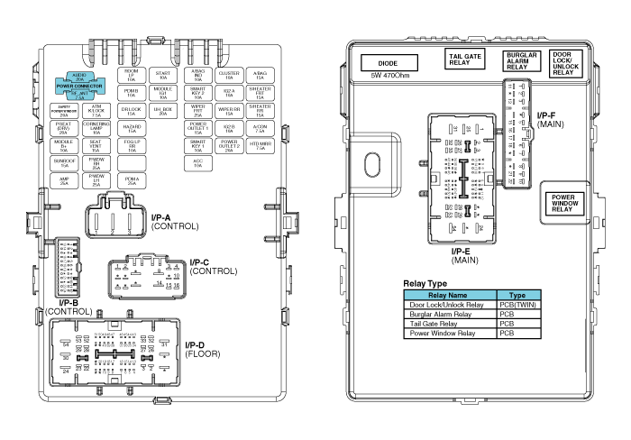
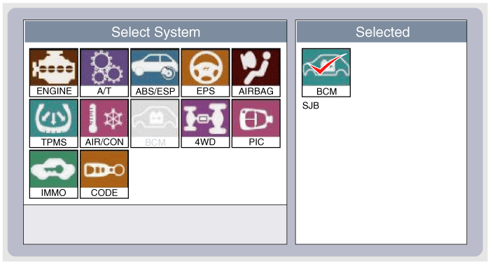
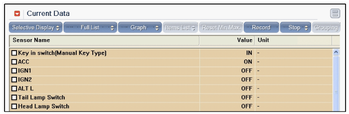
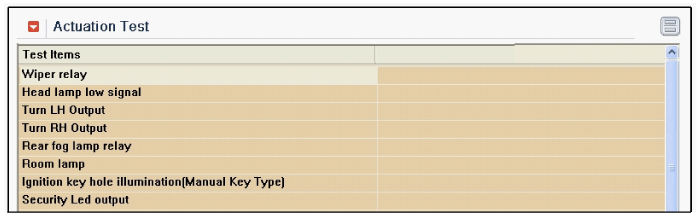
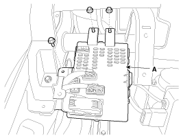

# Kia Sportage: Caixa de Relés (Compartmento do Passageiro): Procedimentos de Reparo

[Home](../../index.md) / [Manual de Serviço e Reparo do Kia Sportage SL](../sportage-482.md) / [Sistema Elétrico do Corpo](sportage-984.md) / [Fusíveis e Relés](sportage-1055.md) / Caixa de Relés (Compartmento do Passageiro): Procedimentos de Reparo

## Inspeção

Fusível

1. Certifique-se de que não há movimento nos suportes dos fusíveis e que os fusíveis estão seguramente fixos.

2. As capacidades dos fusíveis para cada circuito estão corretas?

3. Há algum fusível queimado?

   Se um fusível precisar ser substituído, certifique-se de usar um novo fusível da mesma capacidade. Sempre determine o motivo pelo qual o fusível queimou e elimine completamente o problema antes de instalar um novo fusível.

Conectores SJB

## Inspeção

1. O SJB pode ser diagnosticado usando o GDS. O SJB comunica-se com o GDS, que então exibe entradas e saídas, juntamente com códigos.

2. Para diagnosticar a função do SJB, selecione o modelo do veículo, o BCM e o SJB.

   

3. Para consultar o valor atual de entrada/saída do SJB, selecione "Dados Atuais". Fornece informações sobre as condições de entrada/saída do SJB.

   

4. Para realizar um teste funcional nas saídas do SJB, selecione "Teste de Ativação".

   

## Remoção

1. Desconecte o terminal negativo (-) da bateria.

2. Remova o painel inferior do crash pad.

   (Consulte o grupo BD - "Crash pad")

3. Remova a caixa de relés (A) (Smart Junction Box) após remover os parafusos e as conexões.

   

## Instalação

1. Instale a caixa de relés (Smart Junction Box).

2. Conecte os conectores do SJB.

3. Instale o painel inferior do crash pad.
