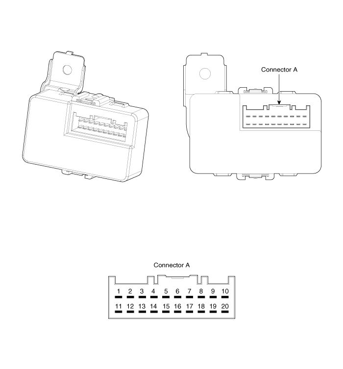

# Kia Sportage: Caixa de Relés do ICM (Integrated Circuit Module): Componentes e Localização dos Componentes

[Home](../../index.md) / [Manual de Serviço e Reparo do Kia Sportage SL](../sportage-482.md) / [Sistema Elétrico do Corpo](sportage-984.md) / [Fusíveis e Relés](sportage-1055.md) / Caixa de Relés do ICM: Componentes e Localização dos Componentes

## Componento

Informações sobre os Pinos

| Número | Conector A | Número | Conector A |
| --- | --- | --- | --- |
| 1 | Motor de limpador de ré (Poder) | 11 | IPM (Limpador de ré 15A) |
| 2 | IPM | 12 | Motor de limpador de ré (Sinal) |
| 3 | Luz de parada | 13 | - |
| 4 | - | 14 | - |
| 5 | Unidade ESC | 15 | GND |
| 6 | U_H_Box (Fusível 7.5A do ABS) | 16 | IPM (BCM) |
| 7 | Interruptor de luz de parada | 17 | IPM (Bloqueio da porta 15A) |
| 8 | Fusível da luz de parada 10A | 18 | Atuador do bloqueio da porta - motorista |
| 9 | - | 19 | - |
| 10 | - | 20 | - |

Especificação

| Tensão nominal | 12V DC |
| --- | --- |
| Intervalo de tensão de operação | 9~16V DC |
| Intervalo de temperatura de operação | -22~167 °F (-30~75 °C) |
| Intervalo de temperatura de armazenamento | -40~185 °F (-40~85 °C) |
| Resistência de isolamento | 100M? MIN. / 500VM |

Especificação de queda de tensão

| Número | Função | Especificação de corrente | Tipo de carga | Queda de tensão | Observações |  |
| --- | --- | --- | --- | --- | --- | --- |
| Nominal | Máx. |  |  |  |  |  |
| 1 | Limpador de ré | 10A | 25A | Motor | Máx. 0,5 V | Tensão de teste: 13,5 V |
| 2 | DBC (luz de parada) | 10A | 25A | Iluminação |  |  |
