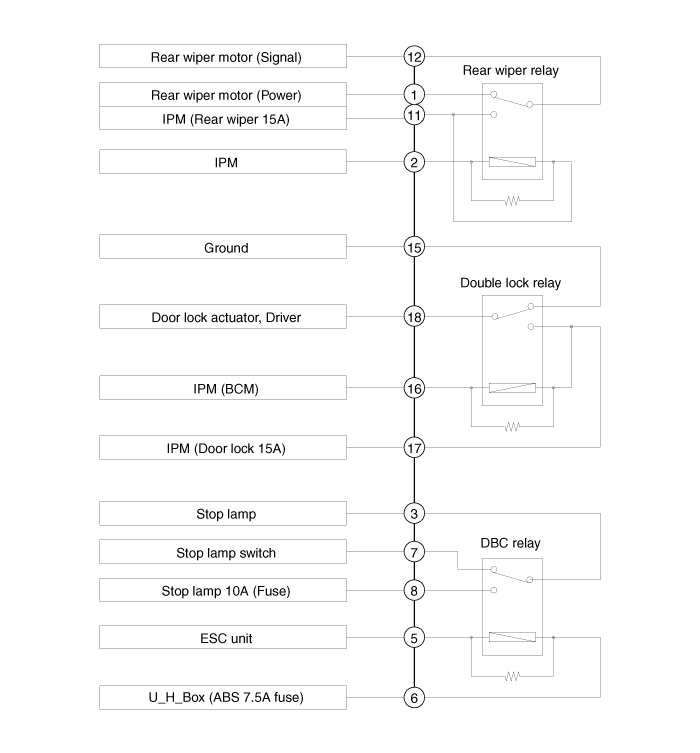

# Kia Sportage: Caixa de Relevo do Módulo de Circuito Integrado (ICM): Diagramas Schematicos

[Home](../../index.md) / [Manual de Serviço e Reparo do Kia Sportage SL](../sportage-482.md) / [Sistema Elétrico do Corpo](sportage-984.md) / [Fusíveis e Releos](sportage-1055.md) / Diagramas Schematicos da Caixa de Relevo do Módulo de Circuito Integrado (ICM)

## Diagrama Schematico

