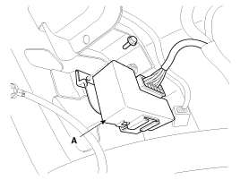

# Kia Sportage: Caixa de Relevo do ICM (Integrated Circuit Module): Descrição e Operação

[Home](../../index.md) / [Manual de Serviço e Reparo do Kia Sportage SL](../sportage-482.md) / [Sistema Elétrico do Corpo](sportage-984.md) / [Fusíveis e Releos](sportage-1055.md) / Caixa de Relevo do ICM: Descrição e Operação

## Descrição

O relevo do ICM (A) está unido ao relé do limpador de ré (A) e ao relé DBC, que estão instalados dentro do crash pad inferior.

