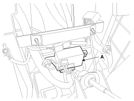
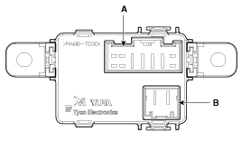
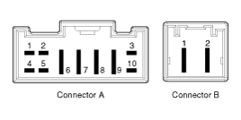

# Kia Sportage: Caixa de Relés: Descrição e Operação

[Home](../../index.md) / [Manual de Serviço e Reparo do Kia Sportage SL](../sportage-482.md) / [Sistema Elétrico do Corpo](sportage-984.md) / [Fusíveis e Relés](sportage-1055.md) / Caixa de Relés PDM: Descrição e Operação

## Descrição

O relé PDM (A) está unido aos relés IG1, IG2 e ACC e instalado no painel da fascia central inferior.

