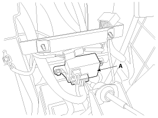

# Kia Sportage: Caixa de Relés: Procedimentos de Reparo

[Home](../../index.md) / [Manual de Serviço e Reparo do Kia Sportage SL](../sportage-482.md) / [Sistema Elétrico do Corpo](sportage-984.md) / [Fusíveis e Relés](sportage-1055.md) / Caixa de Relés PDM: Procedimentos de Reparo

## Remoção

Caixa de Relés PDM

1. Desconecte o terminal negativo (-) da bateria.

2. Remova a montagem do painel central do console.

   (Consulte o grupo BD - "Console")

3. Remova a caixa de relés PDM (A) após soltar as varetas (2UN) e desconectar o conector.

   

## Instalação

1. Instale a caixa de relés PDM.

2. Instale a montagem do painel central do console.

3. Conecte o cabo do negativo (-) da bateria.

## Inspeção

Relé IG2

Verifique a continuidade entre os terminais.

1. Deve haver continuidade entre os terminais No.1 e No.2
   do conector B quando a energia e o terceiro terminal No.3 e o quarto terminal No.4 do conector A estão conectados.

2. Não deve haver continuidade entre os terminais No.1 e No.2 do conector B quando a energia é desconectada.

Relé IG1

Verifique a continuidade entre os terminais.

1. Deve haver continuidade entre os terminais No.7 e No.8
   do conector A quando a energia e o terceiro terminal No.3 e o décimo terminal No.10 do conector A estão conectados.

2. Não deve haver continuidade entre os terminais No.7 e No.8 do conector A quando a energia é desconectada.

Relés ACC

Verifique a continuidade entre os terminais.

1. Deve haver continuidade entre os terminais No.7 e No.6
   do conector A quando a energia e o primeiro terminal No.1 e o terceiro terminal No.3 do conector A estão conectados.

2. Não deve haver continuidade entre os terminais No.7 e No.6 do conector A quando a energia é desconectada.
