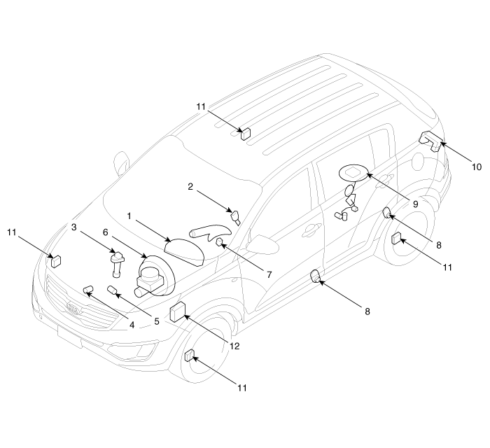

# Indicadores e Painéis de Informações — Componentes e localização

[Home](../../index.md) / [Manual de Serviço e Reparo](../sportage-482.md) / [Sistema Elétrico do Corpo](sportage-984.md) / [Indicadores e Painéis de Informações](sportage-1069.md) / Componentes e localização

## Diagrama

## Legenda

| Nº | Componente |
| --- | --- |
| 1 | Montagem do cluster |
| 2 | Interruptor do cinto de segurança |
| 3 | Sensor de velocidade do veículo |
| 4 | Enviador de temperatura do líquido de refrigeração do motor |
| 5 | Interruptor de pressão do óleo |
| 6 | Interruptor de nível de líquido de freio |
| 7 | Interruptor do travamento do câmbio em lugar |
| 8 | Interruptor da porta |
| 9 | Enviador do indicador de combustível |
| 10 | Interruptor do travamento do porta-malas |
| 11 | Sensor de velocidade do eixo da roda |
| 12 | ECU do ABS |
