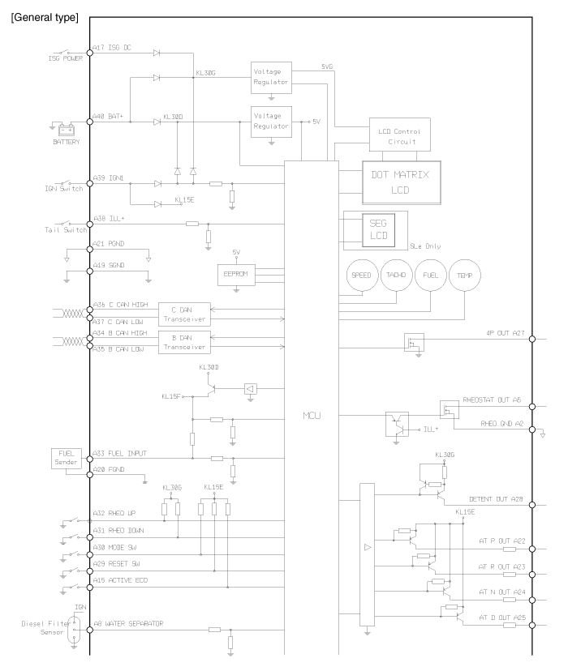
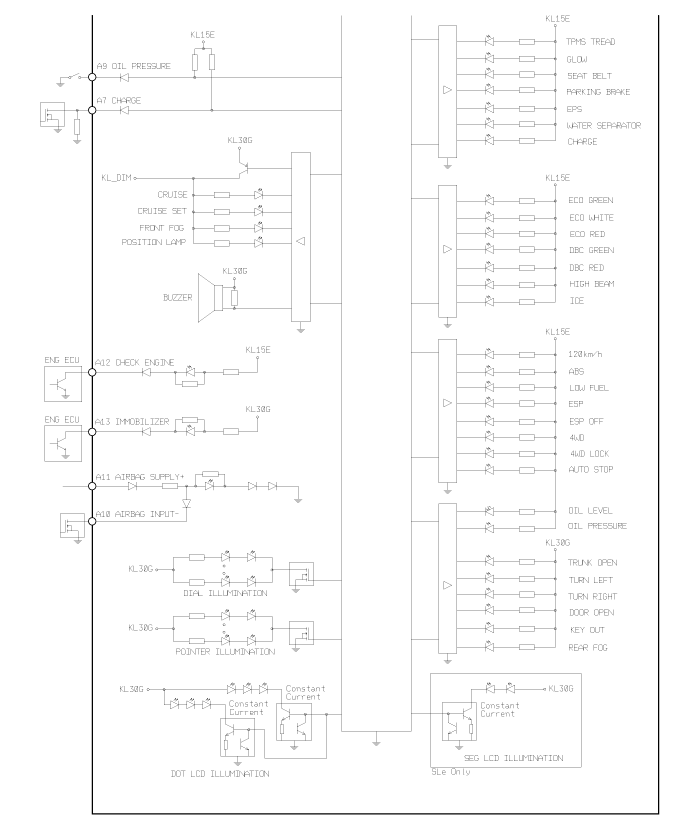
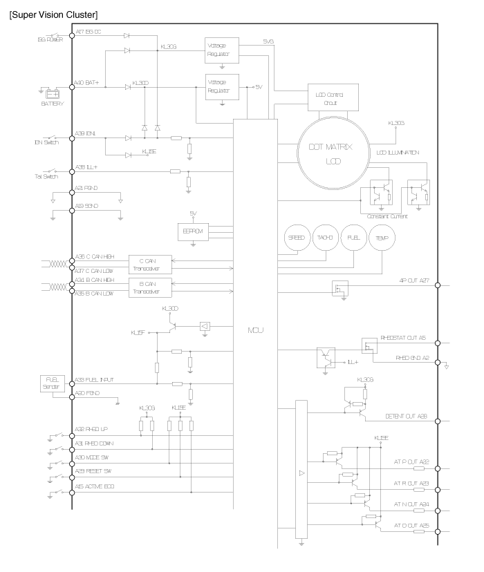
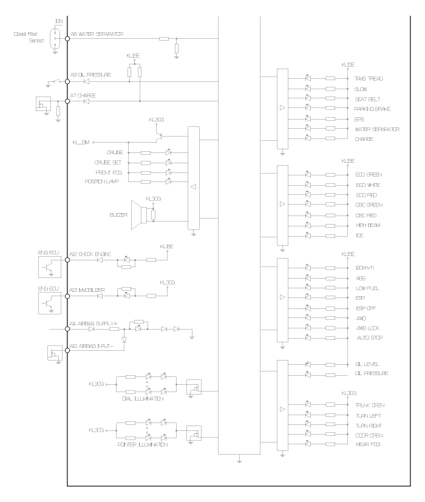
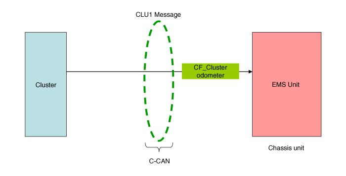
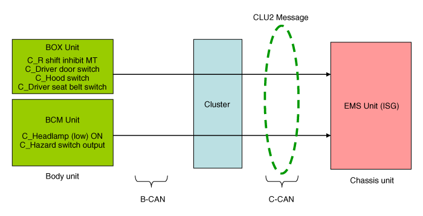
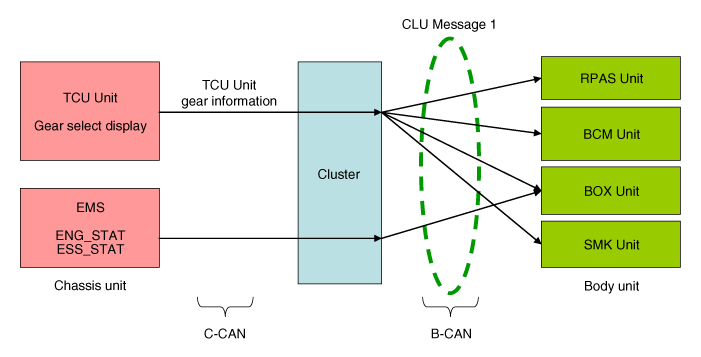
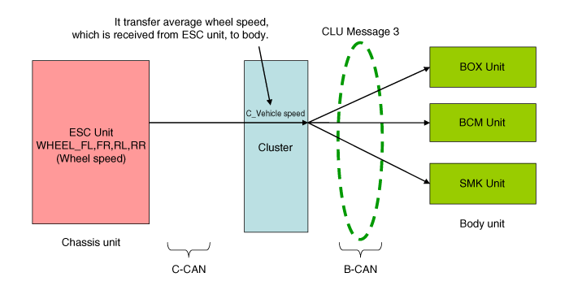

# Kia Sportage: Painel de Instrumentos: Diagramas Schematicos

[Home](../../index.md) / [Manual de Serviço e Reparo do Kia Sportage SL](../sportage-482.md) / [Sistema Eletrônico do Veículo](sportage-984.md) / [Indicadores e Gauges](sportage-1069.md) / Diagramas Schematicos do Painel de Instrumentos

## Diagrama de Circuito (1)

## Diagrama de Circuito (2)

## Fluxo de Mensagens CLU1 (B > C Gateway CAN)

## Fluxo de Mensagens CLU2 (B > C Gateway CAN)

## Fluxo de Mensagens CLU (1) (C > B Gateway CAN)

## Fluxo de Mensagens CLU (3) (C > B Gateway CAN)

