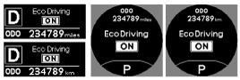
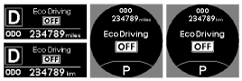

# Kia Sportage: Painel de Instrumentos: Descrição e Operação

[Home](../../index.md) / [Manual de Serviço e Reparo do Kia Sportage SL](../sportage-482.md) / [Sistema Elétrico do Corpo](sportage-984.md) / [Indicadores e Índices](sportage-1069.md) / Painel de Instrumentos: Descrição e Operação

## Descrição

Sistema ECO

Este sistema foi projetado para incentivar a condução ecológica, fornecendo feedback em tempo real ao motorista.

A luz do indicador ECO auxilia o motorista a conduzir de forma mais econômica.

A luz verde acende quando o motorista dirige com alta eficiência energética.

A eficiência energética depende do hábito de condução do motorista e das condições de tráfego.

O sistema para operar quando a transmissão está em posição P, R ou N, ou no modo desportivo, ou quando o modo de consumo de combustível instantâneo é selecionado.

Ligar/Desligar o Indicador ECO

1. O sistema de indicador ECO para operar quando o modo de consumo de combustível instantâneo é selecionado.

2. A luz do indicador ECO fica sempre apagada quando o motorista seleciona o modo "ECO OFF" pressionando o botão "Viagem".

   a. Defina a exibição principal LCD para "ECO ON" pressionando o botão "Viagem" conforme a imagem abaixo.

    

   b. Em seguida, defina o "ECO OFF" pressionando o botão "Reset" por mais de 1 segundo conforme a imagem abaixo.

    Nesta opção, a luz do indicador ECO não opera em nenhum modo de viagem.

    
