# Kia Sportage: Painel de Instrumentos: Procedimentos de Reparo

[Home](../../index.md) / [Manual de Serviço e Reparo do Kia Sportage SL](../sportage-482.md) / [Sistema Elétrico do Corpo](sportage-984.md) / [Indicadores e Índices](sportage-1069.md) / Procedimentos de Reparo do Painel de Instrumentos

## Remoção

1. Desconecte o terminal negativo (-) da bateria.

2. Remova o painel da frente do painel de instrumentos (A).

   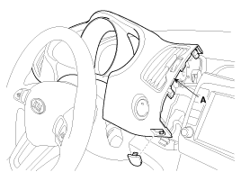

3. Remova o conjunto do painel de instrumentos (A) após soltar 4 parafusos.

   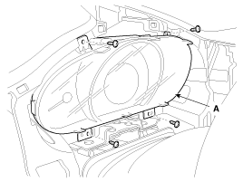

4. Desconecte o conectador do painel da frente (A) e, em seguida, remova o painel de instrumentos.

   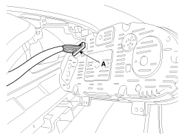

## Instalação

1. Conecte o conectador do painel de instrumentos.

2. Instale o conjunto do painel de instrumentos.

3. Instale o painel da frente do painel de instrumentos.

## Inspeção

Speedômetro

1. Ajuste a pressão das rodas para o nível especificado.

2. Dirija o veículo em um teste de velocímetro. Use as chaves de bloqueio de rodas (A) conforme necessário.

   [2WD]

   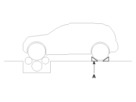

   [4WD]

   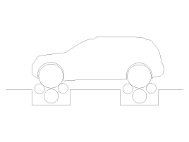

3. Verifique se o intervalo do indicador do speedômetro está dentro dos valores padrão.

   > **Cuidado**
   >
   > - Não operacionalize o freio-marcha de forma repentina ou aumente/diminua a velocidade rapidamente durante o teste.

   > **Nota**
   >
   > - O desgaste do pneu e a sobreaquecimento ou subaquecimento do pneu aumentarão o erro de indicação.

   [Km/h]

   | Velocidade (km/h) | 20 | 40 | 60 | 80 | 100 | 120 |
   | --- | --- | --- | --- | --- | --- | --- |
   | Tolerância (km/h) | +2,0 0 | +3,3 0 | +3,4 0 | +3,8 0 | +4,1 0 | +4,9 0 |
   | Velocidade (km/h) | 140 | 160 | 180 | 200 | 220 | 240 |
   | Tolerância (km/h) | +5,2 0 | +5,7 0 | +6,2 0 | +6,5 0 | +6,7 0 | +7,0 0 |

   [MPH]

   | Velocidade (MPH) | 10 | 20 | 40 | 60 | 80 |
   | --- | --- | --- | --- | --- | --- |
   | Tolerância (MPH) | +2,3 0 | +2,0 0 | +2,5 0 | +2,6 0 | +2,7 0 |
   | Velocidade (MPH) | 100 | 120 | 140 | 160 | |
   | Tolerância (MPH) | +2,8 0 | +2,9 0 | +3,0 0 | +3,2 0 | |

Tachômetro

1. Conecte o scanner ao conector de ligação diagnóstica ou instale um tachômetro.

2. Com o motor ligado, compare as leituras do teste com as do tachômetro. Substitua o tachômetro se a tolerância for excedida.

   > **Cuidado**
   >
   > - Inverter as conexões do tachômetro danificará o transistor e os diodos internos.
   > - Ao remover ou instalar o tachômetro, tenha cuidado para não deixá-lo cair ou suje-lo a choques severos.

   | Revolução (rpm) | Tolerância (rpm) | |
   | --- | --- | --- |
   | Gasolina Máx 8.000rpm Diesel Máx 6.000rpm | | |
   | Gasolina | Diesel | |
   | 1.000 | ±100 | ±100 |
   | 2.000 | ±100 | ±100 |
   | 3.000 | ±100 | ±100 |
   | 4.000 | ±100 | ±100 |
   | 5.000 | ±100 | ±100 |
   | 6.000 | ±100 | ±100 |
   | 7.000 | ±100 | - |
   | 8.000 | ±100 | - |

Medidor de Combustível

1. Desconecte a conexão do envio de combustível do envio de combustível.

2. Conecte uma lâmpada de teste de 3,4 watts, 12V aos terminais 1 e 3 do conectador do fio de cabine.

3. Ligue o interruptor de ignição para o ON e, em seguida, verifique se a lâmpada acende e a agulha do medidor de combustível se move para a posição máxima.

   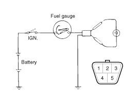

Medidor de Combustível Envio

1. Usando um ohmmetro, mede a resistência entre os terminais 1 e 3 do conectador do envio (A) em cada nível do flutuador.

   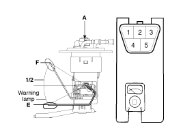

2. Verifique também que a resistência muda suavemente quando o flutuador é movido de "E" para "F".

   | Posição | Resistência (?) |
   | --- | --- |
   | E | 184 ± 2,5? |
   | Lâmpada de advertência acesa | 170 ± 2,5? |
   | 1/2 | 66 ± 2,5? |
   | F | 15 ± 2,5? |

3. Se a resistência de altura não estiver satisfeita, substitua o envio de combustível como um conjunto.

   > **Cuidado**
   >
   > - Após concluir este teste, seque o envio e reinstale-o na tanque de combustível.

Engine Coolant Temperature Sender

1. Usando um ohmmetro, medir a resistência entre o terminal 2 e a massa.

2. Se o valor de resistência não for o mesmo que o mostrado na tabela, substitua o sensor de temperatura.

   | Temperatura [°F(°C)] | Ângulo padrão | Tolerância |
   | --- | --- | --- |
   | <122(50) | -45° | ±3° |
   | 122(50) | 0° | ±3° |
   | 159,8(71) | 35° | ±3° |
   | 230(110) | 35° | ±3° |
   | 266(130) | 75° | ±5° |
   | >266(130) | 80° | ±5° |

Nível do Liquido de Freio Aviso do Interruptor

1. Remova o conectador (A) do interruptor localizado no reservatório do líquido de freio.

2. Verifique a continuidade entre os terminais 1 e 2 do interruptor enquanto pressionar o interruptor (flutuador) com um varão.

   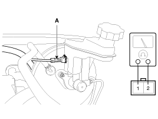

Aviso do Nível do Liquido de Freio

1. Ignição "ON".

2. Solte o travamento de estacionamento.

3. Remova o conectador do interruptor de nível do líquido de freio.

4. Tercele o conectador no lado do fio de massa.

5. Verifique se a lâmpada de aviso se acende.

Interruptor do Travamento de Estacionamento

O interruptor do travamento de estacionamento é do tipo puxo. Está localizado ao lado do travamento de estacionamento.

1. Verifique se há continuidade entre o terminal e o corpo do interruptor com o interruptor (A) ON.

2. Verifique se não há continuidade entre o terminal e o corpo do interruptor com o interruptor OFF.

   Se a continuidade não for conforme especificado, substitua o interruptor ou inspecione sua conexão de massa.

   [Tipo de Pedal]

   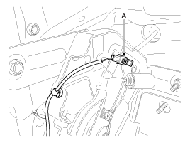

   [Tipo de Travamento]

   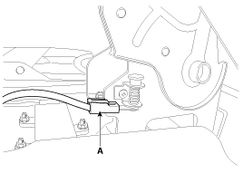

Interruptor da Porta

Remova o interruptor da porta e verifique a continuidade entre os terminais.

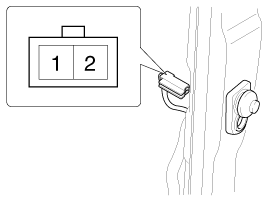

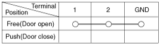

Interruptor do Cinto de Segurança

1. Remova o conectador do interruptor.

2. Verifique a continuidade entre os terminais.

   | Estado do cinto de segurança | Continuidade |
   | --- | --- |
   | Ajustado | Não condutiva (??) |
   | Não ajustado | Condutiva (0?) |

   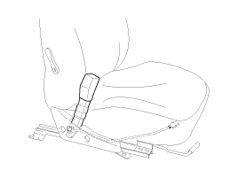

Aviso do Cinto de Segurança

Com o interruptor da ignição ligado "ON", verifique se a lâmpada se acende.

| Estado do cinto de segurança | Aviso da lâmpada |
| --- | --- |
| Ajustado | DESLIGADO |
| Não ajustado | LIGADO |
