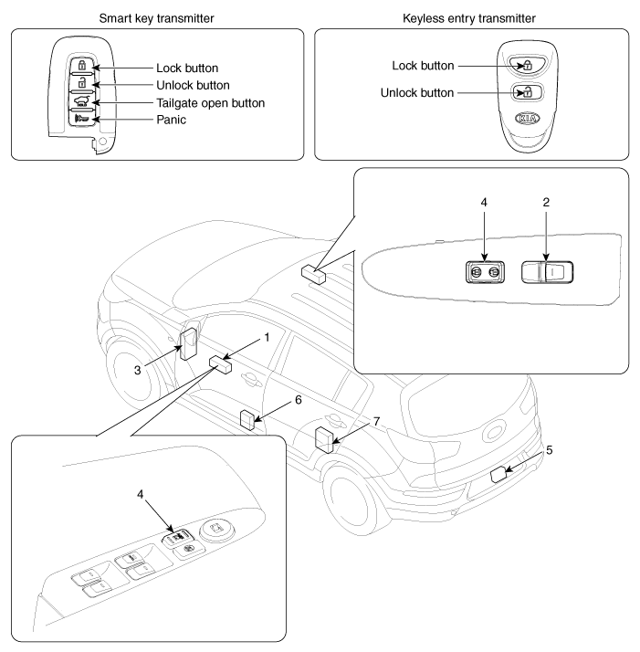

# Kia Sportage: Componentes e Localização dos Componentes

[Home](../../index.md) / [Manual de Serviço e Reparo do Kia Sportage SL](../sportage-482.md) / [Sistema Elétrico do Corpo](sportage-984.md) / [Portas com Bloqueio Elétrico](sportage-1076.md) / Componentes e Localização dos Componentes

## Localização dos Componentes

| 1. Interruptor do vidro elétrico do motorista 2. Interruptor do vidro auxiliar elétrico 3. SJB (Box de Juntamento Inteligente) 4. Interruptor do bloqueio da porta |
| --- | --- |
| 5. Atuador e interruptor do travamento do porta-malas 6. Atuador e interruptor do travamento da porta dianteira 7. Atuador e interruptor do travamento da porta traseira |
