# Kia Sportage: Atuadores de Fechaduras de Portas Elétricas: Procedimentos de Reparo

[Início](../../index.md) / [Manual de Serviço e Reparo do Kia Sportage SL](../sportage-482.md) / [Sistema Elétrico do Corpo](sportage-984.md) / [Fechaduras de Portas Elétricas](sportage-1076.md) / Procedimentos de Reparo dos Atuadores de Fechaduras de Portas Elétricas

## Inspeção

Atuador de Fechadura da Porta Dianteira

1. Remova o trim da porta dianteira.

   (Consulte o grupo BD - "Porta dianteira")

2. Remova o módulo da porta dianteira.

   (Consulte o grupo BD - "Porta dianteira")

3. Desconecte os conectores do atuador.

   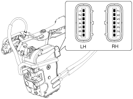

4. Verifique a operação do atuador conectando o fornecimento de energia e a massa de acordo com a tabela. Para prevenir danos ao atuador, aplique apenas momentaneamente a tensão da bateria.

   [Central Lock]

   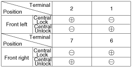

   [Double Lock]

   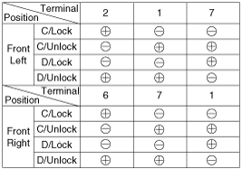

Atuador de Fechadura da Porta Traseira

1. Remova o trim da porta traseira.

   (Consulte o grupo BD - "Porta traseira")

2. Remova o módulo da porta traseira.

   (Consulte o grupo BD - "Porta traseira")

3. Desconecte os conectores do atuador.

   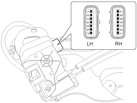

4. Verifique a operação do atuador conectando o fornecimento de energia e a massa de acordo com a tabela. Para prevenir danos ao atuador, aplique apenas momentaneamente a tensão da bateria.

   [Central Lock]

   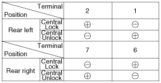

   [Double Lock]

   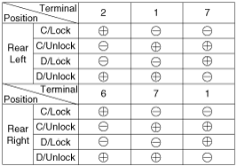

Inspeção do Atuador de Fechadura do Porta-malas

1. Remova o trim do porta-malas.

   (Consulte o grupo BD - "Porta-malas")

2. Desconecte o conectore 4P do atuador.

   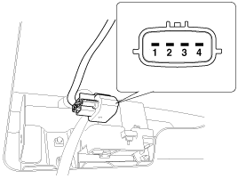

3. Verifique a operação do atuador conectando o fornecimento de energia e a massa de acordo com a tabela. Para prevenir danos ao atuador, aplique apenas momentaneamente a tensão da bateria.

   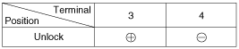

Interruptor de Fechadura da Porta Dianteira

1. Remova o trim da porta dianteira.

   (Consulte o grupo BD - "Porta dianteira")

2. Remova o módulo da porta dianteira.

   (Consulte o grupo BD - "Porta dianteira")

3. Desconecte os conectores do atuador.

   

4. Verifique a continuidade entre os terminais em cada posição do interruptor ao inserir a chave na porta de acordo com a tabela.

   [Central Lock]

   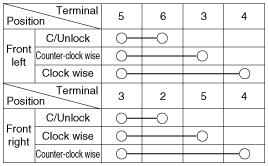

   [Double Lock]

   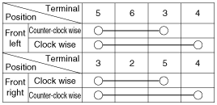

Interruptor de Fechadura da Porta Traseira

1. Remova o trim da porta traseira.

   (Consulte o grupo BD - "Porta traseira")

2. Remova o módulo da porta traseira.

   (Consulte o grupo BD - "Porta traseira")

3. Desconecte os conectores do atuador.

   

4. Verifique a continuidade entre os terminais em cada posição do interruptor de acordo com a tabela.

   [Central Lock]

   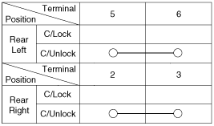

Interruptor do Porta-malas

1. Remova o trim do porta-malas.

   (Consulte o grupo BD - "Porta-malas")

2. Desconecte o conectore 4P do atuador.

   

3. Verifique a continuidade entre os terminais em cada posição do interruptor de acordo com a tabela.

   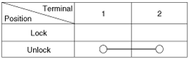
