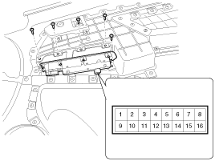
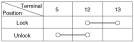
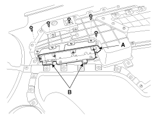
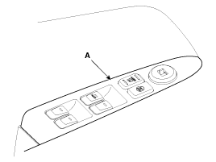

# Kia Sportage: Interruptor de Fechadura de Portas Elétricas: Procedimentos de Reparo

[Home](../../index.md) / [Manual de Serviço e Reparo do Kia Sportage SL](../sportage-482.md) / [Sistema Elétrico do Corpo](sportage-984.md) / [Fechaduras de Portas Elétricas](sportage-1076.md) / Procedimentos de Reparo do Interruptor de Fechadura de Portas Elétricas

## Inspeção

Interruptor de Fechadura de Porta do Motorista

1. Desconecte o terminal negativo da bateria.

2. Remova o acabamento da porta dianteira.

   (Consulte o grupo BD - "Porta dianteira")

3. Desconecte o conectador (16 pinos) do interruptor do conjunto de fiação.

   

4. Verifique a continuidade entre os terminais. Se necessário, substitua o interruptor.

   

## Remoção

Interruptor de Fechadura de Porta do Motorista

1. Desconecte o terminal negativo da bateria.

2. Remova o acabamento da porta dianteira.

   (Consulte o grupo BD - "Porta dianteira")

3. Remova as parafusos (A) e os conectores (B) do interruptor de janela elétrica.

   

4. Remova o interruptor de janela elétrica do motorista (A) do acabamento da porta dianteira.

   

   > **Nota**
   >
   > - Cuide para não danificar a garrilha ao remover o módulo do interruptor.

## Instalação

Interruptor de Fechadura de Porta do Motorista

1. Instale o interruptor de janela elétrica e os conectores.

2. Instale o acabamento da porta dianteira.
