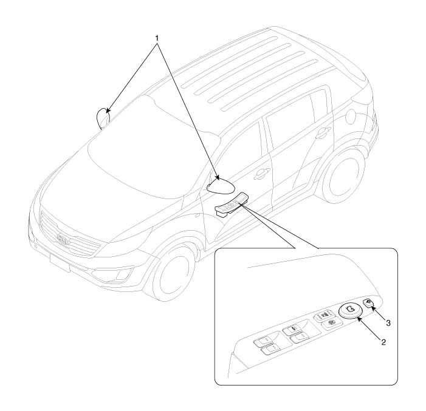

# Kia Sportage: Componentes e Localização dos Componentes

[Home](../../index.md) / [Manual de Serviço e Reparo do Kia Sportage SL](../sportage-482.md) / [Sistema Elétrico do Corpo](sportage-984.md) / [Réplicas de Mídia do Vidro Lateral](sportage-1080.md) / Componentes e Localização dos Componentes

## Localização dos Componentes

| 1. Réplica de mídia do vidro lateral 2. Interruptor de réplica de mídia do vidro lateral | 3. Interruptor de réplica de mídia do espelho dobrável |
| --- | --- |
