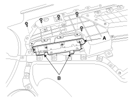
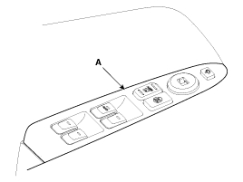
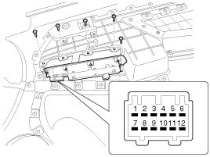
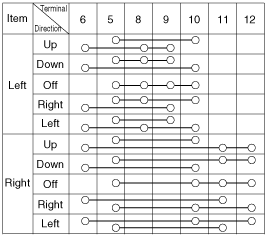
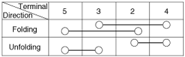

# Kia Sportage: Interruptor do Espelho Retrovisor Eletrônico: Procedimentos de Reparo

[Home](../../index.md) / [Manual de Serviço e Reparo do Kia Sportage SL](../sportage-482.md) / [Sistema Elétrico do Corpo](sportage-984.md) / [Espelhos Retrovisores Eletrônicos](sportage-1080.md) / Procedimentos de Reparo do Interruptor do Espelho Retrovisor Eletrônico

## Remoção

Interruptor do Espelho Retrovisor do Motorista

1. Desconecte o terminal negativo da bateria.

2. Remova o trim da porta dianteira.

   (Consulte o grupo BD - "Porta dianteira")

3. Remova as parafusos do interruptor do vidro elétrico (A) e das conexões (B).

   

4. Remova o interruptor do vidro elétrico do motorista (A) do trim da porta dianteira.

   

   > **Nota**
   >
   > - Cuide para não danificar a garrilha ao remover o módulo do interruptor.

## Instalação

Interruptor do Espelho Retrovisor do Motorista

1. Instale o interruptor do vidro elétrico do motorista e as conexões.

2. Instale o trim da porta dianteira.

## Inspeção

1. Remova o trim da porta dianteira e o módulo do interruptor do espelho retrovisor (A).

   

2. Verifique a continuidade entre os terminais do interruptor do espelho retrovisor de acordo com a tabela.

   

   
