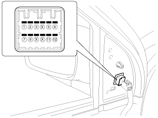
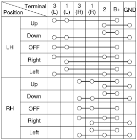
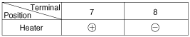
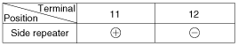
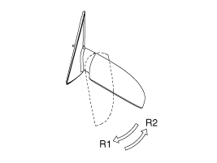
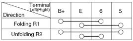

# Kia Sportage: Atuador do Retrovisor Eletrônico: Procedimentos de Reparo

[Home](../../index.md) / [Manual de Serviço e Reparo do Kia Sportage SL](../sportage-482.md) / [Sistema Elétrico do Corpo](sportage-984.md) / [Retrovisores Eletrônicos](sportage-1080.md) / Procedimentos de Reparo do Atuador do Retrovisor Eletrônico

## Inspeção

1. Desconecte o terminal negativo (-) da bateria.

2. Remova a capa delta da porta dianteira.

   (Consulte o grupo BD - "Porta dianteira")

3. Desconecte o conector do retrovisor da porta.

4. Verifique que o retrovisor opera corretamente conforme mostrado na tabela.

   

   

   Aquecedor do Retrovisor

   

   Luz de Sinalização de Girassol

   

   Plegagem do Retrovisor

   

   
